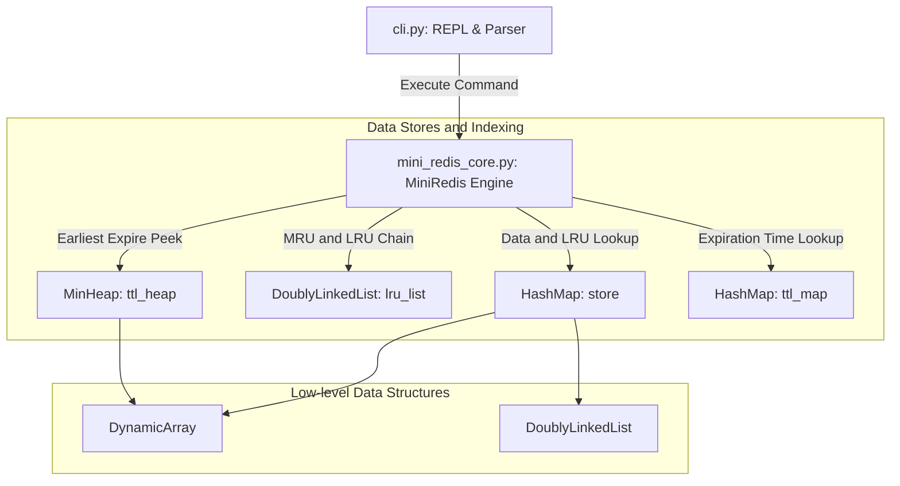

## blank_canvas

[미션 목표]
- 이 미션은 자료구조를 이해하는 미션임. redis라는 key-value로 이루어진 nosql in-memory db의 기본 동작을 구현해보면서, 자연스레 hashmap, DLL, heap 그리고 cache, lru, ttl 개념을 알게 됨.

[Redis의 기능]
- db니까 데이터 저장, 조회, 삭제 등의 기능이 있음. 근데 ram은 고비용 저장장치니, 메모리를 관리해야 함. expire, ttl 등의 데이터 지연 삭제 방법이 있음.

[redis 구현 시, 자료구조 선택 이유와 구현 전략]
[hashmap 관련]
- hash: 임의의 길이의 데이터를 고정된 길이의 값으로 매핑하는 함수. 암호화에도 사용됨.
- hashmap: hash값을 key로 사용하면, 곧바로 타겟 데이터에 접근할 수 있어서 O(1)에 빠르게 조회 가능. 
- chaining: 해시맵 충돌 문제 해결을 위해 체이닝
- load factor: 탐색 속도와 저장 공간의 트레이드오프. 0.75이상, rehash를 통해 배열 2배 확장

[DLL, LRU 관련]
- LRU 캐시를 구현하기 위해 이중 연결 리스트(Doubly Linked List)
- head, tail 더미 노드.
- 리스트 맨 앞이 가장 최근에 사용된 노드, 맨 뒤가 가장 오래전에 사용된 노드

[heap 관련]
- TTL을 지키기 위한 min heap
- 가장 작은 수(가장 먼저 만료될 시간)부터 뺄 수 있음
- heapify up/down으로 재배열

[pub/sub 관련]
- redis에는 기본적으로 pub/sub 기능이 있음.
- publish/subscribe 구현하기 위한 hashmap
- subscriber별로 channel을 구독, key에 queue를 저장
- publish시 해당 채널 구독하고 있는 모든 queue에 발행
- 이 과정에서 blocking poll을 사용하면, 발행이 있을 때만 깨어나서 효율적으로 동작

[보너스 관련]
1. 동적 배열 직접 구현
- 동적 배열이 왜 등장하지? 이 미션과 무슨 상관? 로드 팩터 0.75 넘을 때, hashmap 배열 확장할 때 사용된다는 건가? 근데 이게 왜 보너스지? 원래는 '동적'이 아니라는 소리인가? 그렇게도 구현할 수 있나?

2. 스택/큐/덱 이해와 활용
- 스택은 LIFO, 큐는 FIFO, 덱은 양쪽에서 삽입/삭제 가능.
- 근데 보너스에 갑자기 스택, 큐, 덱이 왜 나왔지? 그냥 자료구조 공부하면서 이것도 알아 두라는 의미인가?

3. 이진 트리와 순회 알고리즘
- ttl을 관리하기 위한 heap이 이미 이진 트리(그중에서도 완전 이진 트리) 아닌가? 왜 굳이 보너스로 이진 트리 구현이 나왔지? 게다가 전/중/후/레벨(레벨은 또 뭐야?) 순회를 구현하라는 건 또 왜지? 이 mini-redis에 트리 순회가 필요할 일이 있었나?

4. 이진 탐색 트리(BST)
- 이 미션에서 bst가 쓰일 일이 있나? 왜 언급된지 모르겠다.

5. pub/sub 기능 구현
- 이게 너무 뚱딴지 같다. 발행과 구독이라고? mini-redis라는 자료구조 공부하다가 너무 이질적인 느낌이 드네. 내가 아는 발행과 구독은 유튜브나 블로그에서 어떤 게시물을 배포하고, 구독자가 follow하는 게 전부인데. 왜 db에 이런 기능이 별도로 있는 거지? 채널 기반 메시징이 뭐야.
- '구현한 연결 리스트를 메시지 큐(구독자별 버퍼 등)로 재활용할 수 있다'라는 요구사항도 뭔 뜻인지 모르겠어.

---

## LLM note

### 1. 백지 노트 이해도 평가 & 교정 (Feedback & Clarifications)

작성해 주신 이해는 **미션의 핵심을 매우 잘 잡고 계십니다!** 전체적인 방향성이 정확하며, 특히 자료구조의 선정 이유(해시맵-O(1) 접근, DLL-O(1) 순서 변경, MinHeap-빠른 만료 검색)를 제대로 파악하고 계십니다. 몇 가지 보완 및 디테일 교정을 진행해 드립니다.

- **[교정 & 보완 1] Hashmap & Dynamic Array (동적 배열)**
  - **이해 요약**: 해시맵 체이닝과 로드 팩터(0.75) 2배 재해싱 원리를 정확히 파악하셨습니다.
  - **보완**: 왜 '동적 배열(Dynamic Array)' 구현이 요구사항/보너스에 들어갈까요? 파이썬의 `[]` (list)는 언어 차원에서 자동으로 크기가 늘어나는 동적 배열입니다. 하지만 본 미션의 **제약 조건(7. 라이브러리/내장 컬렉션 제한)**은 "파이썬 `list`가 내부적으로 해주는 자동 expansion 마법마저 원시적인 고정 크기 배열(`[None] * capacity`)로 직접 구현해 보라"는 뜻입니다. 따라서 `DynamicArray`를 밑바닥부터 짜서, 그 위에 `HashMap` 버킷 배열과 `MinHeap` 저장소를 올리는 것이 완벽한 풀이입니다.
- **[교정 & 보완 2] DLL (이중 연결 리스트) & LRU 캐시**
  - **이해 요약**: `head`/`tail` 더미(Sentinel) 노드의 목적과 맨 앞(MRU)/맨 뒤(LRU) 배치의 원리를 완벽하게 이해하고 계십니다.
  - **보완**: 해시맵과 이중 연결 리스트가 어떻게 조합되어 O(1) LRU 추적을 가능케 하는지 뼈대를 기억해야 합니다. `HashMap`은 `Key -> Node` 참조를 들고 있고, `Node` 자체는 `prev`와 `next` 포인터를 들고 있습니다. 따라서 키를 통해 노드의 주소를 O(1)로 가져온 뒤, 포인터만 재연결하여 노드를 떼어내고(`remove_node`) 맨 앞으로 이동(`move_to_front`)시키는 것이 핵심입니다.
- **[교정 & 보완 3] MinHeap & TTL (Time-To-Live)**
  - **이해 요약**: 만료 시각이 가장 빠른 항목을 $O(1)$에 `peek()`하고 $O(\log N)$에 `pop()`하는 원리를 잘 짚으셨습니다.
  - **보완**: 실제 구현에서는 타이머 스레드를 별도로 돌리지 않고, 명령어가 들어올 때마다 최상단 루트 노드를 확인하여 지연 삭제(Lazy Deletion) 방식으로 청소합니다.

### 2. 의문점 및 보너스 과제 완벽 해설 (Addressing Doubts)

질문하신 보너스 항목들의 존재 이유와 Redis와의 연관성을 정리해 드립니다.

#### 1) 동적 배열(Dynamic Array)이 왜 등장하고, 왜 보너스인가?
- **질문**: *"원래는 '동적'이 아니라는 소리인가? 그렇게도 구현할 수 있나?"*
- **해답**: 
  - 컴퓨터 하부 메모리(C언어나 하드웨어 관점)의 배열은 **고정 크기(Fixed-size Array)**입니다. 파이썬의 `list`가 자동으로 크기를 늘려주는 것이 '동적 배열'입니다.
  - 미션에서 기본 요구사항은 고정 배열로 시작할 수 있지만, 보너스 5.1로 `DynamicArray`를 직접 구현함으로써 `HashMap`의 버킷 확장(`resize`)이나 `MinHeap`의 요소 추가(`append`)를 원시 배열 상에서 감추고 캡슐화할 수 있습니다.
  - 우리 워크스페이스에는 이미 `dynamic_array.py`가 구현되어 있으며, 파이썬 내장 `list`의 자동 확장에 의존하지 않고 `[None] * capacity` 고정 상자를 2배씩 늘리는 로직이 들어가 있습니다.

#### 2) 스택 / 큐 / 덱(Stack / Queue / Deque)은 갑자기 왜 나왔는가?
- **질문**: *"그냥 자료구조 공부하면서 이것도 알아 두라는 의미인가?"*
- **해답**:
  - 절반은 맞고, 절반은 Redis의 실제 데이터 타입 및 내부 메커니즘과 직결됩니다.
  - Redis의 대표적 자료형 중 하나인 **List 타입**(`LPUSH`, `RPUSH`, `LPOP`, `RPOP`)은 본질적으로 **Deque (Double-Ended Queue, 양방향 큐)**입니다.
  - 또한 이 미션의 보너스인 **Pub/Sub** 구현 시, 각 구독자(Subscriber)에게 도착할 메시지를 일시적으로 쌓아두는 **메시지 버퍼(Message Queue)**가 바로 큐(Queue/FIFO)입니다.
  - 미션에서 구현한 `DoublyLinkedList`에 `insert_front` / `remove_front` / `insert_back` / `remove_back`을 선언하면 그 자체가 완벽한 O(1) Deque(스택+큐)가 됩니다.

#### 3) 이진 트리와 순회(Traversal)가 왜 필요한가?
- **질문**: *"TTL 관리하는 heap이 이진 트리인데 왜 굳이 이진 트리를? 레벨 순회는 뭐고, 순회가 왜 필요하지?"*
- **해답**:
  - **힙(Heap)**은 배열 상에 저장되는 **완전 이진 트리(Complete Binary Tree)**입니다. 힙에서 자식 노드 인덱스 `2*i + 1`, `2*i + 2`를 계산하는 공식이 트리 구조에서 유래했습니다.
  - **순회(Traversal)**의 목적:
    - **중위 순회 (Inorder)**: 이진 탐색 트리(BST)를 중위 순회하면 데이터가 **오름차순으로 자동 정렬**되어 출력됩니다.
    - **레벨 순회 (Level-order / BFS)**: 트리의 루트부터 깊이별(위에서 아래로, 좌에서 우로)로 방문하는 순회입니다. 이 레벨 순회로 방문하는 순서가 바로 **1차원 배열에 힙을 저장하는 인덱스 순서(0, 1, 2, 3...)와 정확히 일치**합니다!
  - 힙이 내부 배열로 어떻게 매핑되는지 시각적/원리적으로 연결고리를 완성하기 위해 보너스에 포함된 것입니다.

#### 4) 이진 탐색 트리(BST)는 미션에서 쓰일 일이 있는가?
- **질문**: *"이 미션에서 bst가 쓰일 일이 있나? 왜 언급된지 모르겠다."*
- **해답**:
  - 본 미션의 String (SET/GET) 키-값 저장소는 해시맵을 쓰므로 BST를 직접 사용하지 않습니다.
  - 하지만 Redis의 또 다른 핵심 자료구조인 **Sorted Set (ZSET)**이나 **범위 조회(Range Query)** 기능을 구현할 때, 내부적으로 SkipList나 Red-Black Tree(BST의 균형 버전)가 쓰입니다.
  - 해시맵(무순서, O(1))과 트리(순서 정렬, O(log N))의 특성을 비교 분석할 수 있도록 보너스로 제시된 것입니다.

#### 5) Pub/Sub (발행/구독) 기능은 왜 DB에 있고, 메시지 큐와 무슨 상관인가?
- **질문**: *"왜 DB에 이런 기능이 있지? 채널 기반 메시징이 뭐고, 연결 리스트를 메시지 큐로 재활용한다는 게 뭔 소리지?"*
- **해답**:
  - **Redis의 정체성**: Redis는 단순 데이터베이스일 뿐만 아니라, 전 세계에서 가장 널리 쓰이는 **In-Memory 메시지 브로커(Message Broker)**입니다! (채팅방 메시지 전달, 이벤트 알림, 비동기 작업 전달 등)
  - **채널 기반 메시징**: 텔레그램이나 카카오톡 단톡방을 생각하면 됩니다. "sports"라는 채널 이름(Key)이 있고, 이 채널을 구독(Subscribe)하고 있는 사용자들에게 메시지를 발행(Publish)하면 전달되는 구조입니다.
  - **연결 리스트 = 메시지 큐 재활용**:
    - 구독자가 접속 중이 아니거나 메시지를 읽는 속도가 늦을 때, 메시지를 버리지 않고 채널별/구독자별로 순서대로 저장해야 합니다.
    - FIFO(선입선출) 특성을 가진 메시지 큐가 필요하므로, 구현해 둔 `DoublyLinkedList`의 `insert_back` (메시지 쌓기)과 `remove_front` (메시지 읽어가기)를 그대로 **메시지 큐 버퍼**로 재활용하는 것입니다.

### 3. mini_redis 구현 체계 및 코드 오케스트레이션 골격

현재 워크스페이스에 구현된 코드 구조와 데이터 흐름 오케스트레이션 지도입니다.

#### 핵심 작동 파이프라인
1. **지연 삭제 (Lazy Deletion, `_cleanup_expired`)**:
   - `GET`, `SET`, `EXISTS`, `DBSIZE`, `KEYS` 등 어떠한 명령어가 수행되든 **실행 직전** `ttl_heap.peek()`을 통해 만료 시각이 지난 키를 즉시 청소합니다.
2. **LRU 추적 & 메모리 관리 (`_evict_lru`)**:
   - `SET` 명령으로 데이터를 저장할 때, `used_memory` (키+값 바이트 크기 합)가 `maxmemory`를 초과하면 `lru_list.remove_back()`으로 가장 오래 쓰이지 않은 키를 떼어내어 `store`와 `ttl_map`에서 연쇄 삭제합니다.
3. **4개 서브시스템의 유기적 결합**:
   - `store`: `Key` -> `Node(Key, Value)` (해시맵을 통한 노드 참조 저장)
   - `lru_list`: `Head(MRU) <-> ... <-> Tail(LRU)` (이중 연결 리스트로 노드 순서 관리)
   - `ttl_heap`: `(expire_at, key)` (최소 힙으로 만료 순서 관리)
   - `ttl_map`: `Key` -> `expire_at` (해시맵으로 최신 만료 시각 검증)

### 4. 코드 공부를 위한 추천 실행 & 검증 아이디어 (Next Steps)

1. **단위 테스트 실행으로 동작 확인하기**:
   - 터미널에서 `pytest` 또는 `python -m unittest discover tests`를 실행해 기존 구현체들이 모든 에지 케이스(OOM, TTL 만료, LRU eviction)를 통과하는지 확인하세요.
2. **REPL 직접 구동해보기**:
   - `python -m mini_redis`를 실행하여 `CONFIG SET maxmemory 30`, `SET`, `GET`, `EXPIRE`, `TTL` 등의 명령어가 Redis 스타일 결과로 정상 출력되는지 손으로 확인해 보세요.
3. **각 모듈 모노로그(Docstring) 읽기**:
   - 각 구현 파일(`doubly_linked_list.py`, `hash_map.py`, `min_heap.py`, `mini_redis_core.py`) 상단에는 "어떤 로직인가", "왜 존재하는가", "복잡도"가 친절히 정리되어 있으므로 이를 지표 삼아 공부하시면 쉽게 이해하실 수 있습니다.

