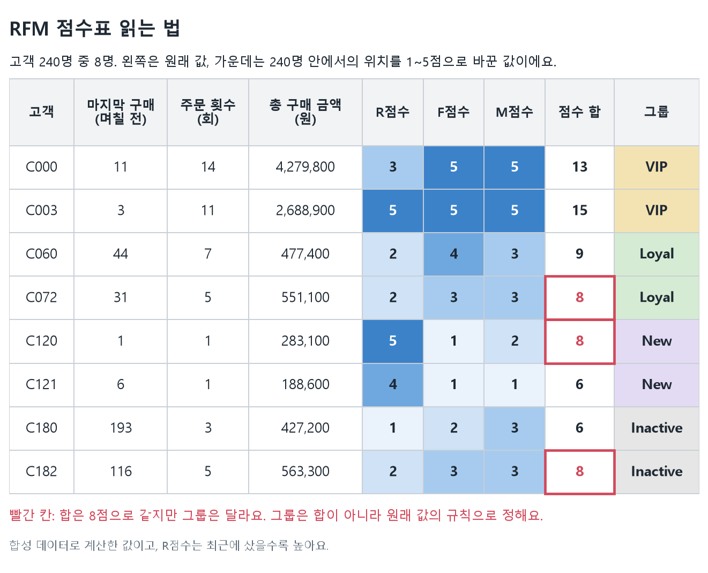

# A1-1 쇼핑몰 고객 분석: 누가 자주 오고 많이 살까?

쇼핑몰 거래 기록으로 고객을 네 그룹으로 나누고, 그룹별로 해 볼 만한 마케팅을 제안하는 프로젝트예요. 숫자뿐 아니라 상품명(텍스트)과 상품 이미지(배열)도 분석에 쓸 수 있는 숫자로 바꿔요.

> **먼저 알아 두세요.** 이 데이터는 코드로 만든 **합성 데이터**예요(`seed=42`). 실제 고객이나 상품 사진이 아니고, 고객 행동도 일부러 네 패턴으로 만들었어요. 그래서 아래 수치는 분석 방법을 보여 주는 예시이고, 인사이트는 효과를 측정하지 않은 **가설**이에요. 예측 모델은 학습하지 않았어요.

## 한눈에 보는 결과

| 그룹 | 어떤 고객인가 | 고객 수 | 평균 구매 횟수 | 마지막 구매 후 | 매출 비중 |
| --- | --- | ---: | ---: | ---: | ---: |
| VIP | 최근에도 사고, 자주, 많이 산다 | 60명 | 13.08회 | 8.33일 | **71.40%** |
| Loyal | 자주 사지만 금액이나 최근성은 VIP에 못 미친다 | 60명 | 5.92회 | 27.52일 | 16.26% |
| Inactive | 90일 넘게 구매가 없다 | 60명 | 3.15회 | 171.93일 | 9.68% |
| New | 최근에 처음 샀다 | 60명 | 1.00회 | 4.47일 | 2.66% |

**고객 25%인 VIP가 매출의 약 71%를 차지해요.** 그룹이 정확히 60명씩인 이유는 데이터를 네 패턴으로 60명씩 만들었기 때문이에요.


## 실행하기

[uv](https://docs.astral.sh/uv/getting-started/installation/)만 있으면 돼요. 없다면 `pip install uv`로 설치할 수 있어요. 다른 운영체제에서도 명령은 같아요. 실행 확인은 Windows에서 했어요.

```bash
cd 02_Advanced/A1-1
uv sync --locked
uv run python -m src.run_analysis
```

- `uv sync`는 Python 3.12와 라이브러리를 이 폴더의 `.venv`에 설치해요. 처음 한 번은 내려받는 데 시간이 걸리고, 약 250MB를 차지해요.
- 분석은 10초 안팎이면 끝나고, 결과는 `results/`에 저장돼요. 샘플 데이터는 레포에 들어 있어서 따로 받을 필요가 없어요.

**노트북 실행:** VS Code나 Jupyter에서 노트북을 열고, 커널을 `.venv`의 Python으로 고른 뒤 **커널 재시작 후 전체 실행**을 누르세요.

## 어디부터 읽을까?

전부 읽을 필요 없어요. 지금 상황에 맞는 줄 하나만 골라 시작하세요.

| 이럴 때 | 여기를 보세요 | 특징 |
| --- | --- | --- |
| Python이나 데이터 분석이 낯설어요 | [`study/a1-1-guide.html`](study/a1-1-guide.html) | 코드 몰라도 읽을 수 있고, 값을 직접 바꿔 볼 수 있어요. 레포를 받은 뒤 브라우저로 여세요 |
| 코드를 한 줄씩 따라가고 싶어요 | [`notebooks/learning_walkthrough.ipynb`](notebooks/learning_walkthrough.ipynb) | 클래스 없이 한 단계씩 직접 계산해요 |
| 완성된 분석을 보고 싶어요 | [`notebooks/analysis_report.ipynb`](notebooks/analysis_report.ipynb) | 미션 결과물이에요. 계산, 차트, 해석이 한 파일에 있어요 |
| 클래스를 어떻게 설계했는지 궁금해요 | [`src/pipeline.py`](src/pipeline.py) | `DataAnalyzer` 클래스예요. 한국어 주석이 달려 있어요 |
| 왜 빠른지, 어디까지 믿을 수 있는지 궁금해요 | [`results/method_notes.md`](results/method_notes.md) | IQR의 한계, 대치의 위험, 연속 메모리와 SIMD, 대규모 처리, 머신러닝 확장 |

## 분석 흐름

`DataAnalyzer`의 메서드를 아래 순서로 호출해요.

```text
load_data()              파일 3개를 검사하고 하나의 표로 연결한다
handle_missing_values()  빈칸을 카테고리별 중앙값으로 채운다
engineer_features()      이미지와 상품명을 숫자로 바꾼다
detect_outliers()        튀는 값에 표시만 붙인다 (지우지 않는다)
calculate_rfm()          거래를 고객별로 요약하고 그룹을 나눈다
```

## 데이터

| 파일 | 한 행(또는 한 칸)의 뜻 | 크기 |
| --- | --- | --- |
| `data/sample/transactions.csv` | 주문 안의 상품 한 줄 | 2,842행, 11컬럼 (주문 1,389건, 고객 240명) |
| `data/sample/products.csv` | 상품 하나 | 80행, 6컬럼 |
| `data/sample/images.npy` | 상품 이미지 하나 | 80장, 각 16×16 RGB |
| `data/sample/customers.csv` | 고객 한 명과 가입일 (보너스용) | 240행 |

**출처:** 모두 [`src/sample_data.py`](src/sample_data.py)로 만든 합성 데이터예요. 생성 조건은 `data/sample/metadata.json`에 있어요. 수치, 범주, 날짜, 이미지 네 가지 유형이 모두 들어 있어요.

## 고객을 나누는 기준

고객마다 세 숫자를 구해요. 이 방법을 **RFM**이라고 불러요.

- **R (Recency):** 마지막 구매 후 며칠이 지났나
- **F (Frequency):** 주문을 몇 번 했나
- **M (Monetary):** 총 얼마를 썼나

그다음 **위에서부터 차례로** 확인해서 처음 맞는 그룹에 넣어요.

| 순서 | 그룹 | 조건 |
| ---: | --- | --- |
| 1 | Inactive | 마지막 구매 후 90일 초과 |
| 2 | New | 30일 이내에 구매했고, 주문이 1회 |
| 3 | VIP | 30일 이내에 구매했고, 4회 이상 주문했고, 금액이 상위 25% (1,786,650원 이상) |
| 4 | Loyal | 4회 이상 주문 |
| 5 | Regular | 그 외 (이 데이터에서는 0명) |

Inactive는 구매 공백을 뜻할 뿐 이탈이 확정됐다는 뜻은 아니에요. 기준일은 마지막 거래 다음 날(2026-10-10)이고, 90일이나 4회 같은 기준은 메서드 인자로 바꿀 수 있어요.



<details>
<summary>왜 점수 합으로 나누지 않았나요?</summary>

R, F, M을 각각 1~5점으로 매긴 점수도 계산해요. 하지만 그룹은 점수 합으로 나누지 않고 원래 값의 규칙으로 나눠요. 점수 합이 같아도 방금 처음 산 고객과 넉 달째 안 오는 고객은 해야 할 일이 다르기 때문이에요. 점수는 고객의 상대 위치를 보는 데 써요. 같은 값은 같은 점수를 받도록 평균 순위의 백분위로 계산해요.

</details>

## 비즈니스 인사이트

근거 수치는 [`results/segment_summary.csv`](results/segment_summary.csv)와 [그룹별 고객 수 차트](results/figures/03_bar.png), 위의 산점도에서 확인할 수 있어요.

### 1. VIP를 지키면 매출을 지킬 수 있을까?

- **근거:** 고객의 25%인 VIP가 매출의 71.40%를 차지하고, 평균 13.08회 구매했어요.
- **실행:** VIP를 대상으로 멤버십 혜택을 소규모 대조군 실험으로 제공해요. 재구매 유지를 기대하지만, 효과 크기는 아직 측정하지 않았어요.
- **검증:** 혜택 비용과 대조군 재구매율이 필요해요. 비용 증가가 추가 이익보다 크면 이 제안은 버려요.

### 2. 구매가 끊긴 고객을 다시 데려올 수 있을까?

- **근거:** Inactive 60명은 마지막 구매 후 평균 171.93일이 지났고, 과거에 평균 3.15회 구매했어요.
- **실행:** Inactive 대상으로 품목별 구매 간격을 먼저 확인하고, 수신 동의한 고객에게 보낸 복귀 메시지를 대조군과 비교해요. 재구매 회복을 기대해요.
- **검증:** 품목별 정상 구매 주기, 수신 동의, 반품 정보가 필요해요. 원래 구매 주기가 긴 것이라면 이탈이라는 해석을 고쳐야 해요.

### 3. 첫 구매 고객이 두 번째로 사게 할 수 있을까?

- **근거:** New 60명은 첫 구매 후 평균 4.47일이 지났고, 구매 횟수는 1회예요.
- **실행:** New 대상으로 사용 안내와 다음 구매 추천을 제공하고 대조군과 비교해요. 두 번째 구매 전환을 기대해요.
- **검증:** 고객별로 같은 추적 기간과 반품 정보가 필요해요. 전환율에 차이가 없으면 추천 효과가 있다고 말할 수 없어요.

## 더 자세히

필요할 때만 펼쳐 보세요.

<details>
<summary>전처리에서 지킨 원칙</summary>

- **빈칸 채우기:** 상품 가격과 평점은 상품 표의 카테고리별 중앙값으로, 배송 일수는 거래 표의 카테고리별 중앙값으로 채워요. 채운 수는 가격 12개, 평점 7개, 배송 일수 272개예요.
- **채우지 않는 값:** 고객 ID, 구매일, 구매 금액은 추정하지 않아요. 없는 매출을 만들게 되기 때문이에요.
- **이미지:** 상품 축만 남기고 나머지 축을 한 번에 줄여 평균과 표준편차를 구해요. 이미지나 픽셀을 도는 Python 반복문은 없어요.
- **이상치:** IQR로 찾은 값에 표시만 붙이고 원본은 유지해요. 배송 일수의 경계는 −1.5~10.5일이고 15행이 후보예요. 전후 비교 차트의 클리핑 값은 별도로 만들어요.
- **오류로 멈추는 경우:** 잘못된 표 연결, 중복 `line_id`, 한 주문에 고객이나 날짜가 여러 개인 경우, `amount`와 `unit_price × quantity`가 다른 경우.
- **RFM에서 빼는 경우:** 고객, 주문, 날짜가 유효하지 않거나 양수 구매가 아닌 행. 뺀 수는 `results/audit.json`에 남아요.
- **M의 뜻:** 관측 기간의 양수 구매 금액 합계예요. 반품을 뺀 순매출이나 LTV가 아니에요.

</details>

<details>
<summary>통계와 차트 6종</summary>

- **단가:** 평균 40,497원, 중앙값 37,800원, 표준편차 22,539원, Q1 21,100원, Q3 54,000원. 거래 행 기준이라 자주 팔린 상품이 더 많이 반영돼요.
- **상관:** 단가와 금액 r=0.731, 수량과 금액 r=0.605. `amount = unit_price × quantity`라는 계산식 때문에 생긴 값이라 마케팅 효과로 해석하면 안 돼요.
- **이미지 값:** 밝기와 변동을 요약할 뿐, 이미지의 의미나 품질을 나타내지 않아요.
- **월별 매출:** 첫 달과 마지막 달은 일부 기간일 수 있어요. 샘플의 10월은 9일까지라 9월과 바로 비교하면 안 돼요.

| 차트 | 파일 | 보여 주는 것 |
| --- | --- | --- |
| 히스토그램 | [`01_histogram.png`](results/figures/01_histogram.png) | 단가 분포 |
| 박스플롯 | [`02_boxplot.png`](results/figures/02_boxplot.png) | 배송 일수 클리핑 전후 |
| 막대그래프 | [`03_bar.png`](results/figures/03_bar.png) | 그룹별 고객 수 |
| 히트맵 | [`04_heatmap.png`](results/figures/04_heatmap.png) | 상관행렬 |
| 산점도 | [`05_scatter.png`](results/figures/05_scatter.png) | 주문 수와 구매 금액 |
| 라인차트 | [`06_line.png`](results/figures/06_line.png) | 월별 구매 금액 |

한글 폰트가 없어도 깨지지 않도록 차트 글자는 영어로 쓰고, 해석은 한국어로 적었어요. 최신 해석은 [`results/analysis_summary.md`](results/analysis_summary.md)에 있어요.

</details>

<details>
<summary>보너스 과제 3종</summary>

자세한 결과는 [`results/bonus/README.md`](results/bonus/README.md)에 있어요. 코드는 [`src/bonus.py`](src/bonus.py)예요.

1. **이미지 고급 피처:** 밝기 히스토그램 8구간, 이웃 픽셀 차이, 엔트로피를 NumPy로 계산해요. 밝기와 질감의 요약이고 품질 판별이 아니에요.
2. **가입 코호트:** 고객 240명을 가입 월로 12개 코호트로 나눠, 달마다 구매한 고객의 비율을 구해요. 끝까지 관측하지 못한 칸은 비워 둬요. 가입일도 난수로 만든 예시예요.
3. **인터랙티브 RFM:** [`rfm_interactive.html`](results/bonus/rfm_interactive.html)을 브라우저로 열면 점 위에 마우스를 올려 고객 값을 보고, 범례로 그룹을 고를 수 있어요. 인터넷 없이 동작해요.

사용한 라이브러리는 NumPy, Pandas, Matplotlib, Seaborn이고, Plotly는 보너스 3에만 썼어요.

</details>

<details>
<summary>내 데이터로 바꿔 돌리기</summary>

아래 형식으로 변환한 파일을 `data/external/`처럼 별도 폴더에 두고 경로를 지정하세요. 임의의 데이터를 자동으로 변환해 주는 도구는 아니에요.

```bash
uv run python -m src.run_analysis --data-dir data/external --output-dir results/external --reference-date 2026-10-10 --observation-end 2026-10-09
```

- **`transactions.csv`:** `line_id`, `order_id`, `customer_id`, `order_date`, `product_id`, `unit_price`, `quantity`, `amount`, `shipping_days`. `amount`는 그 행의 금액이어야 해요. 주문 전체 금액을 행마다 반복하면 안 돼요.
- **`products.csv`:** `product_id`(중복 없음), `product_name`, `category`(빈칸 없음), `catalog_price`, `rating`, `image_index`(0부터 시작하는 위치).
- **`images.npy`:** 크기와 픽셀 범위가 같은 숫자 배열. 모양은 `(N,H,W)` 또는 `(N,H,W,C)`이고, pickle 배열은 안 돼요.
- **`customers.csv` (코호트 보너스용):** `customer_id`, `signup_date`. 구매하지 않은 가입 고객도 넣어요. 다른 위치면 `--customers-path`로 지정하고, 가입일이 없으면 `--skip-bonus`로 필수 분석만 돌려요.

`--generate-sample`은 지정한 폴더의 샘플 파일을 덮어쓰니 실제 데이터 폴더에는 쓰지 마세요. 실행 후에는 실제 그룹 수와 제외된 행 수를 `audit.json`에서 확인하세요.

</details>

---

[심화 과정 목차](../README.md) · [전체 과정](../../README.md)
