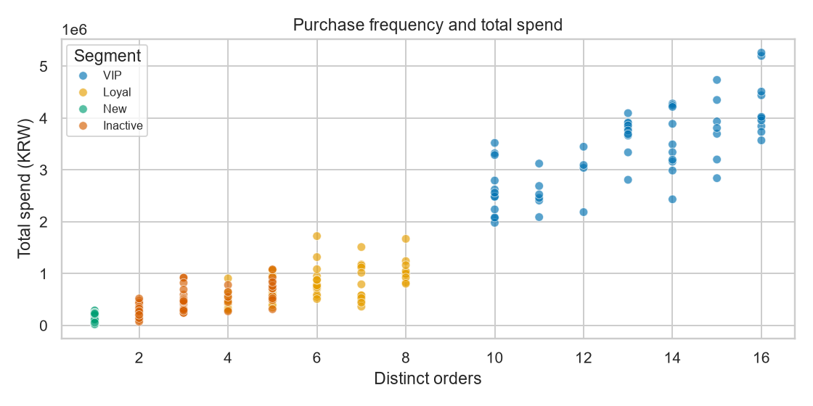

# A1-1 쇼핑몰 고객 분석: 누가 자주 오고 많이 살까?

쇼핑몰 거래 기록으로 고객을 네 그룹으로 나누고, 그룹별로 해 볼 만한 마케팅을 제안하는 미션이에요. 분석하는 동안 상품명(텍스트)과 상품 이미지(배열)도 분석에 쓸 수 있는 숫자로 바꿔요.

## 고객 한 명은 이렇게 나뉘어요

고객마다 마지막 구매 후 며칠이 지났는지, 몇 번 주문했는지, 총 얼마를 썼는지 세 숫자를 구하고, 그 숫자로 그룹을 정해요.

| 고객 | 마지막 구매 후 | 주문 수 | 총 구매 금액 | 그룹 |
| --- | ---: | ---: | ---: | --- |
| C001 | 7일 | 13회 | 3,917,400원 | VIP |
| C072 | 31일 | 5회 | 551,100원 | Loyal |
| C120 | 1일 | 1회 | 283,100원 | New |
| C182 | 116일 | 5회 | 563,300원 | Inactive |

C072와 C182는 주문 수와 금액이 비슷하지만, C182는 넉 달 가까이 오지 않아서 다른 그룹이 돼요.

## 결론: 어떤 그룹이 나왔을까?

**고객 25%인 VIP가 매출의 약 71%를 차지해요.**

| 그룹 | 어떤 고객인가 | 고객 수 | 평균 구매 횟수 | 마지막 구매 후 | 매출 비중 |
| --- | --- | ---: | ---: | ---: | ---: |
| VIP | 최근에도 사고, 자주, 많이 산다 | 60명 | 13.08회 | 8.33일 | **71.40%** |
| Loyal | 자주 사지만 금액이나 최근성은 VIP에 못 미친다 | 60명 | 5.92회 | 27.52일 | 16.26% |
| Inactive | 90일 넘게 구매가 없다 | 60명 | 3.15회 | 171.93일 | 9.68% |
| New | 최근에 처음 샀다 | 60명 | 1.00회 | 4.47일 | 2.66% |



이 데이터는 코드로 만든 **합성 데이터**예요(거래 2,842줄, 주문 1,389건, 고객 240명, 상품 80개). 고객 행동을 일부러 네 패턴으로 60명씩 만들었기 때문에 그룹도 정확히 60명씩 나왔어요. 수치는 분석 방법을 보여 주는 예시예요.

## 어떻게 나눌까?

고객마다 구하는 세 숫자를 **RFM**이라고 불러요.

- **R (Recency):** 마지막 구매 후 며칠이 지났나
- **F (Frequency):** 주문을 몇 번 했나
- **M (Monetary):** 총 얼마를 썼나

그다음 **위에서부터 차례로** 확인해서 처음 맞는 그룹에 넣어요.

| 순서 | 그룹 | 조건 |
| ---: | --- | --- |
| 1 | Inactive | 마지막 구매 후 90일 초과 |
| 2 | New | 30일 이내에 구매했고, 주문이 1회 |
| 3 | VIP | 30일 이내에 구매했고, 4회 이상 주문했고, 금액이 상위 25% (1,786,650원 이상) |
| 4 | Loyal | 4회 이상 주문 |
| 5 | Regular | 그 외 (이 데이터에서는 0명) |

R, F, M을 1~5점으로 매겨 더하는 방법도 있지만, 그룹은 점수 합으로 나누지 않았어요. 위의 C072, C120, C182는 점수 합이 모두 8점인데, 방금 처음 산 고객과 넉 달째 안 오는 고객은 해야 할 일이 다르기 때문이에요.

Inactive는 구매가 끊겼다는 뜻일 뿐, 떠났다고 확정한 것은 아니에요.

## 그룹별로 해 볼 일

아래 제안은 효과를 측정하지 않은 **가설**이에요. 근거 수치는 [`results/segment_summary.csv`](results/segment_summary.csv)에 있어요.

### 1. VIP를 지키면 매출을 지킬 수 있을까?

- **근거:** 고객의 25%인 VIP가 매출의 71.40%를 차지하고, 평균 13.08회 구매했어요.
- **실행:** VIP 일부에게 멤버십 혜택을 주고, 혜택을 받지 않은 VIP와 재구매를 비교해요. 재구매 유지를 기대해요.
- **검증:** 혜택 비용과 비교 집단의 재구매율이 필요해요. 비용 증가가 추가 이익보다 크면 이 제안은 버려요.

### 2. 구매가 끊긴 고객을 다시 데려올 수 있을까?

- **근거:** Inactive 60명은 마지막 구매 후 평균 171.93일이 지났고, 과거에 평균 3.15회 구매했어요.
- **실행:** 품목별 구매 간격을 먼저 확인하고, 수신 동의한 Inactive 고객에게 복귀 메시지를 보내 보내지 않은 고객과 비교해요. 재구매 회복을 기대해요.
- **검증:** 품목별 정상 구매 주기, 수신 동의, 반품 정보가 필요해요. 원래 구매 주기가 긴 것이라면 이탈이라는 해석을 고쳐야 해요.

### 3. 첫 구매 고객이 두 번째로 사게 할 수 있을까?

- **근거:** New 60명은 첫 구매 후 평균 4.47일이 지났고, 구매 횟수는 1회예요.
- **실행:** New 고객에게 사용 안내와 다음 구매 추천을 보내고, 받지 않은 고객과 비교해요. 두 번째 구매 전환을 기대해요.
- **검증:** 고객별로 같은 추적 기간과 반품 정보가 필요해요. 전환율에 차이가 없으면 추천 효과가 있다고 말할 수 없어요.

## 실행하기

[uv](https://docs.astral.sh/uv/getting-started/installation/)가 필요해요. 없다면 `pip install uv`로 설치할 수 있어요.

```bash
cd 02_Advanced/A1-1
uv sync --locked
uv run python -m src.run_analysis
```

`uv sync`는 Python 3.12와 라이브러리를 이 폴더의 `.venv`에 설치해요. 처음 한 번은 내려받는 데 시간이 걸리고, 약 250MB를 차지해요. 분석은 10초 안팎이면 끝나고, 결과는 `results/`에 저장돼요. 샘플 데이터는 레포에 들어 있어요.

- **노트북 실행:** VS Code나 Jupyter에서 노트북을 열고, 커널을 `.venv`의 Python으로 고른 뒤 **커널 재시작 후 전체 실행**을 누르세요.
- **내 데이터로 실행:** 필요한 파일 형식과 명령은 [`data/README.md`](data/README.md)에 있어요.

## 더 알아보기

| 이럴 때 | 여기를 보세요 |
| --- | --- |
| Python이나 데이터 분석이 낯설어요 | [`study/a1-1-guide.html`](study/a1-1-guide.html): 코드를 몰라도 읽을 수 있어요. 레포를 받은 뒤 브라우저로 여세요 |
| 코드를 한 줄씩 따라가고 싶어요 | [`notebooks/learning_walkthrough.ipynb`](notebooks/learning_walkthrough.ipynb): 클래스 없이 한 단계씩 직접 계산해요 |
| 완성된 분석을 보고 싶어요 | [`notebooks/analysis_report.ipynb`](notebooks/analysis_report.ipynb): 계산, 차트, 해석이 한 파일에 있어요 |
| 클래스 설계가 궁금해요 | [`src/pipeline.py`](src/pipeline.py): `DataAnalyzer` 클래스에 한국어 주석이 달려 있어요 |
| 이 방법을 어디까지 믿을 수 있는지 궁금해요 | [`results/method_notes.md`](results/method_notes.md): IQR의 한계, 빈칸 채우기의 위험, 대규모 처리 |

## 자세한 근거

미션에서 요구한 세부 결과예요. 필요할 때만 펼쳐 보세요.

<details>
<summary>데이터, 처리 과정, 통계와 차트</summary>

**데이터**

| 파일 | 한 행(또는 한 칸)의 뜻 | 크기 |
| --- | --- | --- |
| `data/sample/transactions.csv` | 주문 안의 상품 한 줄 | 2,842행, 11컬럼 |
| `data/sample/products.csv` | 상품 하나 | 80행, 6컬럼 |
| `data/sample/images.npy` | 상품 이미지 하나 | 80장, 각 16×16 RGB |
| `data/sample/customers.csv` | 고객 한 명과 가입일 (보너스용) | 240행 |

모두 [`src/sample_data.py`](src/sample_data.py)로 만든 합성 데이터예요(`seed=42`). 수치, 범주, 날짜, 이미지 네 가지 유형이 들어 있어요.

**처리 과정:** `DataAnalyzer` 클래스의 메서드를 아래 순서로 호출해요.

```text
load_data()              파일 3개를 검사하고 하나의 표로 연결한다
handle_missing_values()  빈칸을 카테고리별 중앙값으로 채운다
engineer_features()      이미지와 상품명을 숫자로 바꾼다
detect_outliers()        튀는 값에 표시만 붙인다 (지우지 않는다)
calculate_rfm()          거래를 고객별로 요약하고 그룹을 나눈다
```

- **빈칸 채우기:** 상품 가격 12개, 평점 7개, 배송 일수 272개를 카테고리별 중앙값으로 채웠어요. 고객 ID, 구매일, 구매 금액은 추정하지 않아요. 없는 매출을 만들게 되기 때문이에요.
- **이미지와 상품명:** 이미지마다 밝기의 평균과 표준편차를, 상품명마다 글자 수와 단어 수를 구해요. 이미지 계산에는 Python 반복문 없이 NumPy 배열 연산만 써요.
- **이상치:** IQR로 찾은 값에 표시만 붙이고 원본은 유지해요. 배송 일수는 −1.5~10.5일 밖의 15행이 후보예요.
- **기준일:** 마지막 거래 다음 날(2026-10-10)이에요. 90일, 4회 같은 기준은 메서드 인자로 바꿀 수 있어요.
- **M의 뜻:** 관측 기간의 양수 구매 금액 합계예요. 반품을 뺀 순매출이 아니에요.

**통계**

- **단가:** 평균 40,497원, 중앙값 37,800원, 표준편차 22,539원, Q1 21,100원, Q3 54,000원이에요.
- **상관:** 단가와 금액 r=0.731, 수량과 금액 r=0.605예요. `금액 = 단가 × 수량`이라는 계산식 때문에 생긴 값이라 마케팅 효과로 해석하면 안 돼요.
- **월별 매출:** 샘플의 10월은 9일까지라 9월과 바로 비교하면 안 돼요.

**차트 6종**

| 차트 | 파일 | 보여 주는 것 |
| --- | --- | --- |
| 히스토그램 | [`01_histogram.png`](results/figures/01_histogram.png) | 단가 분포 |
| 박스플롯 | [`02_boxplot.png`](results/figures/02_boxplot.png) | 배송 일수 이상치 처리 전후 |
| 막대그래프 | [`03_bar.png`](results/figures/03_bar.png) | 그룹별 고객 수 |
| 히트맵 | [`04_heatmap.png`](results/figures/04_heatmap.png) | 상관행렬 |
| 산점도 | [`05_scatter.png`](results/figures/05_scatter.png) | 주문 수와 구매 금액 |
| 라인차트 | [`06_line.png`](results/figures/06_line.png) | 월별 구매 금액 |

차트 글자는 한글 폰트가 없어도 깨지지 않게 영어로 썼어요. 고객별 RFM 값과 점수는 [`rfm_score_table.png`](results/figures/rfm_score_table.png)에 있어요.

</details>

<details>
<summary>보너스 과제 3종</summary>

자세한 결과는 [`results/bonus/README.md`](results/bonus/README.md)에 있어요.

1. **이미지 고급 피처:** 밝기 히스토그램 8구간, 이웃 픽셀 차이, 엔트로피를 NumPy로 계산해요. 밝기와 질감의 요약이고 품질 판별이 아니에요.
2. **가입 코호트:** 고객 240명을 가입 월로 12개 코호트로 나눠, 달마다 구매한 고객의 비율을 구해요. 가입일도 합성한 값이에요.
3. **인터랙티브 RFM:** [`rfm_interactive.html`](results/bonus/rfm_interactive.html)을 브라우저로 열면 점 위에 마우스를 올려 고객 값을 보고, 범례로 그룹을 고를 수 있어요.

</details>

---

[심화 과정 목차](../README.md) · [전체 과정](../../README.md)
