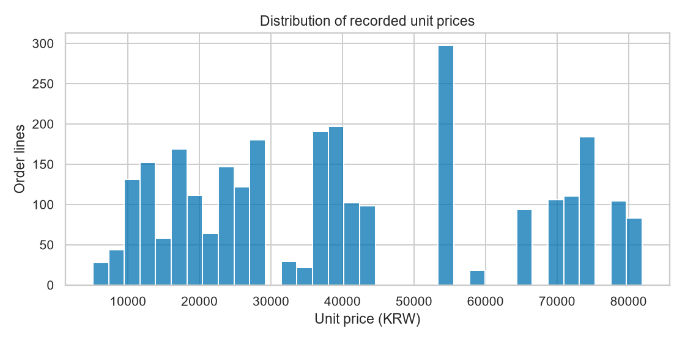
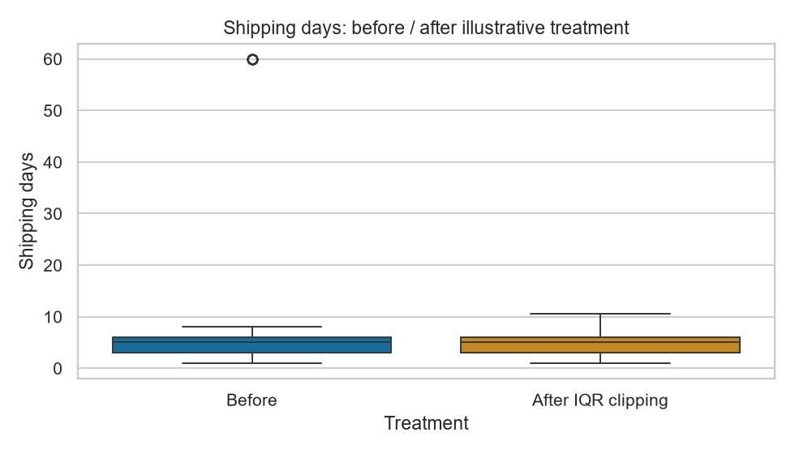
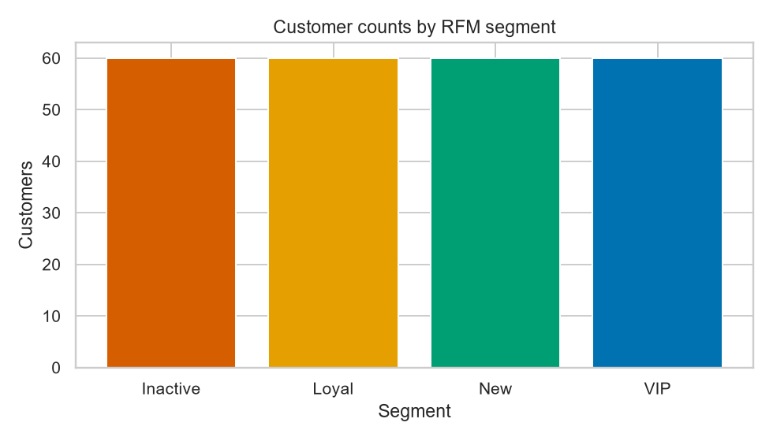
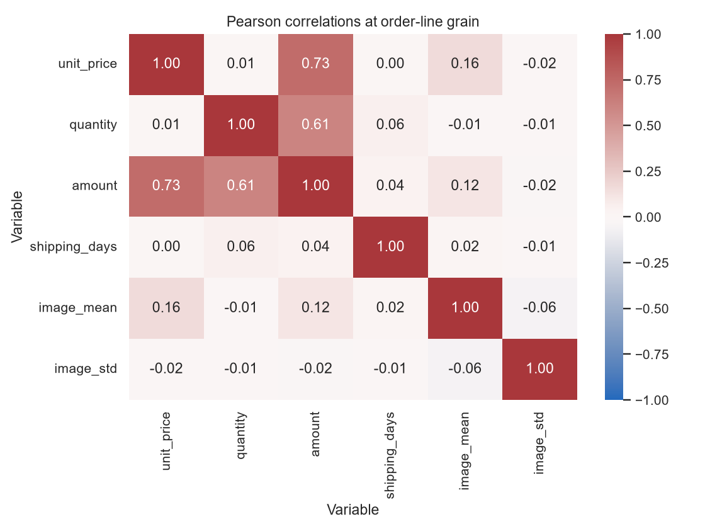
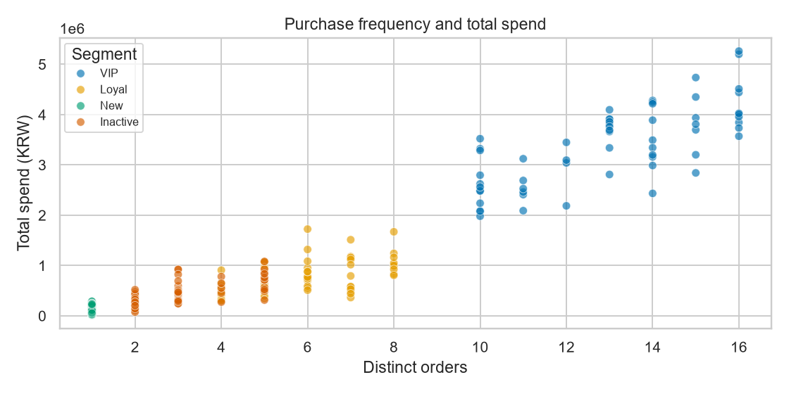
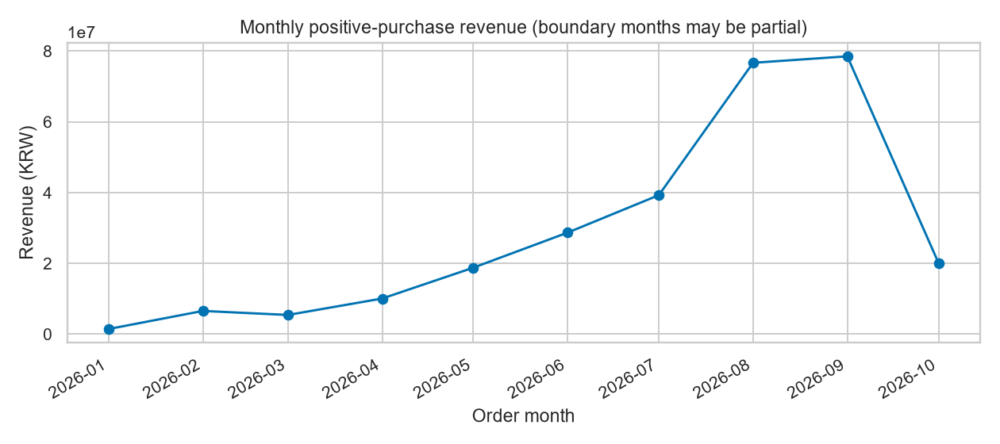

# A1-1 분석 결과

이 기본 실행은 고정 난수로 만든 합성 데이터다. 상품 이미지도 생성한 RGB 배열이며 실제 상품 사진이 아니다. 고객 행동을 의도적으로 구성했으므로 아래 수치는 분석 구현을 설명하는 예시다. 실제 시장 결론이나 세분화의 외부 타당성 검증으로 사용할 수 없다. 외부 데이터를 넣었다면 이 출처 설명을 별도로 갱신해야 한다.

입력 2,842행, 22컬럼. 상품 80개. 유효 구매 2,842행, 제외 0행, 고객 240명, 주문 1,389건이다. 한 주문의 여러 상품 행을 합쳐 고유 주문 수로 구매 횟수를 계산해야 한다.

상품 결측치 대치 수: {'catalog_price': 12, 'rating': 7}; 거래 행 대치 수: {'shipping_days': 272}. 카테고리별 median을 사용하고 그룹 전체가 비면 전체 통계로 보완했다. 상품 통계와 판매 빈도를 구분하며 고객 ID·날짜·거래 금액은 추정하지 않는다.

배송 일수 IQR 경계는 [-1.50, 10.50]일이며 15행을 표시했다. 차트는 경계로 클리핑한 비교값을 보여준다. 장기 배송이 오류인지는 별도 확인이 필요하며 원본과 RFM 거래 금액은 유지했다.

## 통계 해석

거래 행 기준 단가 평균 40497원, 중앙값 37800원, 표준편차 22539원, Q1 21100원, Q3 54000원이다. 평균·중앙값 차이와 히스토그램을 함께 봐야 고가 상품의 영향을 판단할 수 있다.

unit_price–amount Pearson r=0.731. amount=unit_price×quantity라는 계산 관계가 있으므로 독립적인 원인이나 마케팅 효과의 증거로 해석하지 않는다.

quantity–amount Pearson r=0.605. amount=unit_price×quantity라는 계산 관계가 있으므로 독립적인 원인이나 마케팅 효과의 증거로 해석하지 않는다.

이미지 평균·표준편차는 밝기와 픽셀 변동의 요약값이다. 의미·품질·상품 종류를 판별한 값이 아니다.

월별 매출은 관측 기간의 첫·마지막 달이 일부 날짜만 포함할 수 있다. 특히 기본 데이터의 10월은 9일까지이므로 완전한 9월과 단순 비교해 매출 감소를 주장하지 않는다.

## 고객 세분화

기준일 2026-10-10. 기본값은 최종 유효 거래일 다음 날이다. 관측 기간 전체의 고유 주문 수와 구매 금액을 사용한다. R은 작을수록, F·M은 클수록 높은 1–5 점수다. 동점에는 같은 점수를 부여하므로 점수별 고객 수는 같지 않을 수 있다.

최근 기준 30일, 비활성 기준 90일, 반복 구매 기준 4회, VIP 금액 경계 1786650원. Inactive → New → VIP → Loyal → Regular 순서로 상호 배타적으로 분류한다. Inactive는 구매 공백을 나타내며 확정 이탈을 의미하지 않는다.

## 비즈니스 가설

### VIP

- 근거: 고객 60명(25.0%), 매출 비중 71.4%, 평균 구매 횟수 13.08회, 평균 최근 구매 경과 8.3일. `segment_summary.csv`와 `03_bar.png`, `05_scatter.png` 참조.
- 실행: VIP 대상 → 멤버십 혜택을 소규모 대조군 실험으로 제공 → 기대 효과: 재구매 유지. 아직 검증하지 않은 가설이며 효과 크기를 측정하지 않았다.
- 검증: 혜택 비용과 대조군의 재구매율이 필요하다. 비용 증가가 추가 이익보다 크면 제안을 기각한다.

### Inactive

- 근거: 고객 60명(25.0%), 매출 비중 9.7%, 평균 구매 횟수 3.15회, 평균 최근 구매 경과 171.9일. `segment_summary.csv`와 `03_bar.png`, `05_scatter.png` 참조.
- 실행: Inactive 대상 → 최근 구매 간격을 확인하고 복귀 메시지를 대조군과 비교 → 기대 효과: 재구매 회복. 아직 검증하지 않은 가설이며 효과 크기를 측정하지 않았다.
- 검증: 품목별 정상 구매 주기와 수신 동의 정보가 필요하다. 긴 구매 주기가 정상이라면 이탈 해석을 수정한다.

### New

- 근거: 고객 60명(25.0%), 매출 비중 2.7%, 평균 구매 횟수 1.00회, 평균 최근 구매 경과 4.5일. `segment_summary.csv`와 `03_bar.png`, `05_scatter.png` 참조.
- 실행: New 대상 → 첫 구매 후 사용 안내와 다음 구매 추천을 대조군과 비교 → 기대 효과: 두 번째 구매 전환. 아직 검증하지 않은 가설이며 효과 크기를 측정하지 않았다.
- 검증: 첫 구매 후 동일한 추적 기간과 반품 정보가 필요하다. 전환율 차이가 없으면 추천 효과를 주장할 수 없다.

### Loyal

- 근거: 고객 60명(25.0%), 매출 비중 16.3%, 평균 구매 횟수 5.92회, 평균 최근 구매 경과 27.5일. `segment_summary.csv`와 `03_bar.png`, `05_scatter.png` 참조.
- 실행: Loyal 대상 → 반복 구매 품목의 재입고 알림을 대조군과 비교 → 기대 효과: 구매 편의 개선. 아직 검증하지 않은 가설이며 효과 크기를 측정하지 않았다.
- 검증: 재고와 알림 비용이 필요하다. 자연 재구매와 차이가 없으면 효과를 주장할 수 없다.

## 차트

