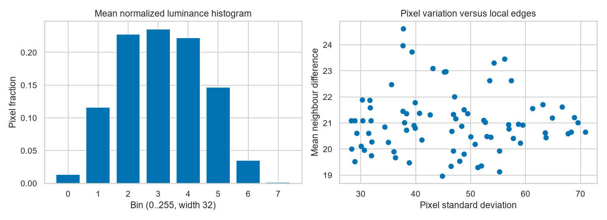
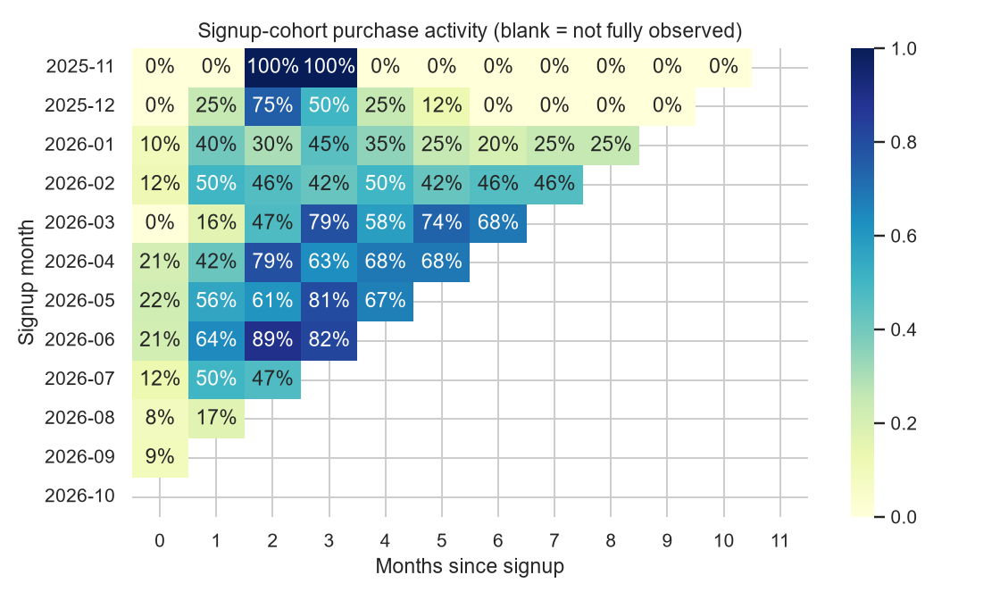

# A1-1 보너스 결과

이미지 피처는 NumPy로 직접 계산한 8구간 정규화 히스토그램·이웃 픽셀 차이·엔트로피다. 상품별 결과는 image_features.csv, 거래에 연결한 결과는 transactions_with_image_features.csv에 있다. 밝기와 질감의 요약이며 의미·품질을 판별한 값이 아니다.

코호트는 customers.csv의 가입 월을 기준으로 한다. 가입 고객 전체를 분모로, 해당 경과 월에 양수 구매한 고유 고객 수를 분자로 사용한다. 미구매자도 분모에 포함한다. month 0은 가입 월의 구매 활동률이며 반드시 100%가 아니다. 관측 종료일은 2026-10-09이다. 월말까지 관측하지 않은 칸은 NaN/공백으로 남긴다. 공백을 재구매율 0%로 해석하면 안 된다. 합성 가입일이므로 실제 유지율의 근거가 아니다.

[오프라인 Plotly RFM 차트](rfm_interactive.html): 확대·hover·범례 그룹 선택·PNG 저장. Plotly는 이 보너스 시각화에서만 사용한다.
