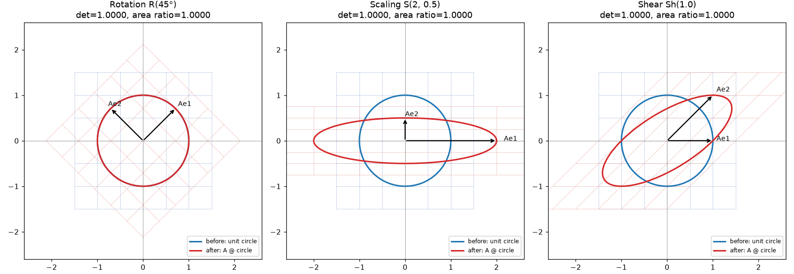
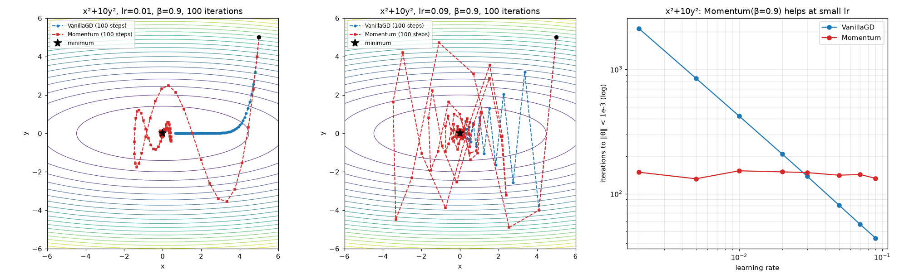

# A2-1 AI 수학과 학습 원리: 신경망은 틀린 답을 어떻게 고칠까?

아주 작은 신경망이 답을 고치는 과정을 NumPy로 직접 만들어 보는 프로젝트예요. 이 과정에 선형대수, 미적분, 확률통계가 각각 어디에 쓰이는지 코드와 그림으로 확인해요.

> **먼저 알아 두세요.** 아래 신경망 결과는 데이터 **하나**로 학습 과정을 보여 주는 고정 예제예요. 처음 보는 데이터도 잘 맞힌다는 뜻은 아니에요. 계산은 NumPy, 그림은 Matplotlib만 쓰고, 자동 미분 라이브러리와 scikit-learn은 쓰지 않아요.

## 한눈에 보는 결과

입력 `[1, 0]`의 정답이 1일 때, 신경망이 답을 **한 번** 고치면 이렇게 달라져요.

| | 고치기 전 | 한 번 고친 뒤 | 뜻 |
| --- | ---: | ---: | --- |
| 정답이 1일 확률 | 0.6473 | **0.7121** | 정답 쪽으로 더 기울었어요 |
| 손실 | 0.4350 | **0.3395** | 틀린 정도가 줄었어요 |

**손실(loss)** 은 답이 얼마나 틀렸는지 나타내는 점수예요. 작을수록 좋아요. 같은 데이터로 20번 고치면 손실은 0.0473까지 줄어요.

## 이 한 번에 수학이 쓰이는 자리

신경망은 **가중치**라는 숫자들로 답을 계산해요. 학습은 이 숫자들을 고치는 일이에요. 한 번 고칠 때 아래 네 단계를 거쳐요.

| 단계 | 하는 일 | 쓰는 수학 | 이 예제의 값 |
| --- | --- | --- | --- |
| 1. 예측하기 | 입력에 가중치를 곱해 확률을 내요 | 선형대수 | 확률 0.6473 |
| 2. 채점하기 | 예측이 틀린 정도를 손실로 계산해요 | 확률통계 | 손실 0.4350 |
| 3. 고칠 방향 찾기 | 가중치를 바꿀 때 손실이 어떻게 변하는지 구해요 | 미적분 | 가중치 하나의 기울기 −0.1852 |
| 4. 고치기 | 기울기의 반대 방향으로 가중치를 옮겨요 | 최적화 | 같은 가중치 0.5 → 0.5926 |

3단계의 기울기가 음수이므로, 이 가중치를 키우면 손실이 줄어요. 그래서 4단계에서 가중치가 커졌어요. 옮기는 폭은 **학습률**이 정하고, 이 예제의 학습률은 0.5예요.

## 어디부터 읽을까?

전부 읽을 필요 없어요. 지금 상황에 맞는 줄 하나만 골라 시작하세요.

| 이럴 때 | 여기를 보세요 | 특징 |
| --- | --- | --- |
| Python이나 수학이 낯설어요 | [`study/a2-1-guide.html`](study/a2-1-guide.html) | 코드를 몰라도 읽을 수 있고, 값을 직접 바꿔 볼 수 있어요. 레포를 받은 뒤 브라우저로 여세요 |
| 계산을 한 단계씩 따라가고 싶어요 | [`notebooks/backprop_derivation.ipynb`](notebooks/backprop_derivation.ipynb) → [`notebooks/probability_loss.ipynb`](notebooks/probability_loss.ipynb) | 이 순서로 보세요. 행렬과 미분에서 신경망 학습으로, 확률에서 손실 함수로 이어져요 |
| 구현 코드를 읽고 싶어요 | [`study/code-walkthrough.md`](study/code-walkthrough.md) | 문법, 배열 모양의 변화, 작은 숫자 예제를 함께 설명해요 |
| 수치와 근거를 확인하고 싶어요 | 아래 [자세한 결과와 근거](#자세한-결과와-근거) | 실험별 수치와 그림을 정리했어요 |

## 실행하기

[uv](https://docs.astral.sh/uv/getting-started/installation/)만 있으면 돼요. 없다면 `pip install uv`로 설치할 수 있어요.

```bash
cd 02_Advanced/A2-1
uv sync --locked
uv run python -m src.run_all
```

- `uv sync`는 Python 3.12.13과 라이브러리를 이 폴더의 `.venv`에 설치해요. 처음 한 번은 내려받는 데 시간이 걸리고, 약 190MB를 차지해요.
- `src.run_all`은 15초 안팎이면 끝나요. 그림 19개와 수치 요약 `summary.json`을 `outputs/`에 저장해요. 같은 이름의 파일은 덮어써요.

**노트북 실행:** VS Code나 Jupyter에서 노트북을 열고, 커널을 `.venv`의 Python으로 고른 뒤 **커널 재시작 후 전체 실행**을 누르세요. 두 노트북은 각각 따로 실행돼요.

## 직접 만들고 확인한 것

처음 보는 용어는 쉬운 뜻만 먼저 보세요. 차근차근 배우고 싶다면 [HTML 학습 자료](study/a2-1-guide.html)가 더 좋아요.

| 영역 | 개념 | 쉬운 뜻 | 직접 확인한 결과 |
| --- | --- | --- | --- |
| 선형대수 | 행렬식(determinant, det) | 행렬이 도형의 면적을 몇 배로 바꾸는지 알려 주는 값 | det가 5인 행렬은 면적을 5배로 바꿔요 |
| 선형대수 | 고유값(eigenvalue) | 행렬을 곱해도 방향이 그대로인 벡터가 늘어나는 배율 | 직접 구한 4.6180이 NumPy 결과와 일치해요 |
| 선형대수 | SVD(Singular Value Decomposition, 특이값 분해) | 행렬을 중요한 성분 순서로 나누는 방법 | 성분 10개로 이미지 에너지의 95.41%를 보존해요 |
| 미적분 | Gradient(기울기 벡터) | 값이 가장 빠르게 커지는 방향 | 등고선과 수직인 것을 확인했어요 |
| 미적분 | 역전파(backpropagation) | 출력에서 입력 쪽으로 기울기를 전달하는 계산 | 손계산과 소수점 4자리까지 일치해요 |
| 최적화 | 경사하강법(Gradient Descent) | 기울기의 반대 방향으로 조금씩 옮기는 방법 | 학습률이 너무 크면 값이 줄지 않고 오히려 커져요 |
| 최적화 | Momentum(관성) | 이전에 움직인 방향을 이어 가는 방법 | 작은 학습률에서는 유리하지만, 항상 더 빠르지는 않아요 |
| 확률통계 | MLE(Maximum Likelihood Estimation, 최대우도추정) | 데이터를 가장 그럴듯하게 설명하는 값을 찾는 방법 | 손실을 줄여 찾은 값과 MLE로 찾은 값이 같아요 |

학습률에 따라 같은 방법도 결과가 크게 달라져요. 아래 그림에서 수렴과 발산을 비교할 수 있어요.


SVD로 성분을 많이 남길수록 이미지가 선명해지지만, 저장량도 늘어나요. k는 남긴 성분의 수예요.


## 자세한 결과와 근거

필요할 때만 펼쳐 보세요.

<details>
<summary>실험별 결과와 근거</summary>

노트북은 수식 유도와 손계산, `src.run_all`은 전체 실험과 그림을 맡아요. 표의 "역전파 노트북"은 `backprop_derivation.ipynb`, "확률 노트북"은 `probability_loss.ipynb`예요.

| 실험 | 결과 | 근거 |
| --- | --- | --- |
| 단위 원의 회전·스케일링·전단 | 변환 전후를 한 Figure에 겹침 | `plot_transformation`, [01](outputs/01_rotation.png)·[02](outputs/02_scaling.png)·[03](outputs/03_shear.png)·[04](outputs/04_transforms_overview.png), 역전파 노트북 8절 |
| det와 면적비 | 오차 최대 6.7e-14% (기준 1%) | `area_ratio_check` |
| Power Iteration과 `np.linalg.eig` | λ=4.6180, 오차 3.8e-11% (기준 5%) | `power_iteration`, `compare_with_numpy_eig`, [05](outputs/05_power_iteration.png), 역전파 노트북 8절 |
| SVD k=10, 50, 100 | PSNR 20.89, 33.84, 54.45 dB | `plot_svd_compression`, [06](outputs/06_svd_compression.png), 역전파 노트북 8절 |
| x²의 x=3 수치 미분 | 오차 3.9e-11 (기준 1e-4) | `numerical_derivative`, [09](outputs/09_derivative_error.png) |
| 등고선과 Gradient 수직 | \|cos\| 최대 9.9e-12 | `plot_gradient_field`, [08](outputs/08_gradient_field.png) |
| 2층 신경망 유도와 손계산 | 순전파 중간값, 역전파 6단계, 각 shape | 역전파 노트북 2·3절 |
| 손계산과 NumPy 대조 | 소수점 4자리 전체 일치 | 역전파 노트북 4절 |
| GD, x²+y², lr=0.1, 100회 | ‖θ‖=1.4e-9 (기준 반경 0.1) | [10](outputs/10_gd_quadratic.png) |
| 학습률과 발산 | lr=1.1 → 5.9e8, 타원 lr=0.5 → 6.1e19, 원형 lr=0.5는 수렴 | [11](outputs/11_lr_divergence.png) |
| GD와 Momentum 경로 겹침 | x²+y² lr=0.1에서는 GD가 더 가까움 | `plot_convergence_paths`, [12](outputs/12_gd_vs_momentum_quadratic.png) |
| 타원 x²+10y² 비교 | lr=0.01에서 Momentum이 25배 이상 가까움, 큰 lr에서는 역전 | [13](outputs/13_gd_vs_momentum_elliptic.png), 역전파 노트북 7절 |
| 정규 PDF, 베르누이 PMF 각 2종 | 한 Figure에 비교 | `plot_normal_pdfs`, `plot_bernoulli_pmfs`, [16](outputs/16_normal_pdf.png)·[17](outputs/17_bernoulli_pmf.png), 확률 노트북 1절 |
| softmax 합 | 1과의 차이 0 (기준 1e-6) | `softmax`, 확률 노트북 2절 |
| MSE·CE와 MLE의 연결 | 최적 w가 1.505, 1.745로 각각 일치 | 확률 노트북 3·4절, [18](outputs/18_loss_mle.png) |

</details>

<details>
<summary>선형대수: 행렬식, Power Iteration, SVD</summary>

| 변환 | det | 변환 후/전 면적비 | 오차 |
| --- | ---: | ---: | ---: |
| 회전 R(45°) | 1.0000 | 1.0000 | 0% |
| 스케일링 S(2, 0.5) | 1.0000 | 1.0000 | 0% |
| 전단 Sh(1.0) | 1.0000 | 1.0000 | 6.7e-14% |
| 일반 [[2,1],[1,3]] | 5.0000 | 5.0000 | 0% |
| 반사+스케일 [[0,2],[1,0]] | −2.0000 | 2.0000 | 0% |

요구된 세 변환은 모두 det=1이라 면적이 그대로예요. 그래서 det≠1인 두 행렬로도 `|det| = 면적비`를 확인했어요. det가 음수이면 면적이 음수라는 뜻이 아니라 방향이 뒤집힌다는 뜻이에요. 면적은 100개 점으로 만든 다각형의 신발끈 공식으로 계산했어요. 선형 변환은 모든 도형의 면적을 같은 비율로 바꾸므로, 다각형으로 근사해도 면적비는 |det|와 정확히 같아요.



- **개별 그림:** [회전](outputs/01_rotation.png), [스케일링](outputs/02_scaling.png), [전단](outputs/03_shear.png)
- **Power Iteration, A=[[4,1],[1,3]]:** tol=1e-6에서 23회 만에 λ=4.6180, v=[0.8507, 0.5257]을 얻어요. `np.linalg.eig`와의 고유값 오차는 3.8e-11%, 고유벡터 각도 차는 5.1e-5°예요. 오차는 (λ₂/λ₁)^(2t)로 줄어요 ([그림](outputs/05_power_iteration.png)). 6x6 무작위 대칭 행렬에서도 26회 만에 일치했어요. 반복 수는 시작 벡터에 따라 달라지며, `[1,0]`에서 시작하는 노트북에서는 21회예요.
- **SVD 압축, 128x128 이미지** ([특이값 그림](outputs/07_singular_values.png)):

| k | 저장 비율 | 에너지 보존 | 상대 오차 | PSNR |
| ---: | ---: | ---: | ---: | ---: |
| 10 | 0.157 | 95.41% | 0.214 | 20.89 dB |
| 50 | 0.784 | 99.77% | 0.048 | 33.84 dB |
| 100 | 1.569 | 100.00% | 0.004 | 54.45 dB |

rank-k 근사는 U의 m·k개, σ의 k개, V의 n·k개 값을 저장해요. 128x128에서는 k < 63.75일 때만 원본보다 작아요. k=100은 화질이 원본과 거의 같지만 저장량은 1.57배예요.

</details>

<details>
<summary>미적분: 수치 미분, Gradient</summary>

- f(x)=x²의 x=3 중심차분 미분값은 6.0000000000이고, 해석적 미분값 6과의 오차는 3.9e-11이에요.
- 등고선 위 점에서 Gradient와 등고선 접선의 |cos|는 최대 9.9e-12예요. 두 방향은 독립적으로 구했어요. 접선은 등고선 위 이웃 점의 차이, Gradient는 수치 미분으로 계산했어요 ([그림](outputs/08_gradient_field.png)). 그림은 축 비율을 같게 맞춰야 수직이 그대로 보여요.
- h를 줄이면 절단 오차가 줄지만, 지나치게 작으면 반올림 오차가 커져요. 중심차분의 오차는 h≈1e-5 부근에서 가장 작아요 ([그림](outputs/09_derivative_error.png)).

</details>

<details>
<summary>역전파: x=[1,0], y=1의 중간값</summary>

| 값 | shape | 결과 |
| --- | --- | --- |
| z1, a1 | (2,) | [0.1, 0.3], [0.5250, 0.5744] |
| z2, ŷ, L | () | 0.6072, 0.6473, 0.4350 |
| ∂L/∂ŷ, ∂L/∂z2 | () | −1.5449, −0.3527 |
| ∂L/∂W2, ∂L/∂a1 | (2,) | [−0.1852, −0.2026], [−0.1764, −0.2116] |
| ∂L/∂z1 | (2,) | [−0.0440, −0.0517] |
| ∂L/∂W1 | (2,2) | [[−0.0440, 0], [−0.0517, 0]] |

- 손계산과 NumPy 결과는 소수점 4자리까지 모두 일치해요. 수치 미분과의 최대 차이는 1.1e-11이에요.
- 미션의 참고 예시에는 z2가 0.6071, ∂L/∂z1의 둘째 값이 −0.0513으로 적혀 있어요. 실제 값은 0.607155와 −0.051734이므로, 반올림하면 0.6072와 −0.0517이에요.
- 같은 관측으로 20회 학습한 결과와 첫 갱신의 결과는 노트북에서 구분해 보여 줘요.

</details>

<details>
<summary>최적화: 시작점 (5, 5)에서 학습률과 Momentum 비교</summary>

- **Vanilla GD, x²+y², lr=0.1, 100회:** (1.0e-9, 1.0e-9)에 도달해 반경 0.1 조건을 만족해요 ([그림](outputs/10_gd_quadratic.png)).
- **학습률과 발산:** x²+y²에서는 x_{t+1} = (1−2·lr)·x_t이므로 lr<1이면 수렴해요. lr=1이면 같은 크기로 진동하고, lr>1이면 발산해요. 따라서 lr=0.5는 발산하지 않고 한 번에 원점에 도달해요. 발산 그래프는 lr=1.1(100회 후 ‖θ‖=5.9e8)과 x²+10y²의 lr=0.5(|1−20·0.5|=9, 20회 후 6.1e19)로 보였어요. 일반적인 안정 조건은 lr < 2/최대 곡률이에요.
- **Momentum(β=0.9):**

| 함수, lr | VanillaGD | Momentum |
| --- | --- | --- |
| x²+y², 0.1: 100회 후 ‖θ‖ | 1.4e-9 | 2.0e-2 |
| x²+10y², 0.01: 100회 후 ‖θ‖ | 0.663 | 0.026 |
| x²+10y², 0.05: 100회 후 ‖θ‖ | 1.3e-4 | 0.020 |
| x²+10y², 0.09: 100회 후 ‖θ‖ | 1.2e-8 | 0.025 |

x²+10y²에서 lr이 작으면 GD는 완만한 x 방향으로 천천히 이동해요. Momentum은 같은 방향의 기울기를 누적해 25배 이상 가까이 도달해요. ‖θ‖<1e-3까지 반복 수는 lr=0.002에서 GD 2126회, Momentum 149회예요.

그러나 lr을 GD의 한계 가까이 키우면 GD가 더 빨라요. lr=0.05에서는 y 방향 배율이 1−20·0.05=0이라 GD의 y가 한 번에 0이 되고, 지그재그 없이 Momentum보다 가까이 가요. β=0.9에서는 Momentum의 수렴률이 약 √β≈0.95로 제한되기 때문이에요 ([그림](outputs/13_gd_vs_momentum_elliptic.png), [x²+y² 비교](outputs/12_gd_vs_momentum_quadratic.png)). β=0.9는 조건수가 훨씬 큰 골짜기에 맞는 값이에요. 조건수가 10인 이 함수에서는 관성이 과해 진동해요.



</details>

<details>
<summary>확률통계: 분포, softmax, 손실과 MLE</summary>

- 정규분포 N(0,1)·N(2,0.5)의 PDF와 베르누이 B(0.3)·B(0.7)의 PMF를 각각 한 Figure에 그렸어요 ([PDF](outputs/16_normal_pdf.png), [PMF](outputs/17_bernoulli_pmf.png)). N(μ, σ²) 표기에 따라 0.5는 분산(σ≈0.707)으로 처리했어요.
- 소프트맥스 출력의 합과 1의 차이는 0이고, 기준은 1e-6이에요. 최댓값을 빼는 안정화로 [1000, 1001, 1002]도 overflow 없이 계산해요.
- MSE 최소화와 가우시안 NLL 최소화의 최적 w는 1.505로 같아요. BCE 최소화와 베르누이 우도 최대화의 최적 w도 1.745로 같아요 ([그림](outputs/18_loss_mle.png)). 수식 유도는 노트북에 있어요.

</details>

<details>
<summary>보너스 과제 3종: Adam, Newton Method, 정보 이론</summary>

| 과제 | 결과 |
| --- | --- |
| Adam | 같은 lr=0.1에서 x²+10y²의 GD는 y 방향에서 영원히 진동해요(1−20·0.1=−1). Adam은 좌표별 기울기 크기로 나누므로 144회 만에 1e-3에 도달해요. Momentum은 159회가 걸려요. 첫 이동 폭이 곡률과 무관하게 좌표마다 lr이에요 ([그림](outputs/14_adam_comparison.png)). |
| Newton Method | x²+10y²에서 1회 만에 최솟값에 도달해요. Rosenbrock에서는 Newton 5회, GD(lr=0.001) 17,695회가 걸려요. 대신 Hessian 계산·풀이 비용이 들고, x²−y²에서는 안장점으로 곧장 이동해요. 같은 위치에서 GD는 안장점에서 벗어나요 ([그림](outputs/15_newton_method.png)). |
| 정보 이론 | p=[0.7,0.2,0.1], q=[0.4,0.4,0.2]에서 H(p)=0.8018, H(p,q)=0.9856, KL(p‖q)=0.1838, KL(q‖p)=0.1920이에요. H(p,q)=H(p)+KL(p‖q)이고, KL은 대칭이 아니에요 ([그림](outputs/19_information_theory.png)). |

</details>

<details>
<summary>계산의 전제와 읽는 법</summary>

- 고정 신경망은 입력 `[1,0]`, 정답 1인 관측 하나예요. 6자리 표시는 읽기용이고 중간 계산은 반올림하지 않아요.
- 정규분포는 `N(평균, 분산)`으로 표기해요. PDF의 높이는 확률이 아니라 밀도예요.
- MSE와 가우시안 NLL의 최적점 일치는 모든 관측의 잡음 분산이 같은 고정값일 때 성립해요. MSE 자체는 확률 가정 없이 오차 지표로도 쓸 수 있어요.
- 노트북의 BCE·CE와 NLL 함수는 관측별 항의 합을 반환해요. MSE 평균 및 기울기 비교의 `½(예측−정답)²`와 배율이 달라요.
- `x²+y²`에서 GD의 안정 범위는 `0 < lr < 1`이에요. 같은 학습률도 곡률이 다른 함수에서는 진동하거나 발산할 수 있어요. Momentum의 이점도 조건에 따라 달라져요.
- SVD는 복원 오차, 에너지, 저장할 실수 개수를 함께 봐요. PSNR이 높다고 압축 효율도 높다고 판단하지 않아요.
- 고유값은 Power Iteration으로 직접 구하고, `np.linalg.eig`와 `eigvals`는 결과 비교와 그래프의 이론선에만 써요. SVD 분해에는 `np.linalg.svd`를 써요.

</details>

<details>
<summary>친구에게 보여 줄 때</summary>

1. 역전파 노트북의 **첫 갱신**에서 확률과 손실이 어떻게 바뀌었는지 먼저 설명해요.
2. 그다음 반복 학습과 다른 수학 부품으로 이어 가요.
3. 확률 노트북에서는 관측별 손실 한 행을 설명한 뒤 합, 평균, 곡선으로 연결해요.
4. 코드 셀을 실행하기 전에 결과를 예상하고, 확인 질문은 출력 표를 근거로 답해 봐요.

</details>

<details>
<summary>파일 구조</summary>

| 경로 | 내용 |
| --- | --- |
| `src/linear_algebra.py` | 회전·스케일링·전단 행렬, 행렬식과 신발끈 면적, Power Iteration, SVD 압축과 시각화 |
| `src/calculus.py` | 중심차분 미분, 다변수 Gradient·Hessian, 등고선–Gradient 수직 검증과 시각화 |
| `src/neural_net.py` | 2층 신경망 순전파·역전파, BCE, 고정 손계산 예제 |
| `src/optimizer.py` | `VanillaGD`, `Momentum`, `Adam`, `NewtonMethod` 클래스, 테스트 함수, 수렴 경로 시각화 |
| `src/probability.py` | 정규분포 PDF, 베르누이 PMF, 소프트맥스, MSE·가우시안 NLL·BCE·Categorical CE |
| `src/information.py` | 엔트로피, Cross-Entropy, KL-Divergence (보너스) |
| `src/run_all.py` | 전체 실험 실행, 그림과 `summary.json` 저장 |
| `notebooks/backprop_derivation.ipynb` | 행렬·수치 미분, 역전파와 첫 갱신, Momentum 상태, 공간 변환·고유값·SVD |
| `notebooks/probability_loss.ipynb` | 분포·softmax 중간 계산, 관측별 손실과 합·평균, MLE 유도, 정보 이론 |
| `data/grace_hopper_128.png` | SVD 실험용 128x128 흑백 이미지 |
| `scripts/prepare_image.py` | 위 이미지를 만드는 전처리 |
| `study/a2-1-guide.html` | HTML 학습 자료 |
| `study/code-walkthrough.md` | 코드 읽기 가이드: 문법, 배열 shape 변화, 작은 숫자 예제, 확인 질문 |
| `pyproject.toml`, `uv.lock`, `.python-version` | uv 환경 정의 |
| `requirements.txt` | uv 없이 설치할 때 쓰는 의존성 목록 |

노트북은 기존 `outputs/` 파일 없이 계산과 그림을 만들지만, 같은 프로젝트의 `src/`와 `data/grace_hopper_128.png`는 필요해요.

</details>

<details>
<summary>uv 없이 실행하기, 검증한 환경</summary>

**uv가 없을 때:** `pip install -r requirements.txt`로 계산과 시각화 라이브러리만 설치할 수 있어요. 의존성의 원본은 `pyproject.toml`이고, `requirements.txt`는 같은 최소 버전을 적은 사본이에요.

**재현성:** `src.run_all`의 모든 실험은 `np.random.seed(42)`로 실행해요.

| 검증 조합 | 결과 |
| --- | --- |
| Windows, Python 3.12.13, NumPy 2.5.4, Matplotlib 3.11.2 (`uv.lock`, 현재 `.python-version`) | 전체 실험, 노트북 2개 통과 |
| Windows, Python 3.12.14, NumPy 2.5.4, Matplotlib 3.11.2 (`uv.lock`) | 전체 실험, 노트북 2개 통과 |
| Windows, Python 3.8.20, NumPy 1.21.6, Matplotlib 3.4.3 (미션 최소 버전) | 전체 실험 통과 |

</details>

<details>
<summary>SVD 실험 이미지의 출처</summary>

Matplotlib 배포본의 `sample_data/grace_hopper.jpg`(Grace Hopper 제독의 미 해군 공식 초상, 퍼블릭 도메인)를 사용했어요. 위쪽 512x512를 흑백으로 바꾸고 4x4 블록 평균으로 128x128로 줄였어요(`scripts/prepare_image.py`). 64x64 이하에서는 rank가 최대 64라서 k=100 비교가 불가능해요. 그래서 k=10, 50, 100을 모두 의미 있게 비교할 수 있는 128x128을 사용했어요.

</details>

---

[심화 과정 목차](../README.md) · [전체 과정](../../README.md)
