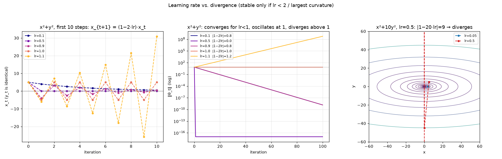
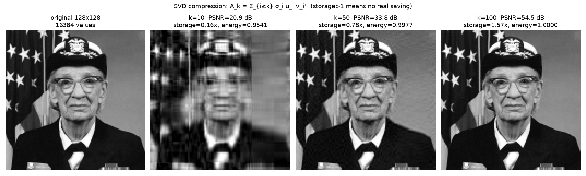

# A2-1 AI 수학과 학습 원리: 신경망은 틀린 답을 어떻게 고칠까?

AI가 학습한다는 것은, 답을 내는 계산식 속 숫자(**가중치**)를 틀린 만큼 조금씩 고치는 일이에요. 이 미션은 그 과정에 쓰이는 수학인 선형대수, 미적분, 확률통계를 NumPy로 직접 구현하고 그림으로 확인해요. 자동 미분 라이브러리는 쓰지 않아요.

## 작은 신경망이 답을 고치는 모습

예제는 숨은 층이 하나만 있는 아주 작은 신경망이에요. 실제 문제를 푸는 게 아니라, 계산을 손으로 따라갈 수 있게 미션이 입력과 목표값을 정해 준 연습 문제예요. 신경망은 0과 1 사이의 숫자 하나를 내고, 목표는 1이에요. 한 번 고치면 출력이 목표에 더 가까워져요.

| | 고치기 전 | 한 번 고친 뒤 |
| --- | ---: | ---: |
| 출력 (목표 1) | 0.6473 | **0.7121** |
| 손실 (틀린 정도, 작을수록 좋음) | 0.4350 | **0.3395** |

같은 데이터로 20번 고치면 손실은 0.0473까지 줄어요. 데이터 하나로 학습 과정만 보여 주는 예제라서, 처음 보는 데이터도 잘 맞힌다는 뜻은 아니에요.

## 한 번 고칠 때 쓰는 수학

한 번 고칠 때 아래 네 단계를 거쳐요. 미션의 다른 실험들은 각 단계에 쓰이는 수학을 따로 떼어 확인한 거예요.

| 단계 | 하는 일 | 이 예제의 값 | 그 수학을 따로 확인한 실험 |
| --- | --- | --- | --- |
| 1. 예측하기 (선형대수) | 입력에 가중치 행렬을 곱해 0과 1 사이의 출력을 내요 | 출력 0.6473 | 행렬을 곱하면 도형이 돌거나 늘어나고, 면적은 행렬식(det)배가 돼요. 행렬에서 가장 중요한 방향(고유값)을 직접 구하고, 중요한 성분만 남겨 이미지를 압축했어요(SVD) |
| 2. 채점하기 (확률통계) | 예측이 틀린 정도를 손실로 계산해요 | 손실 0.4350 | 손실을 줄이는 것이, 데이터를 가장 그럴듯하게 설명하는 값을 찾는 것(MLE)과 같았어요 |
| 3. 고칠 방향 찾기 (미적분) | 가중치를 바꿀 때 손실이 어떻게 변하는지(기울기) 구해요 | 기울기 −0.1852 | 기울기가 등고선과 수직, 즉 가장 가파른 방향임을 그림으로 확인했어요 |
| 4. 고치기 (최적화) | 기울기의 반대 방향으로 가중치를 옮겨요 | 가중치 0.5 → 0.5926 | 옮기는 폭(학습률)이 너무 크면 값이 줄지 않고 커졌어요. 관성을 더하는 Momentum은 조건에 따라 더 빠르기도, 느리기도 했어요 |

3단계의 기울기가 음수이므로, 이 가중치를 키우면 손실이 줄어요. 그래서 4단계에서 가중치가 커졌어요. 이 예제의 학습률은 0.5예요. 3단계처럼 출력에서 입력 쪽으로 거꾸로 기울기를 전달하는 계산을 **역전파**라고 해요. 손으로 계산한 값과 NumPy 값이 소수점 4자리까지 같았어요.

4단계에서 학습률이 너무 크면 이렇게 발산해요.



1단계의 SVD로 성분을 많이 남길수록 이미지가 선명해지지만, 저장량도 늘어나요. k는 남긴 성분의 수예요.



## 실행하기

[uv](https://docs.astral.sh/uv/getting-started/installation/)가 필요해요. 없다면 `pip install uv`로 설치할 수 있어요.

```bash
cd 02_Advanced/A2-1
uv sync --locked
uv run python -m src.run_all
```

`uv sync`는 Python 3.12와 라이브러리를 이 폴더의 `.venv`에 설치해요. 처음 한 번은 내려받는 데 시간이 걸리고, 약 190MB를 차지해요. `src.run_all`은 15초 안팎이면 끝나고, 그림 19개와 수치 요약 `summary.json`을 `outputs/`에 덮어써요. 난수 시드는 42로 고정했어요.

- **노트북 실행:** VS Code나 Jupyter에서 노트북을 열고, 커널을 `.venv`의 Python으로 고른 뒤 **커널 재시작 후 전체 실행**을 누르세요. 두 노트북은 각각 따로 실행돼요.
- **uv 없이 실행:** `pip install -r requirements.txt`로 설치한 뒤, 위 명령의 `uv run python`을 `python`으로 바꾸세요.

## 더 알아보기

| 이럴 때 | 여기를 보세요 |
| --- | --- |
| Python이나 수학이 낯설어요 | [`study/a2-1-guide.html`](study/a2-1-guide.html): 코드를 몰라도 읽을 수 있고, 값을 직접 바꿔 볼 수 있어요. 레포를 받은 뒤 브라우저로 여세요 |
| 계산을 한 단계씩 따라가고 싶어요 | [`notebooks/backprop_derivation.ipynb`](notebooks/backprop_derivation.ipynb) → [`notebooks/probability_loss.ipynb`](notebooks/probability_loss.ipynb): 행렬과 미분에서 신경망 학습으로, 확률에서 손실 함수로 이어져요 |
| 구현 코드를 읽고 싶어요 | [`study/code-walkthrough.md`](study/code-walkthrough.md): 문법, 배열 모양의 변화, 작은 숫자 예제를 함께 설명해요 |

## 자세한 근거

미션에서 요구한 세부 결과예요. 필요할 때만 펼쳐 보세요.

<details>
<summary>실험별 결과와 미션 기준</summary>

"역전파 노트북"은 `backprop_derivation.ipynb`, "확률 노트북"은 `probability_loss.ipynb`예요.

| 실험 | 결과 | 근거 |
| --- | --- | --- |
| 단위 원의 회전·스케일링·전단 | 변환 전후를 한 Figure에 겹침 | `plot_transformation`, [01](outputs/01_rotation.png)·[02](outputs/02_scaling.png)·[03](outputs/03_shear.png)·[04](outputs/04_transforms_overview.png) |
| det와 면적비 | 오차 최대 6.7e-14% (기준 1%) | `area_ratio_check` |
| Power Iteration과 `np.linalg.eig` | λ=4.6180, 오차 3.8e-11% (기준 5%) | `power_iteration`, `compare_with_numpy_eig`, [05](outputs/05_power_iteration.png) |
| SVD k=10, 50, 100 | PSNR 20.89, 33.84, 54.45 dB | `plot_svd_compression`, [06](outputs/06_svd_compression.png) |
| x²의 x=3 수치 미분 | 오차 3.9e-11 (기준 1e-4) | `numerical_derivative`, [09](outputs/09_derivative_error.png) |
| 등고선과 Gradient 수직 | \|cos\| 최대 9.9e-12 | `plot_gradient_field`, [08](outputs/08_gradient_field.png) |
| 2층 신경망 유도와 손계산 | 순전파 중간값, 역전파 6단계, 각 shape | 역전파 노트북 2·3절 |
| 손계산과 NumPy 대조 | 소수점 4자리 전체 일치 | 역전파 노트북 4절 |
| GD, x²+y², lr=0.1, 100회 | ‖θ‖=1.4e-9 (기준 반경 0.1) | [10](outputs/10_gd_quadratic.png) |
| 학습률과 발산 | lr=1.1 → 5.9e8, 타원 lr=0.5 → 6.1e19, 원형 lr=0.5는 수렴 | [11](outputs/11_lr_divergence.png) |
| GD와 Momentum 경로 겹침 | x²+y² lr=0.1에서는 GD가 더 가까움 | `plot_convergence_paths`, [12](outputs/12_gd_vs_momentum_quadratic.png) |
| 타원 x²+10y² 비교 | lr=0.01에서 Momentum이 25배 이상 가까움, 큰 lr에서는 역전 | [13](outputs/13_gd_vs_momentum_elliptic.png), 역전파 노트북 7절 |
| 정규 PDF, 베르누이 PMF 각 2종 | 한 Figure에 비교 | `plot_normal_pdfs`, `plot_bernoulli_pmfs`, [16](outputs/16_normal_pdf.png)·[17](outputs/17_bernoulli_pmf.png) |
| softmax 합 | 1과의 차이 0 (기준 1e-6) | `softmax`, 확률 노트북 2절 |
| MSE·CE와 MLE의 연결 | 최적 w가 1.505, 1.745로 각각 일치 | 확률 노트북 3·4절, [18](outputs/18_loss_mle.png) |

</details>

<details>
<summary>실험별 자세한 해석</summary>

**행렬식과 면적**

| 변환 | det | 변환 후/전 면적비 |
| --- | ---: | ---: |
| 회전 R(45°) | 1.0000 | 1.0000 |
| 스케일링 S(2, 0.5) | 1.0000 | 1.0000 |
| 전단 Sh(1.0) | 1.0000 | 1.0000 |
| 일반 [[2,1],[1,3]] | 5.0000 | 5.0000 |
| 반사+스케일 [[0,2],[1,0]] | −2.0000 | 2.0000 |

미션의 세 변환은 모두 det=1이라 면적이 그대로예요. 그래서 det≠1인 두 행렬로도 `|det| = 면적비`를 확인했어요. det가 음수이면 방향이 뒤집힌다는 뜻이에요.

**Power Iteration:** A=[[4,1],[1,3]]에서 tol=1e-6으로 23회 만에 λ=4.6180, v=[0.8507, 0.5257]을 얻었어요. 반복 수는 시작 벡터에 따라 달라져요.

**SVD 압축** (128x128 흑백 이미지, [특이값 그림](outputs/07_singular_values.png))

| k | 저장 비율 | 에너지 보존 | PSNR |
| ---: | ---: | ---: | ---: |
| 10 | 0.157 | 95.41% | 20.89 dB |
| 50 | 0.784 | 99.77% | 33.84 dB |
| 100 | 1.569 | 100.00% | 54.45 dB |

rank-k 근사는 U, σ, V에서 m·k + k + n·k개의 값을 저장해요. 128x128에서는 k가 63 이하일 때만 원본보다 작아서, k=100은 화질이 원본과 거의 같지만 저장량은 1.57배예요. 미션은 64x64 이하 이미지를 권장하지만, 그러면 rank가 최대 64라서 k=100을 비교할 수 없어 128x128을 썼어요. 이미지는 Matplotlib에 들어 있는 Grace Hopper 초상(퍼블릭 도메인)을 줄인 것이에요.

**수치 미분:** f(x)=x²의 x=3 중심차분 미분값은 6.0000000000이에요. h를 줄이면 오차가 줄지만, 너무 작으면 반올림 오차가 커져서 h≈1e-5 부근에서 가장 작아요.

**역전파 중간값** (x=[1,0], y=1)

| 값 | shape | 결과 |
| --- | --- | --- |
| z1, a1 | (2,) | [0.1, 0.3], [0.5250, 0.5744] |
| z2, ŷ, L | () | 0.6072, 0.6473, 0.4350 |
| ∂L/∂ŷ, ∂L/∂z2 | () | −1.5449, −0.3527 |
| ∂L/∂W2, ∂L/∂a1 | (2,) | [−0.1852, −0.2026], [−0.1764, −0.2116] |
| ∂L/∂z1 | (2,) | [−0.0440, −0.0517] |
| ∂L/∂W1 | (2,2) | [[−0.0440, 0], [−0.0517, 0]] |

**학습률과 발산:** x²+y²에서는 한 번 갱신할 때 x가 (1−2·lr)배가 되므로 lr<1이면 수렴하고 lr>1이면 발산해요. 그래서 lr=0.5는 발산하지 않고 한 번에 원점에 도착해요. 발산은 lr=1.1과, 곡률이 큰 x²+10y²의 lr=0.5로 보였어요.

**Momentum(β=0.9)**

| 함수, lr | Vanilla GD | Momentum |
| --- | --- | --- |
| x²+y², 0.1: 100회 후 ‖θ‖ | 1.4e-9 | 2.0e-2 |
| x²+10y², 0.01: 100회 후 ‖θ‖ | 0.663 | 0.026 |
| x²+10y², 0.05: 100회 후 ‖θ‖ | 1.3e-4 | 0.020 |
| x²+10y², 0.09: 100회 후 ‖θ‖ | 1.2e-8 | 0.025 |

x²+10y²에서 학습률이 작으면 GD는 완만한 x 방향으로 천천히 가지만, Momentum은 같은 방향의 기울기를 쌓아 훨씬 가까이 가요. 학습률을 키우면 GD가 더 빨라요. β=0.9는 이 함수에는 관성이 과해서 진동하기 때문이에요.

**확률과 손실:** N(2,0.5)의 0.5는 분산으로 처리했어요. 소프트맥스는 최댓값을 빼고 계산해서 [1000, 1001, 1002]도 overflow 없이 계산해요. MSE를 줄여 찾은 w와 정규분포 가정의 MLE는 1.505로, BCE를 줄여 찾은 w와 베르누이 MLE는 1.745로 같았어요. 수식 유도는 확률 노트북에 있어요.

</details>

<details>
<summary>보너스 과제 3종</summary>

| 과제 | 결과 |
| --- | --- |
| Adam | lr=0.1의 x²+10y²에서 GD는 y 방향으로 계속 진동하지만, Adam은 좌표별 기울기 크기로 나눠 144회 만에 1e-3 안에 들어와요. Momentum은 159회가 걸려요 ([그림](outputs/14_adam_comparison.png)) |
| Newton Method | x²+10y²에서 1회, Rosenbrock에서 5회 만에 최솟값에 도착해요. 같은 Rosenbrock에서 GD(lr=0.001)는 17,695회가 걸려요. 대신 2차 미분(Hessian) 계산 비용이 들고, 안장점으로 곧장 가기도 해요 ([그림](outputs/15_newton_method.png)) |
| 정보 이론 | p=[0.7,0.2,0.1], q=[0.4,0.4,0.2]에서 H(p)=0.8018, H(p,q)=0.9856, KL(p‖q)=0.1838, KL(q‖p)=0.1920이에요. H(p,q)=H(p)+KL(p‖q)이고, KL은 대칭이 아니에요 ([그림](outputs/19_information_theory.png)) |

</details>

---

[심화 과정 목차](../README.md) · [전체 과정](../../README.md)
