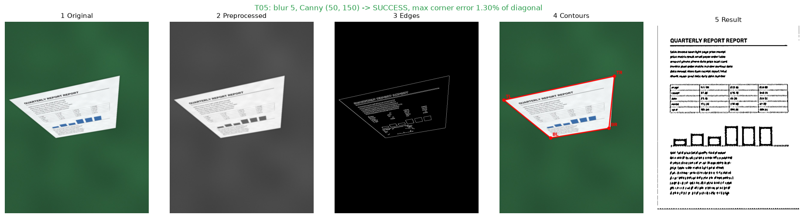
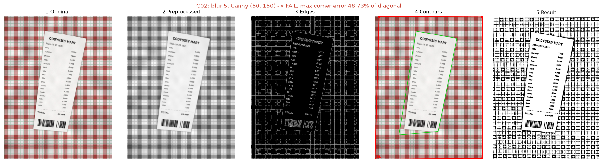
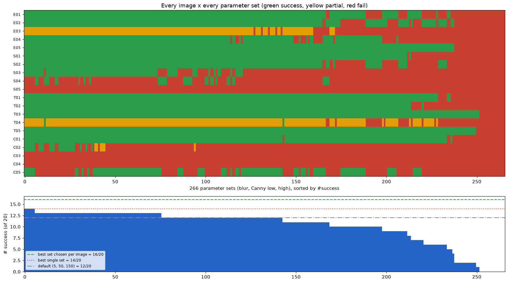
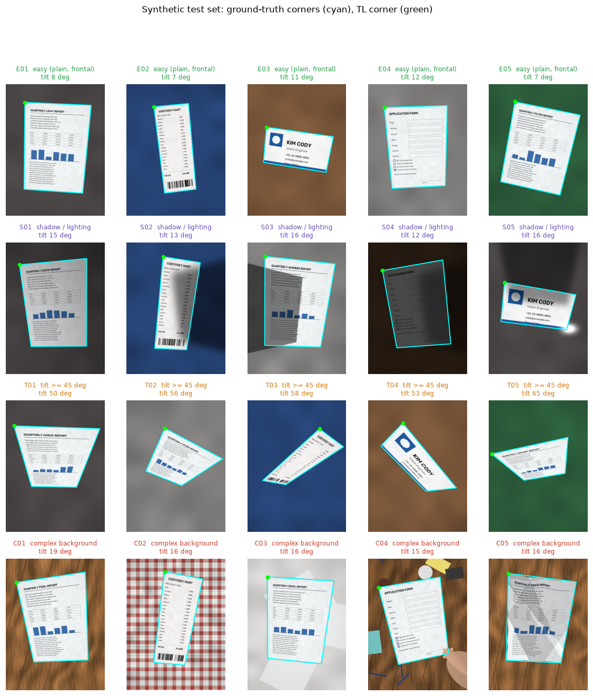
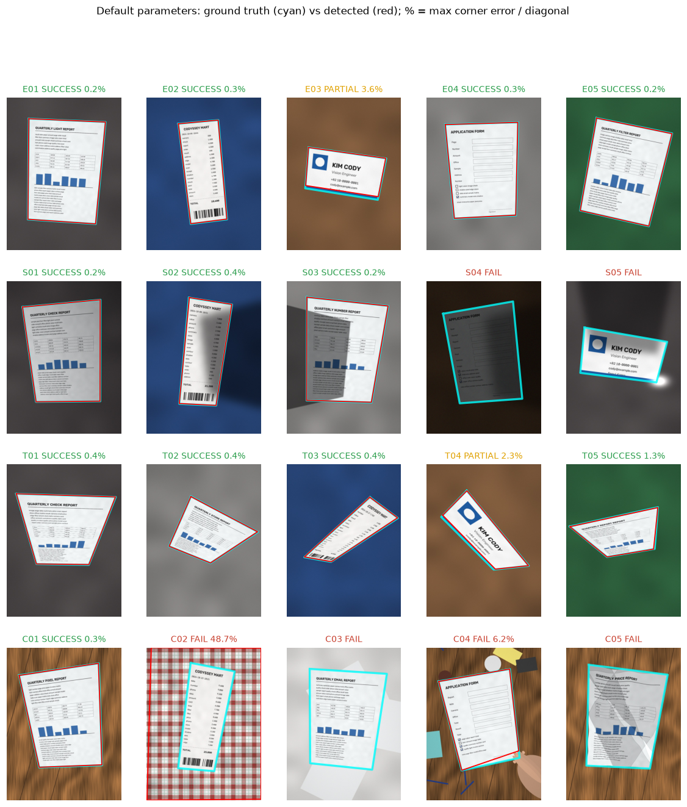
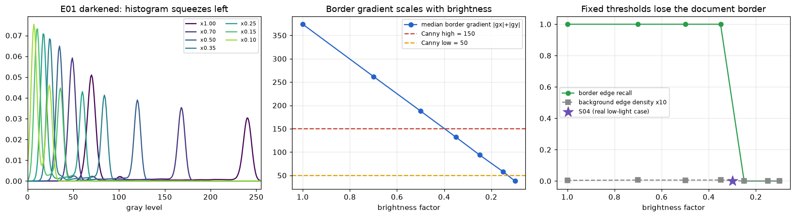
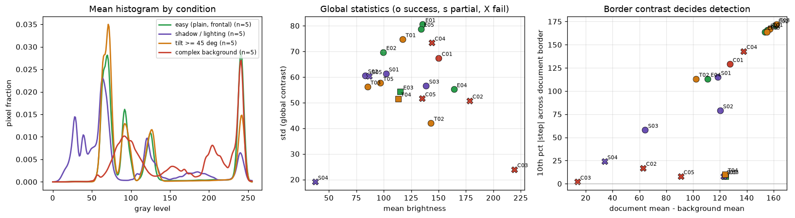
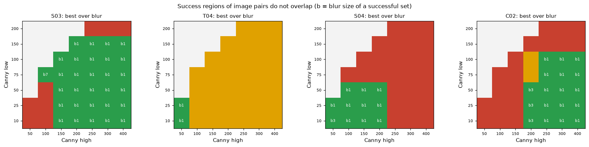
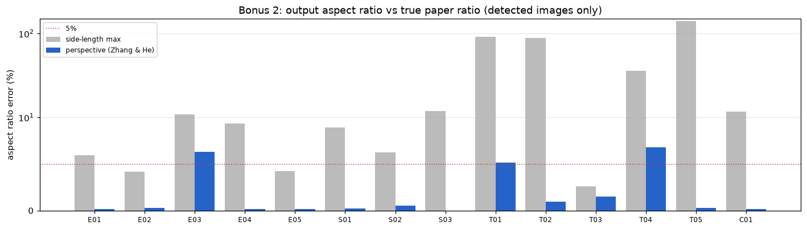

# A3-1 문서 스캐너: 규칙만으로 종이를 찾을 수 있을까?

비스듬히 찍은 문서 사진에서 종이를 찾아, 정면에서 본 것처럼 반듯하게 펴 주는 스캐너를 OpenCV와 NumPy로 만드는 미션이에요. 딥러닝 없이 사람이 정한 규칙(밝기가 크게 바뀌는 곳이 경계, 가장 큰 사각형이 문서)만 써요. 그다음 20장의 테스트 사진으로 이 규칙이 어디서 깨지는지 재요.

## 사진 한 장은 이렇게 펴져요

가장 많이 기울어진 사진(T05, 65°)은 성공하고, 결과가 가장 크게 빗나간 사진(C02)은 실패한 예시예요. 둘 다 같은 기본 설정(블러 5, Canny 50/150)으로 돌렸어요.



종이 테두리만 뚜렷한 선으로 남아서, 네 꼭짓점을 찾고 반듯하게 펼 수 있었어요.



체크무늬의 선도 경계로 잡혀서, 영수증(초록 후보) 대신 사진 전체를 감싼 더 큰 사각형(빨강)을 문서로 골랐어요.

## 결론: 설정을 바꾸고 규칙을 더해도 한계가 있었어요

**블러·Canny 설정 266가지 중 가장 좋은 것도 20장 중 14장, 대책 규칙 네 개를 더해도 15장까지만 성공했어요.**

| 시도 | 성공한 사진 |
| --- | ---: |
| 기본 설정 | 12/20 |
| 20장 전체에 가장 좋은 설정 하나 | 14/20 |
| 사진마다 가장 좋은 설정을 따로 고름 | 16/20 |
| 기본 설정 + 대책 규칙 4개 | 15/20 |

성공은 찾은 꼭짓점이 정답에서 문서 대각선의 2% 이내로 벗어난 경우예요(A4 사진이면 약 18픽셀). 테스트 사진은 정답 꼭짓점을 알 수 있도록 코드로 만든 **합성 사진**이라, 실제 휴대폰 사진의 성공률과는 달라요.

## 어떻게 동작할까?

위 T05 그림의 다섯 칸이 그대로 다섯 단계예요.

1. **흑백으로 바꾸고 흐리게 하기:** 작은 잡티가 경계로 잡히지 않게 가우시안 블러로 뭉개요.
2. **경계 찾기:** Canny가 밝기가 크게 바뀌는 곳을 흰 선으로 그려요. 두 임계값(low, high)이 "얼마나 바뀌어야 경계인가"를 정해요.
3. **문서 고르기:** 닫힌 윤곽선 중 꼭짓점이 4개로 줄어드는(`approxPolyDP`) 가장 큰 볼록 사각형을 문서로 봐요.
4. **펴기:** 네 꼭짓점을 좌상·우상·우하·좌하 순서로 직접 정렬하고, 투시 변환으로 직사각형에 맞춰 펴요.
5. **스캔본 만들기:** 적응형 이진화로 그림자가 있어도 글씨를 살린 흑백 이미지를 저장해요.

## 왜 설정 하나로 안 될까?

어두운 사진(S04)과 체크무늬 배경(C02)이 반대 방향의 설정을 요구해요.

- **어두운 사진**은 종이 경계의 밝기 차도 함께 줄어들어요. 임계값을 **낮춰야** 경계가 잡혀요.
- **체크무늬 배경**은 무늬 선이 영수증 경계만큼 뚜렷해요. 임계값을 **높여야** 무늬가 사라져요.

임계값 하나에 "문서 경계는 살리고 배경 무늬는 지우는" 일을 맡겼는데, 둘 중 어느 쪽이 더 뚜렷한지가 사진마다 바뀌어요. 266가지 설정을 모두 써 봤지만 두 사진을 함께 성공시키는 설정은 없었어요.



## 규칙을 더하면 해결될까?

실패 원인마다 대책 규칙을 만들어 더해 봤어요. 규칙은 자기가 겨냥한 실패만 고쳤어요.

| 실패한 사진 | 원인 | 대책 규칙 | 결과 |
| --- | --- | --- | --- |
| 명함의 파란 띠(E03·T04) | 흑백으로 바꾸면 띠와 책상의 밝기가 비슷해져요 | 색 채널마다 경계 찾기 | 고쳐짐 |
| 어두운 사진(S04) | 경계의 밝기 차가 임계값보다 작아요 | 자동 임계값, 대비 높이기(CLAHE) | 고쳐짐 |
| 구겨진 종이(C05) | 안쪽 접힌 골이 바깥 경계에 이어져요 | 틈 잇기(닫힘 연산) 빼기 | 고쳐졌지만 E03·T04가 다시 실패 |
| 체크무늬(C02), 흰 배경 위 흰 종이(C03), 손가락 가림(C04), 빛 반사(S05) | 어떤 선이 문서 경계인지 판단해야 해요 | - | 그대로 실패 |

남은 실패를 규칙으로 풀려면 "체크무늬면 이렇게, 손가락이면 저렇게"처럼 장면마다 규칙이 늘어나요. 새 규칙은 조정할 숫자도 새로 들여와요. 그래서 무엇이 문서 경계인지를 많은 (사진, 정답 꼭짓점) 쌍에서 **배우는 방식**이 필요하다는 가설로 끝맺었어요.

이 방법은 배경이 단순하고 조명이 고른 곳에서 쓰기 좋아요. 기울기에는 강했어요(45° 이상 기울어진 5장 중 4장 성공, 1장 부분 성공). 배경에 직선 무늬가 많거나 종이와 배경 색이 비슷하면 쓰기 어려워요.

## 실행하기

[uv](https://docs.astral.sh/uv/)가 필요해요. 이 README가 있는 폴더에서 실행해요.

```powershell
uv sync                                          # 가상환경과 의존성 설치
uv run python -m src.app data/synthetic/E01.jpg  # 스캐너 앱: 단계별 창 5개 + 트랙바
uv run python -m src.run_all                     # 전체 실험과 그림을 outputs/에 저장 (약 1~2분)
```

- 앱에서 `s`는 저장, `q`나 `Esc`는 종료예요. 트랙바로 블러, Canny low·high, 이진화 설정을 바꿔 볼 수 있어요.
- 창을 띄울 수 없는 환경(Colab 등)에서는 `--no-gui --blur 7 --low 30 --high 120 --out outputs/cli`처럼 설정을 명령줄로 주면 단계별 이미지를 파일로 저장해요.
- `run_all --quick`은 266가지 설정 탐색을 건너뛰어요.

<details>
<summary>웹캠, PDF, 직접 찍은 사진</summary>

```powershell
uv run python -m src.webcam                       # 실시간 검출, s 저장, q 종료
uv run python -m src.app 사진.jpg --pdf           # s로 저장할 때 PDF도 만들기
uv run python scripts/annotate_corners.py data/real   # 직접 찍은 사진에 정답 꼭짓점 찍기
uv run python -m src.run_all --data data/real --out outputs/real
```

웹캠은 실시간 프레임에서 검출만 하고, `s`를 누른 프레임을 원본 해상도로 펴서 `outputs/webcam/`에 저장해요. Windows에서 카메라가 열리지 않으면 설정 → 개인 정보 → 카메라에서 데스크톱 앱 접근을 허용해요.

</details>

## 더 알아보기

| 이럴 때 | 여기를 보세요 |
| --- | --- |
| 사진 한 장이 스캔본이 되는 계산을 숫자로 따라가고 싶을 때 | [실행 노트북](notebooks/scanner_walkthrough.ipynb) |
| 블러·Canny·투시 변환을 브라우저에서 직접 조작해 보고 싶을 때 | [HTML 학습 자료](study/a3-1.html) |
| 함수별 역할과 코드 읽는 순서가 궁금할 때 | [코드 해설](study/code-walkthrough.md) |
| 실패 분석과 실험 전체를 보고 싶을 때 | [분석 보고서](REPORT.md) |

## 자세한 근거

<details>
<summary>테스트 사진 20장과 조건별 성공률</summary>

미션의 네 조건마다 5장씩 만들었어요. 문서 종류(A4·레터·영수증·명함), 조명, 기울기, 배경은 [`labels.json`](data/synthetic/labels.json)에 기록했어요.



기본 설정(블러 5, Canny 50/150) 결과예요. 부분 성공은 오차가 대각선의 2~5%로, 펴지기는 했지만 가장자리가 잘리거나 배경이 남은 경우예요. 성공률에는 성공만 세요.

| 조건 | 테스트 수 | 성공 | 부분 성공 | 실패 | 성공률 |
| --- | ---: | ---: | ---: | ---: | ---: |
| 단순 배경 + 정면 | 5 | 4 | 1 | 0 | 80% |
| 그림자 있음 | 5 | 3 | 0 | 2 | 60% |
| 45도 이상 기울어짐 | 5 | 4 | 1 | 0 | 80% |
| 복잡한 배경 | 5 | 1 | 0 | 4 | 20% |
| **전체** | 20 | 12 | 2 | 6 | 60% |



사진별 오차는 [보고서 4장](REPORT.md#4-테스트-결과)에 있어요.

</details>

<details>
<summary>어두운 사진에서 경계가 사라지는 이유 (히스토그램 분석)</summary>

밝기를 k배로 줄이면 종이 경계의 밝기 차도 k배로 줄어요. 그 차이가 Canny high 임계값 아래로 내려가는 순간(밝기 ×0.35~×0.25 사이) 경계 검출률이 100%에서 0%로 떨어져요.



밝기 분포의 평균·표준편차만으로는 성공과 실패가 갈리지 않았어요. 갈린 것은 문서 경계에서 가장 약한 구간의 밝기 차였어요. 경계가 한 군데만 약해도 윤곽선이 닫히지 않기 때문이에요.



</details>

<details>
<summary>실패 원인과 규칙별 실험</summary>

실패·부분 성공 8장의 원인과 파라미터를 바꿔 본 결과는 [보고서 5장](REPORT.md#5-실패-원인-분석)에 있어요. 두 사진의 성공 설정이 하나도 겹치지 않는 쌍이 S04–C02, S03–T04 등 4쌍 있었어요.



| 변형 | 성공 | 좋아진 사진 | 나빠진 사진 |
| --- | ---: | --- | --- |
| 기본 규칙 | 12/20 | - | - |
| 닫힘 연산 빼기 | 13/20 | C05 | E03, T04 |
| + 색 채널별 경계 | 15/20 | E03, S04, T04 | - |
| + 자동 Canny 임계값 | 13/20 | S04 | - |
| + CLAHE 대비 높이기 | 13/20 | S04 | - |
| + 사각형 근사 허용 오차 2배 | 12/20 | - | - |
| 위 네 규칙 모두 | 15/20 | E03, S04, T04 | - |

꼭짓점을 정확히 찾아도 결과가 나쁜 경우가 있었어요. 강한 그림자 사진(S03)은 적응형 이진화 뒤 그림자 경계가 검은 선으로 남았어요.

</details>

<details>
<summary>보너스 과제 3종</summary>

- **컨볼루션 직접 구현:** 가우시안 블러를 NumPy만으로 만들었어요. 같은 사진(360×480, 5×5 커널)에서 이중 for문은 573ms, 벡터화 버전은 16ms(36배 빠름)였고 결과는 OpenCV와 같았어요.
- **종횡비 자동 보정:** 마주 보는 변 길이로 결과 크기를 정하면, 45° 이상 기울어진 T01·T02·T05에서 가로세로 비율이 89~142% 틀어졌어요. 원근을 고려해 카메라 초점거리를 추정하는 방법(Zhang & He)은 이 오차를 0.3~5.1%로 줄였고, 앱 기본값으로 써요.
- **PDF 내보내기:** 성공·부분 성공한 스캔본을 [`outputs/scans.pdf`](outputs/scans.pdf) 하나로 묶어요.



</details>

## 과정 내 위치

[심화 과정 목차](../README.md) · [전체 과정](../../README.md)
