# A3-1 분석 보고서 — 규칙 기반 문서 스캐너는 어디서 실패하는가

<!-- 이 파일은 tools/build_report.py가 REPORT.template.md와 outputs/results.json으로 만든다. 직접 고치지 말고 템플릿을 고친다. -->

## 요약

- 기본 파라미터(블러 {{params.blur}}, Canny {{params.canny_low}}/{{params.canny_high}})로 20장 중 **{{summary_by.all.success}}장 성공**, {{summary_by.all.partial}}장 부분 성공, {{summary_by.all.fail}}장 실패했다. 쉬운 케이스도 5장 중 {{summary_by.easy.success}}장만 성공했다.
- 블러·Canny 조합 {{sweep.n_configs}}개를 모두 시험했다. 가장 좋은 단일 조합도 **{{sweep.best.success}}/20**이었다. 이미지마다 가장 좋은 조합을 따로 골라도 {{sweep.oracle_success}}/20이다. {{sweep.never_success:list}}는 어떤 조합으로도 성공하지 못했다.
- 실패마다 대책 규칙을 만들어 더하면 겨냥한 실패만 고쳐진다. 규칙 네 개를 모두 더해도 {{rules_by.V6.success}}/20이다. 구김을 고치려고 닫힘 연산을 빼면 다른 두 장이 실패로 떨어진다.
- 결론: 파라미터를 고르는 문제가 아니라, 사람이 정한 특징(밝기 기울기·사각형 모양)만으로는 문서와 문서 아닌 것을 구분할 수 없다는 문제다. 무엇을 문서 경계로 볼지를 데이터에서 배우는 방식이 필요하다.

## 1. 데이터

### 1.1 합성 테스트셋을 쓴 이유와 한계

직접 찍은 사진과 LMS 표준 테스트셋이 없어서, 휴대폰 촬영을 흉내 낸 합성 사진 20장을 만들었다(`src/synthetic.py`). 미션의 네 조건마다 5장이다. 합성 데이터의 장점은 정답 꼭짓점을 정확히 안다는 것이다. 그래서 "4개의 꼭짓점이 올바르게 검출되었는가"를 눈대중이 아닌 픽셀 오차로 판정할 수 있다.

합성 과정: 종이 내용을 mm 단위로 그린다 → 3차원 핀홀 카메라(초점거리 1000px, 960×1280 세로 사진)로 종이 평면을 기울여 투영한다 → 배경 위에 합성한다 → 조명장(그라데이션·그림자·저조도)을 곱하고 반사광을 더한다 → 초점 흐림, 센서 잡음, JPEG 압축을 적용한다.

실제 사진과 다른 점이 있다. 렌즈 왜곡, 자동 노출·화이트밸런스, 종이 두께와 그림자의 복잡한 모양, 모션 블러가 없다. 구김과 가림도 단순하다. 따라서 이 보고서의 성공률은 실제 사진의 성공률이 아니다. 대신 "어떤 조건이 어떤 규칙을 깨는가"를 통제된 상태에서 확인한 결과다. 직접 찍은 사진은 `data/real/`에 넣고 `tools/annotate_corners.py`로 꼭짓점을 찍으면 같은 기준으로 평가할 수 있다.

### 1.2 촬영 조건 기록

{{table:data}}

기울기는 카메라 광축과 종이 법선 사이의 각도다. 배경 복잡도는 배경에 문서와 비슷한 직선·밝기 경계가 얼마나 있는지를 기준으로 낮음·높음으로 나눴다.

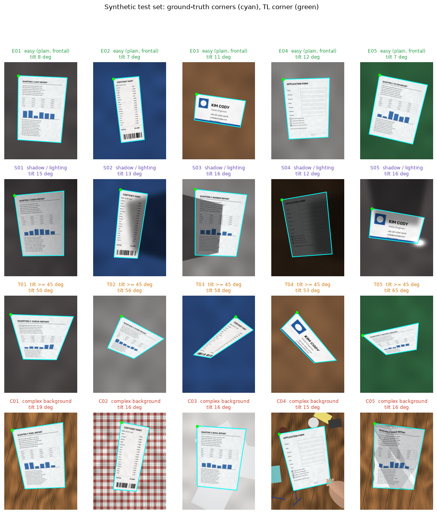

## 2. 이미지 탐색적 분석 (EDA)

### 2.1 히스토그램

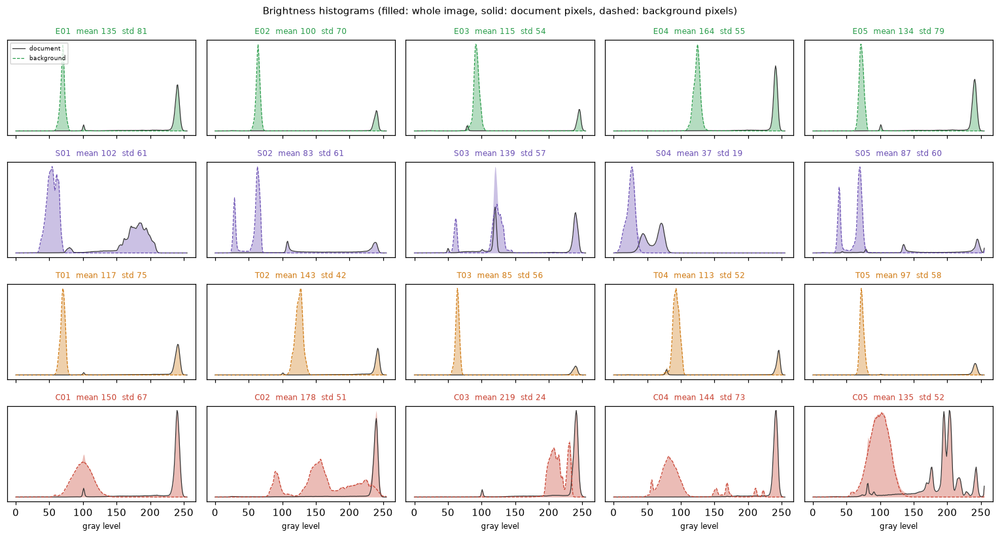

쉬운 케이스의 히스토그램은 봉우리가 둘로 뚜렷하게 갈린다. 어두운 배경 봉우리(60~130)와 흰 종이 봉우리(230~245)다. 두 봉우리 사이가 멀수록 문서 경계를 가로지르는 밝기 차가 크다. Canny는 바로 이 밝기 차(기울기)를 보고 엣지를 찾는다.

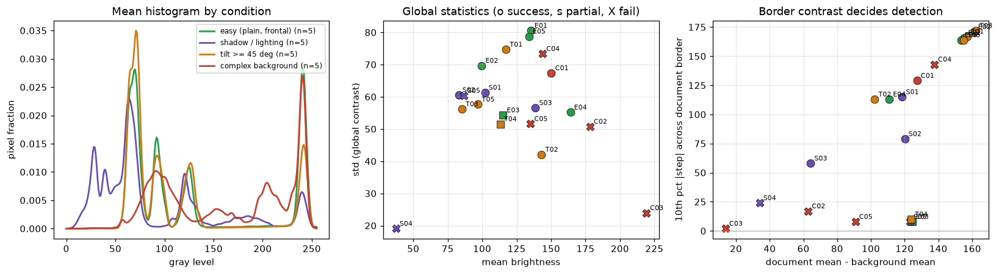

- **그림자·조명(보라)**: 종이 봉우리가 낮아지고 왼쪽으로 퍼진다. 같은 종이가 그림자 안팎에서 다른 밝기로 찍히기 때문이다. S04(저조도)는 전체 평균이 {{eda.S04.mean:f0}}이고 표준편차가 {{eda.S04.std:f0}}다. 쉬운 케이스 E01은 각각 {{eda.E01.mean:f0}}, {{eda.E01.std:f0}}다.
- **복잡한 배경(빨강)**: 배경 봉우리가 하나로 모이지 않고 넓게 퍼진다. C03(흰 책상)은 문서와 배경의 평균 밝기 차가 {{eda.C03.doc_bg_contrast:f0}}에 불과하다. E01은 {{eda.E01.doc_bg_contrast:f0}}이다.
- 가운데 그림처럼 **전역 통계(평균·표준편차)로는 성공과 실패가 갈리지 않는다.** 실패한 C04는 대비가 크고, 성공한 S03은 대비가 작다. 오른쪽 그림의 세로축은 문서 경계에서 가장 약한 10% 구간의 밝기 차다. 이 축에서는 성공(원)과 실패·부분 성공(X·사각형)이 대체로 갈린다. 경계 한 군데만 약해도 윤곽선이 닫히지 않는다. 예외는 C04(손가락 가림)와 C02(체크무늬)다. 경계는 선명하지만 문서가 아닌 직선이 경계에 이어 붙는다.

### 2.2 왜 어두운 이미지에서 엣지 검출이 어려운가

같은 E01을 점점 어둡게 만들고, 센서 잡음은 같은 크기(σ=3)로 더했다.

{{table:dark}}

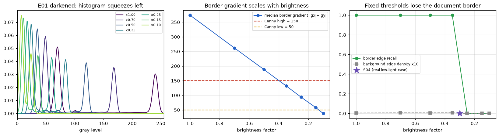

분포 관점의 설명:

1. 밝기를 k배로 줄이면 히스토그램 전체가 k배로 압축된다. 배경 봉우리와 종이 봉우리 사이 거리도 k배가 된다.
2. 경계의 기울기는 두 봉우리의 거리에 비례하므로 역시 k배가 된다(표의 경계 기울기 중앙값이 밝기 배율에 거의 정비례).
3. Canny 임계값은 절대값이다. 기울기가 높은 임계값({{params.canny_high}}) 아래로 내려가면 "강한 엣지" 씨앗이 사라진다. 이력 임계값(hysteresis)은 강한 엣지에서 시작해 약한 엣지를 이어 가는 방식이다. 씨앗이 없으면 낮은 임계값을 넘는 약한 엣지도 모두 버려진다. 그래서 검출률이 서서히 줄지 않고 ×0.35와 ×0.25 사이에서 100%에서 0%로 떨어진다.
4. 잡음은 밝기를 줄여도 그대로라서 신호 대 잡음비가 함께 나빠진다. 임계값을 낮춰 씨앗을 살리면 잡음도 엣지가 된다. 정수 밝기 단계도 줄어(×0.10이면 종이와 배경 차가 약 16단계) 경계가 계단처럼 거칠어진다.

실제 저조도 케이스 S04는 경계 기울기 중앙값이 {{eda.S04.boundary_gradient_median:f0}}로 높은 임계값 아래이고, 경계 엣지 검출률은 {{eda.S04.boundary_edge_recall:pct0}}였다.

## 3. 파이프라인과 규칙

`src/scanner.py`의 처리 순서와, 그 안에 들어 있는 사람이 정한 규칙이다.

| 규칙 | 내용 | 기본값 |
| --- | --- | --- |
| R1 크기 정규화 | 긴 변을 {{params.work_size}}px로 줄여 처리 | 사진 해상도가 달라도 커널 크기가 같은 의미 |
| R2 회색 변환·블러 | BGR → Gray, 가우시안 블러 | 커널 {{params.blur}} |
| R3 Canny | 기울기가 high 이상이면 강한 엣지, low~high면 강한 엣지에 이어질 때만 엣지 | {{params.canny_low}} / {{params.canny_high}} |
| R4 닫힘 연산 | 끊긴 엣지를 3×3 팽창·침식으로 잇기 | 3×3 |
| R5 면적 | 화면의 {{params.min_area_ratio:pct0}}~{{params.max_area_ratio:pct0}}인 닫힌 윤곽선만 후보 | |
| R6 사각형 | `approxPolyDP`(허용 오차 = 둘레의 {{params.approx_epsilon:pct0}})로 근사해 꼭짓점이 4개이고 볼록 | |
| R7 최대 면적 | 조건을 통과한 사각형 중 가장 큰 것이 문서 | |
| R8 꼭짓점 정렬 | 무게중심 기준 각도로 시계 방향 정렬, 가장 수평인 변의 시작점을 TL로 | 직접 구현 (`geometry.order_points`) |
| R9 투시 변환 | `getPerspectiveTransform` + `warpPerspective`, 결과 크기는 원근 보정 종횡비 | 보너스 2 |
| R10 적응형 이진화 | 가우시안 가중 지역 평균 − C를 임계값으로 | 블록 = 짧은 변/20, C = {{params.thresh_c}} |

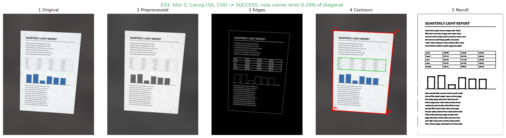

**꼭짓점 정렬(R8)을 직접 구현한 이유.** 흔히 쓰는 규칙은 x+y가 가장 작은 점을 TL, 가장 큰 점을 BR로 고르는 합·차 규칙이다. 문서가 45° 돌아가면 두 점의 x+y가 같아져 같은 점이 두 번 뽑힌다. 그러면 사각형이 삼각형으로 무너진다(`tests`의 `test_sum_diff_rule_breaks_at_45_degrees`). 각도 정렬은 네 점을 항상 한 번씩 쓴다. 문서가 ±45° 안에서 돌아가 있으면 실제 윗변을 고른다. 정확히 45° 근처에서는 어느 변이 위인지 기하만으로 정할 수 없다. 그래서 T04(평면 회전 45°)는 결과가 90° 돌아간 방향으로 나왔다. 이 오차는 꼭짓점 판정에서 제외하고 따로 기록했다.

## 4. 테스트 결과

### 4.1 판정 기준

정답 사각형의 긴 대각선 길이를 D, 네 꼭짓점 중 가장 큰 오차를 e라 할 때,

- **성공**: e ≤ 2% D. 꼭짓점이 문서 모서리에 맞아 반듯하게 펴진다.
- **부분 성공**: 2% D < e ≤ 5% D. 펴지기는 했지만 가장자리가 잘리거나 배경이 남는다.
- **실패**: e > 5% D이거나 사각형을 찾지 못함.

A4 기준 D ≈ 900px이면 2%는 약 18px이다. 성공률에는 성공만 센다.

### 4.2 결과 요약

{{table:summary}}

{{table:rows}}

종횡비 오차는 펴진 결과의 가로/세로 비율이 실제 종이 비율과 얼마나 다른지를 나타낸다(9장 보너스 2 참고).

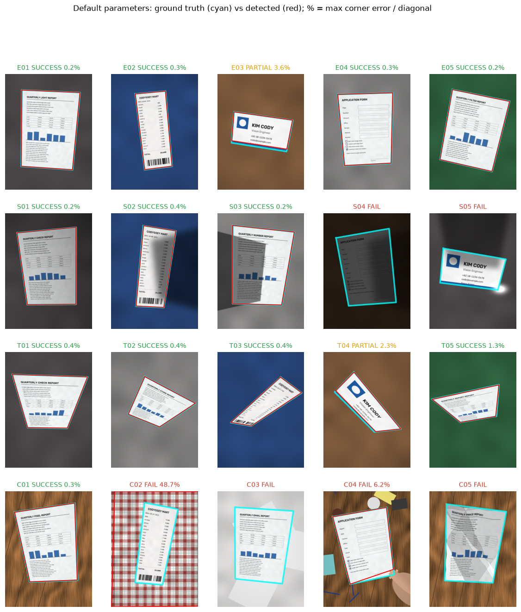

## 5. 실패 원인 분석

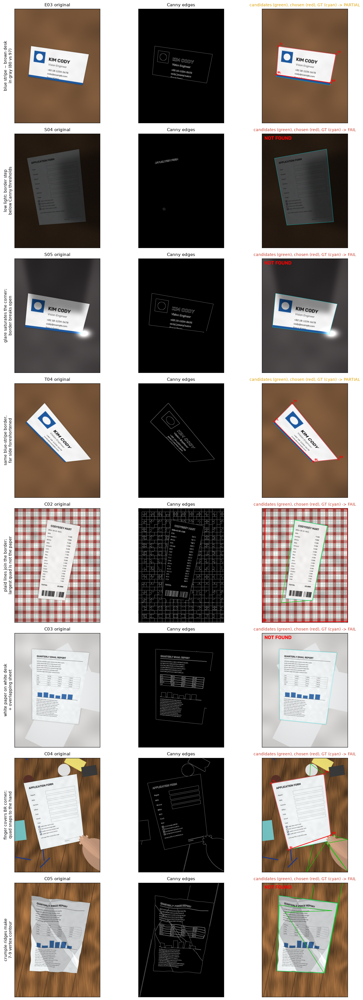

각 실패에 대해 파라미터를 바꿔 본 결과는 6장의 전수 탐색({{sweep.n_configs}}개 조합)에서 가져왔다. "성공 조합 비율"은 전체 조합 중 그 이미지가 성공한 조합의 비율이다.

{{table:sweep_images}}

**E03 명함 (부분 성공, 오차 {{rows.E03.error_ratio:pct2}})** — 명함 아래쪽 파란 띠와 갈색 책상은 색이 전혀 다르지만, 회색으로 바꾸면 밝기가 각각 약 80과 97이 된다. 종이 아래 접촉 그림자까지 더해지면 경계 밝기 차는 10~20 정도만 남는다(경계 하위 10% 밝기 차 {{eda.E03.boundary_step_p10:f0}}). Canny는 흰 종이와 파란 띠 사이의 선명한 경계를 문서의 아랫변으로 잡았다. 띠 높이만큼 잘린 결과가 나온다. 파라미터 조정: {{sweep.n_configs}}개 조합 중 158개에서 부분 성공, 나머지는 실패였다. 띠 아래 경계를 잡은 조합은 하나도 없었다(성공 조합 {{sweep.per_image_success_rate.E03:pct0}}). 회색 변환 단계에서 이미 정보가 사라졌으므로 회색 이미지의 블러·임계값으로는 되살릴 수 없다. 색 채널별 엣지 규칙(V2)을 더하면 성공한다.

**T04 기울어진 명함 (부분 성공, 오차 {{rows.T04.error_ratio:pct2}})** — E03과 같은 파란 띠 문제다. 여기에 48° 기울기와 45° 평면 회전이 더해졌다. 먼 쪽 변이 짧게 찍혀 띠 두께가 몇 픽셀로 줄었다. 블러 1, Canny (10, 50)과 (25, 50)의 두 조합에서만 성공했다(성공 조합 {{sweep.per_image_success_rate.T04:pct1}}). 블러 없이 임계값을 아주 낮춰야 몇 픽셀짜리 띠 경계가 살아난다. 이 두 조합은 20장 전체로는 각각 11장, 13장만 성공시킨다.

**S04 저조도 (실패)** — 2.2절의 메커니즘 그대로다. 경계 기울기({{eda.S04.boundary_gradient_median:f0}})가 높은 임계값보다 낮아 강한 엣지 씨앗이 없다. 엣지 맵에는 제목 글자 일부만 남았다. Canny 임계값을 낮추면(high ≤ 200, low ≤ 50) 성공한다(성공 조합 {{sweep.per_image_success_rate.S04:pct0}}). 하지만 그 낮은 임계값에서는 체크무늬 배경(C02)이 실패한다. 자동 임계값(V3)과 CLAHE(V4)도 S04를 고친다.

**S05 빛 반사 (실패)** — 코팅 명함 모서리의 반사광이 종이와 배경을 모두 흰색(255)으로 포화시킨다(밝기 250 이상인 픽셀이 화면의 {{eda.S05.saturated_fraction:pct1}}). 포화 영역 안에는 기울기가 0이다. 그래서 그 구간의 경계가 사라지고 윤곽선이 열린다. 블러·임계값을 어떻게 바꿔도 없는 경계는 만들 수 없다(성공 조합 0%). 열린 윤곽선을 볼록 껍질로 닫는 규칙을 생각할 수 있다. 하지만 그러면 반사광 덩어리가 문서 모양에 포함되어 꼭짓점이 바깥으로 밀린다.

**C02 체크무늬 식탁보 (실패, 오차 {{rows.C02.error_ratio:pct0}})** — 체크무늬의 직선들이 서로 이어져 거대한 닫힌 윤곽선을 만든다(윤곽선 {{rows.C02.n_contours}}개). R7(가장 큰 사각형)은 영수증이 아닌 무늬 격자를 골랐다. Canny high를 200 이상으로 올리고 블러를 줄이면 성공한다(성공 조합 {{sweep.per_image_success_rate.C02:pct0}}). 무늬 경계의 대비가 영수증 경계보다 약하기 때문이다. 그러나 그 높은 임계값에서는 S04(저조도)가 실패한다. 반대 방향의 요구다.

**C03 흰 책상 위 흰 종이 (실패)** — 문서와 배경의 평균 밝기 차가 {{eda.C03.doc_bg_contrast:f0}}이다. 옆의 다른 흰 종이가 문서 오른쪽 가장자리와 겹친다. 경계가 가장 약한 구간의 밝기 차는 {{eda.C03.boundary_step_p10:f0}}로 잡음 수준이다. 겹친 종이가 덮은 구간에는 문서 경계 자체가 없다. 엣지 맵에서 문서 오른쪽 변이 끊기고 그 자리를 다른 종이의 테두리가 잇는다. Canny를 (10, 30)까지 낮춰도 면적 조건을 만족하는 닫힌 윤곽선이 생기지 않았다. 성공 조합 0%.

**C04 손가락 가림 (실패, 오차 {{rows.C04.error_ratio:pct2}})** — 손가락이 오른쪽 아래 모서리를 덮었다. 윤곽선은 손가락 가장자리를 따라 돌아간다. approxPolyDP는 손가락 끝을 꼭짓점으로 삼은 사각형을 만들었다(최대 오차 {{rows.C04.max_error_px:f0}}px). 가려진 모서리의 위치는 "나머지 두 변을 연장한 교점"으로 추론해야 한다. 엣지와 윤곽선 규칙에는 그런 추론이 없다. 성공 조합 0%.

**C05 구겨진 종이 (실패)** — 접힌 골이 종이 안쪽에 강한 엣지를 만든다. 가장자리도 물결처럼 흔들린다. 닫힘 연산(R4)이 안쪽 골 엣지와 바깥 경계를 이어 붙인다. 그래서 윤곽선이 7~9각형이 되어 R6(꼭짓점 4개)을 통과하지 못한다. 기본값(블러 5, 50/150)은 실패했지만 같은 블러 5에서도 임계값을 바꾼 38개 조합 중 25개는 성공한다(전체 성공 조합 {{sweep.per_image_success_rate.C05:pct0}}). 골 엣지가 바깥 경계에 이어지느냐가 임계값에 민감하다는 뜻이다. 닫힘 연산을 빼도 성공한다. 대신 E03·T04가 부분 성공에서 실패로 나빠진다(7장).

**성공했지만 결과가 나쁜 경우: S03 강한 그림자** — 꼭짓점은 정확히 찾았다(오차 {{rows.S03.error_ratio:pct2}}). 그러나 적응형 이진화 결과에 그림자 경계가 검은 선으로 남는다([그림](outputs/05_pipeline_S03.png)). 적응형 이진화는 블록 안의 평균과 비교한다. 그림자 경계에 걸친 블록에서는 밝은 쪽 평균이 어두운 쪽 픽셀의 임계값이 되어 버린다. 막대그래프처럼 블록보다 큰 검은 면은 속이 비고 테두리만 남는다. 미션에 적힌 "강한 그림자는 실패할 수 있음"은 검출 단계보다 이 후처리 단계에서 더 분명하게 나타났다.

## 6. 파라미터 딜레마 — 모든 이미지에 맞는 최적 파라미터가 있는가

블러 {1, 3, 5, 7, 9, 11, 13} × Canny low {10, 25, 50, 75, 100, 150, 200} × high {50, 100, 150, 200, 250, 300, 400} 중 low < high인 {{sweep.n_configs}}개 조합을 20장 모두에 적용했다(5,320회 검출).

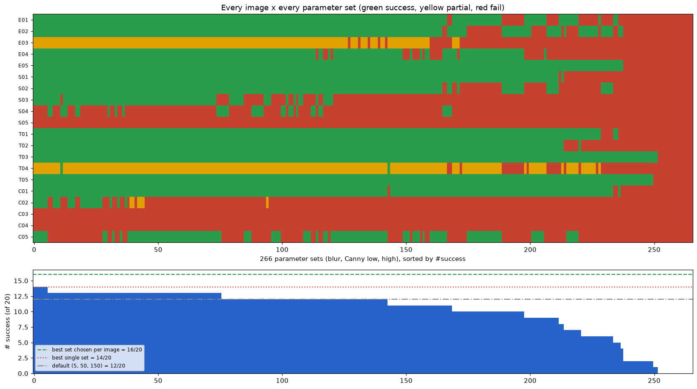

**답: 없다.**

| 기준 | 성공 수 |
| --- | ---: |
| 기본값 (5, 50, 150) | {{sweep.default.success}}/20 |
| 가장 좋은 단일 조합 (블러 3, low 10~50, high 250~300, 6개 동률) | {{sweep.best.success}}/20 |
| 이미지마다 가장 좋은 조합을 따로 고름 (상한) | {{sweep.oracle_success}}/20 |
| 어떤 조합으로도 성공하지 못한 이미지 | {{sweep.never_success:list}} |

1. 가장 좋은 단일 조합(14)과 이미지별 최적(16)의 차이 2장은 "한 조합을 고르면 반드시 버려지는 이미지"다.
2. 이미지별 최적(16)과 20의 차이 4장은 파라미터로 해결할 수 없는 실패다.
3. 그림의 위쪽 판정표에서 모든 행이 초록인 열은 하나도 없다.

**이미지 A의 최적 파라미터가 이미지 B에서 실패하는 이유.** 성공하는 조합이 하나도 겹치지 않는 이미지 쌍이 {{sweep.disjoint_pairs.0.0}}–{{sweep.disjoint_pairs.0.1}}, {{sweep.disjoint_pairs.1.0}}–{{sweep.disjoint_pairs.1.1}} 등 4쌍 있었다.

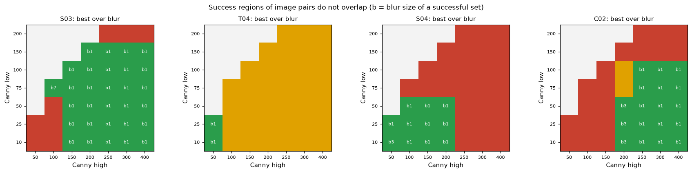

- S04(저조도)는 경계 기울기가 약해 **낮은** 임계값(high ≤ 200)이 필요하다.
- C02(체크무늬)는 배경 무늬를 끊어 내기 위해 **높은** 임계값(high ≥ 200, low ≥ 10)과 약한 블러가 필요하다.
- 두 영역은 high = 200 근처에서도 low와 블러 조건이 어긋나 겹치지 않는다.
- Canny 임계값 하나에 "문서 경계는 살리고, 배경 무늬는 죽인다"는 두 역할을 맡겼다. 그런데 문서 경계와 배경 무늬의 밝기 차 크기 순서가 사진마다 바뀐다. 어두운 사진에서는 문서 경계가 약하고, 체크무늬 사진에서는 무늬가 강하다. 한 숫자로 두 쪽을 다 만족시킬 수 없다.

## 7. 규칙 기반의 한계 — 규칙을 추가하면 해결되는가

### 7.1 규칙과 그 규칙이 깨지는 상황

| 규칙 | 전제 | 깨지는 상황 (이번 데이터) |
| --- | --- | --- |
| R2 회색 변환 | 문서와 배경은 밝기가 다르다 | 색은 다르지만 밝기가 같은 경계 (E03·T04 파란 띠) |
| R3 고정 Canny 임계값 | 문서 경계는 일정 세기 이상, 배경 무늬는 그 이하 | 저조도(S04)에서 경계가 약해짐, 체크무늬(C02)에서 무늬가 강함 |
| R4 닫힘 연산 | 작은 틈은 이어야 할 경계 | 구김의 안쪽 골까지 경계에 이어 붙음 (C05) |
| R5 면적 | 문서는 화면에서 큰 편 | 멀리 찍은 명함이나 영수증은 작다 (이번 데이터에서는 5%로 통과) |
| R6 꼭짓점 4개 | 문서 윤곽은 곧은 4변 | 구김(C05), 가림(C04), 반사로 열린 경계(S05) |
| R7 최대 면적 | 가장 큰 사각형이 문서 | 배경 무늬가 더 큰 사각형을 만듦 (C02) |
| R8 각도 정렬 | 문서는 ±45° 안에서 돌아가 있음 | 45° 근처 회전(T04)에서 방향이 90° 돌아감 |
| R9 원근 종횡비 | 주점이 이미지 중심인 카메라, 네 점이 정확 | 잘라 낸 사진, 꼭짓점 오차가 큰 먼 변 (T01 종횡비 오차 {{rows.T01.aspect_error:pct1}}) |
| R10 적응형 이진화 | 블록 안 조명은 거의 균일 | 블록을 가로지르는 선명한 그림자 경계(S03) |

### 7.2 규칙을 하나씩 더해 본 결과

실패 분석에서 나온 대책을 규칙으로 만들어 기본 파이프라인에 하나씩 더하거나 뺐다.

{{table:rules}}

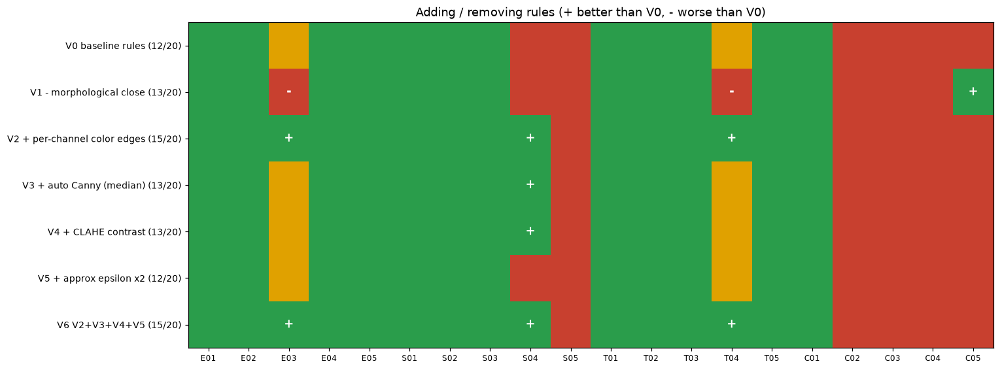

경험적 결론:

1. **규칙은 자기가 겨냥한 실패만 고친다.** 색 채널별 엣지(V2)는 회색 변환으로 사라진 경계(E03·T04)를 되살렸다. 자동 임계값(V3)과 CLAHE(V4)는 어두운 사진(S04)을 고쳤다. 어느 규칙도 체크무늬(C02), 흰 배경(C03), 가림(C04), 반사(S05)는 건드리지 못했다.
2. **규칙끼리 충돌한다.** 닫힘 연산을 빼면(V1) 구김(C05)이 고쳐지지만, 끊긴 경계를 이어 주던 효과가 사라져 E03·T04가 실패로 떨어진다. 근사 허용 오차를 키우는 것(V5)은 아무것도 바꾸지 못했다. 이 데이터에서 C05의 7~9각형은 허용 오차의 문제가 아니라 엣지가 잘못 이어진 문제이기 때문이다.
3. **다 합쳐도 상한이 있다.** V2~V5를 모두 켠 V6는 {{rules_by.V6.success}}/20이다. 남은 실패는 "어떤 엣지가 문서 경계인가"를 판단해야 하는 경우다. 가려진 모서리 추론, 무늬와 경계의 구분, 겹친 종이의 분리가 그렇다. 이걸 규칙으로 쓰려면 "체크무늬면 이렇게", "손이면 저렇게"처럼 장면 종류마다 규칙이 늘어난다. 새 장면(예: 신문지 위의 영수증)이 오면 또 깨진다.

여기에 더해, 이번에 더한 규칙도 결국 새 파라미터(색 채널 OR, 중앙값의 0.66·1.33배, CLAHE 타일 크기)를 들여온다. 규칙을 더할수록 조정할 숫자가 늘어난다. 6장의 딜레마가 더 높은 차원에서 반복된다.

## 8. 학습 기반 접근이 필요한 이유 — 가설

이번 경험에서 나온 관찰:

- 실패의 원인은 파라미터 값이 아니라 **특징의 한계**다. 이미지별 최적 파라미터로도 4장은 실패한다. 이 4장에서는 밝기 기울기라는 특징 자체가 문서 경계와 그 밖의 경계를 구분하지 못한다.
- 사람이 실패마다 원인을 보고 규칙을 하나씩 더하는 과정은 사실상 **손으로 하는 학습**이다. 20장으로 규칙을 고르고 검증까지 같은 20장으로 했으므로 과적합이기도 하다. 6개 동률 최적 조합 중 무엇을 고를지도 이 20장이 정했다.

가설:

1. **경계 판단을 데이터에서 배운다.** 이미지 → 네 꼭짓점(또는 문서 영역 마스크)을 직접 예측하는 모델을 수천 장의 (사진, 정답 꼭짓점) 쌍으로 학습시킨다. 모델은 밝기 기울기뿐 아니라 종이의 질감·글자·색·주변 맥락을 함께 보고 무엇이 문서 경계인지 판단하는 특징을 스스로 만든다. 체크무늬 직선과 영수증 테두리의 차이, 손가락과 종이 모서리의 차이처럼 이번 규칙이 표현하지 못한 구분이 데이터에 들어 있다면 배울 수 있다.
2. **가린 모서리는 모양에 대한 사전 지식으로 추론한다.** 학습 데이터에 가림 사례가 있으면, 모델은 보이는 세 모서리와 변의 방향에서 숨은 모서리 위치를 예측하는 법을 배운다. 규칙 기반에서는 이 추론을 따로 설계해야 했다.
3. **조명 변화는 데이터 증강으로 다룬다.** 이번 합성 생성기의 조명 단계(밝기 배율, 그림자, 반사광, 잡음)는 그대로 학습 데이터 증강이 된다. 고정 임계값처럼 "어두우면 깨지는" 경계가 생기지 않도록, 다양한 밝기에서 같은 정답을 내게 학습시킨다. 2.2절의 정비례 관계를 모델이 정규화로 흡수할 수 있다.
4. **평가는 지금과 같은 방식으로 한다.** 정답 꼭짓점과 최대 오차 2% 기준을 그대로 쓰되, 학습에 쓰지 않은 사진으로만 잰다. 이번 규칙 기반의 이미지별 최적 16/20을 넘는지가 첫 기준이다.

단, 학습 기반도 공짜가 아니다. 정답 꼭짓점이 달린 많은 데이터가 필요하다. 학습 데이터에 없던 장면(예: 투명 비닐 속 문서)에서는 이유를 알 수 없이 틀릴 수 있다. 규칙 기반의 장점인 "왜 실패했는지 단계별로 볼 수 있음"은 잃는다.

## 9. 보너스

### 보너스 1 — 컨볼루션 직접 구현

`src/convolution.py`. 가우시안 블러를 NumPy만으로 네 가지 방식으로 구현했다. 경계 처리는 OpenCV 기본값인 BORDER_REFLECT_101과 같게 했다. 커널은 OpenCV 규칙을 따른다. sigma를 주지 않은 9 이하 커널은 정수비 표를, 그 이상은 σ = 0.3((k−1)/2 − 1) + 0.8 공식을 쓴다. 결과는 `cv2.GaussianBlur`와 부동소수점 오차 안에서 같다.

E01 회색 축소본({{convolution.shape.1}}×{{convolution.shape.0}}), 5×5 커널:

{{table:conv}}

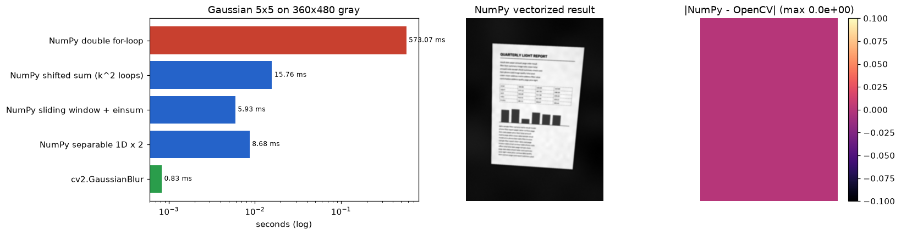

- 이중 for문은 출력 픽셀마다 5×5 조각과 커널의 내적을 계산한다. 반복이 픽셀 수만큼({{convolution.shape.0}}×{{convolution.shape.1}}번) 돌고, 매번 작은 배열 연산을 부르는 비용이 쌓인다.
- 벡터화 버전은 반복을 커널 칸 수(25번)로 줄인다. 각 반복은 "이미지 전체를 한 칸 밀어 가중치를 곱해 더하기"다. 같은 내적을 픽셀 대신 커널 칸 기준으로 다시 묶은 것이다.
- sliding window + einsum은 모든 조각을 메모리 복사 없는 뷰로 만들어 한 번에 내적한다. 분리 버전은 2차원 가우시안이 1차원 두 개의 외적이라는 성질로 연산량을 k²에서 2k로 줄인다.
- OpenCV는 C++로 작성되고 SIMD 명령으로 여러 픽셀을 한 번에 계산해 그보다 빠르다. 시간은 `--threads` 설정(기본 2)과 측정 당시 다른 작업의 부하에 따라 달라진다.

### 보너스 2 — 종횡비 자동 보정

`geometry.output_size_by_distance`(기본형)와 `geometry.estimate_aspect_ratio`(확장)를 구현했다.

- **기본형(변 길이)**: 마주 보는 두 변 중 긴 쪽을 결과의 가로·세로로 쓴다. 정면에 가까우면 충분하지만, 기울어지면 먼 쪽 변이 원근으로 짧아져 비율이 틀어진다.
- **확장(원근 보정)**: Zhang & He(2007)의 화이트보드 스캔 방법이다. 네 꼭짓점의 소실점 관계에서 카메라 초점거리를 구하고, 그 카메라로 두 변의 실제 3차원 길이 비를 계산한다. 주점이 이미지 중심이라는 가정을 쓴다. 초점거리를 구할 수 없으면(정면 촬영) 기본형으로 돌아간다.

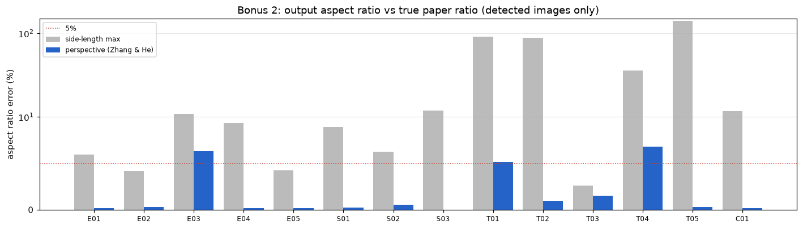

45° 이상 기울어진 T01·T02·T05에서 변 길이 방법의 종횡비 오차는 {{rows.T01.distance_aspect_error:pct0}}, {{rows.T02.distance_aspect_error:pct0}}, {{rows.T05.distance_aspect_error:pct0}}였다. 원근 보정은 {{rows.T01.aspect_error:pct1}}, {{rows.T02.aspect_error:pct1}}, {{rows.T05.aspect_error:pct1}}로 줄였다. 정답 꼭짓점을 넣으면 원근 보정은 오차 없이 실제 비율을 복원한다(`tests`의 `test_zhang_recovers_true_ratio`). 위 오차는 검출된 꼭짓점의 몇 픽셀 오차가 증폭된 것이다. 먼 변이 짧을수록 1픽셀의 의미가 커진다. 한계: 사진을 잘라 내 주점이 중심에서 벗어났거나, 임의로 그린 사각형처럼 실제 카메라로 찍을 수 없는 모양에서는 잘못된 비율을 낸다.

### 보너스 3 — PDF 내보내기

`src/pdf_export.py`. Pillow로 이진화 결과를 1비트 이미지로 바꿔 여러 페이지 PDF로 저장한다. `run_all`이 성공·부분 성공한 스캔을 `outputs/scans.pdf`로 묶는다. 앱에서는 `--pdf` 옵션으로 저장할 때 함께 만든다.

### 후처리 비교 — 전역 이진화 vs 적응형 이진화

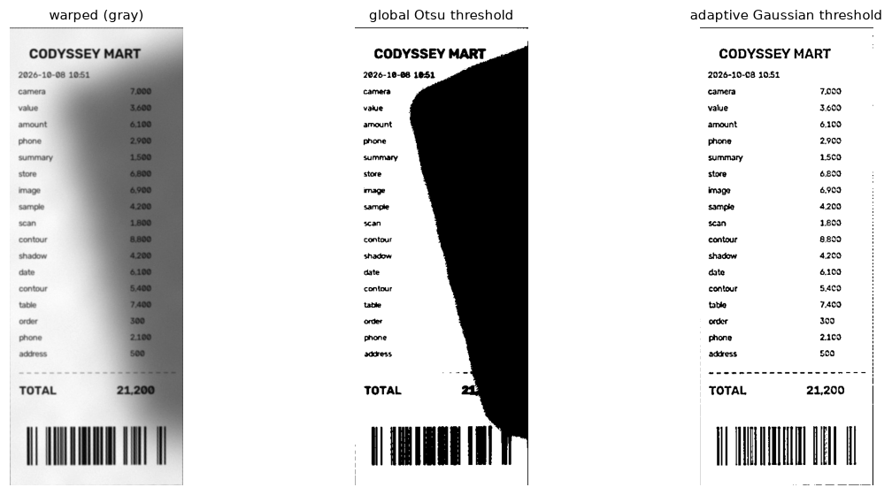

S02(부드러운 그림자)를 펴낸 결과에 Otsu 전역 임계값을 쓰면 그림자 영역 전체가 검게 칠해진다. 적응형 이진화는 픽셀마다 주변 평균과 비교하므로 그림자 안의 글자도 살린다. 5장의 S03처럼 그림자 경계가 블록보다 선명하면 그 경계가 선으로 남는다.

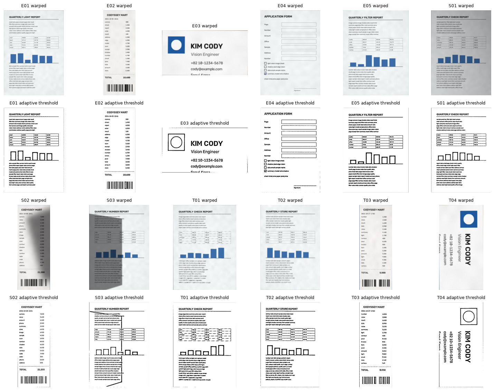

## 10. 한계와 다음 단계

- 이 보고서의 모든 수치는 합성 데이터에서 나왔다. 실제 사진 20장을 찍어 `data/real/`에서 다시 평가하면 합성과 실제의 차이 자체를 분석할 수 있다.
- 파라미터 최적값과 규칙 효과를 같은 20장으로 고르고 평가했다. 새 사진에서는 성공률이 더 낮을 가능성이 크다.
- 성공 기준 2%는 이 보고서에서 정한 값이다. 기준을 3%로 늘리면 E03은 여전히 부분 성공이고 T04는 성공이 된다.

실행 환경: Python {{environment.python}}, OpenCV {{environment.opencv}}, NumPy {{environment.numpy}}, Matplotlib {{environment.matplotlib}}.
