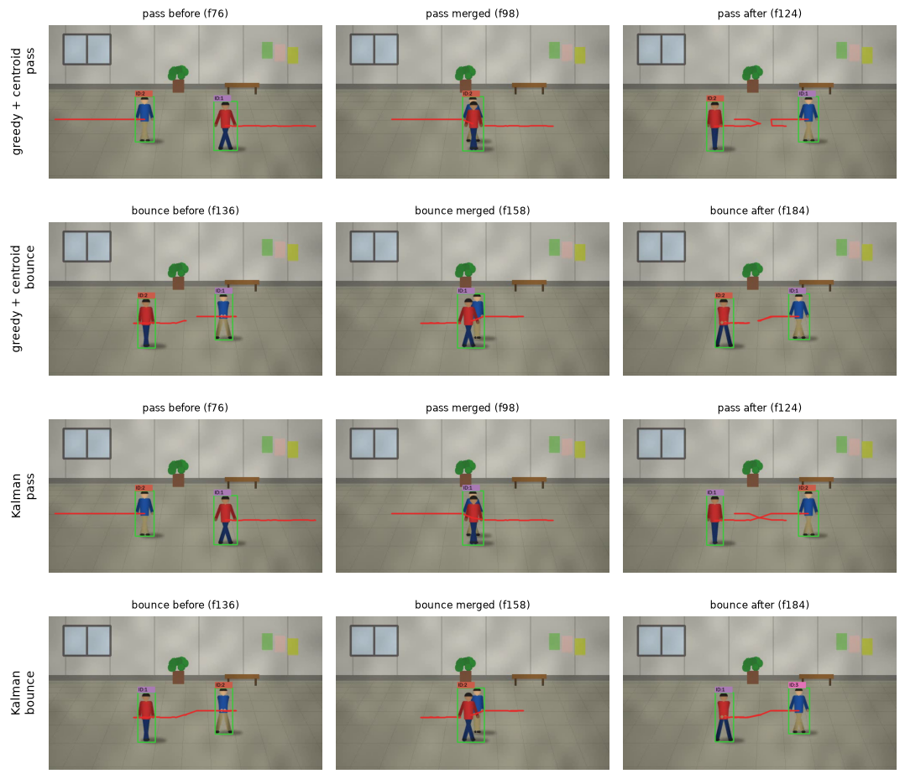

# A3-2 영상 속 사람 따라가기: 위치만으로 두 사람을 구분할 수 있을까?

영상에서 움직이는 사람을 찾아 번호(ID)를 붙이고, 사람이 움직여도 같은 번호를 유지하며 지나간 길을 그리는 미션이에요. 딥러닝 없이 OpenCV만 써요. 배경과 달라진 픽셀로 사람을 찾고(배경 차분), 직전 프레임에서 가장 가까운 사람과 같은 ID를 이어 붙여요. 미리 등록한 책 표지가 화면에 나오면 특징점 매칭으로 알아보고 "TARGET DETECTED"를 띄워요. 사람의 정확한 위치를 아는 합성 영상으로 어떤 상황에서 추적이 무너지는지 쟀어요.

## 두 사람이 엇갈리면 이렇게 돼요

파란 셔츠와 빨간 셔츠를 입은 두 사람이 서로 마주 걸어오는 합성 영상이에요. 첫 줄은 그대로 지나가는 경우이고, 둘째 줄은 가운데서 만났다가 각자 돌아서는 경우예요. 아래 두 줄은 다음 위치를 예측하는 규칙(칼만 필터)을 더한 추적기예요.



- **그대로 지나갈 때 (첫 줄):** 처음에는 파란 사람이 ID 2, 빨간 사람이 ID 1이에요. 두 사람이 겹치면 한 덩어리로 보여서 박스가 하나만 남아요. 갈라진 뒤에는 ID가 서로 바뀌어서, 빨간 사람이 ID 2를 받았어요.
- **만났다 돌아설 때 (둘째 줄):** 같은 추적기가 이번에는 ID를 맞게 이어 붙였어요.
- **예측을 더하면 (아래 두 줄):** 지나가는 경우는 고쳐졌어요. 대신 돌아서는 경우에 파란 사람이 새 ID 3을 받았어요.

## 결론: 위치만으로는 겹친 두 사람을 구분할 수 없어요

**두 사람이 겹치는 10가지 상황 중 8가지에서 ID가 바뀌었고, 규칙을 8가지로 바꿔 가며 더해도 가장 좋은 조합에서 5가지가 남았어요.** 혼자 걷는 사람은 10구간 모두 끝까지 같은 ID로 따라갔어요.

| 상황 | 테스트 | ID가 바뀐 테스트 (ID Switch) | 놓친 테스트 (추적 실패) |
| --- | ---: | ---: | ---: |
| 혼자 걷기 | 10 | 0 | 0 |
| 두 사람 겹침 | 10 | 8 | 1 |
| 걷다가 멈춤 | 5 | 2 | 2 |
| 조명 변화 | 5 | 1 | 2 |

ID Switch는 바뀐 ID가 5프레임 넘게 유지된 경우, 추적 실패는 보이는 사람을 10프레임 넘게 놓친 경우예요. 반 넘게 가려진 프레임은 실패로 세지 않았어요. 합성 영상이라 실제 영상의 옷 무늬, 체형 차이, 카메라 자동 노출은 없어요.

## 왜 규칙으로 못 풀까?

추적은 프레임마다 네 단계를 거쳐요.

1. **배경 빼기:** 픽셀마다 평소 색을 기억해 두고, 달라진 픽셀만 남겨요(MOG2). 남은 점 잡음은 지우고 끊긴 몸은 이어 붙여요(열림·닫힘).
2. **덩어리 찾기:** 남은 픽셀 덩어리 중 작은 것은 버리고, 나머지에 박스와 중심점을 구해요.
3. **ID 잇기:** 직전 프레임의 사람과 중심점 거리가 가장 가까운 덩어리에 같은 ID를 줘요. 짝이 없는 사람은 20프레임 동안 기억했다가 지워요.
4. **물체 알아보기:** 등록한 책 표지와 화면의 특징점(모서리 같은 눈에 띄는 점)을 맞춰 봐요(ORB).

위 예시에서 문제는 3단계에서 생겨요. 두 사람이 겹치는 동안 2단계가 덩어리를 하나만 주니, 그 사이 누가 어디로 갔는지에 대한 위치 정보가 없어요. 겹친 구간 밖에서는 "그대로 지나감"과 "만났다 돌아섬"의 궤적이 똑같은 X자예요. 그래서 위치로 짝을 정하는 규칙은 둘 중 하나를 맞히면 다른 하나를 틀려요. 실제로 해 본 규칙도 그랬어요.

- **거리 기준 바꾸기:** 20~160px로 바꿔도 겹침 결과는 거의 같았어요. 갈라진 직후의 두 후보가 모두 기준 안에 있어서예요.
- **다음 위치 예측(칼만 필터):** 곧게 지나가는 교차 3가지를 고쳤지만 돌아서는 경우를 새로 틀렸어요. 8건이 6건으로 줄었어요.
- **옷 색 비교:** 옷 색이 다르면 8건이 6건으로 줄었고, 같은 옷이면 8건 그대로였어요. 위치 말고 겹침 전후를 이어 줄 정보는 외형뿐이라는 뜻이에요.

같은 한계가 다른 단계에도 있어요.

- **배경 빼기:** 배경을 빨리 배우면 조명이 바뀌어도 금방 회복하지만 멈춘 사람이 배경이 돼 사라져요. 천천히 배우면 반대예요. 멈춘 사람과 갑자기 밝아진 벽은 둘 다 "새로 나타나 안 변하는 색"이라 픽셀만 봐서는 구분할 수 없어요.
- **물체 알아보기:** 책을 화면 안에서 60° 돌려도 찾았지만, 60° 기울이면 ORB와 SIFT 모두 못 찾았어요(0%). 반대로 SIFT는 같은 시리즈의 다른 책을 등록한 책으로 착각했어요(100%).

## 언제 이 방법을 쓰면 좋을까?

- **쓸 만해요:** 고정 카메라에 사람이 드물고 조명이 일정한 곳이에요. 예를 들어 빈 복도에 누가 들어왔는지 세는 일이에요. 노트북 CPU에서 실시간(30fps)보다 빨라요.
- **피하세요:** 사람이 자주 엇갈리는 매장이나 거리, 조명이 자주 바뀌는 곳이에요. 겹침을 풀려면 사람의 외형을 학습한 특징이 필요해요. 이 결론은 A6-1(신경망 학습 엔진)과 A6-2(모델 오류 분석)로 이어져요.

## 실행하기

[uv](https://docs.astral.sh/uv/getting-started/installation/)가 필요해요. 없다면 `pip install uv`로 설치할 수 있어요.

```bash
cd 02_Advanced/A3-2
uv sync
uv run python -m src.app
```

`uv sync`는 OpenCV, NumPy, matplotlib을 이 폴더의 `.venv`에 설치해요. 앱은 두 사람 교차 영상에 등록 물체를 함께 띄워요. `q` 종료, `s` 스냅샷, `p` 일시정지이고, 마우스로 사각형을 끌면 침입 감지 구역이 돼요.

- **내 영상·웹캠으로:** `--source 영상.mp4 --target 물체.png` 또는 `--source 0`(웹캠 0번)을 붙여요.
- **전체 실험 다시 재기:** `uv run python -m src.run_all`을 실행하면 그림과 `results.json`이 `outputs/`에 저장돼요. 8~14분 걸려요.

<details>
<summary>명령 옵션과 키</summary>

| 옵션 | 하는 일 |
| --- | --- |
| `--feature sift` | 물체 알아보기를 SIFT로 해요. 기본값은 ORB예요 |
| `--kalman --matcher hungarian` | 보너스 추적기(예측 + 최적 할당)를 써요 |
| `--zone 470,200,120,130` | 침입 감지 구역을 명령줄로 정해요 |
| `--no-gui --out outputs/cli` | 창 없이 결과 영상과 스냅샷만 저장해요 |
| `--no-realtime` | 영상 속도에 맞추지 않고 최대 속도로 처리해요 |

| 키 | 하는 일 |
| --- | --- |
| `n` | 일시정지 중 한 프레임 넘기기 |
| `[` / `]` | 배경 학습 속도 절반 / 두 배 |
| `m` | 배경을 뺀 마스크 창 열기 |
| `c` | 침입 감지 구역 지우기 |

화면의 FPS는 표시 속도이고, 괄호 안 `proc`는 분석만의 속도예요. 침입 기록은 `outputs/app/intrusion_log.csv`에 남아요. 합성 영상을 다시 만들려면 `uv run python -m src.synthetic`을 실행해요(약 3분).

</details>

## 더 알아보기

| 이럴 때 | 여기를 보세요 |
| --- | --- |
| 교차 장면을 시간에 따라 재생하며 추적기 설정을 바꿔 보고 싶어요 | [`study/a3-2.html`](study/a3-2.html): 브라우저로 열면 돼요. 인터넷이 필요 없어요 |
| 한 프레임이 처리되는 과정을 코드로 따라가고 싶어요 | [`notebooks/tracking_walkthrough.ipynb`](notebooks/tracking_walkthrough.ipynb): 마스크, 거리 행렬, ID 갱신을 직접 실행해요 |
| 미션 보고서 전체를 보고 싶어요 | [`REPORT.md`](REPORT.md): 측정 기준, 기록표, 배경 모델 비교, 딥러닝이 필요한 이유까지 있어요 |
| 추적 규칙 실물이 궁금해요 | [`src/tracker.py`](src/tracker.py): 거리 계산, 매칭, ID 삭제·생성이 있어요 |

## 자세한 근거

미션에서 요구한 세부 결과예요. 필요할 때만 펼쳐 보세요. 전체 표와 그림은 [`REPORT.md`](REPORT.md)에 있어요.

<details>
<summary>추적 성능 측정 결과</summary>

기본 추적기(가장 가까운 것부터 잇기 + 중심점 거리, 거리 기준 60px, 기억 20프레임)와 배경 학습률 0.002로 test 영상을 쟀어요. 파라미터는 시드가 다른 dev 영상에서 골랐어요.

| 상황 | 테스트 횟수 | ID Switch | 추적 실패 | 비고 |
| --- | ---: | ---: | ---: | --- |
| 단일 객체 이동 | 10 | 0 | 0 | 기둥 뒤 50% 이상 가림 49프레임은 실패에서 제외 |
| 두 객체 겹침 | 10 | 8 | 1 | ID Switch 총 16회, 한 덩어리로 검출된 204프레임은 ID 판정 보류 |
| 객체 일시 정지 | 5 | 2 | 2 | 3초·5초 정지에서 사람이 배경으로 흡수됨 |
| 조명 변화 | 5 | 1 | 2 | 조명이 켜지면 화면 전체가 전경이 되고, 없는 사람의 ID(유령 ID) 6개가 생김 |

프레임 범위와 관찰 메모를 적은 기록표는 [`outputs/measurement_log.csv`](outputs/measurement_log.csv)에 있어요.

</details>

<details>
<summary>특징점 매칭 성능 측정 (ORB)</summary>

책 표지를 실내 배경에 0.55배로 놓고 조건마다 10번 시행한 평균이에요. 매칭률은 등록 이미지의 특징점 중 장면에서 제자리를 찾은 비율이에요.

| 조건 | 추출된 특징점 수 (등록 / 장면) | 매칭된 특징점 수 | 매칭률 | 물체를 찾은 비율 |
| --- | ---: | ---: | ---: | ---: |
| 정면 | 340 / 611 | 44.4 | 13.1% | 100% |
| 30도 회전 (화면 안) | 340 / 643 | 38.8 | 11.4% | 100% |
| 60도 회전 (화면 안) | 340 / 629 | 37.5 | 11.0% | 100% |
| 30도 기울임 (3D) | 340 / 598 | 36.9 | 10.9% | 100% |
| 60도 기울임 (3D) | 340 / 482 | 0.4 | 0.1% | 0% |
| 30% 가림 | 340 / 486 | 43.0 | 12.6% | 60% |
| 50% 가림 | 340 / 408 | 15.7 | 4.6% | 40% |

미션의 "회전"은 종류가 정해져 있지 않아서 화면 안 회전과 3D 기울임을 모두 쟀어요. SIFT 결과와 일반화 실험은 [보고서 3장과 6장](REPORT.md)에 있어요.

</details>

<details>
<summary>배경 학습률에 따른 차이</summary>

| 배경 학습률 (MOG2 α) | 멈춘 사람이 사라지기까지 | 조명이 켜진 뒤 회복까지 | 혼자 걷는 사람을 찾은 정도 (F1) |
| --- | ---: | ---: | ---: |
| 0.0005 | 5초 넘게 남음 | 75프레임 초과 | 92.3% |
| 0.002 (기본) | 54프레임 | 70프레임 | 91.2% |
| 0.01 | 8프레임 | 16프레임 | 84.2% |
| 0.05 | 바로 사라짐 | 2프레임 | 22.3% |

멈춘 사람이 사라지는 시간은 ln(0.9)/ln(1−α)로 예측돼요. α=0.002에서 이론값은 52.6프레임이고 실측은 54프레임이었어요.

</details>

<details>
<summary>보너스 과제 4종</summary>

| 보너스 | 결과 |
| --- | --- |
| Hungarian 알고리즘 (NumPy만) | 무작위 7×7 비용 행렬의 85%에서 "가까운 것부터 잇기"가 최적이 아니었어요. 하지만 두 사람 추적에서는 611프레임 중 1프레임만 결과가 달랐어요. ID가 바뀌는 원인은 할당 방식이 아니라 위치만 쓰는 비용이에요 |
| 침입 감지 구역 | 혼자 걷는 영상에서 실제 진입 2번을 모두 경고했고 잘못된 경고는 없었어요 |
| IoU 매칭 | 겹침에서 9건으로 중심점(8건)보다 나빴고, 기둥에 가려 박스 모양이 변할 때 3번 끊겼어요 |
| 칼만 필터 예측 | 겹침 ID Switch가 8건에서 6건으로 줄었어요. 남은 실패는 돌아섬, 멈춤, 방향 전환처럼 등속 가정이 깨지는 경우예요 |

</details>
