# A3-2 분석 보고서 — 위치만으로는 사람을 구분할 수 없다

배경 차분 → 윤곽선 → 거리 기반 추적과 ORB/SIFT 재인식을 구현하고, 정답 궤적이 있는 합성 영상으로 실패 조건을 프레임 단위로 측정했다. 수치는 모두 `python -m src.run_all`이 만든 `outputs/results.json`에서 가져왔다.

## 요약

- 기본 추적기(탐욕 할당 + 중심점 거리, 거리 임계값 60px, 기억 20프레임)는 혼자 걷는 사람 10구간을 **ID Switch 0건, 추적 실패 0건**으로 따라갔다. 두 사람이 마주치는 10가지 상황에서는 **8건에서 ID가 바뀌었다**(총 16회).
- 규칙을 더해도 겹침 문제는 풀리지 않았다. 칼만 예측은 그대로 지나가는 교차를 고쳤지만 마주쳤다 돌아서는 경우를 새로 망쳤다. 색 히스토그램은 옷이 다를 때만 도움이 됐다. 규칙 8가지 중 가장 좋은 조합도 5건이 남았다.
- 배경 학습률은 "멈춘 사람이 사라지는 시간"과 "조명 변화에서 회복하는 시간"을 함께 정한다. 기본값 α=0.002에서 멈춘 사람은 54프레임 만에 배경이 됐다. 이론값 ln(0.9)/ln(1−α)는 52.6이다. 조명이 켜지면 회복에 70프레임이 걸렸다. 두 시간을 동시에 줄이는 학습률은 없다.
- ORB는 평면 안 60° 회전에서 100% 찾았다. 실제로 무너진 조건은 3D 기울임 60°(0%)와 50% 가림(40%)이었다. SIFT는 같은 시리즈의 다른 책을 100% "TARGET DETECTED"로 판정했고, 같은 책의 색 반전은 0%였다.

## 1. 실험 설계

### 데이터

웹캠으로 직접 찍은 영상이나 공개 데이터셋 대신 합성 영상을 만들었다(`src/synthetic.py`, 시드 고정). 사람의 정확한 위치와 가려진 비율을 프레임마다 알 수 있어서, 원문의 기준(5프레임, 10프레임, 50% 가림)을 사람이 눈으로 세지 않고 그대로 적용할 수 있다. 대신 실제 영상의 렌즈 왜곡, 자동 노출, 복잡한 옷 무늬, 사람 사이의 자연스러운 체형 차이는 없다. 직접 찍은 영상은 `tools/annotate_events.py`로 같은 기록 템플릿에 수동 측정할 수 있다.

| 영상 | 길이 | 내용 | 테스트 |
| --- | ---: | --- | ---: |
| `single_test.mp4` | 776프레임 | 한 사람이 10구간을 걷는다. 기둥 뒤를 두 번 지나고, 멀어지고 다가오며 크기가 변한다 | 10 |
| `crossing_test.mp4` | 895프레임 | 파란 셔츠 A와 빨간 셔츠 B가 10가지 방식으로 마주친다 | 10 |
| `crossing_same_test.mp4` | 895프레임 | 같은 동선, 두 사람이 같은 옷 (외형 규칙 대조군) | 10 |
| `pause_test.mp4` | 897프레임 | 0.5·1·2·3·5초 정지, 마지막에 화면 밖으로 나갔다 다시 들어옴 | 5 (+1) |
| `lighting_test.mp4` | 845프레임 | 걷는 동안 조명 켜짐·꺼짐·서서히·국소 조명·깜빡임 | 5 |
| `target_test.mp4` | 460프레임 | 등록 물체(책 표지)가 나타나 회전·기울임·가림을 겪고 사라짐 | 구간별 |

모든 영상은 640×360, 30fps, 센서 잡음(σ=2.2)이 있고 mp4v로 압축했다. 평가도 압축을 푼 프레임으로 한다.

**dev와 test 분할.** 같은 구조의 영상을 시드만 바꿔 두 벌 만들었다(dev 시드 11, test 23). 위치, 속도, 배경 무늬가 다르다. 거리 임계값이나 기억 길이를 고를 때는 dev만 봤고, 보고하는 수치는 test다. A5-1에서 테스트 세트로 하이퍼파라미터를 고르면 성능이 부풀려지는 것을 확인했고, 여기서도 같은 원칙을 지켰다. 배경 학습률 기본값은 실험 전에 OpenCV 기본(1/history = 1/500)으로 정했다.

### 판정 기준

원문의 측정 기준을 다음과 같이 프레임 단위로 옮겼다(`src/evaluate.py`).

1. **대응.** 프레임마다 정답 박스와 추적 박스를 짝짓는다. IoU ≥ 0.3이거나 추적 중심점이 정답 박스 안이면 후보다. 후보 중 IoU 합이 최대가 되게 일대일로 고른다.
2. **한 덩어리 박스.** 추적 박스 하나가 두 사람의 박스를 각각 50% 이상 덮으면, 그 박스는 누구의 ID인지 정할 수 없다. 이 프레임은 ID 판정에서 건너뛰고 실패로도 세지 않는다. 원문 정의가 "겹침 **이후** 5프레임 이상"이기 때문이다. 이 처리가 없으면 겹친 동안 박스가 A와 B 사이를 오가는 것만으로 "1→2→1" 같은 가짜 전환이 세어진다.
3. **ID Switch.** 한 사람에게 붙은 추적 ID가 다른 ID로 바뀌고, 새 ID가 5프레임 이상 유지되면 1회로 센다. 전환 시점은 새 ID가 붙기 시작한 프레임이다. 사라졌다가 새 ID로 다시 잡힌 경우도 포함한다.
4. **추적 실패.** 사람이 보이는데(가시율 ≥ 0.5) 10프레임 이상 연속으로 짝이 없으면 1회로 센다.
5. **가림.** 가시율이 0.5보다 낮은 프레임은 실패 판정에서 빼고, 연속 구간도 끊는다. 대신 비고란에 프레임 수를 적었다. 가시율은 다른 사람이나 기둥에 가려진 부분과 화면 밖으로 나간 부분을 뺀 비율이다.

표의 "ID Switch"와 "추적 실패"는 **해당 일이 한 번이라도 일어난 테스트(이벤트)의 수**다. 한 이벤트 안에서 두 사람의 ID가 맞바뀌면 ID Switch 1건, 2회다.

## 2. 추적 성능 측정 결과

기본 추적기, test 분할.

| 상황 | 테스트 횟수 | ID Switch | 추적 실패 | 비고 |
| --- | ---: | ---: | ---: | --- |
| 단일 객체 이동 | 10 | 0 | 0 | 50% 이상 가림 49프레임 (실패 판정 제외); 유지율 100% |
| 두 객체 겹침 | 10 | 8 | 1 | ID Switch 총 16회; 두 사람이 한 덩어리로 검출 204프레임 (ID 판정 보류); 50% 이상 가림 20프레임 (실패 판정 제외); 유지율 19% |
| 객체 일시 정지 | 5 | 2 | 2 | 유지율 43% |
| 조명 변화 | 5 | 1 | 2 | ID Switch 총 2회; 유령 ID 6개; 유지율 79% |

**조건별 실패율.**

| 조건 | ID Switch 비율 | 추적 실패 비율 | 주된 원인 |
| --- | ---: | ---: | --- |
| 단일 객체 이동 | 0/10 | 0/10 | 기둥 뒤 가림(49프레임)은 실패에서 제외했다. 가림이 풀린 뒤 원래 ID로 다시 붙었다 |
| 두 객체 겹침 | 8/10 | 1/10 | 두 사람이 한 덩어리로 검출되는 동안 위치 정보가 하나로 합쳐진다 (4장) |
| 객체 일시 정지 | 2/5 | 2/5 | 3초·5초 정지에서 사람이 배경으로 흡수됐다. 다시 걸을 때 새 ID가 붙었다 (3장) |
| 조명 변화 | 1/5 | 2/5 | 조명이 켜지면 화면 전체가 전경이 된다. 사람이 그 덩어리에 묻히고 유령 ID가 생긴다 |

### 기록 템플릿

원문의 측정 프로토콜 형식(영상명 - 조건 - 프레임 범위 - ID Switch 수 - 실패 수 - 관찰 메모)이다. 같은 내용이 `outputs/measurement_log.csv`에 있다. "참고" 행(재등장)은 표의 테스트 횟수에 넣지 않았다.

| 영상명 | 조건 | 프레임 범위 | ID Switch 수 | 실패 수 | 관찰 메모 |
| --- | --- | --- | ---: | ---: | --- |
| single_test.mp4 | 왼쪽에서 들어와 오른쪽으로 | 30–119 | 0 | 0 | 50% 이상 가림 8프레임 (실패 판정 제외) |
| single_test.mp4 | 대각선 위로 (멀어지며 작아짐) | 120–193 | 0 | 0 | 이상 없음 |
| single_test.mp4 | 기둥 뒤를 지나감 | 194–278 | 0 | 0 | 50% 이상 가림 12프레임 (실패 판정 제외) |
| single_test.mp4 | 카메라 쪽으로 (커짐) | 279–335 | 0 | 0 | 이상 없음 |
| single_test.mp4 | 빠르게 뛰어 왼쪽으로 | 336–405 | 0 | 0 | 50% 이상 가림 7프레임 (실패 판정 제외) |
| single_test.mp4 | 천천히 위로 | 406–518 | 0 | 0 | 이상 없음 |
| single_test.mp4 | 오른쪽으로 | 519–590 | 0 | 0 | 이상 없음 |
| single_test.mp4 | 대각선 아래로 | 591–635 | 0 | 0 | 이상 없음 |
| single_test.mp4 | 기둥 뒤를 다시 지나감 | 636–719 | 0 | 0 | 50% 이상 가림 13프레임 (실패 판정 제외) |
| single_test.mp4 | 화면 밖으로 나감 | 720–756 | 0 | 0 | 50% 이상 가림 9프레임 (실패 판정 제외) |
| crossing_test.mp4 | 같은 속도로 교차 통과 | 70–127 | 2 | 0 | A: ID 2→1 (f104); B: ID 1→2 (f104); 한 덩어리로 검출 11프레임; 50% 이상 가림 3프레임 (실패 판정 제외) |
| crossing_test.mp4 | 가운데서 만나 되돌아감 | 128–193 | 0 | 0 | 한 덩어리로 검출 14프레임 |
| crossing_test.mp4 | 속도가 다른 교차 | 194–267 | 2 | 0 | A: ID 1→2 (f226); B: ID 2→1 (f226); 한 덩어리로 검출 11프레임; 50% 이상 가림 2프레임 (실패 판정 제외) |
| crossing_test.mp4 | 한 명이 멈춘 사이 통과 | 268–403 | 2 | 1 | A: ID 2→3 (f341); B: ID 1→4 (f373); B: 22프레임 미검출 (f351–372); 한 덩어리로 검출 18프레임; 50% 이상 가림 5프레임 (실패 판정 제외) |
| crossing_test.mp4 | 위아래로 비껴 지나감 (부분 겹침) | 404–466 | 0 | 0 | 한 덩어리로 검출 10프레임; 50% 이상 가림 1프레임 (실패 판정 제외) |
| crossing_test.mp4 | X자 대각 교차 | 467–529 | 2 | 0 | A: ID 3→4 (f504); B: ID 4→3 (f504); 한 덩어리로 검출 11프레임; 50% 이상 가림 2프레임 (실패 판정 제외) |
| crossing_test.mp4 | 겹친 채 멈췄다가 통과 | 530–613 | 2 | 0 | A: ID 4→5 (f590); B: ID 3→4 (f590); 한 덩어리로 검출 35프레임; 50% 이상 가림 5프레임 (실패 판정 제외) |
| crossing_test.mp4 | 겹친 채 멈췄다가 되돌아감 | 614–698 | 2 | 0 | A: ID 5→6 (f672); B: ID 4→5 (f672); 한 덩어리로 검출 32프레임 |
| crossing_test.mp4 | 나란히 함께 걷다가 갈라짐 | 699–791 | 2 | 0 | A: ID 6→7 (f765); B: ID 5→6 (f765); 한 덩어리로 검출 40프레임 |
| crossing_test.mp4 | 만난 자리에서 방향을 꺾음 | 792–851 | 2 | 0 | A: ID 7→6 (f840); B: ID 6→8 (f840); 한 덩어리로 검출 22프레임; 50% 이상 가림 2프레임 (실패 판정 제외) |
| pause_test.mp4 | 0.5초 정지 후 다시 걷기 | 74–130 | 0 | 0 | 이상 없음 |
| pause_test.mp4 | 1초 정지 후 다시 걷기 | 131–205 | 0 | 0 | 이상 없음 |
| pause_test.mp4 | 2초 정지 후 다시 걷기 | 226–317 | 0 | 0 | 이상 없음 |
| pause_test.mp4 | 3초 정지 후 다시 걷기 | 318–452 | 1 | 1 | A: ID 1→2 (f409); A: 36프레임 미검출 (f373–408) |
| pause_test.mp4 | 5초 정지 후 다시 걷기 | 460–654 | 1 | 1 | A: ID 2→3 (f611); A: 96프레임 미검출 (f515–610) |
| pause_test.mp4 | 화면 밖으로 나갔다가 다시 들어옴 (참고) | 716–882 | 1 | 0 | A: ID 3→5 (f805); 50% 이상 가림 11프레임 (실패 판정 제외) |
| lighting_test.mp4 | 조명 켜짐 (밝기 ×1.35) | 127–202 | 2 | 2 | A: ID 1→2 (f138); A: ID 2→4 (f195); A: 11프레임 미검출 (f127–137); A: 41프레임 미검출 (f154–194) |
| lighting_test.mp4 | 조명 꺼짐 (밝기 ×0.55) | 255–330 | 0 | 0 | 이상 없음 |
| lighting_test.mp4 | 2초에 걸쳐 서서히 밝아짐 | 375–450 | 0 | 0 | 이상 없음 |
| lighting_test.mp4 | 국소 조명 켜짐 (왼쪽 위) | 518–593 | 0 | 1 | A: 11프레임 미검출 (f544–554) |
| lighting_test.mp4 | 형광등 깜빡임 (0.8초) | 650–725 | 0 | 0 | 이상 없음 |

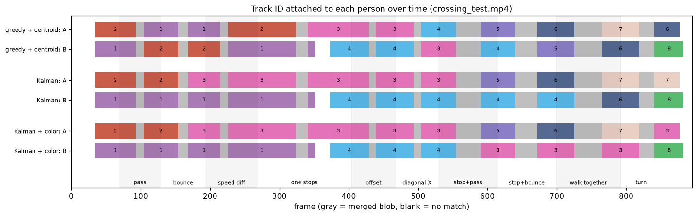

각 사람에게 붙은 ID를 시간 순서로 그렸다. 회색은 한 덩어리 박스로 판정을 보류한 구간이다. 기본 추적기(위 두 줄)에서는 거의 모든 회색 구간 뒤에 색이 바뀐다.

## 3. 특징점 매칭 성능 측정

등록 물체는 320×240 책 표지다(`data/target/target.png`). 실내 배경 위에 표지를 0.55배(176×132px)로 놓고 조건을 바꿨다. 다른 표지 하나를 방해물로 함께 두었고, 잡음과 JPEG 압축을 더했다. 조건마다 배경과 위치를 바꿔 10번 시행한 평균이다.

- **추출된 특징점 수**: 등록 이미지의 특징점 수 / 장면에서 물체 영역 안에 검출된 특징점 수
- **매칭된 특징점 수**: 비율 검정(Lowe, 0.75)을 통과한 매칭 중 위치가 맞는 것. 정답 호모그래피로 등록 이미지 좌표를 장면으로 옮겼을 때 5px 안에 떨어져야 한다.
- **매칭률**: 매칭된 특징점 수 / 등록 이미지 특징점 수. 등록해 둔 특징 중 장면에서 제자리를 찾은 비율이다.
- **검출 성공**: RANSAC inlier ≥ 12이고, 찾은 사각형의 꼭짓점 오차가 평균 10px 미만인 시행의 비율

**ORB** (장면 7조건 × 시행 평균)

| 조건 | 추출된 특징점 수 (등록 / 장면 대상 영역) | 매칭된 특징점 수 (정답) | 매칭률 | 비율 검정 통과 | 정밀도 | 검출 성공 |
| --- | ---: | ---: | ---: | ---: | ---: | ---: |
| 정면 | 340 / 611 | 44.4 | 13.1% | 45.8 | 97% | 100% |
| 30도 회전 (평면 안) | 340 / 643 | 38.8 | 11.4% | 39.9 | 97% | 100% |
| 60도 회전 (평면 안) | 340 / 629 | 37.5 | 11.0% | 38.7 | 97% | 100% |
| 30도 기울임 (3D) | 340 / 598 | 36.9 | 10.9% | 37.4 | 99% | 100% |
| 60도 기울임 (3D) | 340 / 482 | 0.4 | 0.1% | 1.9 | 12% | 0% |
| 30% 가림 | 340 / 486 | 43.0 | 12.6% | 44.4 | 97% | 60% |
| 50% 가림 | 340 / 408 | 15.7 | 4.6% | 17.1 | 88% | 40% |

**SIFT** (장면 7조건 × 시행 평균)

| 조건 | 추출된 특징점 수 (등록 / 장면 대상 영역) | 매칭된 특징점 수 (정답) | 매칭률 | 비율 검정 통과 | 정밀도 | 검출 성공 |
| --- | ---: | ---: | ---: | ---: | ---: | ---: |
| 정면 | 201 / 149 | 67.9 | 33.8% | 82.3 | 83% | 100% |
| 30도 회전 (평면 안) | 201 / 178 | 66.8 | 33.2% | 81.7 | 82% | 100% |
| 60도 회전 (평면 안) | 201 / 174 | 64.3 | 32.0% | 78.6 | 82% | 100% |
| 30도 기울임 (3D) | 201 / 129 | 61.3 | 30.5% | 72.7 | 85% | 100% |
| 60도 기울임 (3D) | 201 / 97 | 4.4 | 2.2% | 16.5 | 29% | 0% |
| 30% 가림 | 201 / 105 | 43.1 | 21.4% | 59.4 | 72% | 100% |
| 50% 가림 | 201 / 86 | 33.1 | 16.5% | 48.4 | 66% | 100% |

ORB는 특징점을 많이 뽑지만(등록 이미지 340개) 정면에서도 매칭률이 13.1%에 그친다. SIFT는 특징점이 201개로 적지만 매칭률이 33.8%다. 표지를 0.55배로 줄여 놓았기 때문에 등록 이미지의 세밀한 특징 상당수가 장면에서는 사라진다. ORB는 이런 크기 변화에 약하다(그림 10의 scale 곡선).

**영상에서.** `target_test.mp4`에서 프레임마다 매칭한 결과다. 표지가 0.42배(134px)로 더 작다. "검출"은 TARGET DETECTED를 띄운 비율, "정확한 위치"는 그중 꼭짓점 오차가 평균 10px 미만인 비율이다.

| 구간 | 프레임 | ORB: 검출 / 정확한 위치 / 꼭짓점 오차 중앙값 (12 ms/프레임) | SIFT (95 ms/프레임) |
| --- | --- | ---: | ---: |
| 물체 없음 | 30–59 | 오검출 0% | 오검출 0% |
| 들어옴 (일부 화면 밖) | 60–109 | 71% / 38% / 8.6px | 94% / 94% / 0.3px |
| 정면 | 110–149 | 100% / 50% / 9.8px | 100% / 100% / 0.4px |
| 평면 회전 0→60° | 150–199 | 100% / 42% / 13.8px | 100% / 100% / 0.4px |
| 평면 회전 60→0° | 200–229 | 100% / 37% / 13.6px | 100% / 100% / 0.4px |
| 3D 기울임 0→65° | 230–279 | 54% / 30% / 8.5px | 78% / 78% / 0.4px |
| 3D 기울임 65→0° | 280–309 | 50% / 40% / 6.6px | 77% / 77% / 0.4px |
| 사람이 앞을 지나며 가림 | 310–379 | 99% / 40% / 13.2px | 100% / 100% / 0.3px |
| 멀어짐 (크기 0.42→0.17) | 380–419 | 42% / 15% / 10.9px | 80% / 78% / 0.5px |
| 물체 없음 | 420–459 | 오검출 0% | 오검출 0% |

ORB는 표지가 보이는 거의 모든 프레임에서 TARGET DETECTED를 띄웠다(정면 100%). RANSAC inlier도 20~30개로 문턱값 12를 넉넉히 넘었다(그림 13). 하지만 찾은 사각형의 꼭짓점 오차 중앙값이 정면에서 9.8px였다. 그래서 10px 기준으로는 50%만 정확했다. SIFT는 같은 구간에서 0.4px였다. ORB 특징점은 영상 피라미드(1.2배 간격) 각 단계의 정수 위치에서 뽑히고 서브픽셀 보정이 없다. SIFT는 극값 위치를 2차식으로 보정한다. 물체가 작으면 이 차이가 위치 오차로 그대로 드러난다. 대신 SIFT는 프레임당 95ms가 걸려 ORB(12ms)보다 다섯 배쯤 느리다. 물체가 없는 구간에서는 두 방법 모두 오검출이 없었다. "있는지"만 알면 되는 앱에는 ORB로 충분하고, 위치까지 정확해야 하면 SIFT가 낫다.

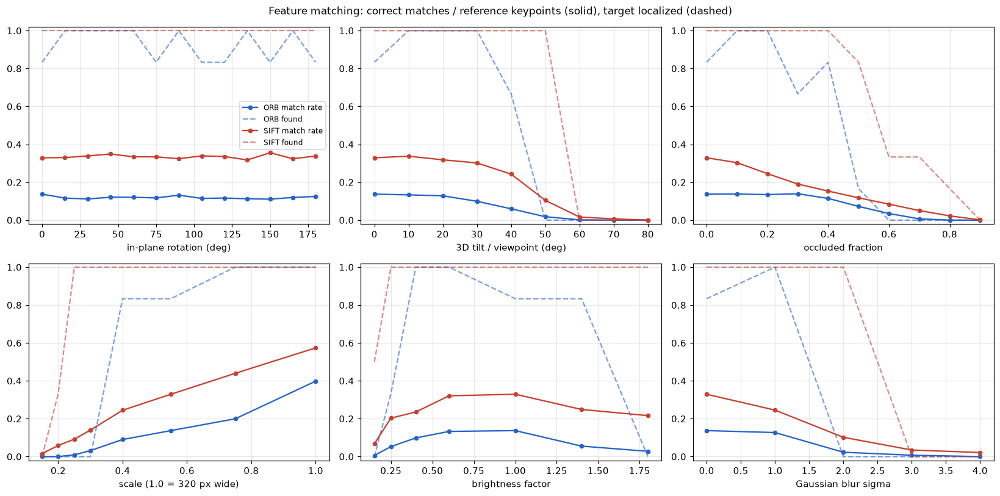

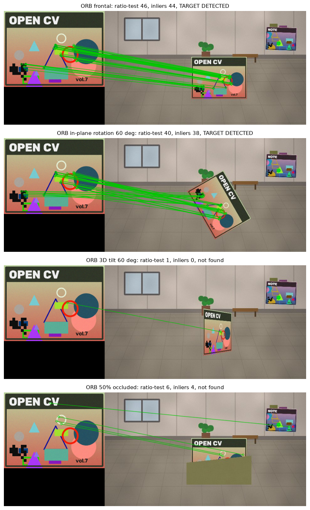

## 4. 배경 모델링의 한계

### 학습률에 따른 동작 차이

MOG2는 픽셀마다 가우시안 몇 개로 "이 픽셀이 평소 보이는 색"을 기억한다. 새 값이 기존 성분 중 하나와 가까우면(마할라노비스 거리² < 16) 배경이다. 학습률 α는 매 프레임 새 값이 기억에 반영되는 비율이다. 학습률 4가지와 비교 대상 5가지를 같은 영상에서 돌리고, 렌더러가 만든 정답 마스크(사람 픽셀)와 비교했다.

| 배경 모델 | 2초 정지: 사라짐(프레임) | 3초 | 5초 | 유령 프레임 합 | 조명 켜짐 회복 | 꺼짐 회복 | 국소 조명 회복 | 단일 영상 F1 | 정지 영상 ID Switch / 실패 | 조명 영상 ID Switch / 실패 / 유령 ID |
| --- | ---: | ---: | ---: | ---: | ---: | ---: | ---: | ---: | ---: | ---: |
| MOG2 α=0.0005 | 흡수 안 됨 | 흡수 안 됨 | 흡수 안 됨 | 36 | 75 초과 | 24 | 75 초과 | 92.3% | 0 / 0 | 2 / 2 / 7 |
| MOG2 α=0.002 (기본, =1/500) | 54 | 54 | 54 | 34 | 70 | 54 | 61 | 91.2% | 2 / 2 | 1 / 2 / 6 |
| MOG2 α=0.01 | 8 | 8 | 8 | 38 | 16 | 5 | 22 | 84.2% | 3 / 4 | 0 / 1 / 7 |
| MOG2 α=0.05 | 0 | 0 | 0 | 14 | 2 | 2 | 2 | 22.3% | 4 / 5 | 2 / 5 / 0 |
| MOG2 α=0.002, 그림자 검출 끔 | 54 | 54 | 54 | 103 | 75 초과 | 75 초과 | 75 초과 | 77.6% | 2 / 2 | 4 / 4 / 11 |
| 이동 평균 α=0.002 | 흡수 안 됨 | 흡수 안 됨 | 흡수 안 됨 | 169 | 75 초과 | 75 초과 | 75 초과 | 85.7% | 0 / 0 | 3 / 5 / 7 |
| 이동 평균 α=0.01 | 흡수 안 됨 | 흡수 안 됨 | 128 | 379 | 75 초과 | 75 초과 | 75 초과 | 83.8% | 0 / 0 | 3 / 5 / 34 |
| 이동 평균 α=0.05 | 23 | 23 | 23 | 197 | 75 초과 | 37 | 75 초과 | 70.4% | 3 / 3 | 1 / 5 / 16 |
| 프레임 차분 | 1 | 1 | 0 | 84 | 1 | 1 | 1 | 46.6% | 4 / 5 | 2 / 2 / 2 |

- "사라짐"은 멈춘 사람의 픽셀 재현율이 50% 아래로 떨어지기까지 걸린 프레임 수다. "흡수 안 됨"은 정지가 끝날 때까지 남아 있었다는 뜻이다.
- "회복"은 조명 이벤트 뒤 잘못된 전경 넓이가 화면의 0.5% 아래로 내려가 5프레임 유지되기까지 걸린 프레임 수다. 75프레임 안에 회복하지 못하면 "75 초과"로 적었다.
- "유령 프레임"은 멈췄다 떠난 자리에 전경이 남은 프레임 수다. 사람이 배경 모델에 이미 들어가 있으면, 떠난 뒤 드러난 진짜 배경이 오히려 "새로운 것"으로 보인다.

**흡수 시간은 학습률로 거의 정확히 예측된다.** 멈춘 사람의 색이 새 가우시안 성분이 되면 그 가중치는 1−(1−α)ᵗ로 커지고, 원래 배경 성분의 가중치는 (1−α)ᵗ로 줄어든다. MOG2는 가중치가 큰 순서로 합이 0.9(backgroundRatio)를 넘을 때까지를 배경으로 본다. 그래서 원래 배경 성분이 0.9 아래로 내려가는 순간 사람이 배경이 된다.

  t = ln(0.9) / ln(1 − α)

| α | 이론값 (프레임) | 실측 (5초 정지) |
| ---: | ---: | ---: |
| 0.0005 | 210.7 | — (정지 150프레임보다 김) |
| 0.002 | 52.6 | 54 |
| 0.01 | 10.5 | 8 |
| 0.05 | 2.1 | 0 (걷는 중에도 이미 흡수) |

α=0.05에서는 걷는 사람도 거의 보이지 않았다(단일 영상 F1 22.3%). 사람의 몸통처럼 색이 균일한 부분은 몇 프레임 동안 같은 픽셀에 머무르는데, 그 사이에 배경이 되어 버린다.

### "느린 변화"와 "빠른 변화"의 트레이드오프

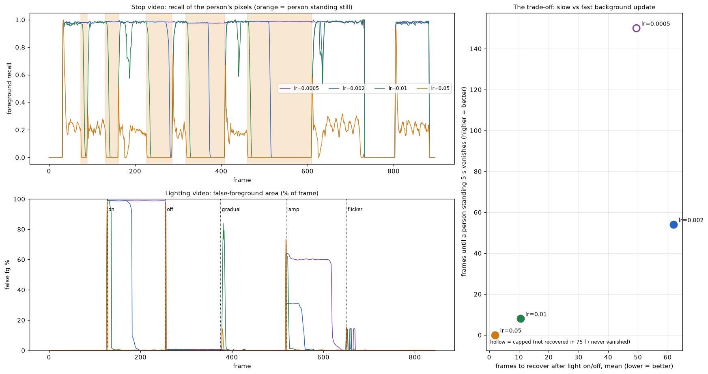

- **느리게 배우면(α=0.0005)** 5초 동안 서 있어도 사람이 남아 정지 영상의 추적 실패가 0건이다. 대신 조명이 켜지면 화면의 99%가 전경이 되고 75프레임 안에 돌아오지 못했다.
- **빠르게 배우면(α=0.05)** 조명 켜짐에서 2프레임 만에 회복했다. 대신 멈춘 사람이 즉시 사라지고 걷는 사람까지 흐려진다.
- 그 사이 값은 두 문제를 조금씩 다 가진다. 오른쪽 그림에서 왼쪽 위(빨리 회복하면서 오래 남음)에 있는 점이 없다.

이 트레이드오프는 원리에서 나온다. 배경 모델은 "얼마나 오래 변하지 않으면 배경인가"라는 시간 기준 하나로 움직이는 것을 정의한다. 멈춘 사람과 갑자기 밝아진 벽은 둘 다 "새로 나타나 변하지 않는 값"이라서 이 기준으로는 구분할 수 없다. 사람에게는 사람이고, 벽은 벽이지만, 픽셀 하나의 시계열에는 그 정보가 없다.

### 조명 변화 시 발생하는 문제

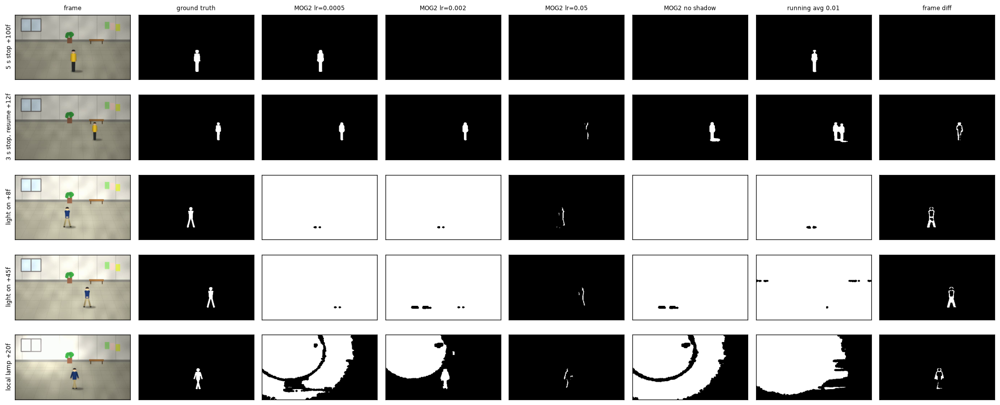

- **갑자기 켜짐(×1.35)**: 모든 픽셀이 동시에 바뀌어 화면 전체가 한 덩어리 전경이 된다. 기본 설정에서 사람은 이 덩어리에 묻혀 2번 추적에 실패했고, ID가 2번 바뀌었다.
- **국소 조명**: 밝아진 영역만 전경이 되고, 사람이 그 영역을 지날 때 덩어리와 합쳐진다.
- **깜빡임**: 4프레임 간격으로 밝기가 0.7배로 떨어진다. 배경 모델은 따라가지 못하지만, 어두워지는 변화라 대부분 그림자로 분류되어 잘못된 전경이 화면의 14%에 그쳤다.
- **그림자**: 그림자 검출을 끄면 그림자가 전경에 들어가 정밀도가 84%에서 63%로 떨어졌다. MOG2의 그림자 판정은 "밝기만 일정 비율 낮아지고 색은 그대로"라는 규칙이다. 그래서 조명이 꺼질 때(전체가 0.55배로 어두워짐)는 화면 거의 전부를 그림자로 분류했다. 잘못된 전경이 0.7%에 그쳤다(그림자 검출을 끄면 99%). 같은 규칙이 밝아지는 변화에는 아무 도움이 되지 않는다.
- **이동 평균 배경**(직접 구현)과 **프레임 차분**은 같은 문제를 더 심하게 가진다. 이동 평균은 픽셀마다 하나의 평균만 기억해서 잡음과 조명 변화를 구분하지 못한다. 프레임 차분은 멈춘 물체를 즉시 잃고(사라짐 1프레임), 움직이는 물체도 가장자리만 잡는다(단일 영상 F1 46.6%).

## 5. 거리 기반 추적의 본질적 한계

### 왜 겹침에서 ID Switch가 생기는가

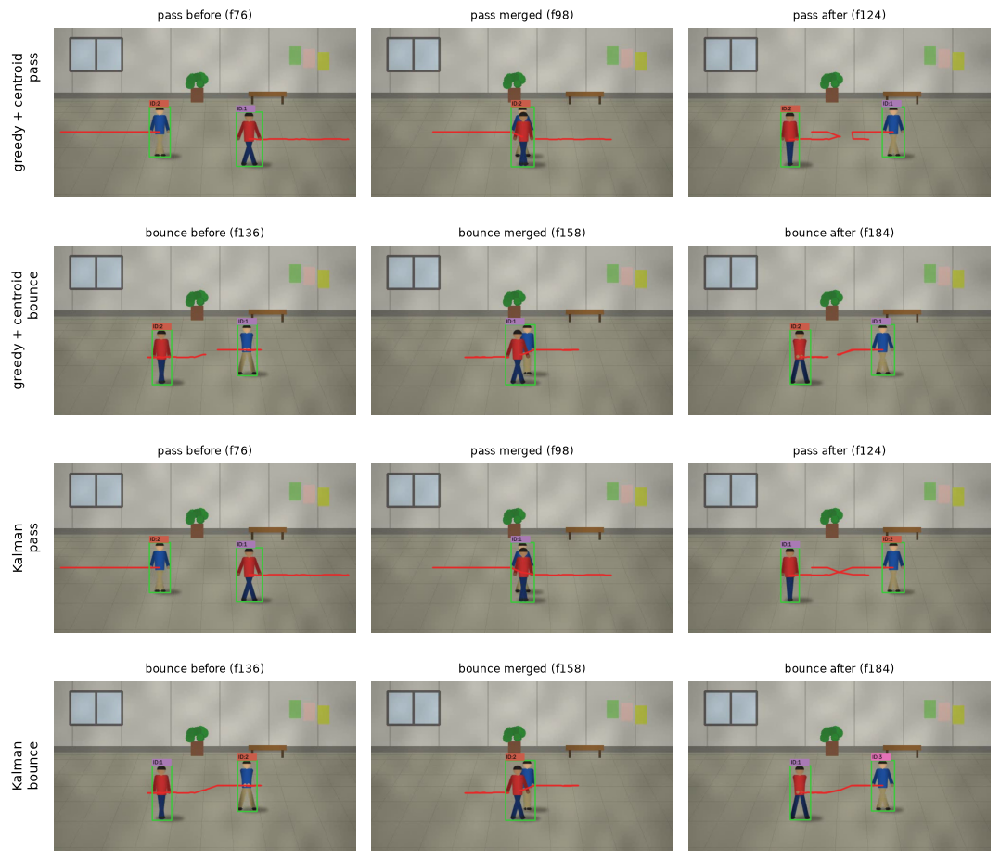

두 사람이 가까워지면 배경 차분 마스크가 하나로 붙는다. 이때 검출은 하나뿐이라 추적기는 두 사람 중 한 명만 이어 갈 수 있다. 다른 한 명은 "잠시 안 보이는" 상태로 마지막 위치에 머문다. 덩어리가 다시 둘로 갈라지면 추적기는 두 검출을 기억해 둔 두 위치와 비교한다.

- **그대로 지나간 경우**: 덩어리를 이어 간 추적의 마지막 위치는 덩어리 가운데다. 안 보이던 추적은 겹치기 전 위치, 곧 자기가 *왔던* 쪽에 있다. 갈라진 두 사람 중 그쪽에 있는 사람은 반대편에서 건너온 상대다. 가장 가까운 것끼리 이으면 ID가 맞바뀐다.
- **마주쳤다 돌아선 경우**: 각자 왔던 쪽으로 돌아가므로, 같은 규칙이 우연히 맞는다.

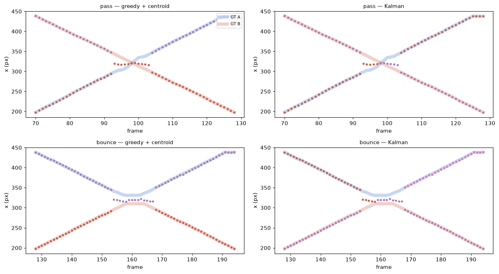

가로 위치를 시간에 따라 그리면 문제가 보인다. "그대로 지나감"과 "만났다 돌아섬"은 겹친 구간 밖에서는 정답 궤적(굵은 선)이 완전히 같은 X자 모양이다. 다른 것은 겹친 동안 누가 어느 선을 따라갔는가뿐이다. 그 구간에서는 검출이 하나라 위치 정보가 없다. 그러니 겹침 전후의 위치만으로 두 경우를 구분하는 규칙은 존재할 수 없다. 한 규칙이 둘 중 하나를 맞히면 나머지는 반드시 틀린다.

### 규칙을 추가해서 해결하려 했던 시도와 결과

추적기 변형 8가지를 같은 검출 결과에 적용했다. 검출이 같으므로 차이는 모두 짝짓기 규칙에서 나온다.

| 추적기 | 겹침 ID Switch | 겹침(같은 옷) | 단일 | 정지 Switch / 실패 | 조명 실패 / 유령 ID | 유지율 (겹침 / 같은 옷) |
| --- | ---: | ---: | ---: | ---: | ---: | ---: |
| 기본: 탐욕 + 중심점 거리 | 8건 (16회) | 8건 (17회) | 0건 (0회) | 2 / 2 | 2 / 6 | 19% / 27% |
| Hungarian 할당 (보너스 1) | 8건 (17회) | 8건 (17회) | 0건 (0회) | 2 / 2 | 2 / 6 | 27% / 27% |
| IoU 매칭 (보너스 3) | 9건 (18회) | 9건 (19회) | 3건 (3회) | 2 / 2 | 2 / 3 | 30% / 30% |
| 칼만 예측 (보너스 4) | 6건 (7회) | 6건 (9회) | 0건 (0회) | 2 / 2 | 2 / 8 | 36% / 36% |
| 칼만 + Hungarian | 6건 (8회) | 6건 (10회) | 0건 (0회) | 2 / 2 | 2 / 8 | 36% / 36% |
| 색 히스토그램 섞기 | 6건 (8회) | 8건 (17회) | 0건 (0회) | 2 / 2 | 2 / 6 | 31% / 27% |
| 칼만 + 색 히스토그램 | 6건 (8회) | 6건 (10회) | 0건 (0회) | 2 / 2 | 2 / 8 | 38% / 36% |
| 칼만 + Hungarian + 색 + 긴 기억 | 5건 (8회) | 6건 (11회) | 0건 (0회) | 2 / 2 | 2 / 8 | 41% / 33% |

**옷 색이 다름 (파랑·빨강)** — 이벤트별 ID Switch 횟수

| 이벤트 | 기본: 탐욕 + 중심점 거리 | 칼만 예측 (보너스 4) | 색 히스토그램 섞기 | 칼만 + 색 히스토그램 | 칼만 + Hungarian + 색 + 긴 기억 |
| --- | ---: | ---: | ---: | ---: | ---: |
| 1. 같은 속도로 교차 통과 | 2 | 0 | 0 | 0 | 0 |
| 2. 가운데서 만나 되돌아감 | 0 | 1 | 0 | 1 | 2 |
| 3. 속도가 다른 교차 | 2 | 0 | 1 | 0 | 0 |
| 4. 한 명이 멈춘 사이 통과 | 2 | 1 | 2 | 1 | 0 |
| 5. 위아래로 비껴 지나감 (부분 겹침) | 0 | 0 | 0 | 0 | 0 |
| 6. X자 대각 교차 | 2 | 0 | 0 | 0 | 0 |
| 7. 겹친 채 멈췄다가 통과 | 2 | 1 | 1 | 2 | 2 |
| 8. 겹친 채 멈췄다가 되돌아감 | 2 | 1 | 1 | 1 | 1 |
| 9. 나란히 함께 걷다가 갈라짐 | 2 | 2 | 1 | 1 | 1 |
| 10. 만난 자리에서 방향을 꺾음 | 2 | 1 | 2 | 2 | 2 |
| **합계** | 16 | 7 | 8 | 8 | 8 |

**같은 옷 (둘 다 파랑)** — 이벤트별 ID Switch 횟수

| 이벤트 | 기본: 탐욕 + 중심점 거리 | 칼만 예측 (보너스 4) | 색 히스토그램 섞기 | 칼만 + 색 히스토그램 | 칼만 + Hungarian + 색 + 긴 기억 |
| --- | ---: | ---: | ---: | ---: | ---: |
| 1. 같은 속도로 교차 통과 | 2 | 0 | 2 | 0 | 0 |
| 2. 가운데서 만나 되돌아감 | 0 | 1 | 0 | 1 | 2 |
| 3. 속도가 다른 교차 | 2 | 0 | 2 | 0 | 0 |
| 4. 한 명이 멈춘 사이 통과 | 3 | 1 | 3 | 1 | 1 |
| 5. 위아래로 비껴 지나감 (부분 겹침) | 0 | 0 | 0 | 0 | 0 |
| 6. X자 대각 교차 | 2 | 0 | 2 | 0 | 0 |
| 7. 겹친 채 멈췄다가 통과 | 2 | 1 | 2 | 2 | 2 |
| 8. 겹친 채 멈췄다가 되돌아감 | 2 | 2 | 2 | 2 | 2 |
| 9. 나란히 함께 걷다가 갈라짐 | 2 | 2 | 2 | 2 | 2 |
| 10. 만난 자리에서 방향을 꺾음 | 2 | 2 | 2 | 2 | 2 |
| **합계** | 17 | 9 | 17 | 10 | 11 |

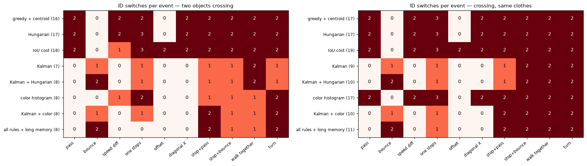

1. **거리 임계값 조정.** 20px에서 160px까지 바꿨다(아래 표). 너무 작으면 빠르게 걷는 사람도 놓쳐 단일 영상에서 ID가 바뀌었다(20·30·45px에서 3회). 60px 이상에서는 겹침 결과가 거의 변하지 않았다. 원문 예시처럼 임계값으로는 근본적으로 해결되지 않는다. 겹침 직후의 두 후보는 모두 임계값 안에 있기 때문이다.
2. **기억 길이 조정.** 겹친 채 오래 서 있으면(32~40프레임) 안 보이던 추적이 지워져 새 ID가 붙는다. 기억을 늘리면 이 경우는 줄었다. 하지만 지워져야 할 추적이 오래 남는 문제가 생긴다. 이렇게 남은 추적이 다른 사람과 이어질 수 있다. dev 점수(겹침 ID Switch + 추적 실패 + 유령 ID)가 가장 낮은 값은 거리 90px, 기억 20프레임이었다. 이 값을 test에 적용해도 겹침 ID Switch는 8건으로 기본값과 같았다. 줄어든 것은 조명 영상의 유령 ID(6 → 4개)뿐이다.
3. **Hungarian 할당**(보너스 1). 탐욕 할당과 거의 같았다. 사람이 둘뿐이면 "가장 가까운 것부터"와 "합이 최소"가 거의 항상 같은 답을 낸다(7장).
4. **IoU 매칭**(보너스 3). 겹침에서는 나아지지 않았다. 대신 단일 영상에서 기둥에 가려지는 순간 3번 끊겼다. 박스 모양이 갑자기 변하면 직전 박스와의 IoU가 0에 가까워지기 때문이다.
5. **칼만 예측**(보너스 4). 안 보이는 동안 속도대로 움직인다고 예측한다. 그래서 기본 추적기가 틀린 직선 교차 3가지(통과, 속도 차, 대각)를 모두 고쳤다. 비껴감은 원래 맞았다. 대신 되돌아가기에서 처음으로 ID가 바뀌었다. 예측은 "계속 간다"고 말하는데 실제로는 돌아섰기 때문이다. 앞 절의 결론대로, 위치 규칙은 둘 중 하나만 맞힐 수 있다.
6. **색 히스토그램.** 위치 거리와 색 거리(HSV 색상·채도 히스토그램의 바타차리야 거리)를 반씩 섞었다. 옷 색이 다른 영상에서는 8건이 6건으로 줄었다. 같은 옷 영상에서는 8건으로 기본 추적기(8건)와 같았다. 또 겹친 동안 이어진 추적은 두 사람 색이 섞인 덩어리의 히스토그램으로 색 기억을 갱신한다(구현은 0.2 비율로 섞는다). 그래서 겹침이 길수록 색 기억도 흐려진다.
7. **모두 합침.** 칼만 + Hungarian + 색 + 긴 기억도 옷이 다를 때 5건, 같을 때 6건이 남았다. 각 규칙이 고치는 이벤트와 망치는 이벤트가 서로 다르기 때문이다.

| 거리 임계값 max_distance (px) | dev: 겹침 Switch / 실패 / 유령 | dev 점수 (합) | test: 같은 순서 |  |
| ---: | ---: | ---: | ---: | --- |
| 20 | 35 / 4 / 7 | 46 | 37 / 6 / 7 |  |
| 30 | 39 / 4 / 7 | 50 | 40 / 6 / 6 |  |
| 45 | 29 / 4 / 7 | 40 | 33 / 6 / 6 |  |
| 60 | 29 / 4 / 6 | 39 | 33 / 6 / 6 |  |
| 90 | 29 / 4 / 4 | 37 | 32 / 6 / 4 | **선택** |
| 120 | 29 / 4 / 4 | 37 | 32 / 6 / 4 |  |
| 160 | 29 / 4 / 4 | 37 | 32 / 6 / 4 |  |

| 기억 길이 max_missed (프레임) | dev: 겹침 Switch / 실패 / 유령 | dev 점수 (합) | test: 같은 순서 |  |
| ---: | ---: | ---: | ---: | --- |
| 5 | 34 / 4 / 6 | 44 | 35 / 6 / 6 |  |
| 10 | 32 / 4 / 6 | 42 | 33 / 6 / 6 |  |
| 20 | 29 / 4 / 6 | 39 | 33 / 6 / 6 | **선택** |
| 40 | 30 / 4 / 6 | 40 | 27 / 6 / 6 |  |
| 80 | 30 / 4 / 6 | 40 | 28 / 6 / 6 |  |
| 160 | 30 / 4 / 5 | 39 | 29 / 6 / 6 |  |

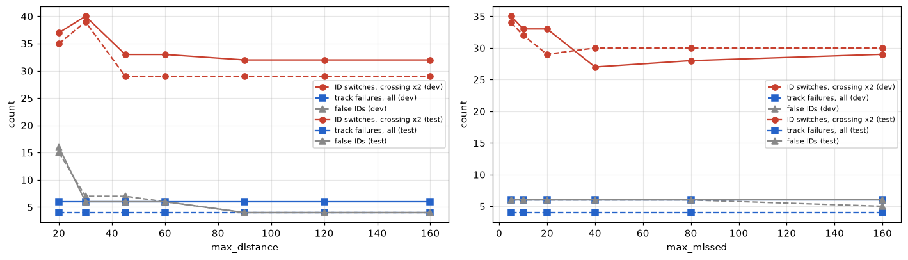

### 결론: 위치만으로는 객체를 구분할 수 없다

위치, 속도, 박스 크기는 겹친 순간 하나로 합쳐진다. 겹침이 풀린 뒤 누가 누구인지 판단하려면, 겹침 *전*의 사람과 *후*의 사람이 같은지 비교할 수 있는 정보가 필요하다. 그 정보는 외형뿐이다. 색 히스토그램은 사람이 정한 외형 특징의 가장 단순한 형태다. 이것도 "옷 색이 다르다"는 조건에서만 통했다. 같은 옷, 조명 변화, 겹침 중의 색 섞임 앞에서는 다시 위치와 같은 처지가 됐다.

## 6. Hand-crafted Feature의 한계

### 회전과 가림에 왜 취약한가

- **평면 안 회전에는 강하다.** ORB는 FAST 코너 주변 밝기의 무게중심 방향을 구해 그 방향으로 BRIEF 비교 쌍을 돌린다. SIFT는 기울기 방향 히스토그램의 최빈 방향을 기준으로 삼는다. 둘 다 회전 불변을 직접 설계해 넣었다. 그래서 0~180° 평면 회전 곡선이 거의 평평하다(그림 10). 원문의 "30도 회전"을 평면 회전으로 해석하면 이 표는 "회전에 취약하다"를 보여 주지 않는다. 그래서 3D 기울임을 함께 측정했다.
- **3D 기울임(시점 변화)에는 약하다.** 기울이면 표지의 한쪽은 가로로 눌리고 다른 쪽은 커진다. 원은 타원이 되고, 코너 주변의 31×31 패치 모양 자체가 달라진다. 설계자가 넣은 불변성은 회전과 크기뿐이고 이런 원근 왜곡은 들어 있지 않다. ORB는 40°에서 흔들리기 시작해 50°에서 0%가 됐다. SIFT는 50°까지 버텼지만 60°에서 0%가 됐다.
- **가림에는 개수로 약하다.** 가린 부분의 특징점은 그냥 없다. 남은 부분의 매칭은 정확하지만(정밀도 88%), RANSAC은 inlier가 12개 이상이어야 물체라고 판정한다. ORB는 50% 가림에서 평균 15.7개로 문턱값 근처라 40%만 찾았다. 특징점이 고르게 퍼져 있지 않아서, 무늬가 많은 쪽이 가려지면 더 빨리 무너진다.
- **크기와 흐림.** 표지를 0.3배 이하로 줄이거나 σ=2 이상으로 흐리면 ORB는 0%가 됐다. FAST가 코너로 볼 만한 날카로운 밝기 변화가 사라지기 때문이다.

### "학습되지 않은 특징"은 왜 새로운 상황에 일반화되지 못하는가

| 장면에 놓인 것 | ORB: TARGET DETECTED 비율 (평균 inlier) | SIFT |
| --- | ---: | ---: |
| 등록 물체 그대로 | 100% (42.2) | 100% (65.8) |
| 같은 시리즈 다른 권 | 0% (0.0) | 100% (34.3) |
| 무관한 표지 | 0% (0.4) | 0% (8.3) |
| 색 반전 (음화) | 0% (0.4) | 0% (10.6) |
| 윤곽선 그림 | 0% (0.8) | 0% (5.8) |

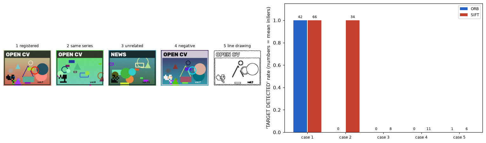

- **같은 시리즈 다른 권**: 테두리, 제목 띠, 글자 "OPEN CV", 바코드 위치가 같고 그림만 다르다. SIFT는 이것을 100% 등록 물체로 판정했다. 공통 요소의 특징점만으로 inlier가 평균 34개 나왔기 때문이다. 기술자는 "이 패치가 저 패치와 비슷한가"만 답한다. 어떤 차이가 물체를 구분하는 차이인지는 모른다.
- **색 반전**: 사람에게는 같은 책이다. 하지만 BRIEF의 "a점이 b점보다 밝은가" 비트가 모두 뒤집히고, SIFT의 기울기 방향도 180° 돌아간다. 둘 다 0%다.
- **선 그림**: 윤곽만 남기면 질감과 면의 밝기가 사라져 0%다.

ORB와 SIFT는 "밝기 패턴이 비슷하면 같은 것"이라는 고정된 규칙이다. 그 규칙이 맞는 상황(회전, 약간의 크기 변화)은 설계자가 미리 넣어 두었다. 그 밖의 변화(시점, 반전, 그림체)는 규칙이 처음부터 고려하지 않은 것이라 데이터를 더 모아도 나아지지 않는다. 반대로 "같은 시리즈"처럼 구분해야 할 차이가 작을 때는 너무 관대하다. 무엇에 둔감하고 무엇에 민감해야 하는지를 정하는 것이 바로 일반화이고, 고정된 특징은 그것을 상황에 맞게 바꿀 수 없다.

## 7. 딥러닝이 필요한 이유

**"객체의 외형을 학습한다면 겹침 문제가 해결될까?"**
대부분 해결된다. 5장의 결론은 "겹침 전후를 잇는 정보는 외형뿐"이었다. 색 히스토그램 실험이 그 증거다. 옷 색이 다르면 줄고, 같으면 그대로였다. 학습된 외형 표현(re-identification 임베딩)은 색뿐 아니라 체형, 머리 모양, 옷 무늬, 걸음새의 차이를 벡터로 바꾼다. DeepSORT 같은 추적기가 칼만 예측과 이 임베딩의 거리를 함께 쓰는 이유다. 겹친 동안 위치를 모르는 것은 그대로지만, 갈라진 뒤 "누가 누구인가"를 외형으로 판단할 수 있다. 다만 같은 옷을 입은 쌍둥이처럼 외형까지 같으면 학습해도 풀 수 없다. 또 덩어리째 검출되는 문제는 배경 차분 대신 사람 하나하나를 찾는 검출기가 있어야 줄어든다.

**"다양한 변형을 학습한다면 특징점 매칭이 개선될까?"**
개선된다. 3D 기울임 60°와 색 반전에서 ORB·SIFT가 0%였던 것은, 그런 변형이 불변성으로 설계되어 있지 않아서다. 학습된 특징(SuperPoint, 대조 학습 임베딩 등)은 기울어진 사진, 조명이 다른 사진을 같은 것으로 묶도록 훈련 데이터로 불변성을 배운다. 반대로 "같은 시리즈 다른 권"처럼 구분해야 할 차이는 다른 것으로 밀어내도록 배운다. 설계자가 상상하지 못한 변형도 데이터에 있으면 배울 수 있다. 반대로 데이터에 없는 변형에는 학습된 특징도 약하다. 그래서 학습 데이터의 다양성이 새 한계가 된다.

**"환경 변화를 학습한다면 배경 모델링이 강건해질까?"**
부분적으로 그렇다. 4장의 트레이드오프는 "변하지 않는 시간"이라는 한 가지 기준으로 전경을 정했기 때문에 생겼다. 학습된 분할 모델은 "이 영역이 사람 모양인가"를 직접 판단한다. 그러면 멈춘 사람은 사람이라서 남고, 밝아진 벽은 벽이라서 무시할 수 있다. 시간 기준이 아니라 의미 기준이 된다. 다만 학습에 없던 조명이나 장면에서는 여전히 틀릴 수 있다. 또 연산이 훨씬 무거워진다. 이 미션의 기본 파이프라인은 노트북에서 프레임당 22.3ms였다.

이 결론은 A6로 이어진다. A6-1에서 역전파로 가중치를 직접 학습시키는 엔진을 만들면, "규칙을 사람이 정하는 대신 데이터가 정하게 한다"가 구체적으로 무엇인지 보게 된다. A6-2의 오분류 분석은 학습된 모델도 데이터에 없는 경우에는 틀린다는 이 장의 마지막 단서를 다시 확인하는 일이다.

## 8. 보너스

### 1. Hungarian Algorithm (NumPy만, `src/hungarian.py`)

쿤–먼크레스의 포텐셜 방식(최단 증가 경로)을 구현했다. 행을 하나씩 추가하며, 줄인 비용 c−u−v가 0인 간선으로 새 행을 잇는 경로를 찾는다. 경로가 없으면 포텐셜을 가장 작은 줄인 비용만큼 옮긴다. 시간은 O(n²m)이다. 무작위 행렬 2,000개(2×2~6×6)에서 완전 탐색과 비용이 같은지 확인했다. 테스트에서 직사각형 행렬 200개도 확인했다.

| 무작위 비용 행렬 | 탐욕이 최적이 아닌 비율 | 그때 평균 추가 비용 |
| --- | ---: | ---: |
| 2×2 | 16% | +64% |
| 3×3 | 33% | +34% |
| 4×4 | 56% | +30% |
| 5×5 | 65% | +27% |
| 6×6 | 78% | +32% |
| 7×7 | 85% | +33% |

| 크기 | Hungarian (ms) | 탐욕 (ms) |
| --- | ---: | ---: |
| 5×5 | 0.41 | 0.029 |
| 20×20 | 3.14 | 0.233 |
| 50×50 | 7.73 | 0.922 |
| 100×100 | 36.05 | 3.502 |
| 200×200 | 73.68 | 24.890 |

| 영상 | 추적 2개 이상·검출 2개 이상인 프레임 | 두 방식의 할당이 다른 프레임 |
| --- | ---: | ---: |
| 겹침 | 611 | 1 |
| 겹침(같은 옷) | 609 | 0 |
| 단일 | 0 | 0 |

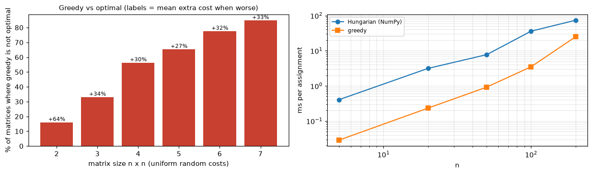

행렬이 커질수록 탐욕은 거의 항상 최적이 아니다. 하지만 실제 추적에서 둘의 할당이 달랐던 프레임은 교차 영상 611프레임 중 1프레임이었다. 결과도 거의 같았다(5장 표). 탐욕이 틀리려면 "가장 가까운 쌍을 먼저 고른 것이 다른 쌍을 크게 손해 보게 하는" 배치가 필요하다. 사람이 둘이고 대부분 멀리 떨어져 있으면 그런 배치가 거의 생기지 않는다. ID Switch의 원인은 할당 알고리즘이 아니라 비용에 들어간 정보(위치)다. Hungarian이 의미를 갖는 것은 사람이 많고 서로 가까운 군중 장면이다.

### 2. 침입 감지 구역

앱에서 마우스로 사각형을 끌면 구역이 된다(`--zone x,y,w,h`로도 지정 가능). 추적 객체의 중심점이 들어오면 구역을 빨갛게 칠하고 "INTRUSION! ID n"을 띄우며, 콘솔에 경고를 출력한다. 들어감·나감은 `outputs/app/intrusion_log.csv`에 시각, 프레임, ID, 좌표와 함께 저장된다. 구역 안에서 잠깐 가려진 객체는 나간 것으로 치지 않는다.

`single_test.mp4`에 구역 (x 470, y 200, 120×130)을 두고 정답과 비교했다. 정답상 2번 들어갔고, 경고 2번 중 2번이 실제 진입 ±10프레임 안이었다(오경보 0번).

| 프레임 | ID | 이벤트 | 중심점 |
| ---: | ---: | --- | --- |
| 289 | 1 | enter | (558, 200) |
| 346 | 1 | exit | (470, 276) |
| 675 | 1 | enter | (472, 241) |
| 720 | 1 | exit | (594, 240) |

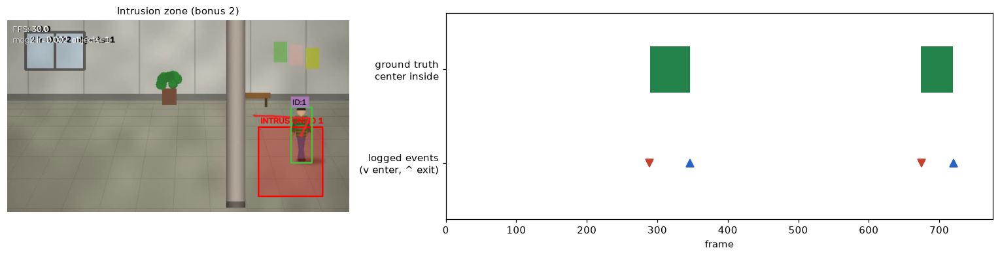

### 3. IoU 기반 매칭

`Tracker(cost="iou")`는 예측 박스와 검출 박스의 1−IoU를 비용으로 쓴다(IoU < 0.05면 짝짓지 않음). 5장 표의 두 줄을 비교하면 다음과 같다.

| | ID Switch (겹침) | 단일 영상 ID Switch | 유지율 (겹침) |
| --- | ---: | ---: | ---: |
| 중심점 거리 | 8건 (16회) | 0회 | 19% |
| IoU | 9건 (18회) | 3회 | 30% |

IoU는 크기와 모양까지 보므로 "가까운데 크기가 전혀 다른" 짝을 막는다. 대신 프레임 사이에 박스가 크게 변하면 끊긴다. 기둥에 가려 몸이 둘로 나뉘거나 덩어리가 합쳐지고 갈라질 때다. 이 영상에서는 그런 순간이 많아 중심점보다 나빴다. 프레임레이트가 낮아 물체가 박스 너비보다 많이 움직이는 영상에서는 IoU가 더 불리하다.

### 4. 칼만 필터 기반 예측

`cv2.KalmanFilter`로 상태 [x, y, vx, vy], 측정 [x, y]인 등속 모델을 만들었다. 매 프레임 먼저 예측하고, 예측 위치와 검출을 비교해 짝지은 뒤 보정한다. 짝이 없으면 예측만 계속하므로, 안 보이는 동안에도 속도대로 움직인다.

| | ID Switch 비율 (겹침) | 같은 옷 | 단일 | 정지 |
| --- | ---: | ---: | ---: | ---: |
| 적용 전 | 8/10 | 8/10 | 0/10 | 2/5 |
| 적용 후 | 6/10 | 6/10 | 0/10 | 2/5 |

칼만은 등속으로 지나가는 교차(통과, 속도 차, 대각)를 모두 고쳤다. 남은 실패는 등속 가정이 깨지는 경우였다. 돌아섬, 멈춤, 방향 전환, 함께 걷다 갈라짐이다. 정지 영상에서는 효과가 없었다. 문제가 짝짓기가 아니라 검출(배경 흡수)이기 때문이다.

## 9. 실행 성능

i5-13420H 노트북, OpenCV 스레드 2개, 640×360, 화면 표시 제외. 교차 영상 150프레임을 예열 후 3번 처리해 가장 빠른 값을 썼다.

| 구성 | 처리 FPS (가장 빠른 반복) | 프레임당 ms | 같은 실행의 가장 느린 반복 (ms) |
| --- | ---: | ---: | ---: |
| 배경 차분 + 추적 | 45 | 22.3 | 25.7 |
| + ORB 매 프레임 | 35 | 28.5 | 53.1 |
| + ORB 2프레임마다 | 48 | 20.8 | 28.5 |
| + SIFT 매 프레임 | 9 | 106.7 | 112.3 |

같은 노트북에서도 측정 시점에 따라 처리 시간이 크게 달랐다. 이 작업 중 기본 파이프라인(배경 차분 + 추적)을 여러 번 쟀을 때 프레임당 7ms에서 22ms까지 나왔고, 표는 마지막 실행 값이다. 측정 중 CPU 사용률은 낮았다. 그래서 다른 프로그램의 부하보다는 전원 관리(백그라운드 프로세스의 클럭·코어 배정)의 영향으로 추정하지만 확인하지는 못했다. 아래 결론은 느린 쪽 값에서도 성립한다.

배경 차분과 추적만으로는 실시간(30fps, 프레임당 33ms)보다 빠르다. ORB를 2프레임마다 돌려도 실시간 안쪽이다. SIFT는 9fps로 실시간에 못 미친다. 그래서 앱 기본값은 ORB, 2프레임마다다.

## 10. 해석 결정과 한계

- **합성 데이터.** 사람 모양이 단순하고 옷 무늬가 적어, 실제 영상보다 배경 차분이 쉽다. 반대로 실제 사람은 체형과 걸음새가 달라 외형 규칙이 이 실험보다 잘 통할 수 있다. 정답이 정확한 대신 현실성이 낮다는 교환이다.
- **"30도 회전"의 해석.** 원문은 회전 종류를 정하지 않았다. 평면 회전과 3D 기울임을 둘 다 측정했다. "회전에 취약하다"는 결론은 3D 기울임에만 해당한다.
- **ID Switch에 새 ID 포함.** 원문 정의는 "다른 ID로 유지"이므로, 바뀐 ID가 상대의 것이든 새로 만든 것이든 1회로 셌다. 재등장 이벤트는 사람이 화면 밖에 있던 동안 정보가 없으므로 새 ID가 정상이다. 그래서 표에서 뺐다.
- **측정의 수동/자동.** 원문은 수동 측정을 요구한다. 합성 영상에서는 같은 기준을 코드로 적용했고, 같은 형식의 기록표를 만들었다. 실제 영상은 `tools/annotate_events.py`로 키를 눌러 같은 표에 기록한다.
- **실시간 앱 FPS.** 화면의 FPS는 표시 갱신 속도다. 영상 파일은 원래 속도(30fps)에 맞춰 재생한다. 괄호 안의 proc는 분석만의 속도다.
