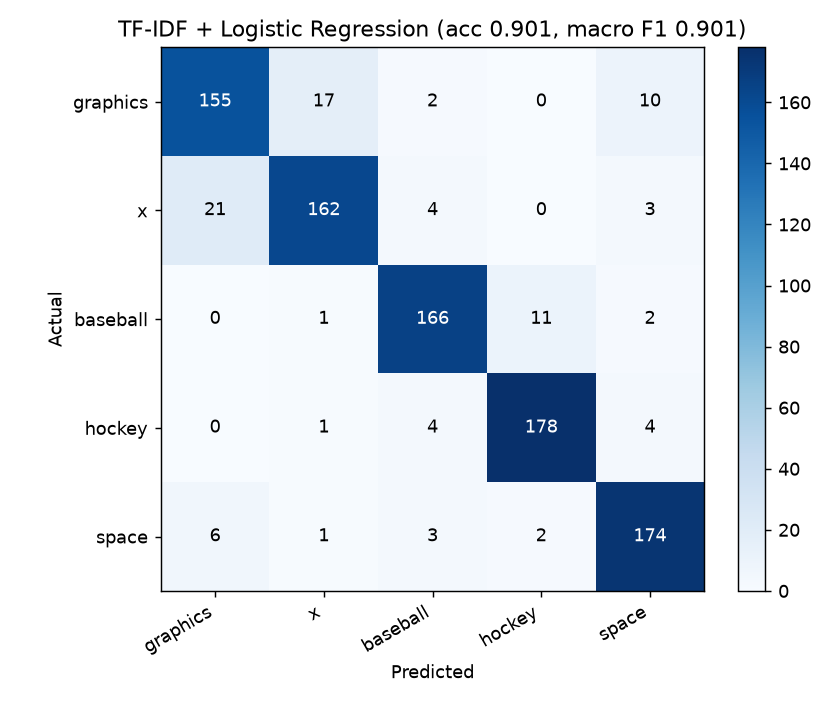
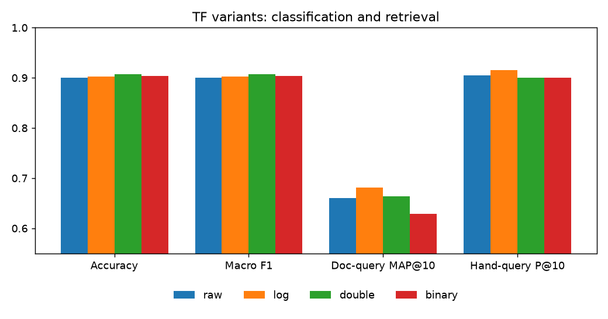
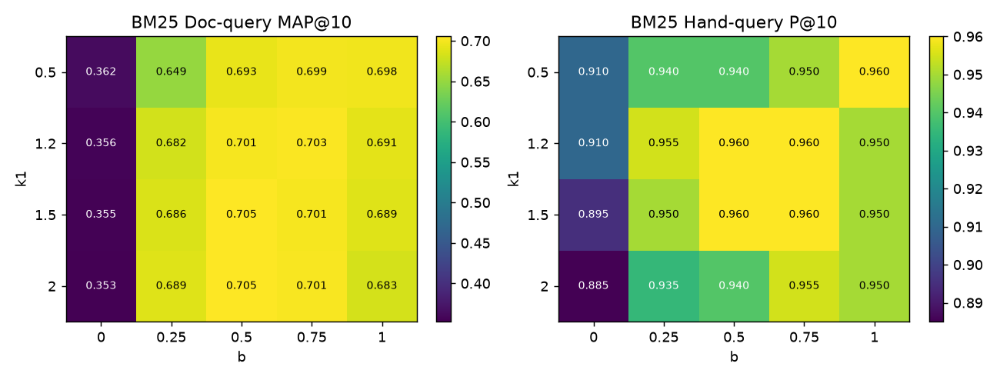
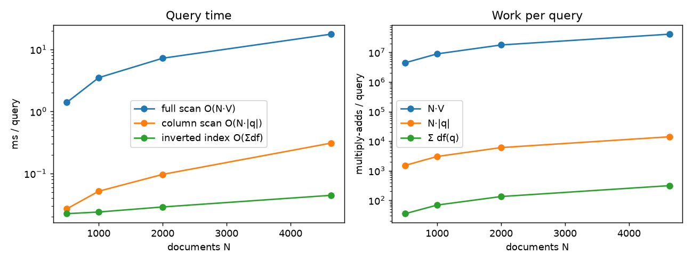

# A4-1 문서 검색기 만들기: 단어 빈도만으로 글의 뜻을 알 수 있을까?

[심화 과정 목차](../README.md)

검색어를 넣으면 비슷한 글을 찾아 주는 검색기와, 글이 어느 주제인지 맞히는 분류기를 만드는 미션이에요. 글을 **TF-IDF**(단어가 이 글에 얼마나 자주, 다른 글에는 얼마나 드물게 나오는지를 곱한 점수)라는 숫자 목록으로 바꾸고, 두 목록이 가리키는 방향이 얼마나 비슷한지(**코사인 유사도**)로 검색해요. 이 계산은 라이브러리 없이 NumPy로 직접 구현했어요. 단어의 순서는 버리고 개수만 세기 때문에 이런 방식을 **BoW**(Bag of Words, 단어 주머니)라고 불러요.

데이터는 1990년대 인터넷 게시판 글 모음인 20 Newsgroups에서 고른 5개 게시판의 글 4,631건이에요. 헷갈리도록 비슷한 게시판을 짝지어 골랐어요. 컴퓨터 그래픽(`comp.graphics`)과 X 윈도(`comp.windows.x`), 야구(`rec.sport.baseball`)와 하키(`rec.sport.hockey`)가 짝이고, 우주(`sci.space`)는 비교적 다른 주제예요.

## 검색어를 넣으면 이렇게 나와요

아래는 `outputs/search_examples.txt`에 있는 다섯 검색어 중 첫 번째 결과예요. 위 3건만 옮기고 글은 앞부분만 줄였어요.

```text
검색어: "space shuttle launch"  →  토큰 ['space', 'shuttle', 'launch']

1. [0.469] doc 3165 (sci.space) "the Single Launch Core Station concept. A Shuttle external tank ..."
2. [0.464] doc 279  (sci.space) "For an essay, I am writing about the space shuttle and ..."
3. [0.459] doc 4214 (sci.space) "Well, you better not get the shuttle as your launch vehicle. ..."
```

1위 문서의 점수 0.469는 검색어와 문서에 함께 있는 단어의 점수를 곱해 더한 값이에요.

```text
launch   0.629 × 0.351 = 0.221
shuttle  0.626 × 0.349 = 0.219
space    0.461 × 0.064 = 0.030     ← 우주 게시판에 흔한 단어라 문서 쪽 점수가 낮아요
합계                      0.469
```

## 결론: 단어 빈도만으로 어디까지 됐을까?

**단어 빈도만으로 글의 주제는 90% 맞혔지만, 같은 철자의 다른 뜻, 단어 순서, 같은 뜻의 다른 단어는 구별하지 못했어요.**

| 하는 일 | 결과 |
| --- | --- |
| 직접 구현한 TF-IDF가 scikit-learn과 같은지 | 설정 13가지 모두 오차 1e-6 이내 (최대 2.2e-15) |
| 검색어 20개의 상위 5건 중 같은 주제 글 비율 | TF-IDF 93.0%, BM25 96.0% (P@5) |
| 처음 보는 글 927건의 게시판 맞히기 | 835건 맞힘 (정확도 0.901, macro F1 0.901) |

틀린 92건 중 53건은 일부러 짝지은 두 쌍(그래픽↔X 윈도 38건, 야구↔하키 15건)에서 나왔어요. 비슷한 단어를 쓰는 주제일수록 단어 개수만으로는 가르기 어려웠어요.

영어 게시판 글 5개 주제에서 잰 값이에요. 주제 수가 많거나 리뷰처럼 감정을 판단하는 일에서는 결과가 달라질 수 있어요.

## 어떻게 동작할까?

1. **글을 단어로 자르기:** 소문자로 바꾸고, 이메일·URL·기호를 지운 뒤 단어로 잘라요. `the`, `would`, `thanks`처럼 어느 주제에나 나오는 단어(불용어) 354개를 직접 정해 빼요.
2. **숫자로 바꾸기 (TF-IDF):** 단어마다 "이 글에 몇 번 나왔나(TF) × 얼마나 드문 단어인가(IDF)"를 계산해요. 그래서 위 예시의 `space`는 우주 글 대부분에 나오는 단어라 낮은 점수를 받았어요.
3. **비교하기:** 검색어도 같은 방식으로 바꾼 뒤, 모든 문서와 코사인 유사도를 한 번에 계산해 높은 순으로 5건을 돌려줘요.
4. **분류하기:** 같은 숫자 목록으로 Logistic Regression을 학습해요. 글 80%로 배우고 남은 20%로 시험해요.

BM25는 TF-IDF를 고친 검색 점수예요. 같은 단어가 여러 번 나와도 점수가 한없이 커지지 않게 하고, 긴 문서와 짧은 문서의 차이를 보정해요. TF-IDF는 몇 단어뿐인 짧은 글을 위로 올리는 경향이 있었는데, BM25로 바꾸면 그런 글이 덜 올라와서 검색 정확도가 올랐어요.

## 어디서 틀릴까?

| 사례 | 무엇을 잘못 읽었나 |
| --- | --- |
| `"in the space of 9 months"` (X 윈도 글 → 우주로 분류) | 시간 표현의 `space`를 우주로 읽었어요. 같은 철자의 다른 뜻이에요 |
| `"Roger is now over at r.s.baseball"` (하키 글 → 야구로 분류) | 다른 게시판을 언급만 했는데, `baseball`이 나왔다고 야구 글로 봤어요 |
| `"the pitcher hit the batter"` vs `"the batter hit the pitcher"` | 누가 누구를 쳤는지 달라도 단어가 같아서 유사도가 1.0이에요 |
| `"this is a good team"` vs `"this is not a good team"` | `not`, `good`이 불용어로 빠져 `team`만 남고, 유사도가 1.0이에요 |
| `goalie` vs `goaltender` | 둘 다 하키 골키퍼인데 유사도가 0이고, 각각 검색한 상위 10건이 하나도 겹치지 않아요 |

`not`을 불용어로 뺀 것은 주제 분류에서는 부정어가 주제를 바꾸지 않기 때문이에요. 감정을 판단하는 일이라면 빼면 안 되는 단어예요.

## 언제 이 방법을 쓰면 좋을까?

| 상황 | 알맞은 쪽 |
| --- | --- |
| 검색어와 같은 단어가 들어간 글을 빠르게 찾을 때 | TF-IDF나 BM25 |
| 주제가 단어로 뚜렷이 갈리는 글 분류 | TF-IDF + 선형 분류기 |
| 같은 뜻의 다른 표현까지 찾아야 할 때 | 단어 임베딩이나 LSA |
| 문맥에 따라 뜻이 바뀌는 단어나 부정·어순이 중요할 때 | BERT 같은 문맥 임베딩 |

## 실행하기

[uv](https://docs.astral.sh/uv/getting-started/installation/)가 필요해요. 없다면 `pip install uv`로 설치할 수 있어요.

```bash
cd 02_Advanced/A4-1
uv sync
uv run python main.py --query "space shuttle launch" --topk 5
```

`uv sync`는 Python 3.12와 라이브러리를 이 폴더의 `.venv`에 설치해요. 처음 검색할 때 20 Newsgroups(약 14MB)를 `data/`에 내려받고, 검색할 때마다 색인을 새로 만드느라 10초쯤 걸려요.

- **전체 실험 다시 재기:** `uv run python -m src.run_all`을 실행하면 결과가 `outputs/`에 저장돼요. 3~5분 걸리고 메모리를 2GB 안팎 써요.
- **uv 없이 실행:** `pip install -r requirements.txt`로 설치한 뒤, 위 명령의 `uv run python`을 `python`으로 바꾸세요.

<details>
<summary>명령 옵션과 함수로 쓰기</summary>

| 옵션 | 하는 일 |
| --- | --- |
| `--query "검색어"` | 검색해요 |
| `--topk 5` | 결과 개수를 정해요 |
| `--explain` | 1위 문서의 코사인 계산 과정을 보여 줘요 |
| `--method both` | TF-IDF와 BM25 결과를 나란히 보여 줘요. `tfidf`(기본), `bm25`도 돼요 |
| `--index` | 역색인으로 검색해요 |

코드에서는 함수로 부를 수 있어요. 첫 호출 때 색인을 만들고, 이후 호출은 그 색인을 다시 써요.

```python
from src.search import search

# search(query: str, topk: int = 5, method: str = "tfidf") -> List[(score, doc_id, text_snippet)]
for score, doc_id, snippet in search("hockey playoff goalie"):
    print(f"[{score:.3f}] {doc_id} {snippet[:60]}")
```

문서 ID는 sklearn이 주는 원래 순서의 위치 번호예요.

</details>

## 더 알아보기

| 이럴 때 | 여기를 보세요 |
| --- | --- |
| TF-IDF와 코사인 유사도를 그림으로 이해하고 싶어요 | [`study/a4-1.html`](study/a4-1.html): 전처리부터 보너스까지 차례로 읽고, 브라우저에서 직접 검색해 볼 수 있어요 |
| 작은 예로 계산을 직접 따라가고 싶어요 | [`notebooks/search_walkthrough.ipynb`](notebooks/search_walkthrough.ipynb): 두 문서와 검색어 하나로 계산을 펼친 뒤 실제 데이터로 넘어가요. `uv sync --group dev` 후 실행하세요 |
| 코드를 순서대로 읽고 싶어요 | [`study/code-walkthrough.md`](study/code-walkthrough.md): 파일별로 무엇을 하는지 설명해요 |
| 틀린 글 전체가 궁금해요 | [`outputs/misclassified.md`](outputs/misclassified.md): 오분류 92건과 각 글을 끌어당긴 단어가 있어요 |

## 자세한 근거

미션에서 요구한 세부 결과예요. 필요할 때만 펼쳐 보세요.

<details>
<summary>구현 요약: 데이터, 전처리, TF-IDF, 검색, 분류</summary>

**데이터**

| 항목 | 값 |
| --- | --- |
| 데이터셋 | 20 Newsgroups (`sklearn.datasets.fetch_20newsgroups`, `subset="all"`) |
| 문서 수 | 원본 4,941건에서 토큰 5개 미만 310건을 빼고 **4,631건** |
| 범주별 | graphics 920, windows.x 947, baseball 899, hockey 937, space 928 |
| 문서 길이 | 전처리 후 토큰 수 중앙값 35 |

헤더·서명·인용문은 `remove=("headers", "footers", "quotes")`로 지웠어요. 헤더의 `Newsgroups:` 줄에 정답 게시판이 그대로 적혀 있어서, 남겨 두면 분류기가 본문이 아니라 헤더로 답을 맞혀요. `From:` 줄과 서명에는 이름·이메일도 있어요. 인용만 있던 답글은 지우고 나면 거의 비기 때문에, 토큰이 5개 미만인 글은 결측으로 보고 뺐어요. 원문은 저장소에 넣지 않았고, 첫 실행 때 내려받아요.

**전처리 기준과 근거**

| 단계 | 기준 | 근거 |
| --- | --- | --- |
| 소문자화 | 전부 소문자 | `Shuttle`과 `shuttle`은 같은 단어예요. 대소문자로 구별할 고유명사가 드물어요 |
| 이메일·URL 제거 | `\S+@\S+`, `http://`·`ftp://`·`www.`로 시작하는 문자열 | 개인정보이고, `cs.cmu.edu` 같은 조각이 주제와 무관한 소속 신호가 돼요 |
| 아포스트로피 | 빈 문자열로 지움 | `don't → dont`. 공백으로 바꾸면 `don`과 `t`로 갈라져 불용어로 거를 수 없어요 |
| 특수문자 | 영문자·숫자 외는 공백으로 | `X11R5,` 같은 구두점 붙은 토큰을 원형으로 되돌려요 |
| 토큰 규칙 | 영문자로 시작하는 `[a-z0-9]` 2자 이상 | `x11`, `mpeg2` 같은 기술 용어는 살리고, 순수 숫자와 한 글자는 버려요 |
| 철자 변형 통합 | `colour→color`, `grey→gray`, `jpg→jpeg` 등 15쌍 | 같은 뜻을 다른 철자로 쓴 경우만 합쳐요 |
| 동의어 | 통합하지 않음 | 동의어 사전은 범위가 끝없고 만든 사람의 판단이 섞여요. BoW의 동의어 한계를 그대로 보려고 남겼어요 |
| 불용어 | 직접 정의한 354개 | 기능어(`the`, `would`, `not`), 축약형(`dont`, `im`), 게시판 관용어(`writes`, `thanks`, `know`). 주제를 가르는 `game`, `image`, `space`는 넣지 않았어요 |
| 어간 추출 | 하지 않음 | `graphics → graphic`, `windows → window`처럼 게시판을 가르는 단어가 합쳐져요 |
| 어휘 가지치기 | `min_df=5`, `max_df=0.5` | 5개 미만 문서에만 나오는 오타·고유명사와, 절반 넘는 문서에 나오는 단어를 빼요. 어휘는 8,918개예요 |

**토큰화와 언어 차이:** 영어는 띄어쓰기가 단어 경계와 거의 맞아서 공백·정규식 토큰화로 충분해요. 한국어는 어절에 조사가 붙어서 `고양이가`, `고양이를`이 다른 토큰이 돼요. 손으로 나눈 예에서 "고양이가 쥐를 잡았다"와 "쥐가 고양이를 잡았다"의 코사인은 공백 토큰화로 0.20, 형태소 토큰화로 1.00이었어요. 형태소로 나누면 같은 단어가 맞춰지지만, 이번에는 어순을 잃어 누가 누구를 잡았는지가 다른 두 문장이 같은 벡터가 돼요.

**TF-IDF 수식**

```text
tf(t, d)    = f(t, d)                                    문서 d에서 단어 t의 빈도 (raw)
idf(t)      = ln((1 + n) / (1 + df(t))) + 1              smooth_idf=True
idf(t)      = ln(n / df(t)) + 1                          smooth_idf=False
tfidf(t, d) = tf(t, d) × idf(t)
v_d         = tfidf(·, d) / ‖tfidf(·, d)‖₂               L2 정규화
```

`n`은 문서 수, `df(t)`는 `t`가 나온 문서 수예요. `smooth_idf`는 분자·분모에 문서 하나를 더해 0으로 나누는 일을 막고, 끝의 `+1`은 모든 문서에 나오는 단어의 가중치가 0이 되지 않게 해요. L2 정규화는 긴 문서가 단어가 많다는 이유만으로 커지는 것을 막아요. 구현은 [`src/tfidf.py`](src/tfidf.py)의 `TfidfVectorizerNP`이고, sklearn과 같은 `fit` / `transform` 방식으로 써요. 검색어와 시험 문서는 학습한 어휘·IDF로 `transform`만 하고, 어휘에 없는 단어는 무시해요.

**검색:** `cos(q, d) = (q · d) / (‖q‖ × ‖d‖)`를 `doc_matrix @ query_vec`로 모든 문서에 한 번에 계산해요. 점수가 0보다 큰 문서 중 상위 k개를 고르고, 동점이면 문서 번호가 작은 쪽이 앞서요. 스니펫은 검색어 단어가 처음 나온 곳 주변 160자예요. sklearn `cosine_similarity`와의 최대 오차는 1.11e-16이에요.

**분류 설정**

| 항목 | 설정 |
| --- | --- |
| 분할 | Train 3,704 / Test 927 (8:2, 범주 비율 유지, `random_state=42`) |
| 특성 | 직접 구현 TF-IDF (`tf=raw`, `smooth_idf=True`, `norm="l2"`), Train으로만 학습한 어휘 7,357개 |
| 모델 | `LogisticRegression(C=10, max_iter=2000, random_state=42)` |
| C 선택 | Train 5-fold 교차검증 macro F1: C=1 0.9023, **C=10 0.9028**, C=100 0.8966 |

</details>

<details>
<summary>검증·실험 결과: TF-IDF 검증 로그, 분류 성능, 혼동 행렬</summary>

**TF-IDF 검증:** 같은 토큰 목록을 sklearn에 넣고(`analyzer=lambda doc: doc`), 어휘·IDF·행렬을 비교했어요. 전체 로그는 [`outputs/tfidf_verification.txt`](outputs/tfidf_verification.txt)에 있어요.

```text
=== TF-IDF 구현 검증 결과 ===
TF-IDF 행렬 shape: (4631, 8918)  (min_df=5, max_df=0.5)
sklearn 공통 설정: TfidfVectorizer(analyzer=<같은 토큰 리스트>, min_df=5, max_df=0.5, dtype=float64)

[검증] 직접 구현(tf=raw) vs Scikit-learn
  - sklearn 설정: smooth_idf=True, sublinear_tf=False, norm='l2', binary=False
  - 어휘 일치: True, IDF 최대 오차: 0.00e+00
  - 최대 오차: 1.33e-15
  - 결과: PASS (허용 오차 1e-6 이내)
```

| 직접 구현 | sklearn 설정 | 최대 오차 | 결과 |
| --- | --- | ---: | --- |
| `tf=raw, smooth=True, norm=l2` (**검색·분류에 쓴 설정**) | `smooth_idf=True, sublinear_tf=False, norm='l2'` | 1.33e-15 | PASS |
| `tf=raw, smooth=True, norm=l1` | `smooth_idf=True, sublinear_tf=False, norm='l1'` | 3.05e-16 | PASS |
| `tf=raw, smooth=True, norm=None` | `smooth_idf=True, sublinear_tf=False, norm=None` | 0 | PASS |
| `tf=log, smooth=True, norm=l2/l1/None` | `smooth_idf=True, sublinear_tf=True, norm=…` | ≤ 3.05e-16 | PASS ×3 |
| `tf=raw, smooth=False, norm=l2/l1/None` | `smooth_idf=False, sublinear_tf=False, norm=…` | ≤ 2.16e-15 | PASS ×3 |
| `tf=log, smooth=False, norm=l2/l1/None` | `smooth_idf=False, sublinear_tf=True, norm=…` | ≤ 2.22e-16 | PASS ×3 |
| `tf=binary, smooth=True, norm=l2` | `binary=True, smooth_idf=True, norm='l2'` | 2.22e-16 | PASS |

**분류 성능 (Test 927건)**

```text
정확도: 0.9008
F1-Score (macro): 0.9006
```

| 범주 | precision | recall | F1 | support |
| --- | ---: | ---: | ---: | ---: |
| comp.graphics | 0.852 | 0.842 | 0.847 | 184 |
| comp.windows.x | 0.890 | 0.853 | 0.871 | 190 |
| rec.sport.baseball | 0.927 | 0.922 | 0.925 | 180 |
| rec.sport.hockey | 0.932 | 0.952 | 0.942 | 187 |
| sci.space | 0.902 | 0.935 | 0.918 | 186 |



</details>

<details>
<summary>한계와 개선 방향: 오분류 원인, BoW 한계, 후속 학습</summary>

**오분류 원인:** Logistic Regression에서 단어 `j`가 예측 범주 `p`를 실제 범주 `a`보다 밀어준 양은 `x_j · (w_pj − w_aj)`예요. 이 값이 큰 단어를 "끌어당긴 단어"로 적었어요. 원인 분류는 본문과 이 값을 보고 한 해석이고, 인과를 검증한 것은 아니에요.

| 문서 | 실제 → 예측 | 끌어당긴 단어 | 원인 |
| --- | --- | --- | --- |
| doc 400 | windows.x → space | `space`(0.77) | "in the space of 9 months"의 시간 표현. 다의어 |
| doc 4893 | windows.x → space | `space`(1.86) | "space is at a premium"(디스크 공간이 부족). 다의어 |
| doc 221 | graphics → space | `space`(2.91) | "4 points in 3-space"의 3차원 공간. `points`, `sphere`보다 `space` 하나가 셌어요 |
| doc 3125 | hockey → baseball | `glove`, `jerseys` | 하키 골키퍼의 글러브라는 문맥을 모르고, 야구에 흔한 단어로 읽었어요 |
| doc 3111 | hockey → baseball | `baseball`(1.96) | 야구 게시판을 언급만 한 글. 단어가 나온 것과 그 주제의 글인 것을 구별하지 못해요 |
| doc 552 | graphics → windows.x | `server`(1.71), `client` | "X-Windows based, Client-Server" 가상현실 소프트웨어 공지. 두 게시판에 교차 게시된 글이라 주제가 실제로 겹쳐요 |
| doc 1880 | baseball → hockey | `later`(1.25), `steve` | 토큰 7개 중 대부분이 선수 이름이라, 우연한 단어가 결정을 좌우했어요 |
| doc 780 | space → windows.x | `mit`(1.32), `export`, `lcs` | `http://` 없이 쓴 호스트명 `export.lcs.mit.edu`가 남아 X 윈도 신호가 됐어요. 전처리 규칙의 빈틈이에요 |

정리하면 다의어(같은 철자, 다른 뜻), 문맥 부재, 범주 경계의 실제 중첩, 짧은 글의 증거 부족, 전처리 누수예요. 앞의 셋은 단어를 맥락 없이 하나의 축으로 세는 BoW의 구조적 한계예요.

**BoW 한계 분석:** 본문 「어디서 틀릴까?」의 어순·부정어·동의어 예시와 함께, `save`로 검색하면 야구의 세이브, X 윈도의 Save Under 속성, 파일 저장 글이 섞여 나왔어요. 전체 출력은 [`outputs/bow_limits.txt`](outputs/bow_limits.txt)에 있어요.

**개선 방향**

| 문제 | 개선 | 기대 효과 |
| --- | --- | --- |
| 어순·부정어 | 단어 n-gram(`not good`, `space shuttle`) 추가 | 짧은 구의 어순과 부정을 일부 보존해요. 어휘가 크게 늘어요 |
| 동의어 | LSA 또는 단어 임베딩(Word2Vec·GloVe) | `goalie`와 `goaltender`가 가까운 벡터가 돼요 |
| 다의어·문맥 | 문맥 임베딩(BERT 계열) | 같은 `space`도 주변 단어에 따라 다른 벡터가 돼요 |
| 검색 품질 | BM25로 후보를 뽑고 임베딩으로 재정렬 | 속도와 의미 기반 정렬을 함께 얻어요 |
| 전처리 누수 | 호스트명 패턴 제거 | doc 780 같은 기관 신호를 없애요 |
| 짧은 글 | 신뢰도 낮음 표시, 스레드 단위로 묶기 | 근거가 적을 때의 확신에 찬 오답을 줄여요 |

후속 학습은 A4-2(텍스트 정보 추출과 감성 분석)로 이어져요. 감성 분석에서는 여기서 불용어로 버린 `not`이 핵심 단서가 돼요.

</details>

<details>
<summary>보너스: TF 변형, BM25, 역색인</summary>

**TF 변형 비교:** 분류는 같은 분할·같은 C=10으로 쟀어요. 검색의 Doc-query는 Test 글 927건을 각각 검색어로 써서 Train 3,704건을 검색하고 같은 게시판 글을 정답으로 봐요. 평가 쿼리는 직접 만든 20개(게시판당 4개)예요.

| TF 변형 | 식 (f>0일 때) | 정확도 | macro F1 | Doc-query MAP@10 | 평가 쿼리 P@10 |
| --- | --- | ---: | ---: | ---: | ---: |
| raw | `f` | 0.9008 | 0.9006 | 0.6609 | 0.905 |
| log | `1 + ln f` | 0.9029 | 0.9028 | **0.6814** | **0.915** |
| double | `0.5 + 0.5·f / max f` | **0.9072** | **0.9072** | 0.6634 | 0.900 |
| binary | `1` | 0.9040 | 0.9041 | 0.6293 | 0.900 |



분류에서는 차이가 0.6%p(약 6건) 이내라 우열을 단정하지 않아요. 분류기가 단어 가중치를 다시 배우기 때문이에요. 검색에서는 log가 가장 좋고 binary가 가장 나빴어요. 몇 번 나왔는지는 중요하지만, 20번 나왔다고 20배 중요하지는 않다는 뜻이에요.

**BM25**

```text
score(q, d) = Σ_{t ∈ q} idf(t) · f(t,d)·(k1 + 1) / (f(t,d) + k1·(1 − b + b·|d|/avgdl))
idf(t)      = ln((N − df(t) + 0.5) / (df(t) + 0.5) + 1)          k1 = 1.5, b = 0.75
```

| 방법 | Doc-query P@10 | Doc-query MAP@10 | 평가 쿼리 P@5 | 평가 쿼리 P@10 |
| --- | ---: | ---: | ---: | ---: |
| TF-IDF (raw, L2) | 0.7400 | 0.6609 | 0.930 | 0.905 |
| BM25 (k1=1.5, b=0.75) | **0.7670** | **0.7010** | **0.960** | **0.960** |

`x window server display`의 TF-IDF 1·2위는 7토큰, 10토큰짜리 짧은 글이고, BM25와 상위 5건이 하나도 겹치지 않았어요. `hockey playoff goalie`의 TF-IDF 4위는 "하키 시즌이 거의 끝났으니"라는 한 문장이 든 13토큰짜리 야구 글이었어요. 나란히 비교한 결과는 [`outputs/bm25_vs_tfidf.txt`](outputs/bm25_vs_tfidf.txt)에 있어요.



길이 보정을 끄면(`b=0`) Doc-query MAP@10이 0.35 수준으로 떨어져요. 검색어가 글 전체라 단어가 많아서, 보정이 없으면 긴 글이 상위를 독차지해요. `k1`은 0.5~2.0에서 차이가 0.01 이내였어요. k1=1.5, b=0.75는 격자를 보기 전에 관례값으로 정했어요.

**역색인:** 단어마다 그 단어가 나온 문서 목록만 저장해요(예: `shuttle` → 문서 121개). 전체 8,918단어에 포스팅 220,740개로, 전체 행렬 칸의 0.53%예요.

| 방법 | 시간 복잡도 |
| --- | --- |
| 전체 스캔 (행렬·벡터 곱) | O(N·V) |
| 역색인 | O(Σ_{t∈q} df(t)) + 후보 정렬 |

| 문서 수 N | 전체 스캔 (ms) | 역색인 (ms) | 결과 동일 |
| ---: | ---: | ---: | --- |
| 500 | 1.395 | 0.022 | True |
| 1,000 | 3.501 | 0.024 | True |
| 2,000 | 7.208 | 0.029 | True |
| 4,631 | 17.593 | **0.044** | True |



검색어 200개의 평균이고, 모든 크기에서 상위 5건과 점수가 같았어요. 4,631건에서 역색인은 검색어당 평균 312개 포스팅만 보고 약 400배 빨랐어요. 방문 칸 수 차이(약 13만 배)만큼 빨라지지 않는 이유는 NumPy 행렬 곱이 매우 빠르고, 역색인 쪽에는 Python 반복문의 고정 비용이 있기 때문이에요. 대신 색인을 처음 만드는 데 약 0.44초가 들어요. 전체 측정은 [`outputs/index_benchmark.txt`](outputs/index_benchmark.txt)에 있어요.

</details>
