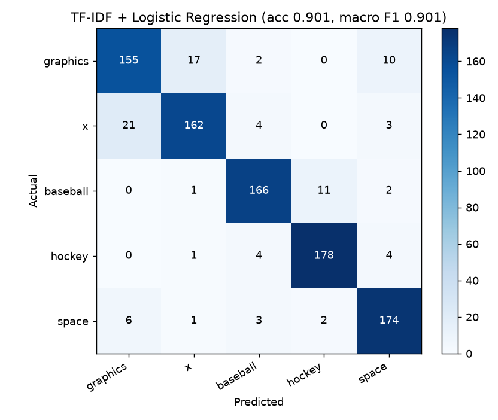
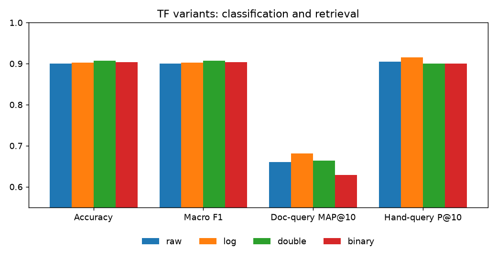
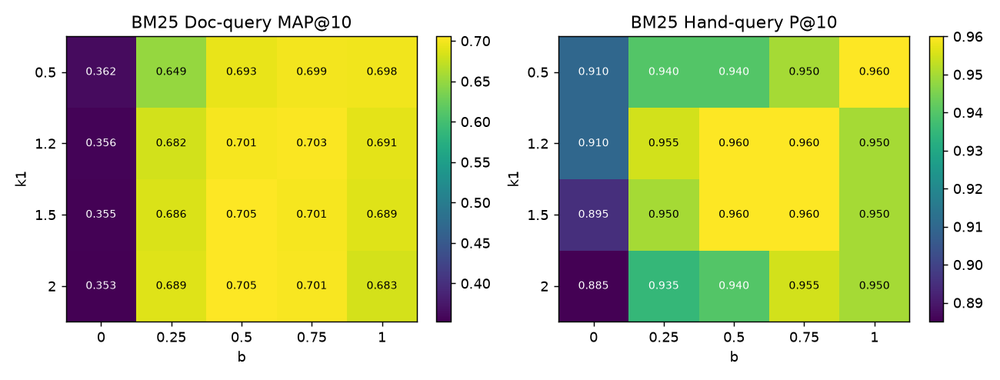
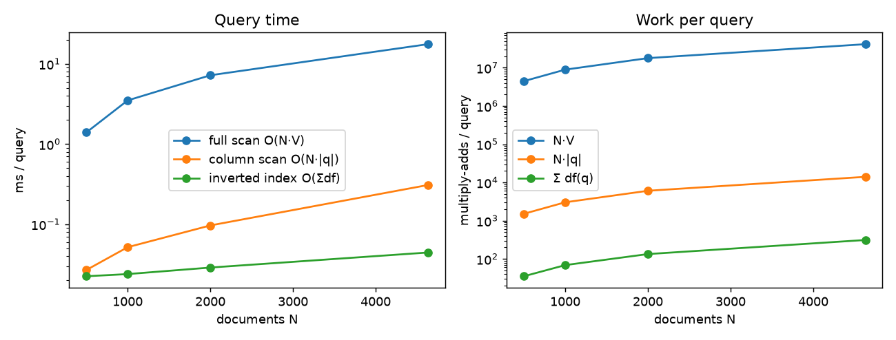

# A4-1 — 문서 검색과 텍스트 표현

[심화 과정 목차](../README.md)

20 Newsgroups의 5개 범주 4,631건으로 문서 검색기와 분류기를 만든다. 텍스트를 숫자 벡터로 바꾸는 과정(정제·토큰화·불용어 제거·TF-IDF)과 코사인 유사도 검색은 NumPy로 직접 구현했다. 직접 구현한 TF-IDF가 scikit-learn `TfidfVectorizer`와 13개 설정에서 1e-6 이내로 일치하는지 검증했다. 그 벡터를 특성으로 Logistic Regression 분류를 학습했다. 선택 보너스 3종(TF 변형 비교, BM25, 역색인)도 구현했다.

scikit-learn은 데이터 다운로드, Train/Test 분할, 분류 모델·지표, 그리고 TF-IDF·코사인 결과 검증에만 쓴다. TF-IDF, 코사인 유사도, BM25, 역색인 계산은 모두 NumPy 코드다.

## 학습 시작

[계산 실습 노트북](notebooks/search_walkthrough.ipynb)은 작은 두 문서·질의의 계산을 펼친 뒤
기존 모듈 대조 → 실제 검색·기여도 → 분류 → 보너스·시연으로 이어진다.
`uv sync --group dev` 후 A4-1의 `.venv` 커널로 위에서 아래로 실행한다.
`uv run --group dev python tools/build_learning_notebook.py --execute`로 재생성·새 커널 실행한다.
노트북은 기존 `outputs/`를 덮어쓰지 않는다.


[HTML 학습자료](study/a4-1.html)의 01 전체 흐름 → 02 전처리 → 03 TF-IDF →
04 코사인 → 05 분류 → 06 한계를 읽고, 07–09 보너스로 이어 간다.
각 장의 추가 해설은 작은 입력·중간값·축·코드 대응과 답 펼치기 질문을 제공한다.
[코드 읽기 가이드](study/code-walkthrough.md)는 같은 해설의 Markdown 판이다.
소스의 한국어 Google 스타일 docstring은 입력·반환·부작용·오류 조건을,
인접 주석은 새 문법과 데이터 변화를 설명한다. 먼저 결과를 예상한 다음 답을 확인한다.
학습 자료의 역할과 실행 방법은 [study/README.md](study/README.md)에 있다.

## 실행

이 README가 있는 A4-1 폴더에서 [uv](https://docs.astral.sh/uv/)로 실행한다.

```powershell
uv sync
uv run python -m src.run_all
uv run python -m unittest discover -s tests -v
```

`uv sync`는 `.python-version`(3.12.13)과 `uv.lock`에 맞춰 `.venv`를 만든다. uv 없이 설치하려면 Python 3.10 이상에서 `pip install -r requirements.txt`를 쓴다. 첫 실행 때 sklearn이 20 Newsgroups(약 14MB)를 `data/`에 내려받는다. `src.run_all`은 검증·검색 예시·분류·보너스 실험을 모두 실행하고 로그와 그림을 `outputs/`에 저장한다. 3~5분 걸린다. 행렬 곱과 로지스틱 회귀가 BLAS로 모든 CPU 코어를 쓰므로, 다른 작업과 함께 돌릴 때는 PowerShell에서 `$env:OMP_NUM_THREADS=2; $env:OPENBLAS_NUM_THREADS=2`로 스레드를 줄인다. 기존 테스트 22개와 학습 경계·CLI 입력 테스트 3개로 수식·실제 데이터·CV 누수 방지·해설 점수 재구성을 확인한다.

### (안 A) CLI

```powershell
uv run python main.py --query "space shuttle launch" --topk 5
uv run python main.py --query "space shuttle launch" --explain        # 1위 문서의 코사인 계산 과정
uv run python main.py --query "save" --method both --topk 3          # TF-IDF와 BM25 나란히
uv run python main.py --query "nasa orbit satellite" --index         # 역색인으로 검색
```

실행할 때마다 원문을 전처리하고 색인을 새로 만든다(약 9초). 출력 예:

```text
색인 준비: 문서 4631건 × 어휘 8918개, 8.9초
쿼리 토큰: ['space', 'shuttle', 'launch']

=== 검색 결과: TF-IDF 코사인, 전체 스캔, 16.6 ms ===
Query: "space shuttle launch"
Top 5 결과:
1. [0.469] doc 3165 (sci.space) ": >the Single Launch Core Station concept. A Shuttle external tank and solid : >rocket boosters would be used to launch the station into orbit. ..."
2. [0.464] doc 279 (sci.space) "For an essay, I am writing about the space shuttle and a need for a better propulsion system. ..."
3. [0.459] doc 4214 (sci.space) "Well, you better not get the shuttle as your launch vehicle. and most ELV's have too far of a backlog ..."
4. [0.440] doc 576 (sci.space) "...irely based on the technical aspects of space, but I couldn't find the answer on the FAQs ! ..."
5. [0.437] doc 660 (sci.space) "COMMERCIAL SPACE NEWS/SPACE TECHNOLOGY INVESTOR NUMBER 22 This is number twenty-two in an irregular series ..."

=== 코사인 유사도 계산 (1위 문서) ===
Query 벡터(0이 아닌 칸): launch=0.629, shuttle=0.626, space=0.461
문서 doc 3165: 0이 아닌 칸 57개, 그중 쿼리와 겹치는 칸
  launch       0.6291 × 0.3512 = 0.2210
  shuttle      0.6257 × 0.3494 = 0.2186
  space        0.4612 × 0.0644 = 0.0297
코사인 유사도 = (Query · 문서) / (||Query|| × ||문서||)
            = 0.4693 / (1.0000 × 1.0000) = 0.4693
```

문서 ID는 sklearn이 주는 원래 순서(`shuffle=False`)의 위치 번호다. 짧은 문서를 빼도 번호는 바뀌지 않는다.

### (안 B) 함수

```python
from src.search import search

search(query: str, topk: int = 5, method: str = "tfidf") -> List[SearchHit]
# SearchHit = NamedTuple(score: float, doc_id: int, snippet: str) → (score, doc_id, text_snippet) 튜플로 풀린다

for score, doc_id, snippet in search("hockey playoff goalie"):
    print(f"[{score:.3f}] {doc_id} {snippet[:60]}")
```

첫 호출 때 데이터를 읽고 색인을 만든다. 이후 호출은 그 색인을 다시 쓴다.

## 구조

| 경로 | 내용 |
| --- | --- |
| `src/preprocess.py` | 정제(소문자·이메일·URL·기호), 토큰화, 철자 변형 통합, 불용어 제거 |
| `src/stopwords.py` | 직접 정의한 불용어 목록(기능어·축약형·게시판 관용어) |
| `src/data.py` | 20 Newsgroups 5개 범주 로딩, 짧은 문서 제거, 8:2 층화 분할 |
| `src/tfidf.py` | 어휘 구축, 빈도 행렬, TF 변형 4종, IDF, 정규화, `TfidfVectorizerNP` |
| `src/search.py` | 코사인 유사도, top-k, 스니펫, `SearchEngine`, `search()` |
| `src/classify.py` | TF-IDF + Logistic Regression, C 교차검증, 오분류 원인 단어 계산 |
| `src/bm25.py` | BM25 (보너스 2) |
| `src/inverted_index.py` | 역색인 (보너스 3) |
| `src/experiments.py` | sklearn 대조, 검색 평가, TF 변형·BM25·역색인 실험, BoW 한계 예시 |
| `src/run_all.py` | 전체 실험 실행, `outputs/` 저장 |
| `main.py` | 검색 CLI |
| `tests/test_requirements.py` | 손계산·sklearn 대조·실제 데이터 테스트 22개 |
| `outputs/` | 검증 로그, 분류 결과, 오분류 목록, 보너스 실험 표와 그림, `summary.json` |
| `study/a4-1.html` | 탑다운 HTML 학습 자료(브라우저 안 검색 실습 포함, `study/README.md` 참고) |
| `tools/build_learning_notebook.py` | 계산 노트북 생성·새 커널 실행 |
| `pyproject.toml`, `uv.lock`, `.python-version` | uv 환경 정의 |
| `requirements.txt` | uv 없이 설치할 때 쓰는 의존성 목록 |

---

## 1. 구현 요약

### 데이터

| 항목 | 값 |
| --- | --- |
| 데이터셋 | 20 Newsgroups (`sklearn.datasets.fetch_20newsgroups`, `subset="all"`) |
| 범주 | `comp.graphics`, `comp.windows.x`, `rec.sport.baseball`, `rec.sport.hockey`, `sci.space` |
| 문서 수 | 원본 4,941건 → 토큰 5개 미만 310건 제거 → **4,631건** |
| 범주별 | graphics 920, windows.x 947, baseball 899, hockey 937, space 928 |
| 문서 길이 | 전처리 후 토큰 수 중앙값 35, 평균 92 |

범주를 일부러 헷갈리는 쌍으로 골랐다. `comp.graphics`와 `comp.windows.x`는 둘 다 컴퓨터 화면을 다루고, 야구와 하키는 둘 다 스포츠 경기 용어를 쓴다. `sci.space`는 비교적 독립적인 대조군이다. 이렇게 해야 BoW의 한계가 오분류로 드러난다.

헤더·서명·인용문은 `remove=("headers", "footers", "quotes")`로 지웠다. 헤더의 `Newsgroups:` 줄은 정답 범주를 그대로 담고 있다. 남겨두면 분류기가 본문이 아니라 헤더로 문제를 푼다. 헤더의 `From:` 줄과 서명에는 이름·이메일 같은 개인 정보도 들어 있다. 인용문까지 지우면 본문 없이 인용만 있던 답글이 비게 된다. 그래서 전처리 후 토큰이 5개 미만인 문서는 결측으로 보고 뺐다.

### 전처리 설계

`preprocess(text)` 하나가 `정제 → 토큰화 → 철자 변형 통합 → 불용어 제거`를 한다. TF-IDF, BM25, 분류, sklearn 검증이 모두 이 함수의 출력을 쓰므로 비교 대상 간 토큰이 항상 같다.

| 단계 | 기준 | 근거 |
| --- | --- | --- |
| 소문자화 | 전부 소문자 | `Shuttle`과 `shuttle`은 같은 단어다. 이 데이터에서는 대소문자로 구별해야 하는 고유명사가 드물다. |
| 이메일·URL 제거 | `\S+@\S+`, `http://`·`ftp://`·`www.`로 시작하는 문자열 | 개인 식별 정보다. 그리고 `cs.cmu.edu` 같은 조각이 주제와 무관한 강한 신호(작성자 소속)가 된다. |
| 아포스트로피 | 공백이 아니라 빈 문자열로 지움 | `don't → dont`. 공백으로 바꾸면 `don`과 `t`로 갈라져 불용어 목록으로 거를 수 없다. |
| 특수문자 | 영문자·숫자 외 모든 문자를 공백으로 | `X11R5,` `"jpeg"` 같은 구두점 부착 토큰을 원형으로 되돌린다. |
| 토큰 규칙 | 영문자로 시작하는 `[a-z0-9]` 2자 이상 | `x11`, `mpeg2`, `r5` 같은 기술 용어는 살린다. 연도·점수·전화번호 같은 순수 숫자, 그리고 `x`·`a` 같은 한 글자는 버린다. |
| 철자 변형 통합 | `colour→color`, `centre→center`, `grey→gray`, `jpg→jpeg`, `email→mail` 등 15쌍 | 같은 뜻을 다른 철자로 쓴 경우만 통합한다. `e-mail`은 정제 후 `e mail`이 되고 `e`는 한 글자라 빠지므로, `email`도 `mail`로 맞췄다. |
| 동의어 | 통합하지 않음 | `goalie`/`goaltender` 같은 의미 동의어 사전은 범위가 끝없고 만든 사람의 판단이 섞인다. BoW의 동의어 한계를 그대로 관찰하려고 남겨 두었다. |
| 불용어 | 직접 정의한 354개 | 아래 세 묶음 |
| 어간 추출 | 하지 않음 | `graphics → graphic`, `windows → window`처럼 범주를 가르는 단어가 합쳐진다. |
| 어휘 가지치기 | `min_df=5`, `max_df=0.5` | 5개 미만 문서에만 나오는 단어(오타·고유명사)와 절반 넘는 문서에 나오는 단어를 뺀다. dense 행렬 크기를 4,631×8,918(330MB)로 묶는다. `min_df=3`이면 13,419열·497MB였다. |

불용어는 `src/stopwords.py`에 세 묶음으로 정의했다.

1. **기능어**: 관사·대명사·전치사·접속사·조동사(`the`, `of`, `would`, `not` …). 어느 범주에나 고르게 나와 범주를 가르지 못한다.
2. **축약형**: 아포스트로피를 지운 형태(`dont`, `im`, `thats` …). 정제 규칙 때문에 생기므로 함께 정의해야 한다.
3. **게시판 관용어**: `writes`, `article`, `thanks`, `anyone` 같은 글쓰기 관습어와 `get`, `know`, `think`, `really` 같은 주제 무관 고빈도 단어. 범주를 가를 수 있는 단어(`game`, `image`, `space`)는 넣지 않았다.

`not`을 불용어로 뺀 것은 의도한 선택이다. 주제 분류에서는 부정어가 범주를 바꾸지 않는다. 대신 감성 분석이라면 치명적인 정보 손실이다. 아래 BoW 한계 분석에서 이 손실을 직접 보였다.

#### 토큰화의 목적과 언어별 차이

토큰화는 텍스트를 "셀 수 있는 단위"로 자르는 일이다. TF-IDF는 이 단위를 축으로 한 벡터이므로, 무엇을 한 단어로 볼지가 곧 벡터 공간을 정한다.

영어는 띄어쓰기가 단어 경계와 거의 일치하고 굴절이 적다. 그래서 공백·정규식 토큰화로도 충분하고, 이 미션도 그렇게 했다. 한국어는 띄어쓰기 단위(어절)에 조사·어미가 붙는다. 같은 명사도 `고양이가`, `고양이를`, `고양이는`처럼 다른 토큰이 된다. 그래서 같은 뜻의 단어가 서로 다른 열로 흩어지고, 어휘가 커지며, 쿼리 `고양이`가 `고양이가`와 맞지 않는다.

`outputs/bow_limits.txt`의 예시다(형태소는 손으로 나눴다).

| 토큰화 | "고양이가 쥐를 잡았다" vs "쥐가 고양이를 잡았다" | 코사인 |
| --- | --- | ---: |
| 공백 | `[고양이가, 쥐를, 잡았다]` vs `[쥐가, 고양이를, 잡았다]` | 0.2020 |
| 형태소 | `[고양이, 가, 쥐, 를, 잡, 았, 다]` vs `[쥐, 가, 고양이, 를, 잡, 았, 다]` | 1.0000 |

공백 토큰화에서는 같은 단어로 이뤄진 두 문장이 `잡았다` 하나만 공유해 유사도가 0.20이다. 형태소 분석을 하면 명사가 맞춰져 같은 단어 집합이 된다. 그런데 이번에는 어순을 잃어 "누가 누구를 잡았는지"가 다른 두 문장이 완전히 같은 벡터(1.0)가 된다. 공백 토큰화의 낮은 유사도는 의미를 구별해서가 아니라 조사 때문에 생긴 우연이다. 한국어 데이터라면 형태소 분석으로 어휘 불일치를 줄여야 검색 재현율이 오르고, 어순 문제는 BoW로는 어느 쪽이든 풀리지 않는다.

### TF-IDF 수식과 구현

```text
tf(t, d)    = f(t, d)                                    문서 d에서 단어 t의 빈도 (raw)
idf(t)      = ln((1 + n) / (1 + df(t))) + 1              smooth_idf=True
idf(t)      = ln(n / df(t)) + 1                          smooth_idf=False
tfidf(t, d) = tf(t, d) × idf(t)
v_d         = tfidf(·, d) / ‖tfidf(·, d)‖₂               L2 정규화
```

`n`은 문서 수, `df(t)`는 `t`가 한 번 이상 나온 문서 수다. TF는 "이 문서에서 얼마나 자주 나오는가", IDF는 "얼마나 드문 단어인가"를 잰다. 둘을 곱하면 이 문서에는 자주 나오지만 다른 문서에는 드문 단어가 커진다. `smooth_idf`는 분자·분모에 문서 하나를 더해 `df=0`일 때의 0 나누기를 막는다. 끝의 `+1`은 모든 문서에 나오는 단어의 가중치가 0이 되지 않게 한다. L2 정규화는 긴 문서의 벡터가 단지 단어가 많아서 커지는 것을 막고, 내적을 곧 코사인으로 만든다.

구현(`src/tfidf.py`)은 다섯 단계다.

1. `build_vocabulary` — 문서 빈도로 `min_df ≤ df ≤ max_df·n`인 단어만 남기고 알파벳순으로 정렬한다. sklearn과 열 순서를 맞추기 위해서다.
2. `count_matrix` — 모든 `(문서 번호, 단어 번호)` 쌍을 모아 `np.add.at(counts, (rows, cols), 1)`로 한 번에 센다. `counts[rows, cols] += 1`은 같은 쌍이 여러 번 나와도 한 번만 더하므로 쓰면 안 된다.
3. `term_frequency` — raw / log / double / binary 변형을 적용한다(보너스 1).
4. `inverse_document_frequency` — `df = (counts > 0).sum(axis=0)`에서 위 식으로 계산한다.
5. `weighted *= idf_`로 열마다 IDF를 곱하고(브로드캐스팅) `normalize_rows`로 행을 정규화한다.

`TfidfVectorizerNP`는 sklearn과 같은 `fit` / `transform` 인터페이스를 가진다. 쿼리와 Test 문서는 `transform`으로 학습된 어휘·IDF를 그대로 쓰고, 어휘에 없는 단어는 무시한다.

### 검색 시스템

```text
cos(q, d) = (q · d) / (‖q‖ × ‖d‖)
```

1. 쿼리를 문서와 같은 `preprocess`로 토큰화하고, 같은 어휘·IDF·L2 정규화로 벡터화한다.
2. `doc_matrix @ query_vec`로 모든 문서와의 내적을 한 번에 구한다. 문서 노름은 미리 계산해 둔다. 분모가 0이면 유사도를 0으로 둔다.
3. 점수가 0보다 큰 문서 중 상위 k개를 `np.lexsort((위치, -점수))`로 고른다. 동점이면 위치 번호가 작은 쪽이 앞선다.
4. 원문에서 쿼리 단어가 처음 나온 곳 주변 160자를 스니펫으로 잘라 `(score, doc_id, snippet)`으로 반환한다.

벡터를 L2 정규화했으므로 노름은 1이고 내적이 곧 코사인이다. 그래도 미션 요구대로 노름으로 나누는 식을 그대로 구현했다. 이 구현을 `sklearn.metrics.pairwise.cosine_similarity`와 비교한 최대 오차는 1.11e-16이다.

### 분류 시스템

| 항목 | 설정 |
| --- | --- |
| 분할 | Train 3,704 / Test 927 (8:2, 범주 비율 유지 `stratify`, `random_state=42`) |
| 특성 | 직접 구현 TF-IDF (`tf=raw`, `smooth_idf=True`, `norm="l2"`, `min_df=5`, `max_df=0.5`) |
| 어휘 | **Train 문서로만** 학습한 7,357개. Test에는 `transform`만 적용 |
| 모델 | `LogisticRegression(C=10, max_iter=2000, random_state=42)` (lbfgs, 다항) |
| C 선택 | Train 안의 5-fold 교차검증 macro F1: C=1 0.9023, **C=10 0.9028**, C=100 0.8966 |

위 표와 기존 `outputs/`의 수치는 이전 CV 조건의 저장 결과다. 당시에는 Train 전체의 어휘·IDF를 fold들이 공유했으나 최종 Test는 분리했다.
현재 `select_C`는 각 fold의 학습 토큰에서 어휘·IDF를 fit하고 검증 토큰은 transform한다.
C 선택 뒤 Train 전체로 다시 학습하고 Test에서 평가한다. 새 CV 조건의 결과는 계산 노트북에 별도로 출력한다.
검색의 전체 문서 색인은 분류의 Train 표현과 별개다.

---

## 2. 검증/실험 결과

이 절과 기존 `outputs/`는 저장 당시 실험 결과다. 검색·전처리·TF-IDF 정의는 유지하며,
분류의 C 선택 경계는 현재 코드에서 수정했다. 따라서 분류 및 C=10을 공유했던 TF 변형 분류 표는
새 CV 실행 결과와 구분한다. `src.run_all`을 현재 코드로 다시 실행하면 새로 선택한 C로 결과를 덮어쓴다.
아래의 BM25 격자·TF 변형 전체 평가·200질의 속도 실험은 이번 계산 노트북의 소규모 확인과 별개다.


### TF-IDF 검증 로그

같은 토큰 리스트를 sklearn에 넣었다(`analyzer=lambda doc: doc`). 그 뒤 직접 구현과 행렬·IDF·어휘를 비교했다. 전체 로그는 `outputs/tfidf_verification.txt`에 있다.

```text
=== TF-IDF 구현 검증 결과 ===
데이터: 20 Newsgroups 5개 범주, 전처리 후 문서 4631건
TF-IDF 행렬 shape: (4631, 8918)  (min_df=5, max_df=0.5)
sklearn 공통 설정: TfidfVectorizer(analyzer=<같은 토큰 리스트>, min_df=5, max_df=0.5, dtype=float64)

[검증] 직접 구현(tf=raw) vs Scikit-learn
  - sklearn 설정: smooth_idf=True, sublinear_tf=False, norm='l2', binary=False
  - 어휘 일치: True, IDF 최대 오차: 0.00e+00
  - 최대 오차: 1.33e-15
  - 평균 오차: 6.41e-20
  - 결과: PASS (허용 오차 1e-6 이내)
```

기본 설정 하나만이 아니라 sklearn 파라미터 조합 13개를 모두 대조했다.

| 직접 구현 | sklearn 설정 | 최대 오차 | 결과 |
| --- | --- | ---: | --- |
| `tf=raw, smooth=True, norm=l2` (**검색·분류에 쓴 기본 설정**) | `smooth_idf=True, sublinear_tf=False, norm='l2'` | 1.33e-15 | PASS |
| `tf=raw, smooth=True, norm=l1` | `smooth_idf=True, sublinear_tf=False, norm='l1'` | 3.05e-16 | PASS |
| `tf=raw, smooth=True, norm=None` | `smooth_idf=True, sublinear_tf=False, norm=None` | 0 | PASS |
| `tf=log, smooth=True, norm=l2/l1/None` | `smooth_idf=True, sublinear_tf=True, norm=…` | ≤ 3.05e-16 | PASS ×3 |
| `tf=raw, smooth=False, norm=l2/l1/None` | `smooth_idf=False, sublinear_tf=False, norm=…` | ≤ 2.16e-15 | PASS ×3 |
| `tf=log, smooth=False, norm=l2/l1/None` | `smooth_idf=False, sublinear_tf=True, norm=…` | ≤ 2.22e-16 | PASS ×3 |
| `tf=binary, smooth=True, norm=l2` | `binary=True, smooth_idf=True, norm='l2'` | 2.22e-16 | PASS |

13개 모두 어휘가 같고, IDF 오차는 0, 행렬 최대 오차는 2.16e-15 이하다. 허용 오차 1e-6보다 9자리 작다. 남은 오차는 부동소수점 덧셈 순서 차이에서 오는 것이다.

### 검색 결과

`outputs/search_examples.txt`에 쿼리 5개의 top-5가 있다. 25건 중 24건이 의도한 범주의 문서였다. 예외 1건은 `hockey playoff goalie`의 4위로, 하키 시즌을 언급한 13토큰짜리 야구 글이다(보너스 2에서 분석). 정량 평가는 아래 보너스 2의 표에 있다. 평가 쿼리 20개의 P@5는 TF-IDF가 0.930이다.

### 분류 성능

```text
=== 분류 성능 평가 ===
모델: Logistic Regression
데이터: Train 3704 / Test 927

정확도: 0.9008
F1-Score (macro): 0.9006
```

| 범주 | precision | recall | F1 | support |
| --- | ---: | ---: | ---: | ---: |
| comp.graphics | 0.852 | 0.842 | 0.847 | 184 |
| comp.windows.x | 0.890 | 0.853 | 0.871 | 190 |
| rec.sport.baseball | 0.927 | 0.922 | 0.925 | 180 |
| rec.sport.hockey | 0.932 | 0.952 | 0.942 | 187 |
| sci.space | 0.902 | 0.935 | 0.918 | 186 |



오분류 92건 중 41%(38건)가 graphics↔windows.x에서, 16%(15건)가 baseball↔hockey에서 나왔다. 헷갈리도록 고른 두 쌍이 실제로 오류의 절반 이상을 만든다. 컴퓨터 범주와 스포츠 범주 사이 오류는 8건뿐이다. 나머지 31건은 주로 다른 범주와 `sci.space` 사이에서 생겼다.

### 보너스 1 — TF 변형 비교

| TF 변형 | 식 (f>0일 때) | 정확도 | macro F1 | Doc-query MAP@10 | 평가 쿼리 P@10 |
| --- | --- | ---: | ---: | ---: | ---: |
| raw | `f` | 0.9008 | 0.9006 | 0.6609 | 0.905 |
| log | `1 + ln f` | 0.9029 | 0.9028 | **0.6814** | **0.915** |
| double | `0.5 + 0.5·f / max f` | **0.9072** | **0.9072** | 0.6634 | 0.900 |
| binary | `1` | 0.9040 | 0.9041 | 0.6293 | 0.900 |



평가 방법: 분류는 같은 분할·같은 C=10으로 학습했다. 검색은 두 가지로 쟀다. **Doc-query**는 Test 927건을 각각 쿼리로 Train 3,704건을 검색해, 같은 범주 문서를 관련 문서로 본다. **평가 쿼리**는 직접 만든 20개 쿼리(범주당 4개)다.

- **분류**에서는 네 변형의 차이가 0.6%p 이내다. Test 927건에서 정확도 0.006은 약 6건이다. 이 정도 차이는 분할을 바꾸면 순위가 뒤집힐 수 있는 크기라 우열을 단정하지 않는다. 분류기는 단어 가중치를 다시 학습하므로 TF 스케일의 영향을 대부분 흡수한다.
- **검색**에서는 차이가 더 분명하다. log가 MAP@10 0.681로 가장 높고 binary가 0.629로 가장 낮다. raw TF는 한 문서에서 같은 단어를 20번 쓰면 가중치도 20배가 되어, 그 단어 하나가 벡터 방향을 독점한다. log는 반복의 효과를 줄이되 남기고, binary는 반복 정보를 아예 버린다. 그 중간인 log가 가장 좋았다. "몇 번 나왔는가"는 중요하지만 선형으로 중요하지는 않다는 뜻이다.

### 보너스 2 — BM25

```text
score(q, d) = Σ_{t ∈ q} idf(t) · f(t,d)·(k1 + 1) / (f(t,d) + k1·(1 − b + b·|d|/avgdl))
idf(t)      = ln((N − df(t) + 0.5) / (df(t) + 0.5) + 1)          k1 = 1.5, b = 0.75
```

BM25는 TF-IDF와 두 가지가 다르다. 첫째, **빈도 포화**: `f`가 커져도 TF 항은 `k1+1`에 수렴한다. raw TF-IDF는 선형으로 커진다. 둘째, **길이 보정**: 평균보다 긴 문서의 TF를 `b`만큼 깎는다. TF-IDF는 L2 정규화로 길이를 간접적으로만 다룬다. 문서 길이 `|d|`는 어휘 가지치기 전 전처리 토큰 수다. 쿼리 안의 반복 단어는 한 번만 센다.

| 방법 | Doc-query P@10 | Doc-query MAP@10 | 평가 쿼리 P@5 | 평가 쿼리 P@10 |
| --- | ---: | ---: | ---: | ---: |
| TF-IDF (raw, L2) | 0.7400 | 0.6609 | 0.930 | 0.905 |
| BM25 (k1=1.5, b=0.75) | **0.7670** | **0.7010** | **0.960** | **0.960** |

BM25가 네 지표 모두에서 높다. 같은 쿼리의 top-5를 나란히 보면 차이가 어디서 오는지 보인다(`outputs/bm25_vs_tfidf.txt`).

```text
Query: "x window server display"  (top-5 겹침 0/5)
  1. TF-IDF doc 1776 (x,    7 tok)   BM25 doc 1975 (x,   74 tok)
  2. TF-IDF doc 1844 (x,   10 tok)   BM25 doc 3344 (x,   43 tok)
  3. TF-IDF doc 2515 (x,   65 tok)   BM25 doc 4008 (x,   46 tok)
  4. TF-IDF doc 1528 (x,   32 tok)   BM25 doc 3423 (x,  129 tok)
  5. TF-IDF doc 770  (x,  133 tok)   BM25 doc 1277 (x,  114 tok)

Query: "hockey playoff goalie"  (top-5 겹침 2/5)
  4. TF-IDF doc 3329 (baseball, 13 tok)   BM25 doc 3039 (hockey, 30 tok)
```

- TF-IDF는 L2 정규화 때문에 **아주 짧은 문서**를 위로 올린다. 7토큰짜리 문서에 `window`가 세 번 나오면 그 단어가 벡터 길이의 대부분을 차지한다. `x window server display`의 TF-IDF 1·2위가 7토큰, 10토큰 문서다. 결과 문서 길이 중앙값은 TF-IDF 32토큰, BM25 49토큰이다.
- `hockey playoff goalie`의 TF-IDF 4위는 13토큰짜리 야구 글이다. "하키 시즌이 거의 끝났으니"라는 한 문장 때문이다. 짧은 문서에서는 단어 하나의 비중이 과하게 커진다. BM25는 포화와 길이 보정으로 이런 문서를 덜 올린다.

`k1 × b` 격자(Doc-query MAP@10, 평가 쿼리 P@10):



`b=0`(길이 보정 없음)일 때 Doc-query MAP@10은 0.35 수준으로 급락한다. 쿼리가 문서 전체라 단어가 많으므로, 길이 보정이 없으면 어휘가 많은 긴 문서가 거의 모든 쿼리 단어를 포함해 상위를 독식한다. `b`를 0.5~0.75로 두면 0.70 안팎으로 회복된다. `k1`은 0.5~2.0 사이에서 차이가 0.01 이내라 덜 민감하다. 이 격자는 Test 쿼리로 잰 민감도 분석이다. 기본값 k1=1.5, b=0.75는 격자를 보기 전에 관례값으로 정했고, 격자에서 최고값을 골라 다시 보고하지 않았다.

### 보너스 3 — 역색인

```text
단어 → [(문서 위치, 가중치), ...]       예: 'shuttle' → 문서 121개 [139, 152, 180, 257, 263, ...]
```

`InvertedIndex`는 가중치 행렬에서 0이 아닌 칸만 단어별 포스팅으로 저장한다. 전체 색인은 단어 8,918개, 포스팅 220,740개다(dense 행렬 4,130만 칸의 0.53%). 검색할 때는 쿼리 단어의 포스팅만 이어 붙인다. 그다음 `np.unique` + `np.bincount`로 문서별 점수를 더한다. 점수가 `Σ_t q_t · W[d,t]` 꼴이면 어떤 가중치든 쓸 수 있다. TF-IDF 코사인에는 정규화한 TF-IDF 행렬을, BM25에는 BM25 기여도 행렬을 넣는다.

| 방법 | 쿼리당 연산량 | 시간 복잡도 |
| --- | --- | --- |
| 전체 스캔 (dense 행렬·벡터 곱) | N × V | O(N·V) |
| 전체 스캔 (쿼리 열만 선택) | N × \|q\| | O(N·\|q\|) |
| 역색인 | Σ_{t∈q} df(t) | O(Σ df(t)) + 후보 정렬 O(P log P) |

쿼리 200개(평가 쿼리 20개 + 문서에서 뽑은 3단어 쿼리 180개)를 문서 수를 바꿔 가며 쟀다. 각 측정은 5회 반복 중 최솟값이다. 아래 표와 해석은 현재 [`outputs/index_benchmark.json`](outputs/index_benchmark.json)의 같은 측정 결과를 기준으로 한다.

| N | 전체 스캔 (ms) | 열 선택 스캔 (ms) | 역색인 (ms) | N·V | N·\|q\| | Σdf(q) | 역색인 구축 (ms) | 결과 동일 |
| ---: | ---: | ---: | ---: | ---: | ---: | ---: | ---: | --- |
| 500 | 1.395 | 0.027 | 0.022 | 4,459,000 | 1,512 | 35.1 | 177 | True |
| 1,000 | 3.501 | 0.052 | 0.024 | 8,918,000 | 3,025 | 68.8 | 93 | True |
| 2,000 | 7.208 | 0.097 | 0.029 | 17,836,000 | 6,050 | 133.8 | 169 | True |
| 4,631 | 17.593 | 0.308 | **0.044** | 41,299,258 | 14,009 | 312.1 | 437 | True |



모든 크기에서 세 방법의 top-5 문서와 점수가 같았다(`same=True`). 전체 4,631건에서 역색인 1회 검색은 평균 312개 포스팅만 방문한다. dense 전체 스캔의 4,130만 칸과 비교하면 약 13만 분의 1이다. 이번 측정에서 역색인 검색은 dense 전체 스캔보다 약 396배 빨랐다(반올림 전 시간의 비율). 연산량 차이만큼 빨라지지 않는 이유는 두 가지다. NumPy 행렬 곱은 BLAS로 최적화돼 칸당 비용이 매우 싸다. 역색인은 Python 반복문과 `np.unique` 정렬의 고정 비용이 있다. 문서 수가 9.3배 늘 때 전체 스캔 시간은 12.6배, 역색인 검색 시간은 약 2.0배로 늘었다. 역색인 검색 시간은 약 0.022~0.044ms였다. 이 작은 규모에서 관찰한 시간 비율에는 고정 비용과 측정 잡음도 작용하므로, 시간 복잡도의 증가율을 그대로 검증한 수치로 해석하지 않는다. 시간 측정값은 다른 작업과 CPU를 나눠 쓰는 정도 등에 따라 실행마다 달라진다. 대신 역색인은 전체 색인 구축에 한 번 약 0.44초가 들고, 문서가 추가되면 포스팅을 갱신해야 한다.

---

## 3. 한계와 개선 방향

### BoW 한계 분석

`outputs/bow_limits.txt`에서 실제 색인(4,631건)으로 확인했다.

```text
[문제 1: 어순 무시]
"the pitcher hit the batter" → ['pitcher', 'hit', 'batter']
"the batter hit the pitcher" → ['batter', 'hit', 'pitcher']
→ 두 TF-IDF 벡터의 코사인 유사도 = 1.0000

[문제 2: 부정어 소실(불용어 'not')]
"this is a good team"     → ['team']
"this is not a good team" → ['team']
→ 두 TF-IDF 벡터의 코사인 유사도 = 1.0000

[문제 3: 동의어 불일치]
"goalie" → ['goalie'] / "goaltender" → ['goaltender']
→ 코사인 유사도 = 0.0000, 각 검색 top-10 겹침 0/10

[문제 4: 다의어]
"save" top-10 범주: baseball, x, graphics, baseball, baseball, graphics, baseball, baseball, graphics, graphics
    doc 4108 (baseball): ...a pitcher as making a save?
    doc 3899 (x):        ...a pop up window which has the Save Under attribute set...
    doc 1490 (graphics): ...create ray-traces and save them as bit-mapped files?
"run" top-10 범주: graphics, x, x, baseball, graphics, x, baseball, x, graphics, x
```

1. **어순**: BoW는 단어의 집합과 빈도만 본다. 누가 누구를 쳤는지가 바뀌어도 벡터는 같다.
2. **부정어**: `not`, `good`, `this`가 모두 불용어라 두 문장은 `team` 하나만 남는다. 주제 분류에는 문제없지만 의견·사실 판단에는 정반대의 의미가 같은 벡터가 된다. 불용어 설계가 과제의 목적에 따라 달라져야 하는 이유다.
3. **동의어**: 하키에서 `goalie`와 `goaltender`는 같은 포지션이다. 그래도 BoW에서는 서로 다른 축이라 직교한다(코사인 0). 각각 검색한 top-10이 한 건도 겹치지 않는다. `goalie`로 검색한 사람은 `goaltender`만 쓴 글을 찾을 수 없다.
4. **다의어**: `save`는 야구의 세이브 기록, X 윈도의 Save Under 속성, 파일 저장을 모두 같은 축으로 센다. 그래서 검색 결과에 세 범주가 섞인다. `run`도 야구의 득점과 프로그램 실행이 섞인다.

### 오분류 원인 분석

오분류 92건 전체는 `outputs/misclassified.md`에 있다. 로지스틱 회귀에서 범주 `k`의 점수는 `w_k · x + b_k`다. 그래서 단어 `j`가 예측 범주 `p`를 실제 범주 `a`보다 밀어준 양은 `x_j · (w_pj − w_aj)`로 계산할 수 있다. 각 사례의 "끌어당긴 단어"가 그 값이 큰 단어다. 절편 차이와 나머지 단어도 작용한다. 아래의 원인 분류는 본문과 모델 기여를 바탕으로 한 해석이며 인과적 원인 검증은 아니다. 7건을 유형별로 묶었다.

| # | 문서 | 실제 → 예측 | 끌어당긴 단어 | 원인 |
| --- | --- | --- | --- | --- |
| 1 | doc 400 | windows.x → space | `space`(0.77), `project`, `months` | 본문은 대학 프로그래밍 과정 이야기다. "**in the space of** 9 months"(9개월 동안)라는 시간 표현의 `space`가 우주 범주의 강한 신호로 작동했다. 다의어 |
| 2 | doc 4893 | windows.x → space | `space`(1.86), `stuff`, `viewer` | X용 dvi 뷰어를 찾는 글이다. "**space is at a premium**"(디스크 공간이 부족하다)의 `space`가 가장 큰 원인이다. 같은 다의어 문제 |
| 3 | doc 221 | graphics → space | `space`(2.91) vs `points`·`sphere` | "4 points in **3-space**"는 3차원 기하 공간이다. `points`, `sphere` 같은 그래픽 신호가 있었지만 `space` 하나의 가중치가 더 컸다 |
| 4 | doc 3125 | hockey → baseball | `bigger`, `glove`(0.18), `jerseys` vs `goalies`(0.84) | 골키퍼 장비가 커졌다는 글이다. `goalies`는 하키 쪽이었지만 `glove`·`jerseys`는 야구에서 더 많이 쓰인다. 하키 골리의 글러브라는 **문맥**을 BoW는 표현하지 못한다 |
| 5 | doc 3111 | hockey → baseball | `baseball`(1.96) | "Roger is now over at r.s.**baseball**"처럼 다른 게시판을 **언급**한 글이다. BoW는 단어가 등장한 것과 그 주제에 대한 글인 것을 구별하지 못한다 |
| 6 | doc 552 | graphics → windows.x | `server`(1.71), `client`, `clients` vs `objects`, `virtual` | 가상현실 소프트웨어 발표문으로, "X-Windows based, Client-Server model"이라고 소개한다. 두 범주에 모두 맞는 글이고 원래 교차 게시된 공지다. **어휘가 겹치는 범주 쌍**의 대표 사례다 |
| 7 | doc 1880 | baseball → hockey | `later`(1.25), `steve` | "Bunker & McNally were later. Pappas, Estrada, Steve Barber…" 토큰 7개 중 어휘에 걸린 단어가 2개뿐이고 나머지는 선수 이름이다. **근거가 부족한 짧은 문서**에서는 `later`·`steve` 같은 우연한 단어가 결정을 좌우한다 |

추가로 doc 780(space → windows.x)은 `xephem`을 받을 수 있는 `export.lcs.mit.edu`라는 호스트명 때문에 틀렸다. `mit`(1.32), `export`, `lcs`가 X 범주로 끌어당겼다. 이메일·URL은 정제했지만 `http://` 없이 쓴 호스트명은 남았다. 이 조각이 특정 기관이 많이 쓰는 범주의 신호가 된 것이다. 전처리 규칙의 빈틈이다.

오류를 유형별로 정리하면 이렇다.

- **다의어**(1–3): 같은 철자에 다른 뜻. 단어를 맥락 없이 하나의 축으로 세는 BoW의 구조적 한계다.
- **문맥 부재**(4, 5): 단어는 맞지만 누구의, 무엇에 대한 단어인지 모른다.
- **범주 경계 자체의 중첩**(6): graphics와 windows.x는 주제가 실제로 겹친다. 오분류 38건이 이 쌍에서 나왔다. 일부는 사람이 봐도 어느 게시판 글인지 확신하기 어렵다.
- **증거 부족**(7): 짧은 문서는 어휘에 걸리는 단어가 몇 개뿐이라, 범주와 무관한 단어 하나가 결정을 바꾼다.
- **전처리 누수**(doc 780): 정제 규칙이 놓친 조각이 강한 신호가 된다.

### 개선 방향

| 문제 | 개선 | 기대 효과 |
| --- | --- | --- |
| 어순·부정어 | 단어 n-gram(`not good`, `space shuttle`)을 특성에 추가 | 짧은 구의 어순과 부정을 일부 보존. 대신 어휘가 크게 늘어 sparse 행렬이 필요하다 |
| 동의어 | LSA(TF-IDF에 SVD) 또는 단어 임베딩(Word2Vec·GloVe) | `goalie`와 `goaltender`가 자주 함께 나오는 단어를 공유하므로 가까운 벡터가 된다 |
| 다의어·문맥 | 문맥 임베딩(BERT 계열 문장 임베딩) | 같은 `space`라도 주변 단어에 따라 다른 벡터가 된다 |
| 검색 품질 | BM25를 1차 후보로, 임베딩 유사도로 재정렬 | 역색인의 속도와 의미 기반 정렬을 함께 얻는다 |
| 전처리 누수 | 호스트명·경로 패턴(`\w+\.\w+\.(edu\|com\|gov)`) 제거 | doc 780 같은 기관 신호 제거 |
| 짧은 문서 | 짧은 문서는 신뢰도가 낮다고 표시하거나, 스레드 단위로 묶어 분류 | 근거가 적을 때 확신에 찬 오답을 줄인다 |
| 메모리 | NumPy dense → CSR sparse 행렬 | 지금은 330MB다. 0이 아닌 칸이 0.53%라 sparse로 바꾸면 수 MB가 된다. `min_df` 가지치기 없이 전체 어휘를 쓸 수 있다 |

후속 학습은 A4-2(텍스트 정보 추출과 감성 분석)로 이어진다. 감성 분석에서는 이 미션에서 불용어로 버린 `not`이 핵심 특성이 된다. 그다음은 LSA와 단어 임베딩으로 "단어의 출현 빈도만으로 의미를 파악할 수 있는가"라는 질문의 두 번째 답을 확인하는 순서를 권한다.

---

## 데이터와 윤리

- 20 Newsgroups는 1990년대 공개 Usenet 게시물을 모은 연구용 공개 데이터셋이다. 별도 라이선스 문서는 없고 원 배포처와 sklearn이 연구·교육용으로 배포한다. 원문 전체는 저장소에 넣지 않았다. 첫 실행 때 sklearn이 내려받으며 `data/`는 `.gitignore`로 제외했다. 다만 `study/a4-1.html`에는 검색 시연용으로 문서별 앞 280자 발췌가 들어 있다(이메일·URL은 가림).
- 헤더(`From:`·이메일·소속)와 서명은 sklearn의 `remove` 옵션으로, 본문 속 이메일·URL은 정제 단계에서 지웠다. 그래도 본문에 공인(선수·연구자)의 이름과 일부 서명 이름이 남아 있어 검색 스니펫에 보일 수 있다. 연락처·건강정보 같은 민감 정보는 다루지 않는다.
- 데이터 준비 체크리스트: 500건 이상(4,631건) · 2개 이상 범주(5개) · Train/Test 분리(8:2) · 결측 제거(빈·짧은 문서 310건) · 개인정보(헤더·이메일·URL 제거) · 라이선스(위 내용).

## 실행 환경

실행 검증 환경은 Windows 11, Python 3.12.13, NumPy 2.5.4, scikit-learn 1.9.1, Matplotlib 3.11.2다. `requirements.txt`의 최소 버전(NumPy 1.23, scikit-learn 1.2, Matplotlib 3.5)은 사용한 API 기준으로 적었다. 최소 버전 조합으로는 실행하지 않았다. 코드는 Python 3.10 이상 문법을 쓴다. 메모리는 TF-IDF dense 행렬 하나가 330MB이고, `src.run_all` 실행 중 최대 2GB 안팎을 쓴다. 시간 측정값은 실행 환경에 따라 달라진다.
