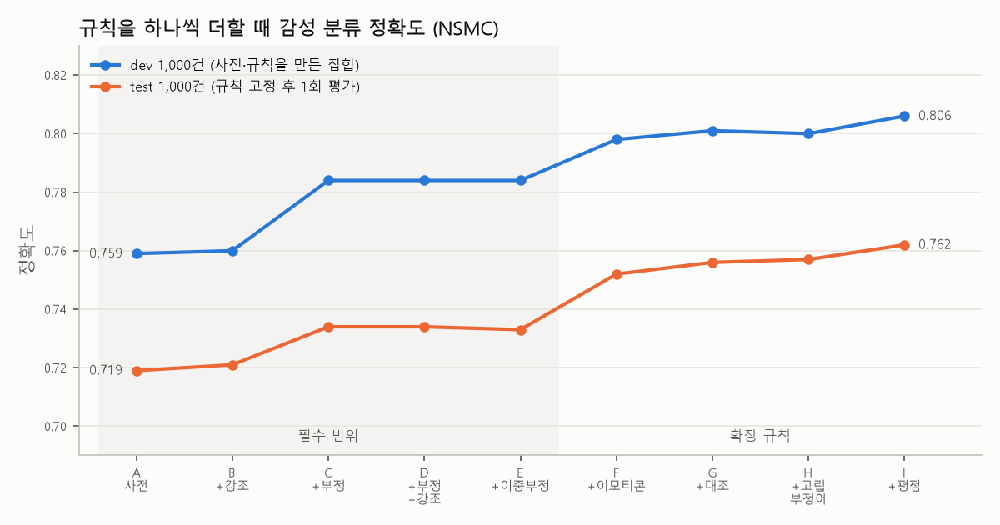
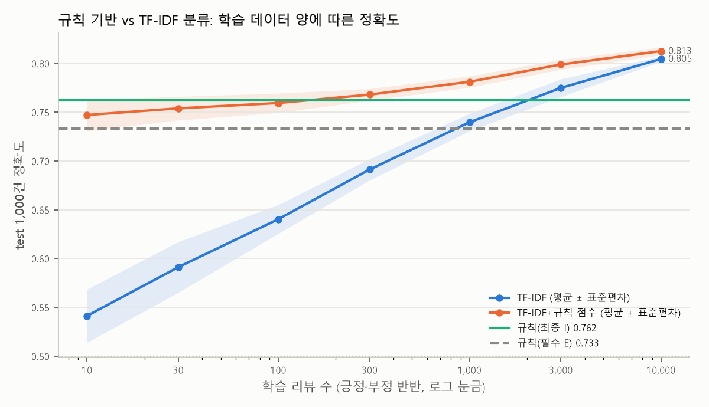

# A4-2 — 텍스트 정보 추출과 감성 분석

[심화 과정 목차](../README.md)

고객 문의나 리뷰 문장에서 연락처·날짜·금액 같은 정보를 정규표현식으로 뽑고, 감성 사전과 부정어·강조어 규칙으로 문장이 긍정인지 부정인지 판단한다. 형태소 분석기도, 학습된 모델도 쓰지 않는 규칙 기반 파이프라인이다. 핵심 질문은 "규칙으로 언어를 정의할 수 있는가?"이고, 이 보고서의 평가와 실패 분석이 그 답이다.

| 결과 | 수치 |
|---|---|
| 정보 추출(직접 만든 80문장, 정답 88개) | micro F1 **0.906** (정밀도 0.939, 재현율 0.875), 정규화 정확도 100% |
| 감성 분석(NSMC test 1,000건) | 필수 규칙 **73.3%**, 확장 규칙 포함 **76.2%** (95% CI 73.4–78.8%) |
| 부정어 규칙 효과(부정어가 작동한 test 72건) | 50.0% → 68.1% |
| 보너스 1 개인정보 마스킹 | 정답 20개 중 17개 가림(유출 3개, 모두 미지원 표기) |
| 보너스 2 규칙 vs TF-IDF | TF-IDF는 학습 리뷰 3,000건부터 규칙을 넘는다. 규칙 점수를 더한 혼합형이 모든 크기에서 가장 높다 |
| 보너스 3 속성 기반 감성 | (속성, 극성) 쌍 F1 **0.921**. 문장 전체 극성을 쓰는 기준선은 0.638 |

학습 자료: [study/a4-2.html](study/a4-2.html) — 브라우저에서 열면 같은 규칙으로 아무 문장이나 분석해 볼 수 있다.

## 1. 프로젝트 개요

```
입력 문장 ─┬─ 정규식 추출 ──── 검증·정규화 ──── 이메일 / 전화 / 날짜(ISO 8601) / 금액(정수) / URL
           │                                    └ 보너스 1: 주민번호·카드·주소까지 찾아 마스킹
           └─ 추출한 개체를 □로 가림 ── 감성 분석 ── 긍정/부정 + 계산 과정
                                          └ 보너스 3: 절 단위로 나눠 속성별 극성
```

- **정보 추출**: 패턴 8종(필수 5종 + 개인정보 3종)을 `re.VERBOSE`로 쓰고 줄마다 주석을 달았다. 정규식은 후보만 찾고, 실제로 있는 날짜인지, 한글 수사가 숫자로 해석되는지 같은 의미 검증은 정규화 단계에서 한다.
- **감성 분석**: 직접 구축한 사전 394개(감성어 371 + 이모티콘·영어 23)와 수식어 54개를 쓴다. 형태소 분석기 대신 한글 음절을 자모로 나눠 활용형을 맞춘다. 그 위에 부정어 반전, 강조어 가중치, 이중부정, 대조 접속 규칙을 얹었다.
- **평가**: 추출은 직접 작성한 정답 문장으로, 감성은 NSMC 레이블 데이터로 평가했다. 사전과 규칙은 dev 1,000건만 보며 만들었고, 고정한 뒤에 test 1,000건으로 한 번 평가했다.

## 2. 설치 및 실행 방법

Python 3.10 이상이 필요하다. 이 README가 있는 A4-2 폴더에서 [uv](https://docs.astral.sh/uv/)로 실행한다.

```powershell
uv sync                                   # .python-version(3.12)과 uv.lock대로 .venv 생성
uv run python main.py --text "문의: support@company.co.kr, 전화 02-1234-5678 일시: 2024년 3월 15일, 참가비: 50,000원"
uv run python main.py --text "이 식당은 정말 맛있지 않았어요"
uv run python main.py --text "음식은 맛있는데 가격이 비싸요" --aspect
uv run python main.py --text "연락처 010-1234-5678, 주민번호 900101-1234567" --mask
uv run python -m src.run_all              # 모든 평가와 보너스 실험 → outputs/ (1~2분)
uv run python -m unittest discover -s tests -t . -v
```

uv 없이 설치하려면 `pip install -r requirements.txt`를 쓴다. requirements.txt는 `uv export`로 uv.lock에서 만들었다. 이후 명령의 `uv run python`을 `python`으로 바꾸면 된다.

| 옵션 | 뜻 |
|---|---|
| `--text` / `--file` | 문장 하나 / 한 줄에 한 문장인 UTF-8 파일 |
| `--rules final\|required` | 확장 규칙 포함(기본) / 미션 필수 범위만 |
| `--lexicon custom\|knu\|knu+domain\|union` | 감성 사전 선택(기본 직접 구축) |
| `--mask` `--aspect` `--json` | 개인정보 마스킹 / 속성별 감성 / JSON 출력 |

출력 예(첫 번째 명령, 미션 결과 예시와 같은 형식):

```text
=== 정보 추출 결과 ===
입력: "문의: support@company.co.kr, 전화 02-1234-5678 일시: 2024년 3월 15일, 참가비: 50,000원"

추출 결과:
- 이메일: support@company.co.kr
- 전화: 02-1234-5678
- 날짜: 2024-03-15 (정규화, 원문 '2024년 3월 15일')
- 금액: 50000 (원, 정규화)
```

```text
=== 감성 분석 과정 ===
문장: "이 식당은 정말 맛있지 않았어요"

1. 토큰화: [이, 식당, 은, 정말, 맛있, 지, 않았어요]
2. 감성 단어 탐지: 맛있(+2)
3. 부정어 탐지: '않' → 감성 반전
4. 강조어 탐지: '정말' → 강도 ×1.5

계산: (+2) × (-1) × 1.5 = -3
최종 판정: 부정
```

NSMC(약 19MB)와 KNU 감성사전(약 1MB)은 처음 실행할 때 `data/downloads/`에 내려받는다. 두 파일은 저장소에 넣지 않는다. `src.run_all`은 BLAS 스레드를 2개로 제한해서, 다른 작업과 함께 돌려도 CPU를 다 쓰지 않는다.

### 구조

```
main.py                      CLI (추출 → 감성 → 속성 → 마스킹)
src/patterns.py              정규식 8종(주석 포함)과 JS 변환
src/normalize.py             검증·정규화: 날짜 ISO, 한글 수사 금액, Luhn, 주민번호 체크섬, URL 끝 정리
src/extract.py               추출, 겹침 해소, 마스킹
src/lexicon.py               사전 로더, 활용형 변이, 최장 일치 매칭기, KNU 변환
src/sentiment.py             토큰화, 절 나누기, 부정·강조·이중부정·대조 규칙, 계산 과정 출력
src/aspect.py                보너스 3 속성 기반 감성
src/bonus_tfidf.py           보너스 2 TF-IDF 학습 곡선
src/eval_*.py, metrics.py    평가(P/R/F1, bootstrap CI, McNemar)
src/run_all.py               전체 실험 → outputs/
data/lexicon/*.tsv           감성 사전, 수식어 사전, 속성 사전
data/handmade/               직접 쓴 평가 데이터(추출·마스킹·속성·규칙 표적 문장, 오분류 주석)
outputs/                     평가 결과 JSON, 그림, 오분류 사례
study/                       HTML 학습 자료
tests/                       단위 테스트 44개
```

## 3. 데이터 구성

| 용도 | 데이터 | 크기 | 출처 |
|---|---|---|---|
| 정보 추출 평가 | `data/handmade/extraction_cases.jsonl` | 80문장, 정답 개체 88개 | 직접 작성 |
| 마스킹 평가(보너스 1) | `data/handmade/masking_cases.jsonl` | 20문장, 정답 20개 | 직접 작성 |
| 감성 분석 개발 | NSMC `ratings_train.txt`에서 층화 추출한 dev | 1,000건(긍정 500, 부정 500) | [e9t/nsmc](https://github.com/e9t/nsmc) (CC0) |
| 감성 분석 평가 | NSMC `ratings_test.txt`에서 층화 추출한 test | 1,000건(긍정 500, 부정 500) | 같음 |
| TF-IDF 학습(보너스 2) | train에서 dev를 뺀 pool | 148,995건 중 n건씩 추출 | 같음 |
| 규칙 표적 문장 | `data/handmade/sentiment_rules.jsonl`, `intensity_pairs.jsonl` | 40문장, 강조어 쌍 16개 | 직접 작성 |
| 속성 평가(보너스 3) | `data/handmade/aspect_cases.jsonl` | 48문장, 정답 쌍 73개 | 직접 작성 |
| 외부 감성 사전(비교용) | KNU 한국어 감성사전 `SentiWord_info.json` | 14,854개 | [park1200656/KnuSentiLex](https://github.com/park1200656/KnuSentiLex), 군산대학교 Data Intelligence Lab(온병원·박상민·나철원, 2018) |

- **추출 테스트 문장**: 패턴별로 13~17문장이고 공통 문장이 6개다. 각 패턴에 맞혀야 할 변형 3가지 이상, 걸리면 안 되는 문장(버전 번호 10.15.7, 주문번호, 멘션 @username 등), 그리고 규칙이 놓칠 현실 표현(한글 숫자, 미국식 날짜 등)을 섞었다. 놓칠 것으로 예상한 문장에는 `fail` 필드에 유형을 미리 적었다.
- **NSMC 레이블**은 별점에서 왔다(1~4점 부정, 9~10점 긍정). 글 내용과 별점이 어긋난 리뷰가 섞여 있다.
- **dev/test 분리**: dev는 사전과 규칙을 만들 때만 봤다. test는 규칙을 고정한 뒤 평가에만 썼다(A5-1의 데이터 누수 방지와 같은 원칙). 그래서 dev 수치는 낙관적이고, 보고하는 성능은 test 수치다.
- KNU 사전은 저장소에 라이선스가 명시돼 있지 않아 커밋하지 않고 실행할 때 내려받는다.

## 4. 규칙 설계

### 4.1 정규표현식

모든 패턴은 `src/patterns.py`에 있다. 세 가지 원칙으로 썼다.

1. **`\d`, `\w`, `\b`를 쓰지 않는다.** Python의 str 패턴에서는 셋 다 유니코드 기준이다. `\b`는 `test@x.com입니다`의 `com`과 `입` 사이를 단어 경계로 보지 않는다. `\d`는 전각 숫자도 받는다. `[0-9]`, `[A-Za-z]`처럼 범위를 직접 쓰고, 앞뒤는 lookaround(`(?<![0-9])`, `(?![A-Za-z0-9-])`)로 막았다. 덕분에 같은 패턴을 학습 자료의 JavaScript에서도 그대로 쓸 수 있다.
2. **정규식은 후보만 찾고, 의미는 코드가 검증한다.** 2월 30일이나 13월을 정규식으로 막으면 읽을 수 없는 패턴이 된다. 날짜는 `datetime.date`로, 카드는 Luhn으로, 금액은 수사 파서로 확인한다.
3. **겹치면 긴 쪽, 같은 길이면 개인정보가 이긴다.** 모든 패턴의 후보를 모은 뒤 겹침을 해소한다.

| 패턴 | 처리하는 변형 | 정규화 형식 | 사용한 문법 |
|---|---|---|---|
| 이메일 | `user@domain.com`, `user.name@sub.domain.co.kr`, `Kim+cs@Example.COM`, 뒤에 붙은 한글·마침표 | 도메인만 소문자(로컬 파트는 대소문자를 구분할 수 있어 유지) | 이름 있는 그룹, 수량자 `{0,62}`, 부정 lookbehind/lookahead |
| 전화번호 | `010-1234-5678`, `02-123-4567`, `031-1234-5678`, `010.1234.5678`, `01012345678`, `(02) 123-4567`, `+82 10-…`, `1588-1234` | `010-1234-5678` 하이픈 구분(+82는 0으로) | 선택 `\|`, 선택적 구분자 `[ .-]?`, 지역번호 목록 |
| 날짜 | `2024년 1월 15일`, `2024/01/15`, `2024-01-15`, `2024. 3. 15.`, `24.12.25`, `3월 15일`, `March 15, 2024` | ISO 8601 `2024-01-15`. 연도가 없으면 `--03-15`, 2자리 연도는 POSIX `%y` 규칙(69~99 → 19xx) | **역참조** `(?P=sep)`로 같은 구분자만 허용(`2024-01/15` 거부), 버전 번호를 막는 lookahead |
| 금액 | `10,000원`, `1억 2천만원`, `$100`, `5만 원`, `2.5억원`, `오천원`, `₩3,000`, `USD 1,299.99`, `100달러` | 정수. 원화는 원, 달러는 **센트** 단위 | 반복 그룹 `(…[만억조][ ]?)*`, lookbehind로 빈 매칭 방지 |
| URL | `https://…?q=v`, `www.naver.com`, `<…>`로 감싼 링크, 포트, `#프래그먼트`, 괄호가 든 위키 주소 | 스킴·호스트 소문자, `www.`만 있으면 `http://` 보충, 기본 포트 제거, 끝 문장부호 제거 | 스킴 대소문자 무관, `(?=www\.)` lookahead |

금액을 센트 정수로 저장하는 이유는 부동소수점 오차 때문이다(0.1 + 0.2 ≠ 0.3). 금융 시스템은 최소 화폐 단위 정수로 저장한다. `parse_korean_amount`는 만 아래 자리를 모으다가 만·억·조를 만나면 곱해서 더한다. `1억 2천만` = 1×10⁸ + 2,000×10⁴ = 120,000,000이다.

### 4.2 감성 사전

`data/lexicon/sentiment.tsv`에 직접 구축했다. 사람이 읽고 고칠 수 있게 TSV로 두었다.

| 구분 | 개수 | 예 |
|---|---|---|
| 일반 감성어 | 279 | 좋(+2), 훌륭하(+3), 지루하(-2), 최악(-3), 별로(-2) |
| 영화 도메인 특화어 | 62 | 명작(+3), 몰입(+2), 여운(+2), 발연기(-3), 뻔하(-2), 졸작(-3), 알바(-1) |
| 고객·상품 도메인 특화어 | 30 | 친절하(+2), 불친절하(-3), 맛있(+2), 비싸(-2), 파손(-2), 오배송(-2) |
| 이모티콘·영어 | 23 | ㅠㅠ(+1), ㅡㅡ(-2), ♥(+2), good(+2), OO(-1, NSMC의 욕설 가림 표시) |
| 차단어(0점) | 18 | 어쩔(‘어쩔 수 없’의 ‘쩔’ 방지), 저질러(‘저질’ 방지), 밖에 없(‘없’이 부정어로 잡히는 것 방지) |

도메인 특화어는 92개로 기준인 30개를 넘는다. 점수는 -3~+3이다. 표제어에는 4가지를 붙일 수 있다.

- **품사 `P`(용언 어간)**: 사전에는 어간만 적고, 활용형은 자동으로 만든다. 하→해(지루해), ㅣ→ㅕ(멋져), ㅡ→ㅓ/ㅏ(슬퍼, 나빠), ㅂ 불규칙(아까워), 르 불규칙(달라)이다.
- **받침 확장**: 마지막 음절에 받침이 없으면 받침이 더해진 음절도 일치로 본다. `지루하`가 지루한·지루할·지루함·지루합니다에 걸린다. 형태소 분석기 없이 활용을 다루는 핵심 장치다.
- **최장 일치**: 위치마다 가장 긴 표제어 하나만 쓴다. `재미`(+1) < `재밌`(+2) < `재미없`(-2) 순이다.
- **일치 제한**: `start`는 어절 처음, `end`는 한글이 끝나는 곳, `exact`는 어절 전체에서만 일치시킨다(`좀`이 `좀비`에 걸리지 않게). `keep`은 부정어로 뒤집지 않는다(`별로 ~지 않다`는 여전히 부정).

토큰화 결과는 미션 예시와 같은 형태다. 사전에 걸린 부분을 어간으로 떼고, 나머지에서 조사를 뗀다.

### 4.3 부정어·강조어·이중부정

`data/lexicon/modifiers.tsv`에 강조어 27개, 약화어 7개, 앞 부정어 2개, 뒤 부정어 17개가 있다.

| 규칙 | 범위 | 예 |
|---|---|---|
| 강조어 ×1.2~1.5 | 감성어 앞, 같은 절, 2어절 이내 | `정말 맛있` (+2)×1.5 |
| 약화어 ×0.5 | 같음 | `좀 별로` (-2)×0.5 |
| 앞 부정어(안·못) | 같은 어절에 붙었거나 바로 앞 어절 | `안 좋아`, `안좋아` |
| 뒤 부정어(않·없·아니·안되·못하·지 마) | 감성어 뒤, 같은 절, 3어절 이내, 다음 감성어 전까지 | `좋지 않다`, `재미가 없다`, `몰입이 안 된다` |
| 이중부정 | 뒤 부정어가 2개면 두 번 뒤집혀 원래 극성 | `재미있지 않을 수 없다` (+2)×(-1)×(-1) = +2 |

- **범위가 다음 감성어에서 끊기는 이유**: `좋지 않고 재미없다`에서 `않`이 `재미없`까지 뒤집으면 안 되기 때문이다.
- **`못하`·`마세요`를 제한하는 이유**: 이 둘은 `~지` 바로 뒤에서만 앞 감성어를 뒤집는다. `망한 영화 연기까지 못함`의 `못함`은 `망한`을 꾸미지 않는다.

필수 범위 밖에서 dev를 보며 추가한 **확장 규칙** 4가지는 끄고 켤 수 있다.

1. **이모티콘**: 같은 글자 반복은 2개로 줄여 비교한다(ㅋㅋㅋㅋ → ㅋㅋ).
2. **대조 접속**: `지만`·`으나`·`하지만`·`근데`·`그래도` 앞 절은 ×0.5, 뒤 절은 ×1.5다(VADER의 but 규칙).
3. **고립 부정어**: 꾸밀 감성어가 없는 부정어는 -1이다. `이건 아니다`, `보지 마세요`가 여기에 해당한다.
4. **평점 언급**: `1점`·`별 한 개`는 -2, `10점`은 +2다. `10점 만점에`는 제외한다.

점수가 0이면(단서가 없거나 상쇄) 기본값으로 판정한다. dev에서 점수 0인 리뷰의 긍정 비율이 0.43이어서 기본값을 '부정'으로 정했다(dev 정확도: 기본값 부정 0.806, 긍정 0.780).

## 5. 평가 결과

### 5.1 정보 추출 (80문장)

일치 기준: 개체 유형과 원문 범위가 정답과 정확히 같아야 TP다. 한 글자라도 다르면 FP 하나와 FN 하나가 된다. 정규화 정확도는 TP 중 정규화 값까지 맞은 비율이다.

| 패턴 | 문장 | TP | FP | FN | 정밀도 | 재현율 | F1 | 정규화 |
|---|---|---|---|---|---|---|---|---|
| 이메일 | 13 | 14 | 1 | 2 | 0.933 | 0.875 | 0.903 | 100% |
| 전화번호 | 15 | 14 | 0 | 2 | 1.000 | 0.875 | 0.933 | 100% |
| 날짜 | 15 | 19 | 0 | 3 | 1.000 | 0.864 | 0.927 | 100% |
| 금액 | 17 | 17 | 3 | 2 | 0.850 | 0.895 | 0.872 | 100% |
| URL | 14 | 13 | 1 | 2 | 0.929 | 0.867 | 0.897 | 100% |
| **전체(micro)** | 80 | 77 | 5 | 11 | **0.939** | **0.875** | **0.906** | 100% |

정밀도가 재현율보다 높다. 규칙 기반 추출의 전형적인 모습이다. 규칙이 잡은 것은 대부분 맞지만, 규칙을 만들 때 상상하지 못한 표기는 놓친다. 정밀도를 깎은 FP 5건 중 3건은 금액이다(`만원 버스`, `3원칙`, `총액이천만원`). 숫자에 '원'이 붙는 표현이 금액 말고도 많기 때문이다.

평가하면서 버그 하나를 찾아 고쳤다. URL 스킴을 `https?`로만 써서 `HTTPS://Example.COM`을 놓쳤다. 고치기 전 URL 재현율은 0.800, 전체 F1은 0.899였다.

### 5.2 감성 분석 (NSMC)

규칙을 하나씩 더할 때의 정확도(위 dev, 아래 test). 같은 표가 `outputs/sentiment_eval.json`에 있다.



| 단계 | dev 정확도 | test 정확도 | test macro F1 | test 단서 없음 |
|---|---|---|---|---|
| A 사전 합산만 | 0.759 | 0.719 | 0.714 | 404 |
| B A + 강조어 | 0.760 | 0.721 | 0.716 | 397 |
| C A + 부정어(한 번만 반전) | 0.784 | 0.734 | 0.729 | 403 |
| D A + 부정어 + 강조어 | 0.784 | 0.734 | 0.729 | 397 |
| **E D + 이중부정 (필수 범위)** | 0.784 | **0.733** | **0.728** | 397 |
| F E + 이모티콘 | 0.798 | 0.752 | 0.750 | 349 |
| G F + 대조 접속 | 0.801 | 0.756 | 0.754 | 347 |
| H G + 고립 부정어 | 0.800 | 0.757 | 0.753 | 278 |
| **I H + 평점 언급 (최종)** | 0.806 | **0.762** | **0.759** | 264 |

- **신뢰구간**: test 1,000건 정확도는 표본 때문에 ±3%p쯤 흔들린다. bootstrap 2,000회로 구한 95% 구간은 A 0.690–0.746, E 0.705–0.759, I 0.734–0.788이다.
- **차이 검정(McNemar, 같은 문장에서 한쪽만 맞힌 수 비교)**
  - A→E: 16 대 30, p = 0.054
  - E→I: 19 대 48, p = 0.0005
  - A→I: 29 대 72, p < 0.0001
  - 필수 규칙의 개선은 test 전체 기준으로는 경계선이고, 확장 규칙까지 더한 개선은 유의하다.
- **dev와 test의 차이(약 4%p)**: 사전을 dev 리뷰를 읽으며 보강했기 때문이다. dev에서 본 단어가 test에는 덜 나온다. 규칙 기반이라고 과적합이 없는 것이 아니다.
- **최종 혼동 행렬(test, 행=정답)**: 부정 [437, 63], 긍정 [175, 325]. 긍정 재현율이 0.65로 낮다. 단서가 없는 리뷰 264건을 모두 '부정'으로 판정하는데, 그 리뷰들 중 긍정 리뷰는 감성어 없이 묘사로 칭찬하는 경우가 많다(5.3 참고).

**부정어·강조어 적용 전후.** 전체 정확도에서는 부정어 효과가 1.4%p뿐이다. 부정 표현이 든 리뷰가 많지 않아서 효과가 희석된다. 그래서 효과를 두 방식으로 따로 확인했다.

| 확인 방법 | 규칙 없음(A) | 필수 규칙(E) |
|---|---|---|
| test에서 부정어가 실제로 작동한 72건 | 50.0% | **68.1%** (McNemar p = 0.06) |
| dev에서 부정어가 실제로 작동한 70건 | 50.0% | **85.7%** (p < 0.0001) |
| 표적 문장: 부정 18개 | 0% | 94.4% |
| 표적 문장: 이중부정 8개 | 100%* | 100% |
| 강조어 쌍 16개에서 강조형 점수 절댓값이 더 큰 비율 | 0/16 | **15/16** |

\* 규칙이 없으면 부정어 두 개를 모두 무시해서 우연히 맞는다. 부정어를 한 번만 뒤집는 C단계에서는 이중부정 8개가 모두 틀린다(0%). 그래서 개수만큼 뒤집는 E단계 규칙이 필요하다.

강조어는 이진 분류 정확도를 거의 바꾸지 않는다(+0.2%p). 강조어는 극성의 부호가 아니라 크기를 바꾸기 때문이다. 대신 점수 크기에서는 효과가 분명하다. 강조어 쌍 16개 중 15개에서 강조형의 점수 절댓값이 더 크다. 실패 1개는 `재미 더럽게 없다`다. 강조어가 감성어 뒤에 오는 어순을 처리하지 못한다.

**사전 비교(test 정확도, 필수 / 최종).**

| 사전 | 규모 | 필수(E) | 최종(I) |
|---|---|---|---|
| 직접 구축 | 394 | **0.733** | **0.762** |
| KNU | 14,854 (안전 규칙으로 30개 제외) | 0.663 | 0.678 |
| KNU + 도메인 특화어 92개 | | 0.682 | 0.690 |
| 직접 구축 + KNU | | 0.718 | 0.740 |

37배 큰 KNU가 직접 구축 사전보다 7~8%p 낮다. KNU를 더하면 오히려 2%p 떨어진다. 이유는 세 가지다.

- **사전의 출처**: KNU는 표준국어대사전 뜻풀이에서 만든 일반어 사전이다. 영화 리뷰의 노잼·발연기·알바·킬링타임 같은 말이 없다.
- **문맥에 따른 극성**: 일반어 극성이 영화 리뷰에서 뒤집힌다. 예: 슬프다·눈물·무섭다.
- **형태 충돌**: KNU 표제어에는 '지'(지다, -1) 같은 1음절 말이 있다. 이런 말이 어미에 걸려 부정어 범위를 끊는다.

마지막 문제 때문에 KNU에도 직접 구축 사전과 같은 안전 규칙을 적용했다. 1음절 체언 25개를 빼고, 1음절 용언 36개는 어절 처음에서만 일치시키고, 부정어와 같은 표제어 5개를 뺐다. 적용 전에는 dev 정확도가 0.633이었다. 사전은 양보다 도메인 적합성이 중요하다.

### 5.3 실패 사례 분석

#### 정보 추출 실패(15건, 유형별)

| 유형 | 사례 | 원인 |
|---|---|---|
| 표기 변형 | `공일공-일이삼사-오육칠팔`, `이천이십사년 삼월 십오일` | 한글 숫자를 받지 않는다. 미션 예시의 실패 사례다 |
| 표기 변형 | `user at domain dot com`, `사용자@도메인.한국` | 난독화 표기와 국제화 도메인. 패턴이 `@`와 ASCII를 전제한다 |
| 동형이의어·단어 경계 | `만원 버스`(→10,000원), `3원칙`(→3원) | 글자만으로는 '만 원'과 '만원(滿員)'을 구별할 수 없다 |
| 띄어쓰기 모호성 | `총액이천만원` | '총액이 천만원'과 '총액 이천만원' 중 하나를 정할 수 없다. 규칙은 2천만 원으로 읽었다 |
| 지원하지 않는 형식 | `3/15/2024`, `1544 - 1234`, `1.2만 달러`, `example.com` | 월/일/연은 일/월/연과 구별되지 않는다. 스킴 없는 도메인은 파일명(report.pdf)과 구별되지 않는다 |
| 경계 설정의 대가 | `https://ko.wikipedia.org/wiki/정규_표현식` | URL 뒤에 붙는 조사(`…com에서`)를 떼려고 한글에서 멈추게 했다. 그래서 한글 경로가 잘린다. 한쪽을 고치면 다른 쪽이 깨진다 |
| 생략 해소 | `2024년 3월 15일~20일`의 `20일` | 범위 끝의 연·월이 앞 날짜에서 물려받아야 하는 정보라 단독 패턴으로는 알 수 없다 |
| 검증 부족 | `user..name@domain.com` | 연속된 점은 RFC 위반인데 패턴이 허용한다 |

#### 감성 분석 오분류(test 238건 중 24건을 직접 분류)

오분류 238건 중 **120건은 사전 단서가 하나도 없는 긍정 리뷰**다. 기본값(부정)으로 판정된 경우로, 가장 큰 실패 원인이다. 나머지는 단서가 있었는데 틀렸다. 전체 목록과 계산 과정은 `outputs/sentiment_errors.md`에 있다.

| 유형 | 사례(정답) | 원인 |
|---|---|---|
| 부분 문자열 오탐 | `참된 평화와 회복을 소망합니다`(긍정) | '소망합'의 '망합'이 '망하다'(-2)로 걸렸다. 어절 안 어디서든 일치시키는 방식의 대가다 |
| 부분 문자열 오탐 | `정신나간 드팔마. … 죄다 최악. 소재는 진짜 좋았는데`(부정) | '정신나간'의 '신나'(+2)가 '최악'을 상쇄했다 |
| 부분 문자열 오탐 | `추모의 의도는 좋았으나 … 마지막장면땜에 봄`(부정) | '마지막장면'의 '막장'(-2)이 걸린 뒤 부정어에 뒤집혀 +2가 됐다 |
| 부정어 오탐 | `결코 잊을 수 없는 영화`(긍정) | '잊을 수 없다'는 찬사 관용구인데 '없'이 고립 부정어(-1)로 잡혔다 |
| 부정어 오탐 | `인생 최고의 드라마 더 이상은 없다`(긍정) | '더 이상 없다'(최상급 강조)의 '없'이 '최고'를 뒤집었다 |
| 반어·비꼼 | `최고라니요ㅋㅋㅋㅋ 최악입니다`(부정) | 남의 평을 인용해 비꼰 '최고'가 문자 그대로 +3이 됐다 |
| 반어·비꼼 | `눈물짜내기의 끝판왕.`(부정) | 신파를 비꼰 말인데 '끝판왕'(+2)과 '눈물'(+1)이 그대로 더해졌다 |
| 평점 메타 언급 | `평점 조정을 위해 1점. 실제로는 7~8점 정도가 적당`(부정) | 평점 규칙이 마지막 언급인 8점을 긍정으로 읽었다 |
| 평점 메타 언급 | `이 영화보면서 1점 주는애들은 진짜 인성이 없는거다`(긍정) | 다른 관객을 비판한 말인데, 감성의 대상(영화/사람)을 구분하지 못한다 |
| 복합 감성 | `정말이지 뛰쳐나오고 싶던영화, 음악은 그런대로 좋았다`(부정) | 전체 혹평은 사전에 없는 표현이고, 부분 칭찬만 단서로 남았다 |
| 복합 감성 | `럼펄스틸스킨 캐릭터만 Good.`(부정) | 조사 '만'이 "나머지는 별로"라는 뜻을 담는데 규칙은 이를 모른다 |
| 도메인 의존 | `그냥보기에 웃기는 사이비영화`(부정) | 코미디 리뷰에서 칭찬인 '웃기'(+1)가 여기서는 조롱이다 |
| 사전 미등록 | `박중훈씨의 진가가 드러났던작품`(긍정) | 감성어 없이 묘사로 칭찬했다. 단서 없음 120건이 대부분 이런 유형이다 |
| 표기 변형 | `I LOVEEEEEEEEEE!!!`(긍정) | 반복을 2글자로 줄이면 'lovee'가 되어 'love'와 맞지 않는다 |
| 레이블 잡음 | `모든 것이 좋았고 마지막도 좋았다`(부정) | 글과 별점이 어긋난다. 규칙의 잘못이 아니다 |

이 실패들은 test를 본 뒤에 알게 되었으므로 규칙에 반영하지 않았다. 반영하면 test 성능이 부풀려진다. 개선 방향은 7장에 정리했다.

## 6. 보너스

### 보너스 1 — 개인정보 마스킹

주민등록번호(생년월일 검증 + 2020년 10월 이전 번호 체크섬 표시), 카드번호(16자리·아멕스 15자리, 역참조로 구분자 통일, Luhn 표시), 주소(시·도 + 시·군·구 + 도로명/지번 + 동·호)를 추가했다. 찾은 개인정보는 유형별 형식으로 가린다.

| 유형 | 마스킹 예 | 기준 |
|---|---|---|
| 전화 | `010-****-5678` | 미션 예시 |
| 주민번호 | `900101-1******` | 생년월일·성별 자리만 남김 |
| 카드 | `4518-42**-****-7890` | 앞 6자리·끝 4자리. PCI DSS가 화면 표시에 허용하는 최대 범위 |
| 이메일 | `us***@domain.com` | 로컬 파트 앞 2글자 |
| 주소 | `서울특별시 강남구 ****` | 시·군·구까지 |

마스킹 테스트 20문장(정답 20개, 음성 사례 3문장)의 결과는 다음과 같다.

| 유형 | 정답 | 정밀도 | 재현율 |
|---|---|---|---|
| 주민번호 | 5 | 1.00 | 0.80 |
| 카드 | 6 | 1.00 | 1.00 |
| 주소 | 5 | 1.00 | 0.80 |
| 전화 | 3 | 1.00 | 0.67 |
| 이메일 | 1 | 1.00 | 1.00 |

오탐은 0건이고 **유출은 3건**이다. 하이픈 없는 주민번호 `9001011234567`, 시·도를 생략한 주소 `강남구 테헤란로 123`, 한글 숫자 전화번호다. 마스킹에서는 놓친 것이 곧 유출이라 추출보다 재현율이 중요하다. 실서비스라면 정밀도를 일부 포기하고 13자리 연속 숫자도 일단 가리는 쪽이 맞다.

### 보너스 2 — 규칙 vs 통계(TF-IDF) 비교

같은 test 1,000건으로 비교했다.
- **TF-IDF 모델**: 글자 1~3-gram TF-IDF(`char_wb`)와 로지스틱 회귀. 띄어쓰기가 불규칙하고 활용이 많은 한국어에서는 어절 단위보다 글자 n-gram이 안정적이다. 벡터라이저는 학습 표본으로만 적합한다.
- **학습 데이터**: pool에서 긍정·부정을 반반 뽑았다. 표본에 따라 결과가 흔들려서, n ≤ 1,000은 seed 10개, 그 이상은 3개로 반복했다.
- **혼합형**: TF-IDF 특성 옆에 규칙 점수(tanh로 눌러 -1~1)와 '단서 없음' 표시를 붙였다.



| 학습 리뷰 수 | TF-IDF | TF-IDF + 규칙 점수 | 규칙(최종) |
|---|---|---|---|
| **10** | 0.541 ± 0.027 | **0.747** ± 0.016 | 0.762 |
| 30 | 0.591 ± 0.026 | 0.754 ± 0.012 | 0.762 |
| **100** | 0.640 ± 0.015 | 0.760 ± 0.010 | 0.762 |
| 300 | 0.691 ± 0.011 | 0.768 ± 0.006 | 0.762 |
| **1,000** | 0.740 ± 0.009 | **0.781** ± 0.006 | 0.762 |
| 3,000 | **0.775** ± 0.009 | 0.799 ± 0.005 | 0.762 |
| 10,000 | 0.805 ± 0.003 | **0.813** ± 0.004 | 0.762 |

- **데이터가 적을 때(10~100건)**: TF-IDF는 거의 찍기 수준이다(54~64%). 10건으로는 "재밌" 같은 기본 단서조차 배우지 못한다. 사람의 언어 지식을 담은 규칙이 압도적이다.
- **교차점(약 3,000건)**: TF-IDF 평균이 규칙을 넘는다. 1만 건에서는 80.5%로 4%p 앞선다. 통계 모델은 사전에 없는 단어, 띄어쓰기 변형, 반어에 섞인 n-gram 패턴까지 데이터에서 배운다.
- **혼합형이 모든 크기에서 가장 높다**: 데이터가 적을 때는 규칙 점수가 바닥을 받쳐 준다. 많을 때도 규칙이 아는 부정어 구조를 더해 1만 건에서 0.8%p를 더 얻는다. 표준편차도 혼합형이 더 작아서 표본 운에 덜 흔들린다.
- **비용 비교**: 규칙도 공짜가 아니다. 사전과 규칙을 만드는 데 dev 1,000건을 사람이 읽었다. "1,000건을 레이블링해 TF-IDF를 학습"하는 것(74.0%)과 "1,000건을 읽고 규칙을 쓰는" 것(76.2%)의 비교로 볼 수도 있다. 다만 규칙은 계산 과정을 설명할 수 있고, 학습 데이터 없이 새 도메인(고객 문의)으로 옮겨 갈 수 있다.

### 보너스 3 — 속성(Aspect) 기반 감성 분석

`"음식은 맛있는데 가격이 비싸요"` → 맛(긍정), 가격(부정)

1. **절 나누기**: 문장부호, 대조 어미(지만·는데·은데·으나), 접속사로 자른다.
2. **속성어 찾기**: 속성 사전(`data/lexicon/aspects.tsv`)으로 속성어를 찾는다. 영화 4개(연기·스토리·연출·음악), 고객 6개(맛·가격·서비스·배송·품질·분위기)다. '맛있다'처럼 감성어 안의 속성도 잡는다.
3. **절 분석**: 각 절을 그 절에 나온 속성의 **문맥 의존어**를 더한 사전으로 분석한다. 문맥 의존어는 '가격이 싸다'(+), '배송이 빠르다'(+), '국물이 짜다'(-)처럼 속성에 따라 극성이 정해지는 말이다. 일반 사전에 넣으면 `싸우다`, `짜임새` 같은 말에 걸려서 속성 안에서만 쓴다. 부정어 규칙은 그대로 적용된다(`배송이 빠르지 않았다` → 배송 부정).
4. **연결**: 감성어를 **앞에 나온 가장 가까운 속성**에 붙인다. 한국어는 "속성은 + 평가" 순서이기 때문이다.

직접 쓴 48문장(고객 30, 영화 18, 정답 쌍 73개)의 결과는 다음과 같다.

| 방식 | 정밀도 | 재현율 | F1 | 완전히 맞힌 문장 |
|---|---|---|---|---|
| 문장 전체 극성을 모든 속성에 붙임(기준선) | 0.677 | 0.603 | 0.638 | — |
| 속성 분석, 거리만 보고 가장 가까운 속성에 연결 | 0.969 | 0.863 | 0.913 | 39/48 |
| **속성 분석, 앞 속성 우선 연결** | **0.970** | **0.877** | **0.921** | **40/48** |
| (속성 탐지만, 극성 무시) | 1.000 | 0.904 | 0.950 | |

두 연결 방식의 차이는 `직원분들이 정말 친절하고 분위기도 좋았어요` 한 문장이다. 거리만 보면 '친절'이 뒤의 '분위기'에 붙는다. 같은 48문장에서 고른 설정이므로 0.913과 0.921의 차이를 일반화하기는 어렵다.

실패 8문장의 원인은 다음과 같다.
- **사전 미등록(6문장)**: 식다, 무심하다, 찌그러지다, 부담스럽다, 깨끗하다, 화려하다, 어색하다.
- **부정 범위 오류(1문장)**: `불친절해서 다시는 안 갈 거예요`에서 '안'이 동사 '갈'이 아니라 앞의 '불친절'을 뒤집었다.
- **제외 표현(1문장)**: `주인공 연기 빼고는 다 별로`.

## 7. 개선 아이디어와 한계

### 규칙 기반 접근의 장단점 (이번 결과로 본 것)

| | 근거 |
|---|---|
| **장점: 높은 정밀도** | 추출 정밀도 0.939(재현율 0.875), 마스킹 오탐 0건, 속성 쌍 정밀도 0.970. 규칙이 잡은 것은 대체로 맞다 |
| **장점: 해석 가능성** | 모든 판정이 `(+2) × (-1) × 1.5 = -3`처럼 계산 과정으로 나온다. 틀린 이유를 한 줄씩 짚을 수 있었다(5.3) |
| **장점: 데이터 없이 시작** | 학습 데이터 10건 상황에서 TF-IDF 54% 대 규칙 76% |
| **단점: 낮은 재현율** | test 리뷰의 26%(264건)는 사전 단서가 하나도 없다. 추출 실패도 대부분 '상상하지 못한 표기'다 |
| **단점: 유지보수** | 고친 곳이 다른 곳을 깬다. URL을 한글에서 멈추면 한글 경로가 잘린다. 1음절 사전어는 조사·어미와 충돌한다. dev를 보며 단어를 더할수록 test와의 차이(4%p)가 생겼다 |
| **단점: 언어 현상을 다 쓸 수 없음** | 반어, 인용, 감성의 대상(영화/다른 관객), 한정 조사 '만'은 단어 수준 규칙의 바깥에 있다 |

**"규칙으로 언어를 정의할 수 있는가?"** 형식이 정해진 언어(이메일, 날짜, 금액)는 대부분 정의할 수 있었다. 그래도 경계 사례가 남았다(한글 숫자, 만원 버스, 띄어쓰기 모호성). 의미와 태도의 언어(감성)는 규칙으로 76%까지 갔다. 나머지는 단서 없는 묘사, 반어, 맥락이라서 규칙을 더 늘려도 잡기 어렵다. 반면 규칙이 담은 지식은 통계 모델과 합쳤을 때 데이터가 적은 구간에서 특히 큰 가치를 냈다(보너스 2의 혼합형).

### 통계 기반(A4-1)과 규칙 기반(A4-2)의 쓰임

| 상황 | 적합한 쪽 |
|---|---|
| 형식이 정해진 값(연락처, 날짜, 금액, 개인정보) 추출·정규화 | 규칙. 정답 형식이 명확하고 검증식(Luhn, 달력)을 쓸 수 있다 |
| 레이블 데이터가 거의 없음, 판정 근거를 설명해야 함(심사·규제) | 규칙 또는 규칙 + 통계 혼합 |
| 레이블이 수천 건 이상, 표현이 다양함(리뷰 감성, 주제 분류) | 통계. 이번 실험에서 약 3,000건부터 규칙을 넘었다 |
| 검색처럼 순위를 매기는 일(A4-1의 TF-IDF·BM25) | 통계. 규칙은 순위가 아니라 일치 여부를 낸다 |

### 개선 방향

1. **형태소 경계 확인**: 부분 문자열 오탐(소망→망하, 정신나간→신나)이 test 오분류의 큰 몫이다. 형태소 분석기(Kiwi, KoNLPy)로 어간 경계를 확인하면 줄일 수 있다. 다만 학습 자료처럼 규칙을 브라우저에서 그대로 돌리는 이점은 잃는다.
2. **관용구 사전**: `잊을 수 없는`, `더 이상 없는`, `믿겨지지 않을 정도`처럼 부정어가 칭찬을 만드는 관용구를 차단어로 등록한다.
3. **단서 없음 처리**: 점수 0인 리뷰를 기본값으로 판정하는 대신, 혼합형처럼 통계 모델에 맡긴다.
4. **한글 숫자 정규화 전처리**: `공일공`, `이천이십사년`을 숫자로 바꾼 뒤 같은 패턴을 적용한다.
5. **문맥 기반 추출**: `만원 버스`처럼 앞뒤 단어(버스, 지하철)를 보는 규칙이나, 개체명 인식 모델로 넘어간다.

## 데이터와 윤리

NSMC 리뷰에는 실명(배우·감독·평론가)과 비속어가 들어 있다. 보고서와 학습 자료에는 오분류 분석에 필요한 리뷰만 인용했다. 추출·마스킹 테스트의 연락처·주민번호·카드번호는 모두 지어낸 값이다. 카드번호 중 일부는 카드사가 공개한 테스트 번호다.

## 실행 환경

검증 조합: Windows 11, Python 3.12.13, numpy 2.5.4, scikit-learn 1.9.1, scipy 1.18.1, matplotlib 3.11.2. `src.run_all` 전체는 1~2분 걸리고, 대부분은 보너스 2 학습 곡선이다.
