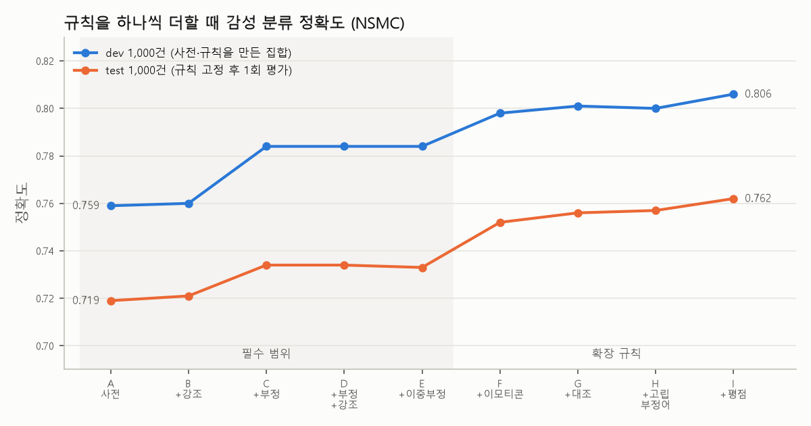
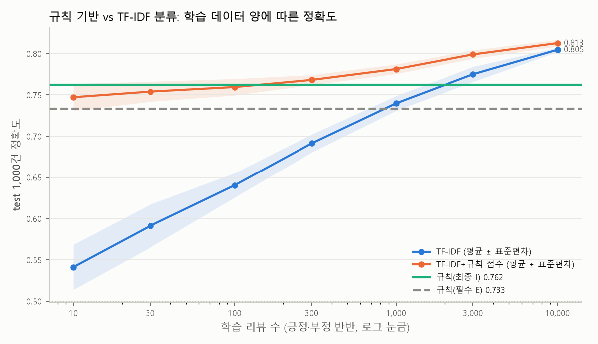

# A4-2 글에서 정보와 기분 뽑기: 규칙으로 언어를 정의할 수 있을까?

고객 문의나 리뷰 문장에서 연락처, 날짜, 금액을 뽑고, 글쓴이의 기분이 좋은지 나쁜지 판단하는 프로그램을 만드는 미션이에요. 학습된 모델 없이 사람이 쓴 규칙만 써요. 글자 모양은 **정규표현식**(글자 패턴을 적는 표기법)으로 찾고, 기분은 **감성 사전**(단어별 점수표)으로 계산해요.

## 문장을 넣으면 이렇게 나와요

```text
입력: 문의: support@example.com, 전화 02-0000-0002 일시: 2024년 3월 15일, 참가비: 50,000원

- 이메일: support@example.com
- 전화: 02-0000-0002
- 날짜: 2024-03-15
- 금액: 50000
```

```text
입력: 이 식당은 정말 맛있지 않았어요

감성 단어: 맛있(+2)
부정어: 않(×-1)
강조어: 정말(×1.5)

계산: (+2) × (-1) × 1.5 = -3
판정: 부정
```

## 결론: 규칙으로 어디까지 됐을까?

**형식이 정해진 값은 규칙으로 대부분 찾았지만, 기분은 단어에 드러난 만큼만 알 수 있었어요.**

| 하는 일 | 결과 |
| --- | --- |
| 이메일, 전화번호, 날짜, 금액, URL 찾기 | 직접 쓴 시험 문장의 정답 88개 중 77개를 찾았고, 찾은 82개 중 77개가 맞았어요 (F1 0.906) |
| 기분 판단 (긍정, 부정) | 영화 리뷰 1,000건 중 762건을 맞혔어요 (정확도 76.2%) |

규칙이 찾은 것은 대체로 맞고, 판정 이유도 계산식으로 설명할 수 있어요. 대신 규칙을 만들 때 생각하지 못한 표현은 놓쳐요.

두 점수 모두 실제 고객 문의로 잰 값은 아니에요. 값 찾기는 직접 쓴 문장, 기분 판단은 네이버 영화 리뷰(NSMC)로 쟀어요.

## 어떻게 동작할까?

**값 찾기:** 정규표현식으로 모양이 맞는 후보를 찾아요. 그다음 코드가 `2월 30일`처럼 없는 날짜를 버리고, `2024-03-15`처럼 형식을 통일해요.

**기분 판단:** 단어마다 -3(매우 나쁨)부터 +3(매우 좋음)까지 점수를 적어 두었어요. 문장에서 찾은 단어의 점수에 아래 규칙을 곱한 뒤 모두 더해요. 합이 0보다 크면 긍정, 그렇지 않으면 부정이에요.

| 규칙 | 하는 일 | 예 |
| --- | --- | --- |
| 부정어 | 점수를 뒤집어요 | `좋지 않다`: (+2) × (-1) = -2 |
| 강조어 | 점수를 키워요 | `정말 좋다`: (+2) × 1.5 = +3 |
| 이중부정 | 두 번 뒤집어 원래대로 돌아와요 | `재미있지 않을 수 없다`: (+2) × (-1) × (-1) = +2 |

## 어디서 틀릴까?

틀린 영화 리뷰 238건 중 120건은 사전에 있는 단어가 하나도 없는 긍정 리뷰였어요. 단서가 없어 점수가 0이면 부정으로 판정하기 때문이에요. 나머지는 아래처럼 글자만 봐서 생긴 오류가 많아요.

| 문장 | 무엇을 잘못 읽었나 |
| --- | --- |
| `공일공-공공공공-공공공일` | 한글로 쓴 숫자를 전화번호로 찾지 못해요 |
| `만원 버스` | 사람이 가득 찬 버스를 10,000원으로 읽어요 |
| `소망합니다` | 안에 든 `망합`을 `망하다`로 읽어요 |
| `결코 잊을 수 없는 영화` | 칭찬인데 `없`을 부정어로 읽어요 |
| `눈물짜내기의 끝판왕.` | 비꼬는 말의 점수를 그대로 더해요 |
| `음식은 맛있는데 가격이 비싸요` | 좋은 점과 나쁜 점이 상쇄돼 0점이 돼요 |
| `문제가 없어요` | `문제`는 사전에 없어서 `없`만 남아 부정이 돼요 |

## 언제 규칙을 쓰면 좋을까?

| 상황 | 알맞은 쪽 |
| --- | --- |
| 연락처, 날짜, 금액처럼 형식이 정해진 값 찾기 | 규칙 |
| 정답 달린 데이터가 거의 없거나 판정 이유를 설명해야 할 때 | 규칙, 또는 규칙과 통계 함께 쓰기 |
| 정답 달린 데이터가 수천 건 이상이고 표현이 다양할 때 | 통계 |

같은 영화 리뷰로 비교하면, 학습 리뷰가 10건일 때 통계 방법(TF-IDF)의 정확도는 54.1%로 규칙(76.2%)에 크게 못 미쳐요. 약 3,000건부터는 통계 방법이 규칙을 넘어요(77.5%).

## 실행하기

[uv](https://docs.astral.sh/uv/getting-started/installation/)가 필요해요. 없다면 `pip install uv`로 설치할 수 있어요.

```bash
cd 02_Advanced/A4-2
uv sync --locked
uv run python main.py --text "이 식당은 정말 맛있지 않았어요"
```

`uv sync`는 Python 3.12와 라이브러리를 이 폴더의 `.venv`에 설치해요. 처음 한 번은 내려받는 데 시간이 걸리고, 약 340MB를 차지해요.

- **전체 평가 다시 재기:** `uv run python -m src.run_all`을 실행하면 결과가 `outputs/`에 저장돼요. 1~2분 걸리고, 처음 실행할 때 NSMC(약 19MB)와 KNU 감성사전(약 1MB)을 내려받아요.
- **uv 없이 실행:** `pip install -r requirements.txt`로 설치한 뒤, 위 명령의 `uv run python`을 `python`으로 바꾸세요.

<details>
<summary>명령 옵션</summary>

| 옵션 | 하는 일 |
| --- | --- |
| `--text "문장"` | 문장 하나를 분석해요 |
| `--file 파일` | 한 줄에 한 문장씩 적힌 UTF-8 파일을 분석해요 |
| `--rules required` | 미션 필수 규칙만 써요. 기본값 `final`은 확장 규칙까지 써요 |
| `--lexicon knu` | 다른 감성 사전을 써요. `custom`(기본), `knu`, `knu+domain`, `union` 중에 골라요 |
| `--mask` | 개인정보를 가린 문장도 보여 줘요 |
| `--aspect` | 음식, 가격처럼 대상별 감성도 보여 줘요 |
| `--json` | 결과를 JSON으로 출력해요 |

</details>

## 더 알아보기

| 이럴 때 | 여기를 보세요 |
| --- | --- |
| 정규식이나 감성 분석이 낯설어요 | [`study/a4-2-guide.html`](study/a4-2-guide.html): 코드를 몰라도 읽을 수 있어요. 레포를 받은 뒤 브라우저로 여세요 |
| 규칙을 끄고 켜며 결과를 보고 싶어요 | [`study/a4-2.html`](study/a4-2.html): 패턴을 고치거나 규칙을 끄면 결과가 달라져요 |
| 코드를 한 단계씩 따라가고 싶어요 | [`notebooks/rules_walkthrough.ipynb`](notebooks/rules_walkthrough.ipynb): 문장 하나가 처리되는 과정을 직접 실행해요 |
| 정규식 실물이 궁금해요 | [`src/patterns.py`](src/patterns.py): 패턴마다 한국어 주석이 달려 있어요 |

## 자세한 근거

미션에서 요구한 세부 결과예요. 필요할 때만 펼쳐 보세요.

<details>
<summary>규칙 상세</summary>

**값 찾기**

| 찾는 값 | 찾을 수 있는 표기 | 이렇게 통일해요 |
| --- | --- | --- |
| 이메일 | `user@example.com`, `user.name@sub.example.com` | 도메인만 소문자로 |
| 전화번호 | `010-0000-0001`, `02-000-0001`, `01000000001`, `+82 10-…` | `010-0000-0001` 형식으로 |
| 날짜 | `2024년 1월 15일`, `2024/01/15`, `24.12.25`, `3월 15일` | `2024-01-15` 형식으로 |
| 금액 | `10,000원`, `1억 2천만원`, `$100`, `오천원` | 정수로. 원화는 원, 달러는 센트 단위 |
| URL | `https://…?q=v`, `www.naver.com` | 앞부분을 소문자로, `www.`만 있으면 `http://`를 붙여서 |

값이 서로 겹치면 더 긴 쪽을 택해요. 찾은 값은 감성 계산 전에 가려서, 날짜 속 숫자나 마침표가 계산을 방해하지 않게 해요.

**감성 사전:** 직접 만든 394개 단어를 써요. 그중 92개는 `발연기`, `불친절하`처럼 영화나 고객 응대에서 자주 쓰는 말이에요. 37배 큰 KNU 사전으로 바꾸면 정확도가 67.8%로 8%포인트쯤 떨어져서, 사전은 크기보다 쓰는 영역에 맞는지가 더 중요했어요.

**적용 범위**

- **강조어(× 1.2~1.5)와 약화어(× 0.5):** 감성어 앞, 같은 절 안, 2어절 이내에서만 적용해요.
- **앞에 오는 부정어(안, 못):** 같은 어절에 붙었거나 바로 앞 어절일 때 적용해요.
- **뒤에 오는 부정어(않, 없, 아니 등):** 감성어 뒤, 같은 절 안, 3어절 이내에서 다음 감성어가 나오기 전까지 적용해요.

**확장 규칙:** 미션 필수 범위 밖에서 네 가지를 더 넣었어요.

1. **이모티콘:** 같은 글자 반복은 2개로 줄여 비교해요. `ㅋㅋㅋㅋ`는 `ㅋㅋ`로 봐요.
2. **대조:** `지만`, `하지만`, `근데` 앞 절은 × 0.5, 뒤 절은 × 1.5를 해요.
3. **꾸밀 말이 없는 부정어:** `이건 아니다`처럼 감성어가 없으면 -1을 줘요.
4. **평점 언급:** `1점`, `별 한 개`는 -2, `10점`은 +2를 줘요. `10점 만점에`는 제외해요.

</details>

<details>
<summary>데이터와 평가 결과</summary>

**데이터**

| 어디에 쓰나 | 데이터 | 크기 |
| --- | --- | --- |
| 값 찾기 시험 | 직접 쓴 문장 | 80문장, 정답 88개 |
| 규칙을 만들 때 보는 리뷰 | NSMC 영화 리뷰 | 1,000건 (긍정 500, 부정 500) |
| 마지막 평가에 쓰는 리뷰 | NSMC 영화 리뷰 | 1,000건 (긍정 500, 부정 500) |
| 규칙 동작 확인 | 직접 쓴 문장 | 40문장, 강조어 쌍 16개 |
| 사전 비교 | KNU 한국어 감성사전 | 14,854개 |

- **출처:** [NSMC](https://github.com/e9t/nsmc)(CC0), [KNU 한국어 감성사전](https://github.com/park1200656/KnuSentiLex). 직접 쓴 문장은 [`data/handmade/`](data/handmade/)에 있고, 연락처와 개인정보는 모두 지어낸 값이에요.
- **정답의 뜻:** NSMC의 정답은 별점에서 왔어요. 1~4점은 부정, 9~10점은 긍정이에요. 글 내용과 별점이 어긋난 리뷰도 있어요.
- **개발용과 시험용을 나눈 이유:** 답을 본 문제로 시험을 치면 점수가 부풀어요. 실제로 규칙을 만들 때 본 리뷰의 정확도는 80.6%, 시험용은 76.2%였어요.
- **리뷰 원문:** NSMC에는 실명과 비속어가 있어요. `outputs/`와 `study/a4-2.html`에는 리뷰 원문이 들어 있어요.

**값 찾기 결과**

유형과 글자가 모두 맞아야 정답으로 쳐요. 정밀도는 찾은 것 중 맞은 비율, 재현율은 정답 중 찾은 비율, F1은 둘을 합친 점수예요.

| 패턴 | 맞게 찾음 | 잘못 찾음 | 놓침 | 정밀도 | 재현율 | F1 |
| --- | ---: | ---: | ---: | ---: | ---: | ---: |
| 이메일 | 14 | 1 | 2 | 0.933 | 0.875 | 0.903 |
| 전화번호 | 14 | 0 | 2 | 1.000 | 0.875 | 0.933 |
| 날짜 | 19 | 0 | 3 | 1.000 | 0.864 | 0.927 |
| 금액 | 17 | 3 | 2 | 0.850 | 0.895 | 0.872 |
| URL | 13 | 1 | 2 | 0.929 | 0.867 | 0.897 |
| **전체** | **77** | **5** | **11** | **0.939** | **0.875** | **0.906** |

맞게 찾은 값은 모두 올바른 형식으로 통일됐어요. 시험 문장을 보고 대문자 URL을 찾지 못하는 문제를 고쳐서 F1이 0.899에서 0.906으로 올랐으니, 0.906은 그만큼 후한 값이에요.

**기분 판단 결과 (시험용 리뷰 1,000건)**

| 단계 | 정확도 | macro F1 | 점수가 0인 리뷰 |
| --- | ---: | ---: | ---: |
| 사전 점수만 더하기 | 71.9% | 0.714 | 404건 |
| + 부정어, 강조어, 이중부정 (미션 필수) | **73.3%** | 0.728 | 397건 |
| + 확장 규칙 4가지 (최종) | **76.2%** | 0.759 | 264건 |



부정어와 강조어를 더한 효과가 작아 보이는 이유는 부정 표현이 든 리뷰가 많지 않고, 강조어는 크기만 바꾸기 때문이에요. 해당 문장만 모아 재면 차이가 뚜렷해요.

| 확인한 것 | 규칙 없음 | 필수 규칙 |
| --- | ---: | ---: |
| 시험용 리뷰 중 부정어가 작동한 72건의 정확도 | 50.0% | **68.1%** |
| 직접 쓴 부정 문장 18개의 정확도 | 0% | **94.4%** |
| 강조어 쌍 16개 중 강조한 쪽의 점수 크기가 더 큰 쌍 | 0개 | **15개** |

최종 규칙은 부정 리뷰 500건 중 437건, 긍정 리뷰 500건 중 325건을 맞혔어요. 0점 리뷰를 부정으로 판정하는 이유는 규칙을 만들 때 본 리뷰에서 0점 리뷰의 긍정 비율이 0.43으로 절반보다 낮았기 때문이에요.

</details>

<details>
<summary>실패 사례 전체와 개선 아이디어</summary>

**값 찾기**

| 유형 | 사례 | 원인 |
| --- | --- | --- |
| 표기 변형 | `공일공-공공공공-공공공일`, `이천이십사년 삼월 십오일` | 한글 숫자를 받지 않아요 |
| 표기 변형 | `user at example dot com`, `사용자@예시.테스트` | 패턴이 `@`와 영문 도메인을 전제해요 |
| 같은 글자, 다른 뜻 | `만원 버스`(→10,000원), `3원칙`(→3원) | 글자만으로는 만 원과 만원(滿員)을 구별할 수 없어요 |
| 띄어쓰기 모호성 | `총액이천만원` | `총액이 천만원`과 `총액 이천만원` 중 하나를 정할 수 없어요 |
| 띄어쓰기 없는 금액 | `참가비만원` | `조원`, `불만 원인` 같은 오탐을 막으려고 앞에 한글이 붙은 `만`, `억`, `조` 금액은 찾지 않아요 |
| 지원하지 않는 형식 | `3/15/2024`, `1544 - 0001`, `1.2만 달러`, `example.com` | 월/일/연은 일/월/연과 구별되지 않아요. `example.com`은 `report.pdf` 같은 파일 이름과 구별되지 않아요 |
| 고치다 생긴 대가 | `https://ko.wikipedia.org/wiki/정규_표현식` | URL 뒤의 조사를 떼려고 한글에서 멈추게 했더니 한글 주소가 잘려요 |
| 생략된 정보 | `2024년 3월 15일~20일`의 `20일` | 연과 월을 앞 날짜에서 물려받아야 해요 |
| 검증 부족 | `user..name@example.com` | 잘못된 연속 점을 패턴이 허용해요 |

**기분 판단** (괄호 안은 별점에서 온 정답). 원인을 분류한 24건은 [`outputs/sentiment_errors.md`](outputs/sentiment_errors.md)에 있어요.

| 유형 | 사례 | 원인 |
| --- | --- | --- |
| 글자 일부 일치 | `참된 평화와 회복을 소망합니다`(긍정) | `소망합`의 `망합`이 -2로 걸렸어요 |
| 글자 일부 일치 | `정신나간 드팔마. … 죄다 최악. 소재는 진짜 좋았는데`(부정) | `정신나간`의 `신나`가 +2로 걸려 `최악`을 상쇄했어요 |
| 칭찬하는 부정 표현 | `결코 잊을 수 없는 영화`(긍정) | `잊을 수 없다`는 찬사인데 `없`을 -1로 읽었어요 |
| 칭찬하는 부정 표현 | `인생 최고의 드라마 더 이상은 없다`(긍정) | `없`이 `최고`를 뒤집었어요 |
| 반어, 비꼼 | `최고라니요ㅋㅋㅋㅋ 최악입니다`(부정) | 남의 평을 비꼰 `최고`를 그대로 +3으로 셌어요 |
| 반어, 비꼼 | `눈물짜내기의 끝판왕.`(부정) | `끝판왕`과 `눈물`을 그대로 더했어요 |
| 평점 언급 | `평점 조정을 위해 1점. 실제로는 7~8점 정도가 적당`(부정) | 마지막에 언급한 8점을 긍정으로 읽었어요 |
| 대상 구별 | `이 영화보면서 1점 주는애들은 진짜 인성이 없는거다`(긍정) | 다른 관객을 비판한 말을 영화 평으로 읽었어요 |
| 복합 감성 | `정말이지 뛰쳐나오고 싶던영화, 음악은 그런대로 좋았다`(부정) | 혹평은 사전에 없고 부분 칭찬만 단서로 남았어요 |
| 복합 감성 | `럼펄스틸스킨 캐릭터만 Good.`(부정) | 조사 `만`에 담긴 "나머지는 별로"를 몰라요 |
| 영역에 따른 뜻 | `그냥보기에 웃기는 사이비영화`(부정) | 칭찬인 `웃기`가 여기서는 조롱이에요 |
| 표기 변형 | `I LOVEEEEEEEEEE!!!`(긍정) | 반복을 줄이면 `lovee`가 되어 `love`와 맞지 않아요 |
| 정답 문제일 수 있음 | `모든 것이 좋았고 마지막도 좋았다`(부정) | 글과 별점이 어긋나요. 원인을 확정할 수는 없어요 |

**고객 문의 문장** (점수로 잰 결과는 아니에요)

| 문장 | 점수 | 원인 |
| --- | ---: | --- |
| `택배가 도착했습니다` | +1 | `도착했`의 `착했`을 `착하다`로 읽었어요 |
| `문제가 없어요` | -1 | `문제`가 사전에 없어서 `없`만 남았어요 |
| `이보다 좋을 수 없다` | -2 | 최고라는 뜻인데 `없`이 `좋`을 뒤집었어요 |

**개선 아이디어**

1. **형태소 분석기 쓰기:** `소망합니다`의 `망합` 같은 오탐을 줄일 수 있어요.
2. **관용구 등록하기:** `잊을 수 없는`처럼 칭찬하는 표현을 사전에 넣어요.
3. **단서 없는 문장은 통계 모델에 맡기기:** 0점 리뷰를 무조건 부정으로 판정하지 않게 돼요.
4. **한글 숫자를 먼저 바꾸기:** `공일공`을 `010`으로 바꾼 뒤 같은 패턴을 써요.
5. **앞뒤 단어 보기:** `만원 버스`의 `버스`처럼 주변 말로 뜻을 가려요.

</details>

<details>
<summary>보너스 과제</summary>

**개인정보 마스킹(`--mask`):** 주민등록번호, 카드번호, 주소, 전화번호, 이메일 정답 20개를 잘못 가린 것 없이 가렸지만 3개를 놓쳤어요. 놓친 값은 곧 유출이라서 재현율이 중요해요.

**규칙과 통계 비교:** 글자 조각의 TF-IDF에 로지스틱 회귀를 붙여 같은 시험용 리뷰로 비교했어요.

| 학습 리뷰 수 | TF-IDF | TF-IDF + 규칙 점수 | 규칙(최종) |
| ---: | ---: | ---: | ---: |
| 10 | 54.1% | 74.7% | 76.2% |
| 100 | 64.0% | 76.0% | 76.2% |
| 1,000 | 74.0% | 78.1% | 76.2% |
| 3,000 | **77.5%** | 79.9% | 76.2% |
| 10,000 | 80.5% | **81.3%** | 76.2% |



**대상별 감성 분석(`--aspect`):** `음식은 맛있는데 가격이 비싸요`를 맛은 긍정, 가격은 부정으로 나눠 판단해요. 직접 쓴 48문장에서 F1이 0.638(문장 전체 판정)에서 0.921(속성별 판단)로 올랐어요.

</details>

---

[심화 과정 목차](../README.md) · [전체 과정](../../README.md)
