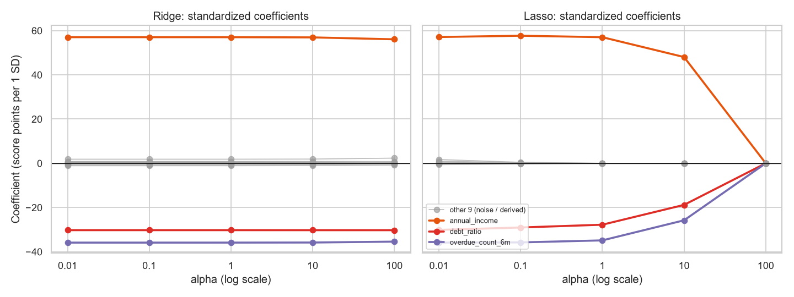
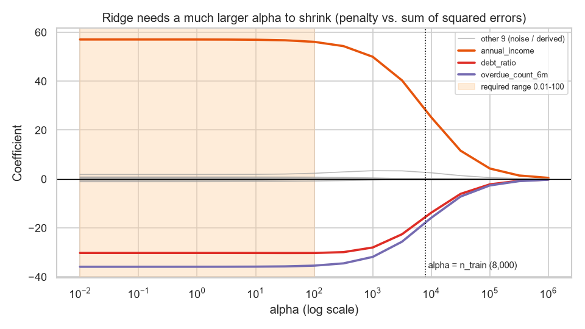
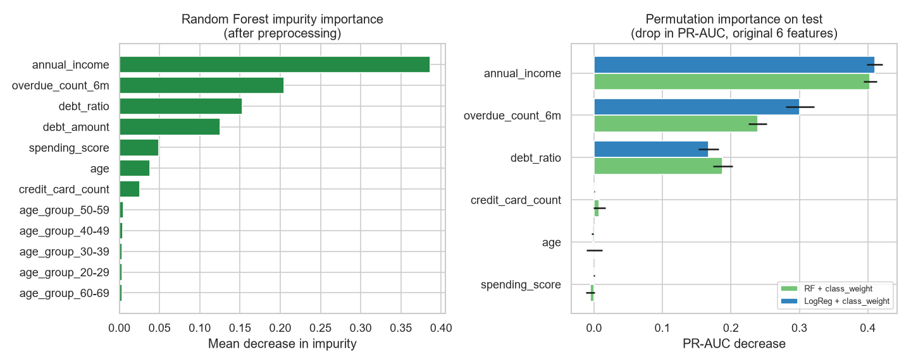
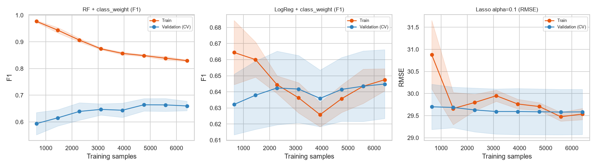

# A5-1 — 신용 점수 회귀와 연체 위험 분류

가상의 금융 고객 10,000명으로 **신용 점수(회귀)**와 **연체 여부(분류)**를 예측한다. if-else 규칙 베이스라인과 머신러닝 모델을 같은 Test Set에서 비교하고, Ridge·Lasso 규제, 불균형 처리(class_weight·SMOTE), 앙상블 튜닝(Random Forest·XGBoost), 승인·보류·거절 정책까지 하나의 scikit-learn 파이프라인으로 구현한다. 선택 보너스 3종(Custom Transformer, 모듈화, Learning Curve)을 모두 포함한다.

데이터는 미션이 제공한 `data_gen.py`로 만든 **합성 데이터**다. 아래 수치와 해석은 방법을 설명하는 예시이며 실제 금융 고객에 대한 결론이 아니다.

## 실행

환경은 [uv](https://docs.astral.sh/uv/)로 관리한다. 이 README가 있는 A5-1 폴더에서 실행한다.

```powershell
uv sync
uv run python data_gen.py
uv run python -m src.run_all
uv run python -m unittest discover -s tests -v
```

`uv sync`는 `.python-version`(3.12.13)과 `uv.lock`에 맞춰 `.venv`를 만든다. `data_gen.py`는 `finance_data.csv`를 만든다(CSV는 저장소에 올리지 않는다). `src.run_all`은 그래프 10개와 `results/metrics.json`, `results/report.md`, 학습 자료용 `results/test_predictions.json`을 만든다.

그리드 탐색은 기본적으로 CPU 코어 2개만 쓰며 약 12분 걸린다. 다른 작업과 함께 돌려도 컴퓨터가 멈추지 않게 하기 위해서다. 모든 코어를 쓰려면 아래처럼 실행한다. 결과 수치는 코어 수와 관계없이 같다.

```powershell
$env:A5_N_JOBS = "-1"; uv run python -m src.run_all
```

Windows 콘솔에서 한글 출력이 깨지면 `$env:PYTHONUTF8 = "1"`을 먼저 설정한다. uv가 없으면 `pip install -r requirements.txt`로 같은 버전을 설치할 수 있다(`uv.lock`에서 내보낸 파일).

| 검증 환경 | 결과 |
| --- | --- |
| Windows, Python 3.12.13, scikit-learn 1.9.1, imbalanced-learn 0.14.2, XGBoost 3.4.1, pandas 3.0.6 | 단위 테스트, 전체 실행, 노트북 실행 통과 |

**Mac에서 실행하기.** Finder에서 [`run_mac_demo.command`](run_mac_demo.command)를 더블클릭하면 환경 준비부터 전체 분석까지 진행하고 결과를 `results/mac-demo/`에 저장한다. Intel Mac(macOS 11 이상)에서는 XGBoost가 요구하는 OpenMP 런타임을 `environment/mac-intel-openmp/`에 동봉해 사용하므로 Homebrew나 관리자 권한이 필요 없다. 실행 권한 오류가 나면 터미널에 `bash `(뒤에 공백)를 입력하고 파일을 끌어다 놓은 뒤 Enter를 누른다. 자세한 내용은 [`MAC_DEMO.md`](MAC_DEMO.md)에 있다.

## 노트북과 학습 자료

| 자료 | 용도 |
| --- | --- |
| [`notebooks/learning_walkthrough.ipynb`](notebooks/learning_walkthrough.ipynb) | 처음 학습할 때 위에서부터 실행하는 노트북(1분 이내). 본편은 규칙 베이스라인 → 혼동행렬과 지표 → 첫 모델(표준편차·표준화·빈 값 채우기, 로지스틱 회귀의 계산 과정, 표준화를 뺐을 때의 차이) → 임계값·ROC-AUC → Pipeline → 교차검증 → 불균형 처리 → 회귀와 규제(R² 계산, 최소제곱법, Ridge·Lasso 계수 변화) 순서로 진행한다. 부록에서 결정 나무와 RF 튜닝, 승인·보류·거절 정책, 특징 중요도, 학습 곡선(편향·분산), Custom Transformer를 다루고, 마지막 F에 노트북과 `src`의 대응표가 있다. 출력 읽는 법과 확인 질문을 포함한다 |
| [`notebooks/analysis_report.ipynb`](notebooks/analysis_report.ipynb) | 최종 실험 보고서. `src/` 모듈을 단계별로 불러 결과와 그래프를 보여준다. 계산 로직은 노트북에 두지 않는다 |
| [`study/a5-1.html`](study/a5-1.html) | 인터넷 없이 여는 HTML 학습 자료 12장. 규칙, 임계값, Alpha, 승인·보류·거절 정책을 직접 조작하며 지표 변화를 본다. 계산은 scikit-learn 결과와 일치하도록 검증한다([`study/README.md`](study/README.md)) |
| [`study/anatomy/two-predictions.html`](study/anatomy/two-predictions.html) | 같은 고객을 회귀·분류로 예측한 뒤 정답을 공개해 출력과 평가 방식의 차이를 비교하는 시각 자료 |
| [`study/anatomy/threshold.html`](study/anatomy/threshold.html) | 임계값에 따라 고객 판정과 분류 지표가 바뀌는 시각 실험 |

학습 노트북은 이해를 위해 원본 6개 입력과 작은 RF 격자(8조합)를 쓰므로, 파생 변수와 더 큰 격자를 쓰는 아래 성능표와 수치가 다를 수 있다. `finance_data.csv`가 없으면 노트북이 `data_gen.py`를 실행해 만든다.

노트북은 VS Code의 Python·Jupyter 확장으로 연다. Windows는 **Select Kernel → Select Another Kernel → Python Environments**에서 이 폴더의 `.venv/Scripts/python.exe`를, Mac은 [Mac 노트북 안내](MAC_DEMO.md#노트북을-셀별로-실행하기)에 따라 등록한 `A5-1 Mac (uv + libomp)` 커널을 선택한다. 커널이 동작하는지는 아래 명령으로 확인한다(Mac은 끝에 `--kernel a5-1-mac-demo` 추가). 모델을 학습하거나 노트북을 수정하지 않고 import와 데이터 로딩만 검사한다.

```powershell
uv run --group dev python tools/check_notebook_kernel.py
```

두 노트북을 처음부터 실행해 출력을 저장하려면 `tools/execute_learning_notebook.py`, `tools/execute_notebook.py`를 `uv run --group dev python`으로 실행한다. 학습 노트북 내용은 `tools/build_learning_notebook.py`에서 생성하므로, 수정할 때는 이 파일을 고친 뒤 다시 생성·실행한다.

## 데이터와 처리 원칙

| 컬럼 | 역할 |
| --- | --- |
| `annual_income`, `debt_ratio`, `overdue_count_6m` | 신용 점수 생성 공식에 들어간 신호 변수 |
| `age`, `spending_score`, `credit_card_count` | 어떤 타깃에도 쓰이지 않은 노이즈 변수 |
| `credit_score` | 회귀 타깃. 위 세 변수의 선형 결합 + 표준편차 30 노이즈, 0~1000으로 자름 |
| `is_overdue` | 분류 타깃. 점수 하위 15%(292점 미만) 중 무작위 80%만 1. 연체 비율 12.01% |

- **데이터 수정 없음.** 생성 코드의 주석은 "소득이 음수면 0"이지만 실제로는 1,500 미만을 1,500으로 올린다(10,000명 중 408명이 1,500). 미션 지시대로 데이터는 그대로 사용한다.
- **두 타깃은 서로의 입력이 아니다.** `is_overdue`는 `credit_score`로 만들어졌으므로 분류 입력에 신용 점수를 넣으면 정답 누수가 된다. 두 모델 모두 원본 6개 변수만 입력으로 쓴다.
- **분할.** 8:2 층화 분할, `random_state=42`. Train·Test 연체 비율은 12.01%·12.00%다.
- **전처리.** `DerivedFeatures`(보너스 1)가 연령대(범주)와 부채액(소득×부채 비율)을 만든다. 수치형은 중앙값 대치 → 표준화, 범주형은 최빈값 대치 → 원-핫 인코딩한다. 원본에는 범주형 변수와 결측치가 없으므로, 연령대를 만들어 인코딩 경로를 실제로 쓰고 결측치·처음 보는 연령대 처리는 테스트로 확인한다.
- **누수 방지.** 전처리와 SMOTE를 모두 Pipeline 안에 두어, Train(교차 검증에서는 각 fold의 학습 부분)에서만 fit한다. SMOTE는 imblearn Pipeline 안에 있어 예측 단계에서는 건너뛴다. 모델·Alpha·임계값은 모두 Train 5-fold 교차 검증으로 고르고, Test는 마지막 평가에만 쓴다.

## 성능 비교 리포트

수치는 Test 2,000명 기준이다. 전체 수치는 [`results/report.md`](results/report.md)에 있다.

### 규칙 기반 베이스라인 vs 머신러닝 (연체 분류, 임계값 0.5)

| 모델 | Accuracy | Precision | Recall | F1 | ROC-AUC | PR-AUC |
| --- | ---: | ---: | ---: | ---: | ---: | ---: |
| 규칙 기반 베이스라인 (규칙 6개) | 0.513 | 0.195 | 0.975 | 0.325 | 0.859 | 0.459 |
| 로지스틱 회귀 (불균형 처리 없음) | 0.917 | 0.692 | 0.562 | 0.621 | 0.950 | 0.685 |
| 로지스틱 회귀 + class_weight | 0.877 | 0.493 | 0.875 | 0.631 | 0.949 | 0.683 |
| 로지스틱 회귀 + SMOTE | 0.882 | 0.505 | 0.858 | 0.636 | 0.949 | 0.683 |
| **Random Forest + class_weight (튜닝, 최종)** | 0.896 | 0.546 | 0.796 | **0.647** | 0.940 | 0.634 |
| Random Forest + SMOTE (튜닝) | 0.901 | 0.564 | 0.787 | 0.657 | 0.938 | 0.602 |
| XGBoost + scale_pos_weight (튜닝) | 0.883 | 0.508 | 0.833 | 0.631 | 0.945 | 0.671 |

최종 모델은 규칙 베이스라인보다 F1이 0.325에서 0.647로 약 99% 높고, ROC-AUC가 0.859에서 0.940으로 약 9% 높다.

- **베이스라인은 거의 모두를 연체로 찍는다.** Recall은 0.975지만 Precision이 0.195다. 연체로 찍은 다섯 명 중 네 명이 정상 고객이다. 특히 "카드 8장 이상"(R6)은 노이즈 변수라 정상 고객만 대량으로 걸러낸다. 직관 규칙이 틀릴 수 있다는 것을 숫자로 확인하는 것이 베이스라인의 역할이다.
- **정확도의 함정.** 모두 정상으로 예측해도 Accuracy는 0.88이다. 불균형 처리 없는 로지스틱은 Accuracy가 가장 높지만 연체자의 44%를 놓친다.
- **성능 상한.** 생성 규칙(실제 신용 점수 < 292)을 그대로 알아도 라벨의 무작위 20% 때문에 Precision 0.800, F1 0.889가 한계다. 모델은 여기에 신용 점수 노이즈까지 더해진 입력만 보므로 F1 0.6대가 합리적인 수준이다.

### 신용 점수 회귀

| 모델 | Alpha (5-fold CV 선택) | RMSE | MAE | R² |
| --- | ---: | ---: | ---: | ---: |
| 평균 예측 | - | 80.87 | 64.73 | -0.000 |
| 선형 회귀 | - | 30.13 | 23.94 | 0.861 |
| Ridge | 10 | 30.13 | 23.94 | 0.861 |
| Lasso | 0.1 | 30.13 | 23.93 | 0.861 |



- RMSE 약 30은 생성 노이즈의 표준편차 30과 같다. 선형 모델이 줄일 수 있는 오차를 거의 다 줄였다.
- **Lasso는 α=1에서 노이즈 변수를 정확히 0으로 만든다.** 나이·소비 점수·카드 수·부채액·연령대 5개가 0이 되고 소득·부채 비율·연체 횟수만 남는다. 생성 공식과 같은 결과다. α=10에서는 신호 변수까지 줄어 RMSE가 35.24로 나빠지고, α=100에서는 모든 계수가 0이 되어 평균 예측과 같아진다.
- **Ridge는 α=100에서도 거의 변하지 않는다.** scikit-learn의 Ridge는 오차 제곱의 합에, Lasso는 평균의 1/2에 규제를 더한다. 그래서 Train 8,000건에서는 같은 α라도 Ridge 규제가 훨씬 약하다. 범위를 넓힌 보충 그래프에서는 α가 수천 이상이 되어야 계수가 줄어든다.



- 위 그래프의 회색 선 9개(노이즈·파생 변수)는 한 묶음으로 그려서 개별 값이 보이지 않는다. 노이즈 변수 세 개(나이·소비 점수·카드 수)만 확대해 Ridge와 Lasso를 나란히 보려면 학습 노트북 10-3의 그래프를 본다. 그 그래프는 설명을 위해 모델마다 Alpha 범위를 다르게 잡았다(Ridge 1~10만, Lasso 0.01~100). 이 README의 그래프는 미션이 정한 0.01~100(위)과 확장 범위(아래)다. 노트북에서 더 촘촘히 보면 Lasso가 노이즈 변수 세 개를 0으로 만드는 지점은 α 0.3 안팎이다.
- 같은 데이터라도 회귀는 오차 크기(RMSE·MAE)와 설명력(R²)으로, 분류는 혼동 행렬 지표와 순위 지표(AUC)로 평가한다. 점수 30점 오차는 회귀에서는 작지만, 292점 경계를 넘으면 분류에서는 정답이 바뀐다.

### 불균형 처리: class_weight vs SMOTE

로지스틱 회귀에서 class_weight와 SMOTE는 Recall을 0.56에서 0.86~0.88로 올리고 Precision을 0.69에서 0.49~0.51로 내린다. ROC-AUC는 세 방식 모두 0.949~0.950으로 같다. 순위를 매기는 능력은 그대로이고 판정 경계만 연체 쪽으로 옮겨진 것이다. 이 데이터에서 불균형 처리 효과는 대부분 "임계값 이동"으로 설명된다. 두 방식의 성능이 비슷하므로, 데이터를 바꾸지 않고 의존성이 없는 class_weight가 더 단순한 선택이다.

### 앙상블과 GridSearchCV

| 모델 | 최적 파라미터 | 탐색 조합 | CV F1 |
| --- | --- | ---: | ---: |
| RF + class_weight | max_depth=12, min_samples_leaf=1, n_estimators=400 | 30 | 0.660±0.018 |
| RF + SMOTE | max_depth=16, min_samples_leaf=1, n_estimators=400 | 30 | 0.665±0.018 |
| XGB + scale_pos_weight | learning_rate=0.1, max_depth=4, n_estimators=200 | 16 | 0.656±0.018 |

파라미터당 후보는 5개 이하, 조합은 100개 이하다. 탐색은 Train 5-fold CV에서 F1 기준으로 했다(ROC-AUC도 함께 기록). RF의 max_depth 후보는 4·8·12·16·None으로, 최적값이 격자 끝에 걸리지 않도록 넓게 잡았다.

**지표에 따라 승자가 다르다.** 임계값 0.5의 F1은 RF가 근소하게 높지만, ROC-AUC와 PR-AUC는 로지스틱이 더 높다. 연체 라벨은 신호 변수의 선형 결합에 경계를 그어 만들었기 때문에 선형 모델이 구조에 맞는다. 앙상블은 비선형 관계나 변수 간 상호작용이 있을 때 강하다.

사후 확인으로 Test에서 임계값만 바꿔 보면 최고 F1은 RF + class_weight 0.657(임계값 0.51), 로지스틱 + class_weight 0.686(임계값 0.80)으로 순서가 뒤집힌다. 따라서 0.5에서의 F1 차이는 모델 실력보다 "임계값 0.5가 각 모델에 얼마나 맞았는가"를 더 많이 반영한다. 이 값은 Test를 보고 고른 것이라 모델 선택에는 쓰지 않았다. 공정하게 비교하려면 Train 교차 검증 예측으로 모델마다 임계값을 정한 뒤 비교해야 한다(한계 참고).

### 특징 중요도 (권장 과제)



1. 연 소득, 6개월 연체 횟수, 부채 비율 순으로 중요하다. 신용 점수 생성 공식의 세 변수와 정확히 일치한다.
2. 나이·소비 점수·카드 수는 Test에서 섞어도 PR-AUC가 0.01 이상 떨어지지 않는다. 연체 판단에 쓸 정보가 없다.
3. 불순도 중요도는 값 종류가 많은 연속 변수(부채액·소득)를 부풀리는 경향이 있다. 그래서 Test permutation 중요도와 함께 해석했다.

### 최종 모델 선택과 승인·보류·거절 정책

CV F1 최고는 RF + SMOTE(0.665±0.018)다. **1-표준오차 규칙**을 적용하면 기준선은 0.665 − 0.018/√5 ≈ 0.657이다. 이 기준선 이상인 후보(RF + class_weight, RF + SMOTE) 중 더 단순한 **RF + class_weight**를 최종 모델로 골랐다. fold 간 흔들림보다 작은 차이로 복잡한 쪽을 고르지 않기 위해서다.

미션 소개의 승인·보류·거절은 연체 확률 구간 두 개로 구현했다. 임계값은 Test가 아니라 Train 교차 검증 예측(out-of-fold)으로 정했다.

| 구간 | 기준 | 고객 | 비중 | 실제 연체 | 연체율 |
| --- | --- | ---: | ---: | ---: | ---: |
| 승인 | 확률 < 0.190 | 1,422 | 71.1% | 14 | 1.0% |
| 보류(사람 심사) | 0.190 ≤ 확률 < 0.557 | 263 | 13.2% | 47 | 17.9% |
| 거절 | 확률 ≥ 0.557 | 315 | 15.8% | 179 | 56.8% |

보류 임계값은 Train에서 연체자의 95%를 보류 이상으로 보내는 가장 높은 값이고, 거절 임계값은 OOF F1이 가장 높은 값이다. Test에서는 자동 승인에 섞인 연체자가 전체 240명 중 14명이다. 보류 비중(13.2%)이 심사 인력으로 감당할 수 있는 양인지가 실제 운영의 결정 기준이 된다.

## 보너스 과제

| 보너스 | 구현 | 위치 |
| --- | --- | --- |
| 1. Custom Transformer | `BaseEstimator`·`TransformerMixin`을 상속한 `DerivedFeatures`. 생성자는 인자만 저장하고 fit에서 검사한다. `get_feature_names_out`을 제공해 `clone`·GridSearchCV·계수 이름 표시와 호환된다 | `src/features.py` |
| 2. 모듈화 | 노트북은 보고서 역할만 하고 계산은 9개 모듈에 둔다. 같은 코드를 CLI·노트북·테스트가 함께 쓴다 | `src/`, `notebooks/` |
| 3. Learning Curve | Train 크기 8단계에서 Train·Validation 점수를 그려 편향·분산을 비교한다 | `src/diagnostics.py`, `results/figures/09_learning_curves.png` |



최종 RF는 마지막 지점에서 Train F1이 Validation보다 0.170 높다. 깊은 나무가 Train의 노이즈까지 외우는 분산 신호다. 로지스틱은 두 곡선이 붙어 있어 분산이 작고, 한계는 라벨 노이즈와 모델의 단순함에서 온다. Lasso의 RMSE는 Train·Validation 모두 노이즈 30 근처에서 만난다. 데이터를 더 모아도 크게 줄일 수 없는 오차에 도달했다.

## 구조

| 파일 | 내용 |
| --- | --- |
| `data_gen.py` | 미션 제공 코드 그대로. `finance_data.csv` 생성 |
| `src/config.py` | 경로, seed, 입력 변수, Alpha 목록, CPU 코어 수 |
| `src/data.py` | 적재·검증·층화 분할 |
| `src/baseline.py` | if-else 규칙 6개와 scikit-learn 형태의 래퍼 |
| `src/features.py` | `DerivedFeatures`, 전처리 Pipeline |
| `src/regression.py` | Ridge·Lasso 계수 경로, Alpha 튜닝 |
| `src/classification.py` | 불균형 처리 비교, GridSearchCV, 1-표준오차 선택, 승인·보류·거절 정책 |
| `src/diagnostics.py` | 불순도·permutation 중요도, 학습 곡선 |
| `src/report.py` | 그래프 10종과 Markdown 보고서 |
| `src/run_all.py` | 전체 실행 진입점 |
| `tests/test_pipeline.py` | 데이터 재현성, 규칙, 변환기 규약, Train 전용 fit, 결측 대치, SMOTE 위치, 선택 규칙, 정책 테스트 |
| `tests/test_mac_demo.py` | Mac 실행기의 OpenMP 런타임 선택·검사, 커널 등록 테스트 |
| `notebooks/`, `study/` | 노트북과 HTML 학습 자료 (위 표 참고) |
| `tools/` | 노트북 생성·실행, 커널 확인, 학습 자료 생성·검증, Mac 실행기 |
| `run_mac_demo.command`, `environment/` | Mac 실행 파일과 Intel Mac용 OpenMP 런타임 |

그래프 레이블은 시스템 한글 폰트에 의존하지 않도록 영어로 쓰고, 해석은 이 README와 학습 자료에서 한국어로 한다.

## 한계

- 합성 데이터라 변수 간 관계가 단순하고 선형이다. 실제 신용 데이터에서는 비선형 관계와 결측, 시간에 따른 분포 변화가 있어 앙상블과 모니터링의 가치가 더 크다.
- 모델 선택은 임계값 0.5의 CV F1로 했다. 임계값이 고정되면 확률 보정이 다른 모델(RF와 로지스틱)이 공정하게 비교되지 않는다. 모델마다 교차 검증 안에서 임계값을 정하고 비교하면 최종 모델이 로지스틱으로 바뀔 수 있다.
- 정책 임계값은 F1과 재현율 목표로 정했다. 실제로는 연체 손실액, 심사 인력 비용, 거절에 따른 기회비용을 넣은 기대 비용으로 정해야 한다.
- 나이로 연령대 변수를 만들었지만 이 데이터에서는 영향이 없었다. 실제 대출 심사에서는 나이 같은 민감 변수의 사용 자체가 규제·공정성 검토 대상이다.

## 과정 내 위치

[심화 과정 목차](../README.md) · [전체 과정](../../README.md)
