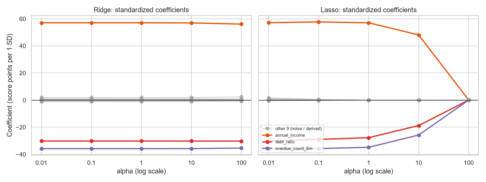
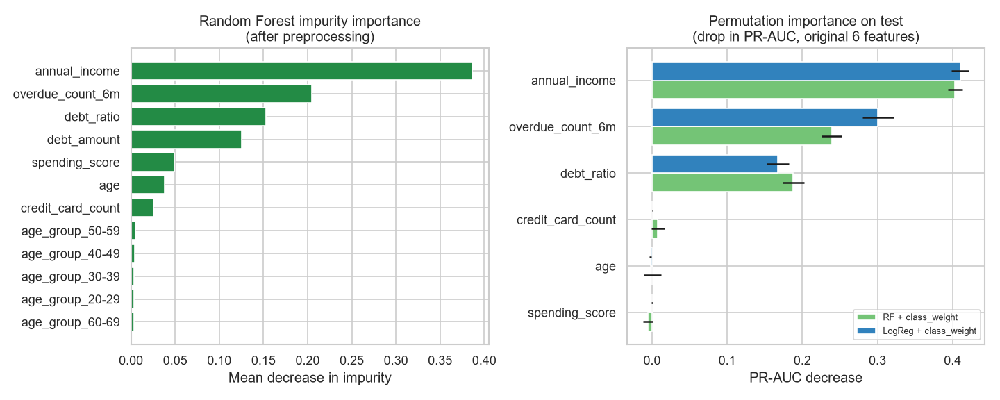
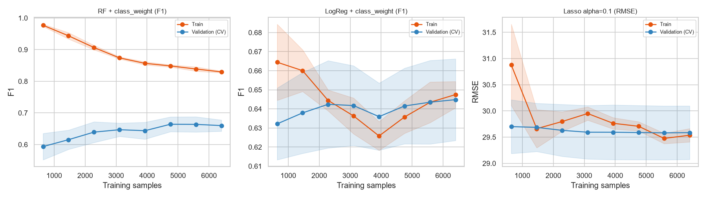

# A5-1 신용 점수 회귀와 연체 위험 분류: 규칙보다 학습이 나을까?

은행의 대출 심사를 가정해, 고객 정보로 신용 점수(0~1000)를 예측하고 연체할지를 판단하는 미션이에요. 사람이 정한 if-else 규칙과 데이터로 학습한 모델을 같은 시험 고객으로 비교하고, 모델이 낸 연체 확률로 대출을 승인, 보류, 거절해요. 데이터는 미션이 제공한 코드로 만든 가상 고객 10,000명이에요.

## 고객 세 명은 이렇게 판정돼요

시험용 고객 중 규칙과 모델의 차이가 잘 드러나는 세 명을 골랐어요. 값은 모두 실제 결과예요.

| | 고객 A | 고객 B | 고객 C |
| --- | ---: | ---: | ---: |
| 연 소득 | 5,529만원 | 3,559만원 | 2,187만원 |
| 부채 비율 | 4% | 84% | 80% |
| 최근 6개월 연체 | 0회 | 0회 | 1회 |
| 신용카드 | 8장 | 1장 | 4장 |
| **규칙의 판정** | 연체 (카드 8장 이상) | 연체 (부채 비율 80% 초과) | 연체 (소득 3,000만원 미만) |
| **모델의 연체 확률** | 0.3% → **승인** | 26% → **보류** | 97% → **거절** |
| 예측한 신용 점수 | 461점 | 322점 | 236점 |
| 실제 | 정상 (434점) | 연체 (286점) | 연체 (196점) |

규칙은 세 명을 모두 연체로 봤지만, 모델은 위험한 정도에 따라 나눴어요. 고객 A는 카드가 많다는 이유로 규칙에 걸렸는데, 이 데이터에서 카드 수는 연체와 관계없는 변수예요. 모델은 고객 A를 승인했어요.

## 결론: 규칙보다 학습이 나았어요

**연체자를 가려내는 성적(F1)이 규칙 0.325에서 모델 0.647로 약 2배가 됐어요.** 시험 고객 2,000명 기준이에요.

| 방법 | 맞힌 비율 (Accuracy) | 연체로 찍은 사람 중 실제 연체자 (Precision) | 실제 연체자 중 찾아낸 비율 (Recall) | 두 비율을 합친 점수 (F1) | 위험 순서로 줄 세우는 능력 (ROC-AUC) |
| --- | ---: | ---: | ---: | ---: | ---: |
| 규칙 6개 | 0.513 | 0.195 | 0.975 | 0.325 | 0.859 |
| 로지스틱 회귀 | 0.917 | 0.692 | 0.562 | 0.621 | 0.950 |
| **Random Forest (최종)** | 0.896 | 0.546 | 0.796 | **0.647** | 0.940 |

- **규칙은 거의 모두를 연체로 찍어요.** 연체자의 97.5%를 잡지만, 연체로 찍은 다섯 명 중 네 명이 정상 고객이에요.
- **맞힌 비율만 보면 속아요.** 연체자는 12%뿐이라 모두 정상이라고 해도 맞힌 비율이 0.88이에요. 로지스틱 회귀는 맞힌 비율이 가장 높지만 연체자의 44%를 놓쳐요. 그래서 F1으로 비교했어요.
- **F1 0.6대가 이 데이터의 현실적인 수준이에요.** 연체 정답은 신용 점수 하위 15% 중 무작위 80%에만 붙어 있어서, 진짜 점수를 알아도 F1은 0.889를 넘을 수 없어요.

## 같은 데이터, 다른 문제: 신용 점수 예측

같은 고객으로 신용 점수도 예측했어요. 점수처럼 숫자를 맞히는 문제(회귀)는 연체 여부처럼 둘 중 하나를 고르는 문제(분류)와 평가 방법이 달라요. 얼마나 크게 틀렸는지(RMSE)와 점수 차이를 얼마나 설명했는지(R²)로 봐요.

| 모델 | 평균 오차 (RMSE) | 설명력 (R²) |
| --- | ---: | ---: |
| 모두 평균 점수로 예측 | 80.87점 | 0.000 |
| 선형 회귀, Ridge, Lasso | 30.13점 | 0.861 |

- 30점 오차는 데이터를 만들 때 넣은 무작위 오차(표준편차 30)와 같아서, 더 줄이기 어려운 수준이에요.
- 규제를 더한 **Lasso**는 강도를 높이면 나이, 소비 점수, 카드 수처럼 관계없는 변수의 계수를 0으로 만들고 소득, 부채 비율, 연체 횟수만 남겼어요. 데이터를 만든 공식과 같은 결과예요.
- 회귀에서 30점 오차는 작지만, 연체 경계인 292점을 넘나들면 분류에서는 정답이 바뀌어요.

## 연체 판정을 다듬은 방법

- **연체자가 적은 문제(불균형):** 연체자에게 가중치를 더 주자(class_weight) 로지스틱 회귀가 찾아낸 연체자 비율이 0.56에서 0.88로 올랐어요. 데이터를 늘리는 SMOTE도 결과가 비슷해서, 더 단순한 가중치 방식을 골랐어요.
- **여러 나무를 합친 모델(앙상블):** Random Forest와 XGBoost를 GridSearchCV로 조정했어요. 최종 모델은 Random Forest예요. 다만 이 데이터는 단순한 선형 관계로 만들어져서, 위험 순서를 매기는 능력은 로지스틱 회귀가 조금 더 높았어요.
- **중요한 변수:** 연 소득, 6개월 연체 횟수, 부채 비율 순이에요. 신용 점수를 만든 공식의 세 변수와 같아요. 나이, 소비 점수, 카드 수는 섞어 버려도 성능이 거의 떨어지지 않아서, 연체 판단에 쓸 정보가 없었어요.

**승인·보류·거절 정책:** 연체 확률에 임계값(판정이 바뀌는 경계값) 두 개를 정했어요. 임계값은 시험 고객이 아니라 학습 데이터로 정했어요.

| 구간 | 연체 확률 | 고객 | 실제 연체율 |
| --- | ---: | ---: | ---: |
| 승인 | 19% 미만 | 1,422명 (71%) | 1.0% |
| 보류 (사람이 심사) | 19% 이상 56% 미만 | 263명 (13%) | 17.9% |
| 거절 | 56% 이상 | 315명 (16%) | 56.8% |

보류 임계값은 학습 데이터의 연체자 95%가 보류 이상으로 가게 정했어요. 그래서 시험에서 자동 승인된 연체자는 전체 240명 중 14명이었어요.

## 한계

- 가상 데이터라 변수 사이의 관계가 단순하고 선형이에요. 실제 신용 데이터에서는 앙상블의 장점이 더 클 수 있어요.
- 모델은 모두 임계값 0.5에서 F1으로 비교했어요. 모델마다 임계값을 따로 맞춰 비교하면 최종 모델이 로지스틱 회귀로 바뀔 수 있어요.
- 실제 정책 임계값은 연체 손실액, 심사 인력 비용, 거절로 놓친 이익까지 따져 정해야 해요. 나이 같은 민감한 변수는 사용 자체가 공정성 검토 대상이에요.

## 실행하기

[uv](https://docs.astral.sh/uv/getting-started/installation/)가 필요해요. 없다면 `pip install uv`로 설치할 수 있어요.

```bash
cd 02_Advanced/A5-1
uv sync
uv run python data_gen.py
uv run python -m src.run_all
```

- `uv sync`는 Python 3.12와 라이브러리를 이 폴더의 `.venv`에 설치해요. `data_gen.py`가 `finance_data.csv`를 만들고(레포에는 올리지 않아요), `src.run_all`이 그래프 10개와 결과 파일을 `results/`에 저장해요.
- 하이퍼파라미터 탐색은 CPU 코어 2개로 약 12분 걸려요. 모든 코어를 쓰려면 PowerShell에서 `$env:A5_N_JOBS = "-1"`을 먼저 설정하세요. 결과는 같아요.
- Windows 콘솔에서 한글이 깨지면 `$env:PYTHONUTF8 = "1"`을 먼저 설정하세요.
- **Mac:** [`MAC_DEMO.md`](MAC_DEMO.md)를 보세요.
- **노트북 실행:** VS Code에서 노트북을 열고, 커널을 이 폴더의 `.venv` Python으로 고르세요.

## 더 알아보기

| 이럴 때 | 여기를 보세요 |
| --- | --- |
| 머신러닝이 낯설어요 | [`study/a5-1.html`](study/a5-1.html): 규칙, 임계값, 규제, 승인·보류·거절을 직접 조작하며 지표 변화를 봐요. 인터넷 없이 브라우저로 열어요 |
| 회귀와 분류의 차이를 그림으로 보고 싶어요 | [`study/anatomy/two-predictions.html`](study/anatomy/two-predictions.html), [`study/anatomy/threshold.html`](study/anatomy/threshold.html) |
| 코드를 한 단계씩 따라가고 싶어요 | [`notebooks/learning_walkthrough.ipynb`](notebooks/learning_walkthrough.ipynb): 규칙에서 시작해 첫 모델, Pipeline, 교차검증, 불균형, 규제 순으로 진행해요. 이해를 위해 입력과 탐색 범위를 줄여서 수치가 리드미와 조금 달라요 |
| 완성된 분석 보고서를 보고 싶어요 | [`notebooks/analysis_report.ipynb`](notebooks/analysis_report.ipynb), [`results/report.md`](results/report.md) |

## 자세한 근거

미션에서 요구한 세부 결과예요. 필요할 때만 펼쳐 보세요.

<details>
<summary>데이터와 전처리</summary>

| 컬럼 | 역할 |
| --- | --- |
| `annual_income`, `debt_ratio`, `overdue_count_6m` | 신용 점수 생성 공식에 들어간 변수 |
| `age`, `spending_score`, `credit_card_count` | 어떤 정답에도 쓰이지 않은 노이즈 변수 |
| `credit_score` | 회귀 정답. 위 세 변수의 선형 결합에 표준편차 30의 무작위 오차를 더하고 0~1000으로 자름 |
| `is_overdue` | 분류 정답. 점수 하위 15%(292점 미만) 중 무작위 80%만 1. 연체 비율 12.01% |

- **데이터는 고치지 않았어요.** 미션 지시대로 생성된 그대로 썼어요. 생성 코드는 소득이 1,500 미만이면 1,500으로 올려서, 10,000명 중 408명의 소득이 1,500이에요.
- **두 정답은 서로의 입력으로 쓰지 않아요.** 연체 정답은 신용 점수로 만들었으니, 신용 점수를 분류 입력에 넣으면 정답이 새어 들어가요. 두 모델 모두 원본 6개 변수만 써요.
- **분할:** 8:2 층화 분할, `random_state=42`. 학습·시험의 연체 비율은 12.01%·12.00%예요.
- **전처리:** 연령대(범주)와 부채액(소득 × 부채 비율)을 만들어요. 수치형은 중앙값으로 빈칸을 채운 뒤 표준화하고, 범주형은 최빈값으로 채운 뒤 원-핫 인코딩해요.
- **누수 방지:** 전처리와 SMOTE를 Pipeline 안에 두어 학습 데이터(교차검증에서는 각 fold의 학습 부분)에서만 fit해요. 모델, Alpha, 임계값은 모두 학습 데이터 5-fold 교차검증으로 고르고, 시험 데이터는 마지막 평가에만 써요.

</details>

<details>
<summary>전체 성능표와 그래프</summary>

**연체 분류 (임계값 0.5, 시험 고객 2,000명)**

| 모델 | Accuracy | Precision | Recall | F1 | ROC-AUC | PR-AUC |
| --- | ---: | ---: | ---: | ---: | ---: | ---: |
| 규칙 기반 베이스라인 (규칙 6개) | 0.513 | 0.195 | 0.975 | 0.325 | 0.859 | 0.459 |
| 로지스틱 회귀 (불균형 처리 없음) | 0.917 | 0.692 | 0.562 | 0.621 | 0.950 | 0.685 |
| 로지스틱 회귀 + class_weight | 0.877 | 0.493 | 0.875 | 0.631 | 0.949 | 0.683 |
| 로지스틱 회귀 + SMOTE | 0.882 | 0.505 | 0.858 | 0.636 | 0.949 | 0.683 |
| **Random Forest + class_weight (튜닝, 최종)** | 0.896 | 0.546 | 0.796 | **0.647** | 0.940 | 0.634 |
| Random Forest + SMOTE (튜닝) | 0.901 | 0.564 | 0.787 | 0.657 | 0.938 | 0.602 |
| XGBoost + scale_pos_weight (튜닝) | 0.883 | 0.508 | 0.833 | 0.631 | 0.945 | 0.671 |

혼동 행렬은 [`05_confusion_matrices.png`](results/figures/05_confusion_matrices.png), ROC·PR 곡선은 [`06_roc_pr_curves.png`](results/figures/06_roc_pr_curves.png)에 있어요.

**규칙 6개:** 6개월 연체 2회 이상, 부채 비율 80% 초과, 연 소득 3,000만원 미만, 연체 1회 이상이면서 부채 비율 60% 초과, 연 소득 4,000만원 미만이면서 부채 비율 50% 초과, 신용카드 8장 이상. 하나라도 맞으면 연체로 판정해요.

**신용 점수 회귀**

| 모델 | Alpha (5-fold CV 선택) | RMSE | MAE | R² |
| --- | ---: | ---: | ---: | ---: |
| 평균 예측 | - | 80.87 | 64.73 | -0.000 |
| 선형 회귀 | - | 30.13 | 23.94 | 0.861 |
| Ridge | 10 | 30.13 | 23.94 | 0.861 |
| Lasso | 0.1 | 30.13 | 23.93 | 0.861 |



Lasso는 α=1에서 노이즈 변수와 파생 변수 5개를 0으로 만들고, α=10에서는 신호 변수까지 줄여 RMSE가 35.24로 나빠져요. Ridge는 α=100에서도 거의 변하지 않아요. scikit-learn의 Ridge는 오차 제곱의 합에, Lasso는 평균의 1/2에 규제를 더해서, 같은 α라도 Ridge 규제가 훨씬 약하기 때문이에요. 범위를 넓힌 그래프는 [`03_ridge_extended_alpha.png`](results/figures/03_ridge_extended_alpha.png)에 있어요.

**GridSearchCV (학습 데이터 5-fold, F1 기준)**

| 모델 | 최적 파라미터 | 탐색 조합 | CV F1 |
| --- | --- | ---: | ---: |
| RF + class_weight | max_depth=12, min_samples_leaf=1, n_estimators=400 | 30 | 0.660±0.018 |
| RF + SMOTE | max_depth=16, min_samples_leaf=1, n_estimators=400 | 30 | 0.665±0.018 |
| XGB + scale_pos_weight | learning_rate=0.1, max_depth=4, n_estimators=200 | 16 | 0.656±0.018 |

CV F1이 가장 높은 RF + SMOTE와의 차이가 fold 사이 흔들림보다 작아서, 더 단순한 RF + class_weight를 최종 모델로 골랐어요(1-표준오차 규칙).



</details>

<details>
<summary>보너스 과제 3종</summary>

| 보너스 | 구현 | 위치 |
| --- | --- | --- |
| 1. Custom Transformer | scikit-learn 형식을 따르는 `DerivedFeatures`가 연령대와 부채액을 만들어요. GridSearchCV와 함께 쓸 수 있어요 | `src/features.py` |
| 2. 모듈화 | 계산은 `src/`의 모듈에 두고, 노트북과 명령 실행이 같은 코드를 써요 | `src/`, `notebooks/` |
| 3. Learning Curve | 학습 데이터 크기 8단계에서 학습·검증 점수를 그려 과대적합 정도를 비교해요 | `src/diagnostics.py` |



최종 Random Forest는 학습 F1이 검증보다 0.170 높아서, 학습 데이터의 노이즈까지 외우는 경향이 있어요. 로지스틱 회귀는 두 곡선이 붙어 있어요. Lasso의 RMSE는 학습과 검증 모두 노이즈 30 근처에서 만나서, 데이터를 더 모아도 크게 줄지 않아요.

</details>

---

[심화 과정 목차](../README.md) · [전체 과정](../../README.md)
