# A5-2 고객 군집화와 SHAP: 모델은 왜 이 고객을 거절했을까?

정답 없이 고객을 비슷한 사람끼리 묶어 페르소나(고객 유형)를 만들고, 연체 예측 모델이 왜 그런 판정을 했는지 SHAP(예측을 변수별 기여로 나누는 방법)으로 설명하는 미션이에요. 데이터는 A5-1과 같은 가상 금융 고객 10,000명이고, 모델도 A5-1에서 고른 Random Forest 설정을 그대로 써요. 마지막에는 두 결과를 이어 "이 페르소나는 왜 위험한가"를 살펴봐요.

## 두 고객은 이렇게 판정돼요

시험 고객 중 위험이 가장 높은 페르소나와 가장 낮은 페르소나에서, 군집 중심에 가장 가까운 거절 고객과 승인 고객을 한 명씩 골랐어요. 값은 모두 실제 결과예요.

| | 거절된 고객 | 승인된 고객 |
| --- | ---: | ---: |
| 페르소나 | C0 연체 반복형 | C5 저부채 고소비 우량형 |
| 최근 6개월 연체 | 2회 | 0회 |
| 연 소득 | 3,873만원 | 4,699만원 |
| 부채 비율 | 0.43 | 0.17 |
| **모델의 연체 점수** | **0.866 → 거절** | **0.000 → 승인** |
| 점수를 가장 크게 움직인 변수 | 연체 2회 (+0.386) | 연체 0회 (−0.172), 낮은 부채 (−0.168), 소득 (−0.141) |

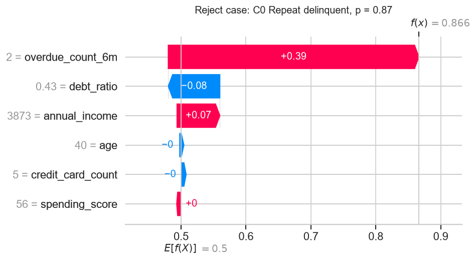

모든 고객은 같은 출발점(기준값 0.50)에서 시작해요. 거절된 고객은 연체 2회가 점수를 +0.386 올렸고, 평균보다 낮은 소득이 조금 더 올렸어요. 영업팀에는 "최근 6개월에 연체가 두 번 있었고 소득이 평균보다 낮아 거절했습니다"라고 전할 수 있어요.

그런데 이 고객의 실제 결과는 **정상**이었어요. 데이터 생성 규칙상 연체 구간에 있었지만, 그 구간에서 무작위로 정상을 받는 20%에 속했어요. SHAP은 모델이 왜 그렇게 예측했는지를 보여 줄 뿐, 예측이 맞았는지는 알려 주지 않아요.

## 결론: 고객을 묶는 기준과 거절하는 이유는 달랐어요

**모델이 가장 중요하게 보는 소득은 어떤 페르소나도 구별하지 못했어요.** 그래서 같은 페르소나 안에서도 판정이 갈려요. 가장 위험한 C0에서도 59명은 승인되고, 가장 안전한 C5에서도 15명은 거절돼요(시험 고객 2,000명 기준).

| 페르소나 | 연체율 | 평균 연체 점수 | 위험을 올리는 변수 (평균 SHAP) | 승인 / 보류 / 거절 |
| --- | ---: | ---: | --- | ---: |
| C0 연체 반복형 | 39.0% | 0.48 | 연체 횟수 +0.245 | 59 / 31 / 98 |
| C1 고령·고부채 다카드형 | 15.7% | 0.27 | 부채 비율 +0.040 | 202 / 58 / 91 |
| C2 청년·고부채 소비형 | 13.2% | 0.21 | 부채 비율 +0.043 | 241 / 50 / 67 |
| C3 청년·다카드 절약형 | 7.7% | 0.13 | 없음 | 311 / 33 / 42 |
| C4 중장년·저소비 실속형 | 7.1% | 0.12 | 없음 | 280 / 22 / 37 |
| C5 저부채 고소비 우량형 | 2.8% | 0.06 | 없음 | 338 / 25 / 15 |

그래서 **페르소나는 마케팅과 상담의 단위로 쓰고, 승인·거절은 고객 한 명의 점수와 SHAP 근거로 정하는 것**을 제안해요. 데이터는 미션이 제공한 코드로 만든 합성 데이터라, 실제 금융 고객에 대한 결론은 아니에요.

## 어떻게 동작할까?

1. **고객을 묶어요.** 연체 여부와 신용 점수를 뺀 6개 변수를 표준화하고 K-Means로 6개 군집을 만들어요. 위 표의 연체율은 군집을 만든 뒤 설명용으로만 계산했어요.
2. **연체를 예측해요.** A5-1과 같은 Random Forest를 원본 6개 변수로 학습해요. 점수 0.5 이상은 거절, 0.178 미만은 승인, 그 사이는 보류예요.
3. **판정을 나눠 봐요.** SHAP의 TreeExplainer로 시험 고객 2,000명의 점수를 변수별 기여로 나눠요. 위 거절 고객의 0.866도 `0.50 + 각 변수의 기여 합`으로 정확히 다시 만들어져요.
4. **두 결과를 이어요.** 군집별로 SHAP 평균을 내서 각 페르소나의 위험이 어디서 오는지 봐요.

### 왜 6개로 나눴을까?

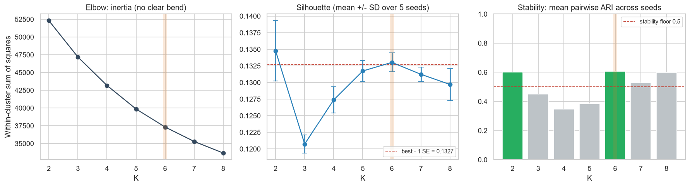

미션 가이드대로 묶임 정도(Silhouette Score)를 먼저 보고, 해석 가능성을 마지막에 봤어요.

- Silhouette은 K=2에서 가장 높았지만(0.1348), K=6(0.1330)과의 차이는 오차 범위 안이었어요. 두 K 모두 시드를 바꿔도 군집이 비슷하게 나왔어요.
- K=2는 "최근 연체 0회 / 1회 이상"으로 나눈 것과 같아서, 규칙 한 줄 이상을 알려 주지 않아요. K=6은 전체 평균과 뚜렷이 다른 변수가 5개라 페르소나로 설명할 수 있어요. 그래서 **K=6**을 골랐어요.
- Elbow(군집을 늘릴 때 오차가 줄어드는 곡선)는 꺾이는 곳이 없어서 판단에 쓰지 않았어요.

모든 K에서 Silhouette이 0.12~0.135로 낮아요. 이 데이터는 6개 변수를 서로 관계없는 난수로 만들어서, 원래부터 뚜렷한 덩어리가 없어요. 그래서 여기서 K는 "진짜 군집 수"가 아니라 **고객을 몇 유형으로 나눠 관리할지**라는 업무 결정이에요.

### 모델은 무엇을 보고 판정할까?

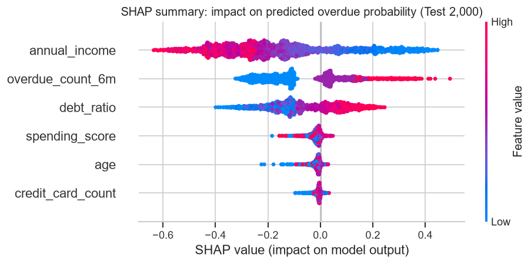

| 순위 | 변수 | 영향의 비중 | 방향 | 업무 언어로 |
| ---: | --- | ---: | --- | --- |
| 1 | 연 소득 | 43.6% | 낮을수록 위험 | 상환 여력 |
| 2 | 최근 6개월 연체 횟수 | 27.1% | 많을수록 위험 | 행동 이력 |
| 3 | 부채 비율 | 21.4% | 높을수록 위험 | 상환 부담. 상담과 대환으로 직접 낮출 수 있어요 |
| 4~6 | 소비 점수, 나이, 카드 수 | 합계 7.9% | 일관되지 않음 | 연체 판단에 쓸 정보가 거의 없어요 |

상위 3개는 데이터 생성 코드가 신용 점수를 만들 때 쓴 변수와 정확히 같아요. 합성 데이터라 SHAP의 설명이 맞는지 정답 공식과 대조할 수 있었어요.

### 페르소나의 위험은 어디서 올까?

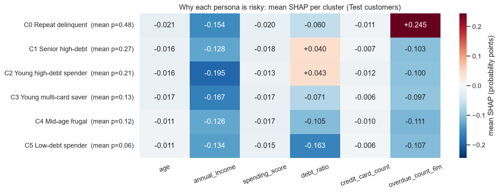

- C0의 위험은 연체 이력에서, C1·C2의 위험은 부채 비율에서 와요. 소비 점수가 가장 높은 C5에서도 소비 점수는 위험과 관계가 없었어요.
- 소득은 모든 페르소나에서 평균과 거의 같아요(표준편차의 ±0.11 이내). 군집화는 여섯 변수를 같은 무게로 다루지만, 모델은 연체와 관계있는 변수만 보기 때문이에요. 결론의 "같은 페르소나 안에서도 판정이 갈린다"가 여기서 나와요.

## 언제, 어떻게 쓰면 좋을까?

| 페르소나 | 대상 | 메시지 | 액션 |
| --- | --- | --- | --- |
| C0 연체 반복형 | 리스크 관리 | 상환 일정을 함께 조정해 연체를 끊어요 | 신규 한도 동결, 채무 조정 상담, 자동이체 전환. 마케팅 발송 제외 |
| C1 고령·고부채 다카드형 | 보류 심사 집중 | 흩어진 카드 부채를 하나로 모아 이자를 줄여요 | 부채 통합 대환 제안, 부채 비율 모니터링, 신규 카드 발급 억제 |
| C2 청년·고부채 소비형 | 단계적 관리 | 쓰는 만큼 관리하면 한도가 함께 커져요 | 소액 한도로 시작해 상환 이력에 따라 상향, 소비 알림 안내 |
| C3 청년·다카드 절약형 | 주거래 전환 | 여러 카드의 혜택을 한 장으로 모아요 | 주거래 카드 통합 혜택, 적금 연계, 안 쓰는 카드 정리 |
| C4 중장년·저소비 실속형 | 교차 판매 | 모아 둔 자산을 안정적으로 불려요 | 예금·연금 상품 제안, 간소화 심사 |
| C5 저부채 고소비 우량형 | VIP 육성 | 많이 쓰는 만큼 더 돌려받아요 | 프리미엄 카드, 한도 상향 사전 승인 |

- **거절 사유 알리기:** Waterfall의 상위 2~3개 변수를 고객 언어로 바꿔요. "연체 2회와 낮은 소득 때문"처럼 구체적으로 말할 수 있어요.
- **보류 고객 상담:** SHAP의 가장 큰 원인이 부채 비율이면 대환 상담으로 위험을 낮출 수 있어요. 연체 이력이 원인이면 상환 계획을 확인해요.
- **나이는 빼는 것을 검토해요.** 이 모델에서 영향은 2.8%로 작지만, 실제 심사에서는 나이 같은 민감 변수를 쓰는 것 자체가 공정성 검토 대상이에요.

한계도 있어요.

- **점수는 확률이 아니에요.** 연체 고객에 가중치를 줘서 학습했기 때문에, 실제 연체율은 12%인데 점수의 평균(기준값)은 0.50이에요. 순위를 매기는 점수로 읽어야 해요.
- **SHAP은 인과가 아니에요.** "모델이 무엇을 보는가"를 보여 줄 뿐이에요. 변수끼리 상관이 큰 실제 데이터에서는 해석이 더 까다로워요.
- **페르소나 이름은 사람이 붙였어요.** "우량형" 같은 이름이 실제 위험보다 강한 인상을 줄 수 있어요.

## 실행하기

[uv](https://docs.astral.sh/uv/getting-started/installation/)가 필요해요. 없다면 `pip install uv`로 설치할 수 있어요.

```bash
cd 02_Advanced/A5-2
uv sync
uv run python data_gen.py
uv run python -m src.run_all
```

- `uv sync`는 Python과 라이브러리를 이 폴더의 `.venv`에 설치해요. `src.run_all`은 군집화(약 25초)와 모델·SHAP(약 1분 40초)을 차례로 실행하고 그래프 13개와 결과 파일을 `results/`에 저장해요. 미션 순서대로 따로 돌리려면 `src.analysis_clustering`, `src.analysis_shap`을 차례로 실행하세요.
- 기본으로 CPU 코어 2개를 써요. 모든 코어를 쓰려면 PowerShell에서 `$env:A5_N_JOBS = "-1"`을 먼저 설정하세요.
- Windows 콘솔에서 한글이 깨지면 `$env:PYTHONUTF8 = "1"`을 먼저 설정하세요.
- **대시보드 (보너스):** `uv run streamlit run app.py`로 열어요. 고객 정보 6개를 넣으면 연체 점수, 판정, 페르소나와 전략, Waterfall, 설명 문장이 나와요.

## 더 알아보기

| 이럴 때 | 여기를 보세요 |
| --- | --- |
| 군집화와 SHAP이 낯설어요 | [`study/a5-2.html`](study/a5-2.html): 직접 조작하며 원리를 익혀요. 인터넷 없이 브라우저로 열어요 |
| 코드를 한 단계씩 따라가고 싶어요 | [`notebooks/analysis_clustering.ipynb`](notebooks/analysis_clustering.ipynb) → [`notebooks/analysis_shap.ipynb`](notebooks/analysis_shap.ipynb) 순서로 실행해요. 실습 결과는 `results/learning/`에 따로 저장돼서 군집 번호와 사례가 이 README와 다를 수 있어요 |
| 수치 요약만 보고 싶어요 | [`results/report.md`](results/report.md) |
| 이전 미션의 모델이 궁금해요 | [A5-1 README](../A5-1/README.md) |

## 자세한 근거

미션에서 요구한 세부 결과예요. 필요할 때만 펼쳐 보세요.

<details>
<summary>군집 수 탐색과 PCA 시각화</summary>

| K | Inertia | Silhouette (시드 5개 평균±SD) | 시드 간 일치도 (ARI) |
| ---: | ---: | ---: | ---: |
| 2 | 52,309 | **0.1348**±0.0045 | 0.600 |
| 3 | 47,181 | 0.1207±0.0014 | 0.450 |
| 4 | 43,176 | 0.1274±0.0020 | 0.347 |
| 5 | 39,863 | 0.1317±0.0016 | 0.384 |
| **6** | 37,317 | 0.1330±0.0014 | **0.607** |
| 7 | 35,288 | 0.1312±0.0011 | 0.527 |
| 8 | 33,656 | 0.1297±0.0024 | 0.599 |

- **선택 규칙:** 최고 Silhouette에서 표준오차 하나를 뺀 0.1327을 기준선으로 잡았어요(A5-1의 1-표준오차 규칙과 같아요). 기준선을 넘는 K는 2와 6이고, 둘 다 ARI가 0.5 이상이에요. 전체 평균과 0.5 표준편차 이상 다른 변수가 K=2는 1개, K=6은 5개라 K=6을 골랐어요.
- **표준화:** K-Means는 거리를 쓰므로 표준화했어요. 하지 않으면 거리의 99% 이상을 소득(만원 단위)이 차지해요.

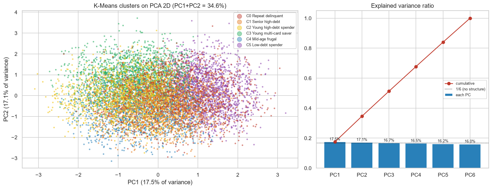

- 두 주성분이 설명하는 분산은 PC1 17.5% + PC2 17.1% = **34.6%**예요. 변수가 서로 독립이라 여섯 주성분이 16.0~17.5%씩 고르게 나눠 가져서, 2차원 그림에서는 군집이 많이 겹쳐 보여요. 군집은 6차원 원래 공간에서 학습했어요.
- 주성분은 원래 변수가 아니라 가중 합이에요. PC1은 소비 점수(+0.62), 부채 비율(−0.56), 나이(+0.43)가 섞인 축이에요. 그래서 페르소나는 주성분이 아니라 원래 변수로 정의했어요.

</details>

<details>
<summary>군집 요약과 페르소나 정의</summary>

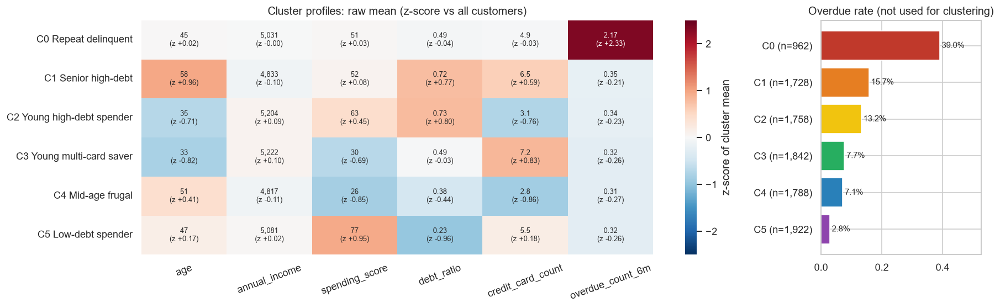

| 군집 | 고객 (비중) | 나이 | 소득(만원) | 소비 점수 | 부채 비율 | 카드 | 6개월 연체 | 연체율 |
| --- | ---: | ---: | ---: | ---: | ---: | ---: | ---: | ---: |
| C0 | 962 (9.6%) | 44.9 | 5,031 | 50.7 | 0.49 | 4.9 | **2.17** | 39.0% |
| C1 | 1,728 (17.3%) | **58.5** | 4,833 | 52.1 | **0.72** | **6.5** | 0.35 | 15.7% |
| C2 | 1,758 (17.6%) | **34.5** | 5,204 | 62.7 | **0.73** | **3.1** | 0.34 | 13.2% |
| C3 | 1,842 (18.4%) | **32.9** | 5,222 | **30.2** | 0.49 | **7.2** | 0.32 | 7.7% |
| C4 | 1,788 (17.9%) | 50.5 | 4,817 | **25.6** | 0.38 | **2.8** | 0.31 | 7.1% |
| C5 | 1,922 (19.2%) | 47.0 | 5,081 | **77.2** | **0.23** | 5.5 | 0.32 | 2.8% |

굵은 값은 전체 평균과 0.5 표준편차 이상 다른 변수예요. 군집 번호는 연체율이 높은 순서로 붙였어요.

- **C0 연체 반복형:** 최근 6개월 연체가 모두 2회 이상이고, 나머지 변수는 평균과 같아요. 연체율이 전체(12%)의 3배를 넘어요.
- **C1 고령·고부채 다카드형:** 평균 58세, 부채 비율 0.72, 카드 6.5장이에요. 연체 이력은 적지만 부채 부담이 커요.
- **C2 청년·고부채 소비형:** 평균 35세, 부채 비율 0.73이에요. 카드는 적고 소비 점수는 평균보다 높아요.
- **C3 청년·다카드 절약형:** 평균 33세, 카드는 7장이지만 소비 점수가 30으로 낮아요.
- **C4 중장년·저소비 실속형:** 평균 51세, 소비 점수와 카드 수가 낮고 부채도 평균보다 조금 낮아요.
- **C5 저부채 고소비 우량형:** 부채 비율이 가장 낮고(0.23) 소비 점수가 가장 높아요(77).

이 데이터에서 나이·소비 점수·카드 수는 연체와 관계없는 변수라, C1~C4의 연체율 차이는 대부분 부채 비율에서 와요. 이 세 축은 마케팅 메시지를 정하는 데만 써요.

</details>

<details>
<summary>모델 성능과 승인 고객의 Waterfall</summary>

| 모델 (시험 고객 2,000명, 임계값 0.5) | 교차검증 F1 | 연체로 찍은 사람 중 실제 연체자 (Precision) | 실제 연체자 중 찾아낸 비율 (Recall) | F1 | ROC-AUC |
| --- | ---: | ---: | ---: | ---: | ---: |
| A5-1 최종 (원본 6개 + 파생 2개) | 0.660±0.018 | 0.546 | 0.796 | 0.647 | 0.940 |
| **A5-2 (원본 6개)** | 0.664±0.024 | 0.543 | 0.792 | 0.644 | 0.940 |

미션이 임의 컬럼 추가를 금지해서 A5-1의 파생 변수 2개를 뺐어요. 하이퍼파라미터(400그루, 최대 깊이 12, class_weight)와 데이터 분할은 A5-1과 같고, 성능도 거의 같아요. SHAP은 TreeExplainer로 시험 고객 2,000명 전체에 계산했어요.

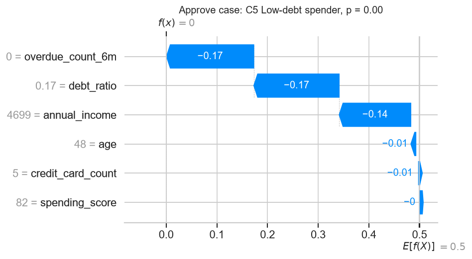

승인된 고객은 연체 0회, 낮은 부채 비율, 평균 수준의 소득이 모두 점수를 내렸어요. Force Plot은 [`results/force_plots/reject_case.html`](results/force_plots/reject_case.html), [`approve_case.html`](results/force_plots/approve_case.html)로도 저장했어요.

</details>

<details>
<summary>Dependence Plot과 인사이트</summary>

변수는 Summary 상위 2개(소득, 연체 횟수)와 업무에서 직접 다루는 부채 비율을 골랐어요.

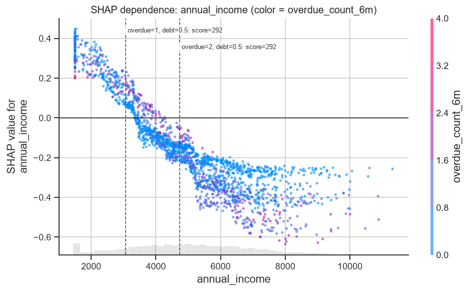

- 소득의 SHAP은 약 2,000~5,000만원 구간에서 가장 가파르게 떨어져요. 점선은 생성 공식에서 부채 비율 0.5인 고객이 연체 기준 점수에 닿는 소득이에요(연체 1회 3,067만원, 2회 4,733만원). 모델이 공식의 경계를 데이터에서 다시 찾아냈어요.
- 소득이 가장 높은 구간에서 연체 이력이 있는 고객의 소득 SHAP은 평균 −0.475, 없는 고객은 −0.320이에요. 연체 이력이 있는 고객일수록 높은 소득이 위험을 더 크게 상쇄해요.

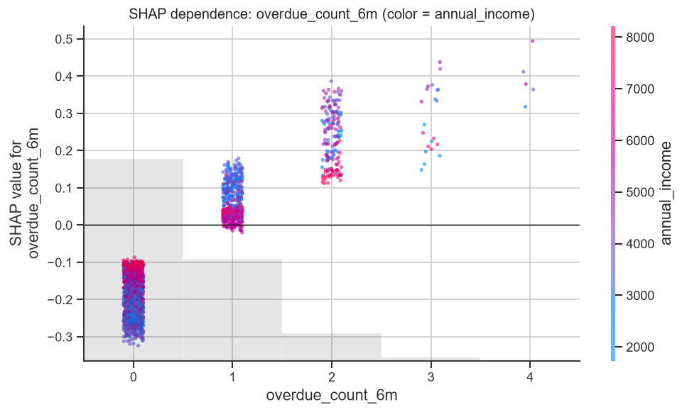

- 연체 0회의 평균 SHAP은 −0.184, 1회 +0.057, 2회 +0.235, 3회 +0.286이에요. 첫 연체 한 번에 점수가 약 0.24 올라요.
- 같은 연체 1회라도 소득이 높은 고객은 SHAP이 0 근처예요. 소득이 연체 한 번의 영향을 흡수해요.

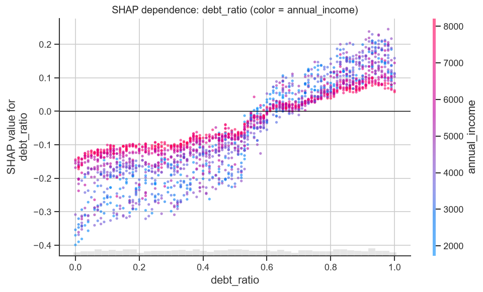

- 부채 비율이 0.6 안팎을 넘으면 SHAP이 양수로 바뀌어요. 업무 언어로는 "부채가 소득의 절반을 넘으면 위험 신호"예요. 가장 낮은 구간의 평균 SHAP은 −0.193, 가장 높은 구간은 +0.132예요.
- 낮은 부채의 효과는 소득이 낮은 고객에게 더 커요. 소득이 낮은 고객에게는 부채 축소가 가장 효과적인 상담 주제예요.

</details>

<details>
<summary>보너스: 군집화 알고리즘 비교</summary>

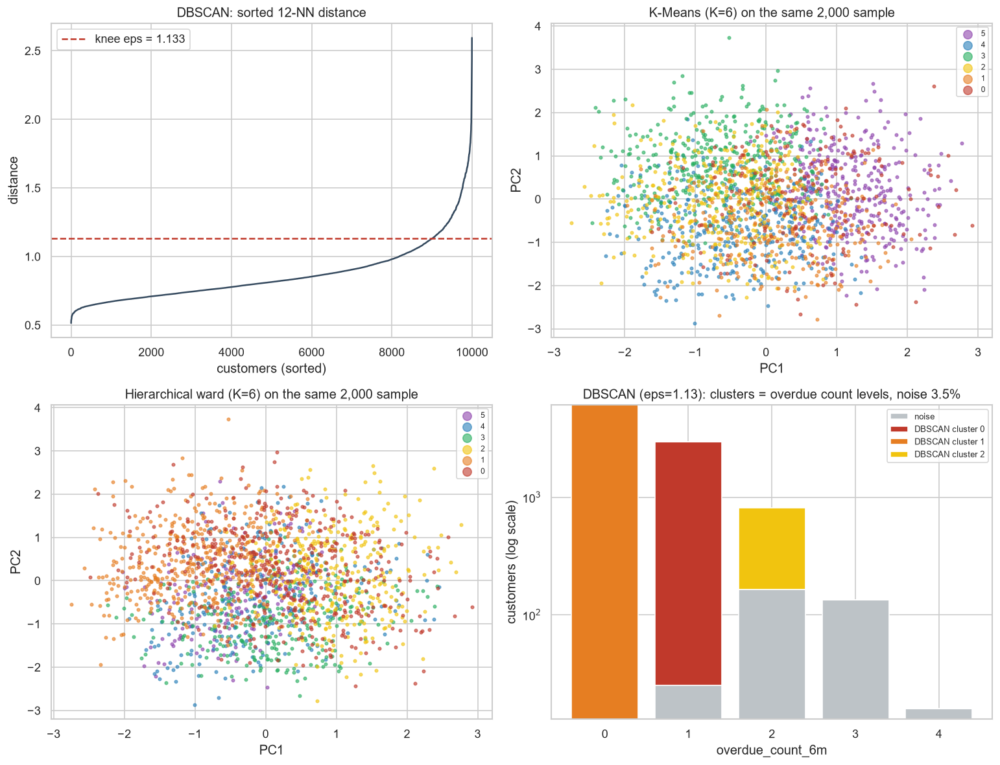

| 방법 | 군집 | Silhouette | K-Means와 일치도 (ARI) |
| --- | ---: | ---: | ---: |
| K-Means | 6 | 0.135 | 1 |
| 계층적 (ward) | 6 | 0.063 | 0.191 |
| 계층적 (complete) | 6 | 0.043 | 0.106 |
| 계층적 (average) | 6 | 0.016 | 0.035 |
| DBSCAN | 3 | 0.095 | 0.068 |

계층적 군집은 메모리가 고객 수의 제곱으로 늘어서 같은 2,000명 표본에서 비교했어요.

- 방법마다 답이 크게 엇갈려요(ARI 0.04~0.19). 진짜 군집이 있다면 방법이 달라도 비슷하게 묶여요. 이 엇갈림이 "자연스러운 군집이 없다"는 또 하나의 근거예요.
- DBSCAN의 세 군집은 연체 횟수 0회·1회·2회와 일치하고, 3회 이상은 노이즈로 빠져요. 정수 값 사이의 빈틈이 이 데이터에서 밀도가 끊기는 유일한 곳이에요.
- 업무에는 K-Means가 맞아요. 새 고객을 가장 가까운 중심에 바로 배정할 수 있고, 군집 크기가 고르고, 페르소나로 해석할 수 있어요.

</details>
