# A5-2 — 고객 군집화와 SHAP으로 대출 판단 설명하기

[심화 과정 목차](../README.md) · [이전 미션 A5-1](../A5-1/README.md)

A5-1과 같은 가상 금융 고객 10,000명을 **정답 없이 페르소나로 묶고**(K-Means), A5-1에서 고른 연체 예측 모델이 **왜 그런 판정을 했는지** SHAP으로 설명한다. 마지막에 두 결과를 이어 "이 페르소나는 왜 위험한가"와 "같은 페르소나 안에서도 판정이 갈리는 이유"를 보인다. 선택 보너스 2종(Streamlit 대시보드, 군집화 알고리즘 비교)을 모두 포함한다.

데이터는 미션이 제공한 `data_gen.py`로 만든 **합성 데이터**다. 아래 수치와 해석은 방법을 설명하는 예시이며 실제 금융 고객에 대한 결론이 아니다.

## 실행

환경은 [uv](https://docs.astral.sh/uv/)로 관리한다. 이 README가 있는 A5-2 폴더에서 실행한다. 미션이 정한 순서는 analysis_clustering → analysis_shap → README다.

```powershell
uv sync
uv run python data_gen.py
uv run python -m src.analysis_clustering   # 1단계: 군집화 (약 25초)
uv run python -m src.analysis_shap         # 2단계: 모델·SHAP (약 1분 40초)
uv run python -m unittest discover -s tests -v
uv run streamlit run app.py                # 보너스 1: 대시보드
```

`uv run python -m src.run_all`은 두 단계를 차례로 실행하고 `results/report.md`에 수치 요약을 만든다. 학습·군집화는 기본적으로 CPU 코어 2개만 쓴다. 다른 작업과 함께 돌려도 노트북이 멈추지 않게 하기 위해서다. 전용으로 빠르게 돌리려면 `$env:A5_N_JOBS = "-1"`로 모든 코어를 쓴다. Windows 콘솔에서 한글이 깨지면 `$env:PYTHONUTF8 = "1"`을 먼저 설정한다.

| 검증 조합 | 결과 |
| --- | --- |
| Windows, Python 3.12.13, scikit-learn 1.9.1, shap 0.53.0, pandas 3.0.6, streamlit 1.65.0 | 테스트 26개, 전체 실행, 노트북 2개, HTML 검증, 대시보드 확인 |

`requirements.txt`에 shap·scikit-learn을 포함한 전체 버전을 고정했다(`uv export`로 `uv.lock`에서 생성). uv가 없으면 `pip install -r requirements.txt`로 같은 환경을 만든다.

## 결과물

| 미션 결과물 | 위치 |
| --- | --- |
| 1. 군집화: PCA 2차원 산점도(설명 분산 표시), 군집 통계와 페르소나 | `results/figures/02_pca_clusters.png`, `03_cluster_profiles.png`, 아래 표 |
| 2. Global: SHAP Summary Plot | `results/figures/04_shap_summary.png` (보조: `05_shap_importance_bar.png`) |
| 3. Local: 승인·거절 Waterfall Plot (+ Force Plot HTML) | `results/figures/06_waterfall_reject.png`, `07_waterfall_approve.png`, `results/force_plots/*.html` |
| 4. Dependence Plot 3개와 인사이트 | `results/figures/08~10_dependence_*.png` |
| 5. 인사이트 리포트 | 이 README |
| 노트북 | [`notebooks/analysis_clustering.ipynb`](notebooks/analysis_clustering.ipynb) → [`notebooks/analysis_shap.ipynb`](notebooks/analysis_shap.ipynb) |
| 학습 자료 | [`study/a5-2.html`](study/a5-2.html) (인터넷 없이 여는 14장, 직접 조작 실험 4개) |

## 문제와 목표

금융 규제는 대출 거절 사유를 설명하도록 요구한다. 이 미션의 질문은 두 가지다. **"우리 고객은 어떤 사람들인가?"**(군집화로 페르소나 정의)와 **"모델은 왜 이 고객을 거절했나?"**(SHAP으로 판정 근거 분해)다. 기술 결과를 영업·심사팀이 쓸 수 있는 전략으로 바꾸는 것까지가 목표다.

## A5-1에서 이어 쓴 것

| 항목 | A5-1 | A5-2 |
| --- | --- | --- |
| 데이터 | `data_gen.py`, 10,000명 | 같은 코드. 생성된 CSV가 A5-1과 같음을 테스트로 확인 |
| 분할 | 8:2 층화, seed 42 | 같은 분할. Test 2,000명이 같은 고객 |
| 모델 | RF + class_weight, max_depth 12, min_samples_leaf 1, 400그루. 입력은 6개 + 파생 2개 | **같은 하이퍼파라미터, 원본 6개 변수만**. 미션의 데이터 정책(임의 컬럼 추가 금지) 때문이다. 설정이 A5-1 결과 파일과 같은지 테스트로 확인 |
| 선택 규칙 | 1-표준오차 규칙으로 모델 선택 | 같은 규칙으로 군집 수 K 선택 |
| 승인·보류·거절 | Train OOF로 두 임계값 | 보류는 같은 방식(0.178), 거절은 미션 정의(0.5) |

| 모델 (Test 2,000명, 임계값 0.5) | CV F1 | Precision | Recall | F1 | ROC-AUC | PR-AUC |
| --- | ---: | ---: | ---: | ---: | ---: | ---: |
| A5-1 최종 (6개 + 파생 2개) | 0.660±0.018 | 0.546 | 0.796 | 0.647 | 0.940 | 0.634 |
| **A5-2 (원본 6개)** | 0.664±0.024 | 0.543 | 0.792 | 0.644 | 0.940 | 0.640 |

파생 변수를 빼도 성능이 거의 같다. 부채액(소득×부채 비율)은 두 원본 변수로 트리가 직접 나눌 수 있고, 연령대는 노이즈 변수인 나이를 다시 쓴 것이기 때문이다. 이 모델의 SHAP 결과에는 원본 변수 이름만 나와서 바로 비즈니스 언어로 옮길 수 있다.

## 1. 고객 군집화

### 전처리와 K 선택

군집화 입력은 타깃(신용 점수, 연체 여부)을 뺀 6개 변수다. K-Means는 유클리드 거리를 쓰므로 표준화했다. 표준화하지 않으면 두 고객 사이 거리의 99% 이상을 소득(만원 단위)이 차지한다.

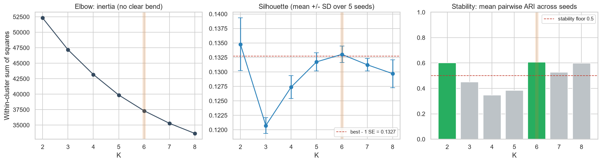

| K | Inertia | Silhouette (시드 5개 평균±SD) | 시드 간 ARI |
| ---: | ---: | ---: | ---: |
| 2 | 52,309 | **0.1348**±0.0045 | 0.600 |
| 3 | 47,181 | 0.1207±0.0014 | 0.450 |
| 4 | 43,176 | 0.1274±0.0020 | 0.347 |
| 5 | 39,863 | 0.1317±0.0016 | 0.384 |
| **6** | 37,317 | 0.1330±0.0014 | **0.607** |
| 7 | 35,288 | 0.1312±0.0011 | 0.527 |
| 8 | 33,656 | 0.1297±0.0024 | 0.599 |

미션 가이드(Silhouette 우선 → Elbow 보조 → 페르소나 해석 가능성)를 세 단계 규칙으로 만들었다.

1. **Silhouette:** 최고는 K=2(0.1348)다. A5-1과 같은 1-표준오차 규칙을 적용하면 기준선은 0.1327이고, 이를 넘는 K는 2와 6이다.
2. **안정성:** 시드만 바꿔도 군집이 달라지는 K는 운영할 수 없다. 두 후보 모두 ARI가 0.5 이상이다.
3. **해석 가능성:** 군집 평균이 전체 평균에서 0.5 표준편차 이상 벗어난 변수(구별 변수)를 센다. K=2는 1개(연체 횟수), K=6은 5개다. 그래서 **K=6**을 골랐다.

Elbow는 꺾이는 곳이 없어서 판단에 쓰지 않았다. K=2는 "최근 6개월 연체 0회 / 1회 이상"과 정확히 같아서, 규칙 한 줄 이상의 정보를 주지 않는다.

**이 데이터에는 자연스러운 군집이 없다.** `data_gen.py`는 6개 변수를 서로 독립인 난수로 만든다(변수 간 상관계수 절댓값 최대 0.031). 그래서 Silhouette이 모든 K에서 0.12~0.135로 낮고 평평하다. 여기서 K는 진짜 군집 수가 아니라 **몇 개의 페르소나로 고객을 나눠 운영할 것인가**라는 업무 결정이다.

### PCA 시각화

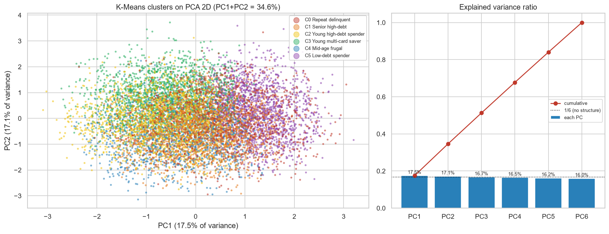

PC1 17.5%, PC2 17.1%로 두 주성분이 설명하는 분산은 **34.6%**다(원문 예시는 73%). 변수가 독립이라 여섯 주성분이 모두 약 1/6(16.0~17.5%)씩 설명한다. 그래서 2차원 그림에서는 군집이 많이 겹쳐 보인다. 나머지 65%의 차이가 그림에 나타나지 않을 뿐이며, 군집은 6차원 원래 공간에서 학습했다. 주성분은 원래 변수가 아니라 가중 합이다. 예를 들어 PC1은 소비 점수(+0.62), 부채 비율(−0.56), 나이(+0.43)가 섞인 축이다. 그래서 페르소나는 PC가 아니라 원래 변수로 정의했다.

### 군집 요약

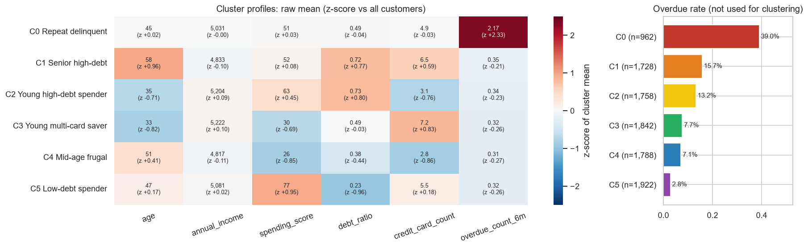

| 군집 | 페르소나 | 고객 (비중) | 나이 | 소득(만원) | 소비 점수 | 부채 비율 | 카드 | 6개월 연체 | 연체율 |
| --- | --- | ---: | ---: | ---: | ---: | ---: | ---: | ---: | ---: |
| C0 | 연체 반복형 | 962 (9.6%) | 44.9 | 5,031 | 50.7 | 0.49 | 4.9 | **2.17** | **39.0%** |
| C1 | 고령·고부채 다카드형 | 1,728 (17.3%) | **58.5** | 4,833 | 52.1 | **0.72** | **6.5** | 0.35 | 15.7% |
| C2 | 청년·고부채 소비형 | 1,758 (17.6%) | **34.5** | 5,204 | 62.7 | **0.73** | **3.1** | 0.34 | 13.2% |
| C3 | 청년·다카드 절약형 | 1,842 (18.4%) | **32.9** | 5,222 | **30.2** | 0.49 | **7.2** | 0.32 | 7.7% |
| C4 | 중장년·저소비 실속형 | 1,788 (17.9%) | 50.5 | 4,817 | **25.6** | 0.38 | **2.8** | 0.31 | 7.1% |
| C5 | 저부채 고소비 우량형 | 1,922 (19.2%) | 47.0 | 5,081 | **77.2** | **0.23** | 5.5 | 0.32 | **2.8%** |

굵은 값은 전체 평균과 0.5 표준편차 이상 차이 나는 변수다. 연체율은 군집화에 쓰지 않았고, 군집을 만든 뒤 설명에만 썼다. 군집 번호는 연체율이 높은 순서로 다시 붙였다.

### 페르소나 정의

- **C0 연체 반복형** — 최근 6개월 연체가 모두 2회 이상이다. 나머지 변수는 전체 평균과 같다. 연체율 39%로 전체(12%)의 3배를 넘는다.
- **C1 고령·고부채 다카드형** — 평균 58세, 부채 비율 0.72, 카드 6.5장이다. 연체 이력은 적지만 부채 부담이 커서 연체율이 두 번째로 높다(15.7%).
- **C2 청년·고부채 소비형** — 평균 35세, 부채 비율 0.73이다. 카드는 3장으로 적고 소비 점수가 평균보다 높다. 젊은 고부채 고객이다.
- **C3 청년·다카드 절약형** — 평균 33세, 카드 7장이지만 소비 점수가 30으로 낮다. 카드를 많이 갖고 있지만 적게 쓰고, 부채는 평균 수준이다.
- **C4 중장년·저소비 실속형** — 평균 51세다. 소비 점수 26, 카드 2.8장으로 낮고 부채 비율도 평균보다 조금 낮다. 위험이 낮은 실속형 고객이다.
- **C5 저부채 고소비 우량형** — 부채 비율 0.23으로 가장 낮고 소비 점수 77로 가장 높다. 연체율 2.8%로 가장 안전하다.

이 데이터에서 나이·소비 점수·카드 수는 연체와 관계없는 노이즈 변수다. C1~C4의 연체율 차이는 대부분 부채 비율에서 온다. 소비·카드·나이 축은 마케팅 메시지를 정하는 데 쓰고 위험 판단에는 쓰지 않는다.

## 2. 모델 해석 — Global

TreeExplainer로 Test 2,000명 전체의 SHAP 값을 계산했다(미션 권장 표본 1,000~2,000건과 같은 규모, 코어 1개로 약 1분). 모든 고객에서 `기준값 + SHAP 합 = 모델 점수`가 성립한다(최대 오차 2.1e-14).

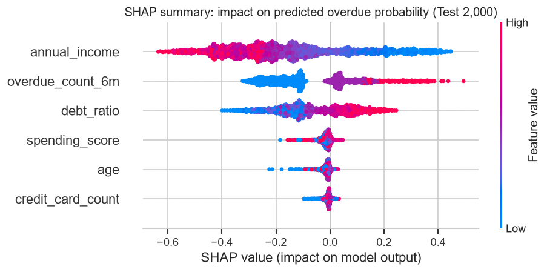

| 순위 | 변수 | 평균 abs SHAP | 비중 | 방향 | 비즈니스 해석 |
| ---: | --- | ---: | ---: | ---: | --- |
| 1 | 연 소득 | 0.243 | 43.6% | 낮을수록 위험 (−0.93) | 상환 여력. 소득 하한 1,500만원 고객이 가장 크게 위험을 올린다 |
| 2 | 6개월 연체 횟수 | 0.151 | 27.1% | 많을수록 위험 (+0.87) | 행동 이력. 0회 → 1회 → 2회에서 점수가 계단식으로 오른다 |
| 3 | 부채 비율 | 0.120 | 21.4% | 높을수록 위험 (+0.90) | 상환 부담. 상담과 대환으로 직접 낮출 수 있는 변수다 |
| 4~6 | 소비 점수, 나이, 카드 수 | 0.010~0.019 | 7.9% 합계 | 일관되지 않음 | 연체 판단에 쓸 정보가 거의 없다 |

방향은 변수 값과 SHAP 값의 순위 상관(Spearman)이다.

- 상위 3개가 영향의 **92.1%**를 차지한다. `data_gen.py`의 신용 점수 공식(소득·연체 횟수·부채 비율)과 정확히 같고, A5-1의 permutation 중요도 순서와도 같다. 서로 다른 두 해석 방법이 같은 답을 냈다.
- **기준값은 0.12가 아니라 0.50이다.** 실제 연체율은 12%지만, `class_weight="balanced"`로 연체 고객에 약 7배 가중치를 주어 학습했기 때문에 모델 점수의 평균이 0.5로 옮겨졌다. 이 모델의 출력은 보정된 확률이 아니라 순위를 매기는 점수로 읽어야 한다.
- 합성 데이터라서 설명이 맞는지 정답 공식과 대조할 수 있었다. 실제 데이터에서 SHAP은 "모델이 무엇을 보는가"이지 인과가 아니다.

## 3. 모델 해석 — Local 사례 2건

선정 기준: 거절은 연체율이 가장 높은 군집(C0)에서 **점수 ≥ 0.5**인 Test 고객 중 군집 중심에 가장 가까운 고객이다. 승인은 연체율이 가장 낮은 군집(C5)에서 **자동 승인 구간(점수 < 0.178)**에 있는 고객 중 중심에 가장 가까운 고객이다. 이렇게 고르면 각 사례가 해당 페르소나를 대표한다.

| 거절 — C0 연체 반복형 | 승인 — C5 저부채 고소비 우량형 |
| --- | --- |
| 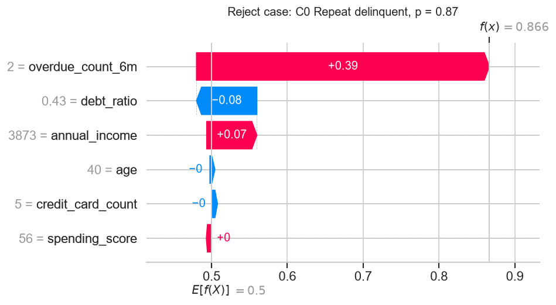 | 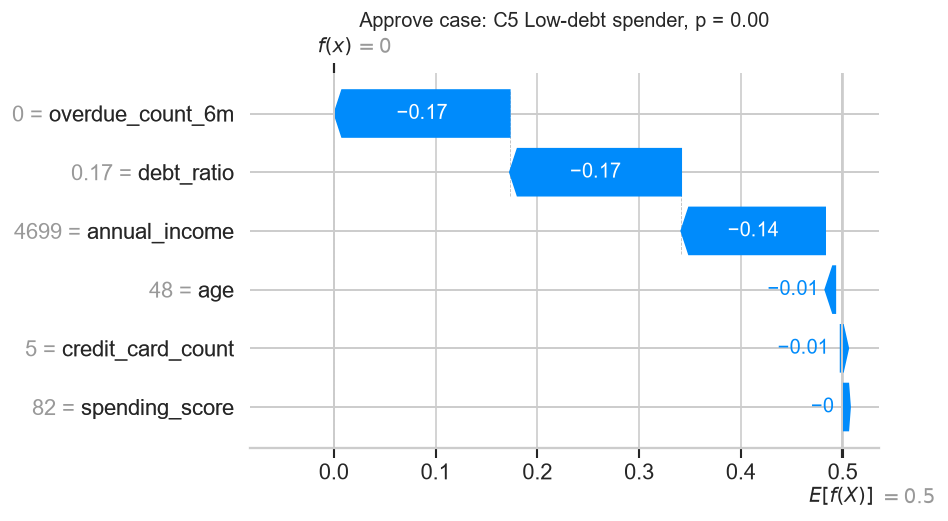 |

**거절 사례 (점수 0.866).** 기준값 0.50에서 연체 2회가 **+0.386**, 낮은 소득(3,873만원)이 +0.066을 더하고, 평균 수준의 부채 비율(0.43)이 −0.080을 뺐다. 영업팀에 전할 문장은 다음과 같다. "최근 6개월에 연체가 두 번 있었고 소득이 평균보다 낮아 상환 여력이 부족하다고 판단했습니다. 부채 비율은 평균 수준이라 위험을 조금 줄였습니다."

이 고객의 실제 라벨은 **정상(0)**이다. 실제 신용 점수는 288점으로 연체 기준(292점)보다 낮다. 생성 규칙상 연체 구간에 있지만, 그 구간에서 무작위로 정상을 받는 20%에 속했다. 모델은 공식대로 판단했고, 불일치는 라벨의 무작위성에서 생겼다. SHAP은 "왜 이렇게 예측했나"를 설명할 뿐 예측이 맞았는지는 알려 주지 않는다.

**승인 사례 (점수 0.000).** 연체 0회(−0.172), 낮은 부채 비율 0.17(−0.168), 소득 4,699만원(−0.141)이 모두 점수를 내렸다. 세 신호 변수가 같은 방향을 가리키는 전형적인 우량 고객이고, 실제 신용 점수는 444점이다.

Force Plot도 `results/force_plots/reject_case.html`, `approve_case.html`로 저장했다. 브라우저로 열면 상호작용 그래프가 보인다.

## 4. Dependence Plot

변수 선택: Summary 상위 2개(소득, 연체 횟수)와 비즈니스 변수 1개(부채 비율)다. 부채 비율은 대출 규제와 고객 상담에서 직접 다루는 변수다.

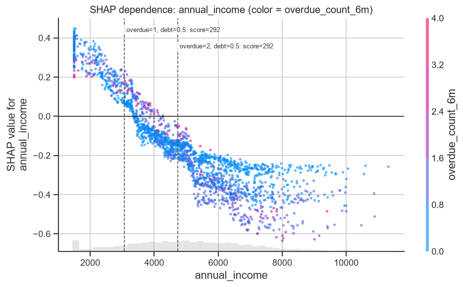

- 소득 SHAP은 약 2,000~5,000만원에서 가장 가파르게 떨어진다. 점선은 생성 공식에서 부채 비율 0.5인 고객의 신용 점수가 292점이 되는 소득이다(연체 1회 3,067만원, 2회 4,733만원). 모델이 공식의 경계를 데이터에서 다시 찾아냈다.
- **상호작용:** 소득 상위 구간에서 연체 이력이 있는 고객의 소득 SHAP은 평균 −0.475, 없는 고객은 −0.320이다. 연체 이력이 있는 고객에게 높은 소득은 위험을 더 크게 상쇄한다. 연체 이력이 없는 고객은 이미 위험이 낮아서 소득이 더 내려 줄 여지가 적다.

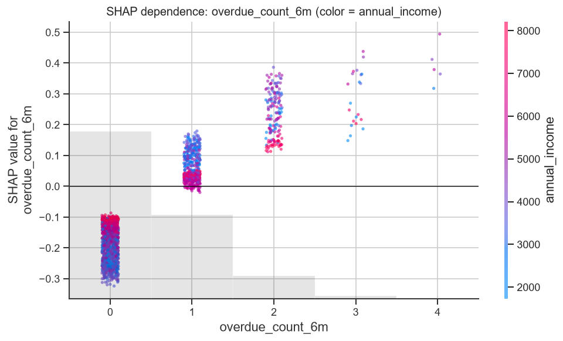

- 연체 0회의 평균 SHAP은 −0.184, 1회 +0.057, 2회 +0.235, 3회 +0.286이다. 첫 연체 한 번에 점수가 약 0.24 오른다. 연체 0회 유지가 가장 강력한 위험 관리 수단이다.
- 같은 연체 1회라도 소득이 높은 고객(분홍)은 SHAP이 0 근처이고, 낮은 고객(파랑)은 +0.15다. 소득이 연체 한 번의 영향을 흡수한다.

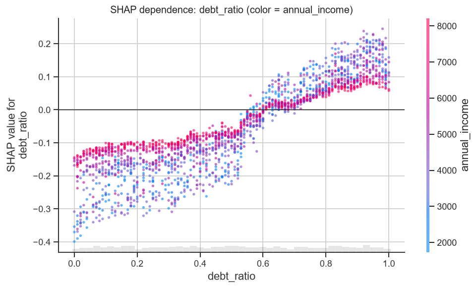

- 부채 비율이 약 0.55~0.6을 넘으면 SHAP이 양수로 바뀐다. 영업 언어로는 "부채가 소득의 절반을 넘으면 위험 신호"다. 부채 비율 하위 구간의 평균 SHAP은 −0.193, 상위 구간은 +0.132다.
- 부채가 낮을 때의 효과는 소득이 낮은 고객(파랑)에게 더 크다(−0.3 이하). 소득이 낮은 고객에게는 부채 축소가 가장 효과적인 상담 주제다.

## 5. 페르소나와 SHAP 연결

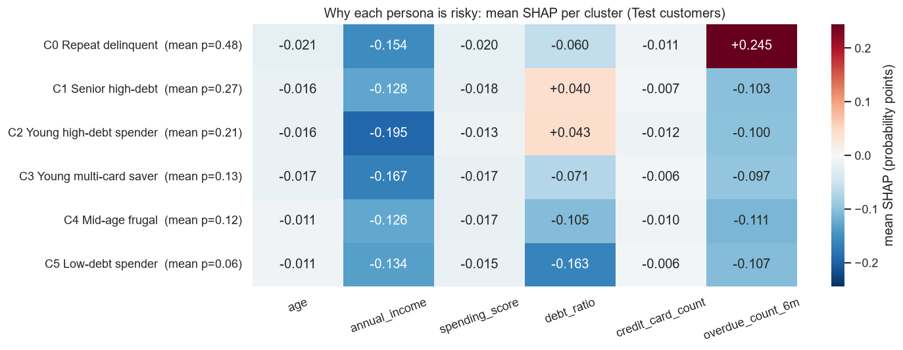

| 페르소나 | 평균 점수 | 위험을 만드는 변수 (평균 SHAP) | Test 승인 / 보류 / 거절 |
| --- | ---: | --- | --- |
| C0 연체 반복형 | 0.48 | 연체 횟수 **+0.245** | 59 / 31 / 98 |
| C1 고령·고부채 다카드형 | 0.27 | 부채 비율 **+0.040** | 202 / 58 / 91 |
| C2 청년·고부채 소비형 | 0.21 | 부채 비율 **+0.043** | 241 / 50 / 67 |
| C3 청년·다카드 절약형 | 0.13 | 없음 (모두 음수) | 311 / 33 / 42 |
| C4 중장년·저소비 실속형 | 0.12 | 없음 (부채 비율 −0.105) | 280 / 22 / 37 |
| C5 저부채 고소비 우량형 | 0.06 | 없음 (부채 비율 **−0.163**) | 338 / 25 / 15 |

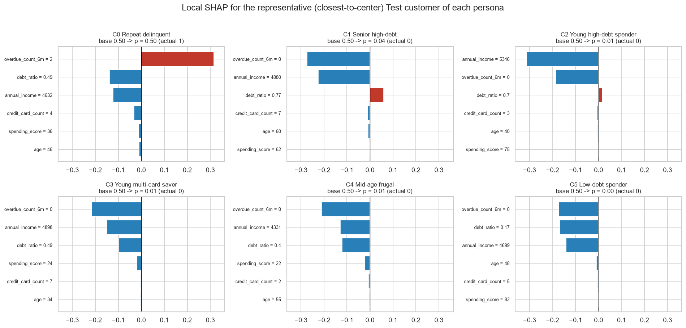

- 페르소나의 위험 원인이 SHAP으로 분리된다. C0은 연체 이력, C1·C2는 부채 비율이 원인이다. 소비 점수가 가장 높은 C5에서도 소비 점수의 SHAP은 −0.015로 위험과 관계가 없다.
- C0 대표 고객(군집 중심에 가장 가까운 고객)은 점수 0.498로 거절 기준 바로 아래 보류 구간에 있다. 실제로는 연체했다. 연체 반복형의 전형은 모델에게도 경계선에 있는 고객이다.
- **가장 중요한 발견:** 모델이 가장 중요하게 보는 소득은 **어떤 군집도 구별하지 않는다**(모든 군집에서 z가 ±0.11 이내). 군집화는 여섯 변수를 같은 무게의 거리로 다루고, 분류 모델은 정답과 관련된 변수만 본다. 그래서 같은 페르소나 안에서도 판정이 갈린다. C0도 59명은 자동 승인이고, C5도 15명은 거절이다.

## 실행 제언

**원칙:** 페르소나는 마케팅·상담의 단위로 쓰고, 승인·거절은 개별 점수와 SHAP 근거로 정한다.

| 페르소나 | 대상 | 메시지 | 액션 |
| --- | --- | --- | --- |
| C0 연체 반복형 | 기존 고객 리스크 관리 | 상환 일정을 함께 조정해 연체를 끊는다 | 신규 한도 동결, 채무 조정 상담, 자동이체 전환 유도. 마케팅 발송 제외 |
| C1 고령·고부채 다카드형 | 보류 심사 집중 대상 | 흩어진 카드 부채를 하나로 모아 이자 부담을 줄인다 | 카드·부채 통합 대환 제안, 부채 비율 변화 모니터링, 신규 카드 발급 억제 |
| C2 청년·고부채 소비형 | 성장 잠재 고객, 단계적 관리 | 쓰는 만큼 관리하면 한도가 함께 커진다 | 소액 한도로 시작해 상환 이력에 따라 단계적 상향, 소비 알림·예산 기능 안내 |
| C3 청년·다카드 절약형 | 주거래 전환 마케팅 | 여러 카드의 혜택을 한 장으로 모은다 | 주거래 카드 통합 혜택, 적금 연계 상품, 쓰지 않는 카드 정리 안내 |
| C4 중장년·저소비 실속형 | 예금·연금 교차 판매 | 모아 둔 자산을 안정적으로 불린다 | 예금·연금·저위험 투자 상품 제안, 간소화 심사로 대출 절차 단축 |
| C5 저부채 고소비 우량형 | VIP 육성 | 많이 쓰는 만큼 더 돌려받는다 | 프리미엄 카드, 한도 상향 사전 승인, 소비 리워드 강화 |

리스크 관리에서 SHAP을 쓰는 방법은 다음과 같다.

- **거절 사유 고지:** Waterfall의 상위 2~3개 변수를 고객 언어로 바꿔 알린다(대시보드의 설명 문장). "연체 2회와 낮은 소득 때문"처럼 구체적으로 말한다.
- **보류 심사 우선순위:** 보류 구간 고객 중 SHAP 상위 원인이 부채 비율이면 대환 상담으로 위험을 낮출 수 있다. 연체 이력이 원인이면 상환 계획을 확인한다.
- **나이 사용 금지 검토:** 나이는 이 모델에서 영향이 작다(2.8%). 하지만 실제 심사에서는 나이 같은 민감 변수를 쓰는 것 자체가 공정성·규제 검토 대상이므로, 입력에서 빼는 것을 권한다.

## 보너스 과제

### 1. Streamlit 대시보드 (`app.py`)

고객 정보 6개를 넣으면 연체 점수, 승인·보류·거절 판정, 페르소나와 전략, Waterfall Plot, 비기술자용 설명 문장을 보여 준다. 페르소나별 대표 고객을 불러와 시작할 수도 있다. 모델은 시작할 때 Train으로 한 번 학습하고(약 2초) 캐시한다. 페르소나 배정은 `results/clustering.json`에 저장한 평균·표준편차·중심으로 가장 가까운 중심을 찾는 방식이라, 파이프라인 결과와 같은 군집을 준다(테스트로 확인). 앱은 이 데이터의 타깃에 맞춰 연체 점수를 표시한다.

### 2. 군집화 알고리즘 비교

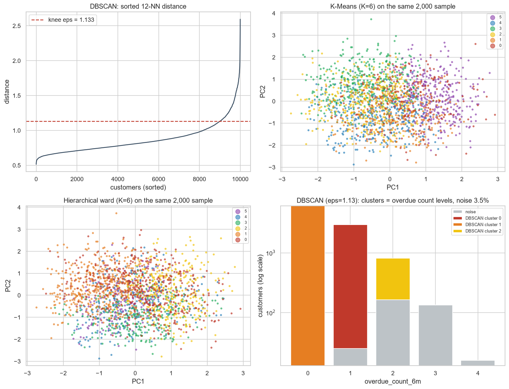

| 방법 | 군집 | Silhouette | K-Means와 ARI | 비고 |
| --- | ---: | ---: | ---: | --- |
| K-Means | 6 | 0.135 | 1 | 크기가 고르다(184~390명) |
| 계층적 (ward) | 6 | 0.063 | 0.191 | 군집 내 분산을 줄이는 기준이라 K-Means와 가장 비슷하다 |
| 계층적 (complete) | 6 | 0.043 | 0.106 | |
| 계층적 (average) | 6 | 0.016 | 0.035 | 1,807명이 한 군집에 몰린다 |
| DBSCAN (eps 1.133, min_samples 12) | 3 | 0.095 | 0.068 | 노이즈 3.5% |

계층적 군집은 메모리가 고객 수의 제곱으로 늘어난다(1만 명이면 거리 행렬만 약 400MB). 그래서 같은 2,000명 표본에서 비교했다. DBSCAN은 전체 1만 명에서 돌렸고, eps는 12번째 이웃 거리 곡선의 꺾이는 점(Kneedle)으로 정했다.

- **알고리즘끼리 답이 엇갈린다**(ARI 0.04~0.19). 진짜 군집이 있다면 방법이 달라도 비슷하게 묶는다. 이 엇갈림 자체가 "자연스러운 군집이 없다"는 증거다.
- **DBSCAN은 데이터에 실제로 있는 빈틈만 찾는다.** 세 군집이 연체 횟수 0회(6,056명)·1회(2,943명)·2회(648명)와 정확히 일치하고, 3회 이상은 노이즈다. 이산 변수의 값 사이 빈틈이 이 데이터에서 유일하게 밀도가 끊기는 곳이다.
- 업무에는 K-Means가 맞다. 새 고객을 가장 가까운 중심에 바로 배정할 수 있고, 크기가 고르며 페르소나 해석이 된다.

## 구조

| 파일 | 내용 |
| --- | --- |
| `data_gen.py` | 미션 제공 코드 그대로(A5-1과 같음) |
| `src/config.py` | 경로, seed, 변수, K 범위, A5-1 모델 설정, CPU 코어 수 |
| `src/data.py` | 적재·검증, 타깃 제외, A5-1과 같은 분할 |
| `src/clustering.py` | 표준화, K 탐색(Inertia·Silhouette·ARI), K 선택 규칙, 프로파일, PCA |
| `src/personas.py` | 페르소나 이름·전략과 서명 검사. 데이터가 바뀌어 서명이 맞지 않으면 실행을 멈춘다 |
| `src/compare.py` | 보너스 2: DBSCAN(eps 자동 선택), 계층적 군집 비교 |
| `src/model.py` | A5-1 설정 재사용과 대조, 성능 평가, 보류 임계값 |
| `src/explain.py` | TreeExplainer, 가법성, Global 요약, 사례 선정, Dependence 요약, 설명 문장 |
| `src/analysis_clustering.py` · `src/analysis_shap.py` | 미션 순서대로 실행하는 두 진입점 |
| `src/report.py` | 그래프 13종, Force Plot HTML, `results/report.md` |
| `app.py` | 보너스 1: Streamlit 대시보드 |
| `tests/test_pipeline.py` | A5-1과 같은 데이터, 타깃 제외, K 선택 규칙, 서명, A5-1 설정 일치, SHAP 가법성, 사례 규칙, 결과 재현 테스트 22개 |
| `tools/` | 노트북 생성·실행, 학습 자료 생성·검증 |

그래프 레이블은 시스템 한글 폰트에 의존하지 않도록 영어로 쓰고, 해석은 이 README와 학습 자료에서 한국어로 한다.

## 한계와 추가 실험

- **군집 구조가 없는 합성 데이터.** 독립 난수로 만든 데이터라 군집의 "발견"이 아니라 공간 분할이다. 실제 고객 데이터에는 변수 간 상관과 덩어리가 있어 Silhouette과 설명 분산이 더 높게 나온다.
- **보정되지 않은 점수.** class_weight 때문에 모델 점수의 평균이 0.5다. 실제 확률로 고객에게 설명하려면 `CalibratedClassifierCV`로 보정한 모델을 해석해야 한다.
- **tree_path_dependent SHAP.** 배경 데이터 없이 트리의 학습 표본 비율로 기댓값을 계산했다. 변수가 독립인 이 데이터에서는 문제가 없지만, 상관이 큰 실제 데이터에서는 interventional 방식과 결과가 달라질 수 있다.
- **페르소나 이름은 사람이 붙였다.** 서명 검사로 군집과 이름이 어긋나지 않게 했지만, 이름이 주는 인상(예: "우량형")이 실제 위험보다 강하게 받아들여질 수 있다.
- **추가 실험:** 신호 변수 3개만으로 군집화, SHAP 값을 입력으로 쓰는 군집화(판정 이유가 비슷한 고객끼리 묶기), 페르소나별 임계값 정책, 시간에 따른 페르소나 구성 변화 모니터링.

## 과정 내 위치

[심화 과정 목차](../README.md) · [전체 과정](../../README.md)

## 노트북으로 한 단계씩 배우기

`notebooks/analysis_clustering.ipynb` → `notebooks/analysis_shap.ipynb` 순서로 실행한다.

군집화 노트북은 고객 한 쌍의 거리부터 표준화, K-Means, K별 지표, K 선택, 군집 특징과 PCA를 직접 실행한다. SHAP 노트북은 Train/Test 분할과 RF 학습부터 한 고객의 기준값·기여·예측 재구성, 전체 Summary, 승인·거절 Waterfall, Dependence, 군집별 설명으로 이어진다. 입력 크기와 중간 결과, 출력 해석, 확인 질문을 포함한다.

프로젝트 가상환경의 커널을 선택하고 첫 셀부터 실행한다. 두 노트북은 각각 새 커널에서 실행할 수 있으며, SHAP 단계는 앞 단계의 `results/learning/clustering.npz`와 데이터 해시·변수 순서를 확인한다. 선행 파일이 없거나 데이터가 바뀌었다면 군집화부터 다시 실행한다.

```text
uv run --group dev python tools/execute_notebook.py
```

셀 내용을 수정하려면 `tools/build_notebook.py`를 수정하고 실행해 재생성한다. 이후 위 명령으로 실행 출력을 저장한다. 실습 그림과 표는 `results/learning/`에 저장되며 기존 CLI 보고서와 대시보드 결과를 덮어쓰지 않는다. 군집 번호는 학습된 중심의 이름표이며 기존 보고서의 연체율 정렬 번호와 다를 수 있다. 승인·거절 사례도 실습에서 명시한 대표 선정 기준으로 고르므로 기존 사례 번호와 섞지 않는다.
