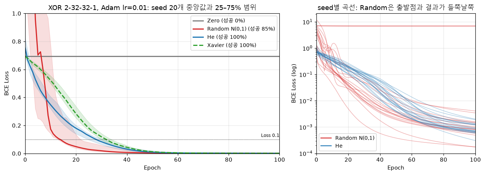
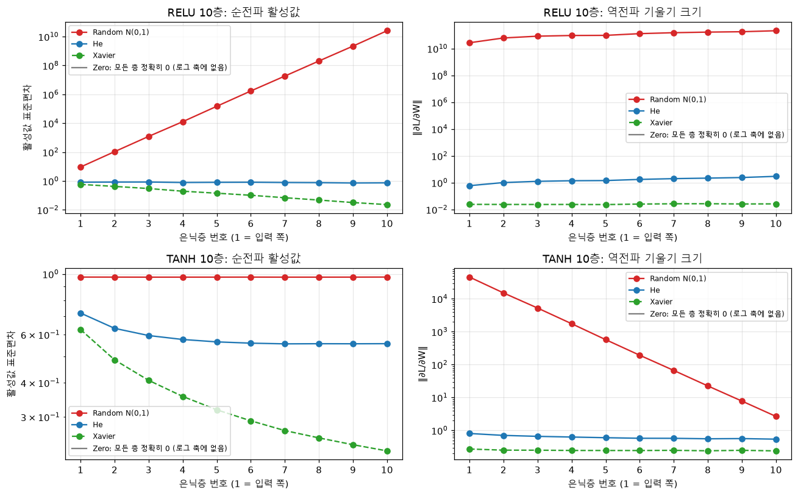
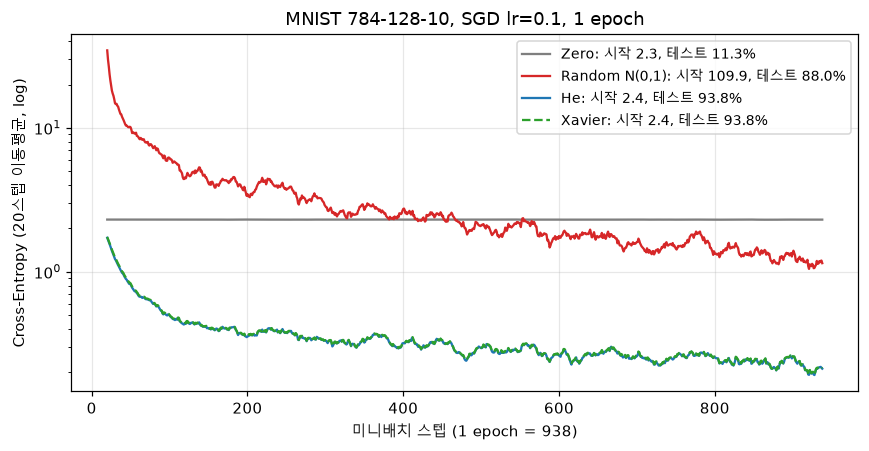
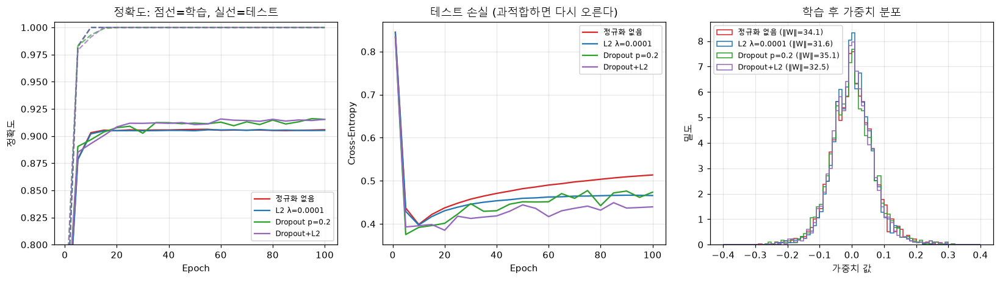
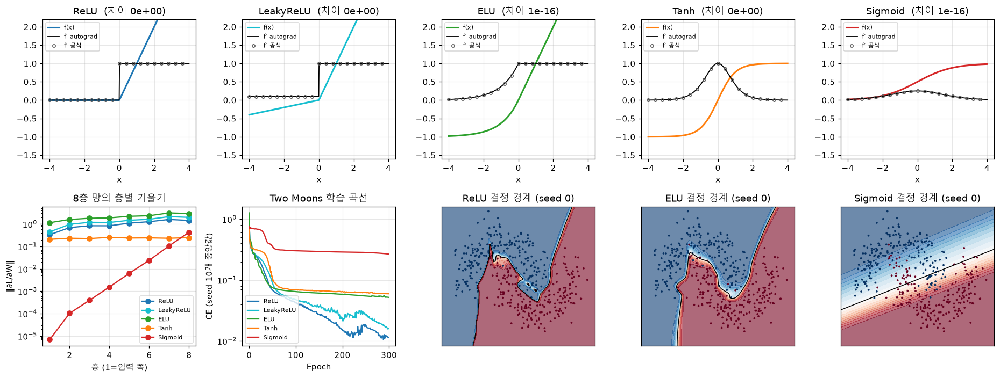

# A6-1 NumPy로 만든 딥러닝 엔진: 가중치를 어떻게 시작해야 학습될까?

PyTorch 같은 딥러닝 라이브러리 없이 NumPy만으로 작은 딥러닝 엔진 `minigrad`를 만들고, 그 엔진이 맞게 계산하는지 검증한 뒤, 가중치의 처음 값(**초기화**)이 학습에 주는 영향을 실험하는 미션이에요. 엔진의 핵심은 **자동 미분**(계산 과정을 기록해 두었다가, 각 값이 결과에 준 영향인 기울기를 거꾸로 계산하는 기능)이에요. 검증에는 **수치 미분**(값을 아주 조금 바꿔 결과가 얼마나 변하는지 직접 재는 방법)을 쓰고, 초기화는 0으로 채우기(Zero), 표준정규분포 무작위 값(Random), He를 비교해요.

## XOR을 학습시키면 이렇게 나와요

XOR은 두 입력이 서로 다르면 1, 같으면 0을 답하는 문제예요. 직선 하나로는 0과 1을 가를 수 없어서 은닉층이 있어야 풀려요. 같은 신경망(입력 2개 → 은닉 32개 → 은닉 32개 → 출력 1개)을 가중치의 처음 값만 바꿔 학습했어요. 아래는 기본 seed 0으로 실행한 실제 결과예요.

| 입력 | 정답 | He 초기화 (100 epoch) | 0으로 초기화 (50 epoch) |
| --- | ---: | ---: | ---: |
| [0, 0] | 0 | 0.0055 | 0.5000 |
| [0, 1] | 1 | 0.9992 | 0.5000 |
| [1, 0] | 1 | 0.9992 | 0.5000 |
| [1, 1] | 0 | 0.0005 | 0.5000 |
| **최종 손실 (loss)** | | 0.0019 | 0.6931 |
| **정확도** | | 100% | 50% |

예측값은 답이 1일 확률이에요. He 초기화는 네 입력을 모두 맞혔어요. 0으로 시작한 망은 모든 입력에 0.5(반반)를 답했고, 손실은 50 epoch 동안 처음 값 0.6931에서 조금도 움직이지 않았어요. 0으로 초기화한 쪽은 미션의 실패 재현 기준에 맞춰 50 epoch만 돌렸어요. XOR은 학습 데이터가 4개뿐이라 1 epoch가 가중치 갱신 한 번이에요.

## 결론: 엔진은 정확했고, 초기화가 학습을 갈랐어요

**직접 만든 역전파는 수치 미분과 거의 같은 기울기를 냈어요. 그 정확한 엔진으로도 가중치를 0으로 시작하면 학습이 멈췄고, 무작위 값을 너무 크게 잡으면 깊은 망에서 값이 폭주했어요.**

| 확인한 것 | 미션 기준 | 결과 |
| --- | --- | --- |
| 역전파가 맞는가 (Gradient Check) | 상대 오차 1e-7 미만 | 연산·레이어·손실·모델의 텐서 38개 모두 통과, 가장 큰 오차 5.2e-11 |
| He 초기화로 XOR을 푸는가 | 100 epoch 안에 손실 0.1 미만 또는 정확도 95% 이상 | 30 epoch에 손실 0.1 미만, 정확도 100% |
| 0으로 초기화하면 실패하는가 | 50 epoch 뒤 손실 감소 없음 | 0.6931 그대로 (변화량 0) |
| MNIST 손글씨 숫자 분류 | 1 epoch에 정확도 80% 이상 | 테스트 정확도 93.76% |

- **0으로 시작하면 아예 배우지 못해요.** 작은 망, 깊은 망, 실제 데이터 모두에서 그랬어요.
- **Random은 작은 XOR 망에서는 He보다 빨랐어요.** 하지만 층을 깊게 쌓거나 입력이 많아지면 값이 폭주했어요.
- **He는 세 실험 모두에서 안정적이었어요.**

초기화 비교는 seed를 고정한 작은 실험 세 가지(XOR, 10층 망, MNIST 1 epoch)에서 잰 값이에요. 학습률이나 망 크기를 바꾸면 Random, He, Xavier의 순위가 바뀌기도 했어요.

## 엔진은 어떻게 동작할까?

1. **계산하며 기록해요.** Tensor끼리 계산할 때마다 결과 Tensor가 "어떤 연산으로, 어떤 값에서 나왔는지"를 기억해요. 계산이 끝나면 계산 그래프가 생겨요.
2. **거꾸로 기울기를 전해요.** `loss.backward()`가 그래프를 거꾸로 훑으며 연산마다 정해 둔 미분을 곱해 나가요(연쇄 법칙). 한 값이 여러 곳에 쓰였으면 각 경로의 기울기를 더해요.
3. **가중치를 고쳐요.** 옵티마이저(SGD, Adam)가 기울기 반대 방향으로 가중치를 조금씩 옮겨요.

```python
from minigrad import Tensor

x = Tensor(2.0, requires_grad=True)
y = Tensor(3.0, requires_grad=True)
loss = (x * y + y) ** 2      # 계산하는 동안 그래프가 만들어져요
loss.backward()              # 그래프를 거꾸로 훑어 기울기를 채워요
print(loss.item(), x.grad, y.grad)   # 81.0  54.0  54.0
```

연습용 숫자로 손 계산과 맞춰 볼 수 있어요. (2·3 + 3)² = 81이고, x에 대한 기울기는 2·9·3 = 54, y에 대한 기울기는 2·9·(2 + 1) = 54예요. 앞의 XOR 망도 같은 방식으로 학습해요.

**엔진이 맞는지는 수치 미분으로 확인했어요.** 값 하나를 1e-5만큼 올렸을 때와 내렸을 때의 손실 차이로 기울기를 직접 재고, `backward()`가 낸 값과 비교했어요. 결론 표처럼 38개 모두 기준을 통과했어요. 검사가 너무 느슨하지 않은지도 봤어요. x²의 미분을 일부러 2x 대신 x로 틀리게 넣으면 오차가 1/3로 커져서 바로 걸렸어요.

**모듈은 네 개예요.**

- `core`: Tensor와 역전파 엔진이에요. 다른 모듈을 모르고 NumPy만 써요.
- `nn`: `core`의 연산을 조합한 레이어(Linear, ReLU, Sigmoid, Softmax 등), 초기화, 손실 함수예요. 레이어에는 역전파 코드가 따로 없어요. 레이어 안에서 쓴 연산의 역전파가 그대로 쓰여요.
- `optim`: SGD와 Adam이에요. 값(`.data`)과 기울기(`.grad`)가 있는 매개변수 목록만 받아서 `nn`을 몰라요.
- `data`: MNIST 파일을 직접 읽는 코드와 미니배치 로더예요. NumPy 배열만 돌려줘서 다른 모듈과 독립이에요.

## 초기화를 바꾸면 무엇이 달라질까?

같은 엔진으로 초기화만 바꿔 세 번 실험했어요. 작은 XOR에서 시작해 망을 깊게, 입력을 넓게 키우며 차이가 어디서 커지는지 봤어요. 편향(bias)은 모든 방법에서 0으로 두었어요.

**1. 작은 망: XOR을 seed 20개로**

seed 하나로는 운에 따라 결론이 뒤집힐 수 있어서, seed 20개로 반복하고 손실의 중앙값을 봤어요.

| 초기화 | 처음 손실 | 5 epoch | 50 epoch | 100 epoch 안에 손실 0.1 미만 | 0.1까지 걸린 epoch (중앙값) |
| --- | ---: | ---: | ---: | ---: | ---: |
| Zero | 0.6931 | 0.6931 | 0.6931 | 0/20 | - |
| Random N(0, 1) | 4.2967 | 0.7028 | 0.0036 | 17/20 | 14 |
| He | 0.7530 | 0.4877 | 0.0082 | **20/20** | 28 |
| Xavier (선택) | 0.6940 | 0.6175 | 0.0123 | **20/20** | 32 |



- **Zero는 대칭이 깨지지 않아요.** 같은 값에서 출발한 뉴런은 같은 기울기를 받아 끝까지 같은 값으로 남아요. 은닉 뉴런 32개가 한 개처럼 움직이니 XOR을 풀 수 없어요. 0이 아닌 0.5로 모두 같게 시작해도, 50 epoch 뒤 은닉 뉴런 32개의 가중치가 완전히 같았어요.
- **Random이 He보다 빨랐어요.** 입력이 2개뿐이라, 첫 층에서는 He의 표준편차 √(2/2) = 1이 Random과 같기 때문이에요. 대신 3개 seed는 학습이 멈췄어요. 이유는 아래 [어디서 막힐까?](#어디서-막히고-언제-무엇을-쓸까)에 있어요.

**2. 깊은 망: 10층으로 쌓기**

층마다 뉴런 256개, ReLU를 쓰는 10층 망에 데이터를 통과시키고, 학습 전 상태에서 층별 출력값의 크기(표준편차)를 쟀어요.

| 초기화 | 1층 출력 크기 | 10층 출력 크기 |
| --- | ---: | ---: |
| Random N(0, 1) | 9.3 | **2.6e10** (폭주) |
| He | 0.82 | 0.75 |
| Xavier | 0.58 | **0.023** (소실) |

ReLU 층 하나를 지날 때마다 값의 분산은 (입력 개수 × 가중치 분산 ÷ 2)배가 돼요. Random은 256 × 1 ÷ 2 = 128배라 표준편차가 층마다 약 11배 커져요. He는 가중치 분산을 2 ÷ 입력 개수로 잡아서 정확히 1배예요. Xavier는 ReLU에서 약 0.5배라 점점 작아져요. 역전파도 같은 곱셈을 거꾸로 거쳐서, Random의 1층 기울기 크기는 2.7e10까지 커졌어요.

**3. 넓은 입력: MNIST 1 epoch**

MNIST는 28×28 손글씨 숫자 사진이라 입력이 784개예요. 784 → 128 → 10 망을 SGD로 1 epoch 학습했어요.

| 초기화 | 첫 손실 | 테스트 정확도 |
| --- | ---: | ---: |
| Zero | 2.303 | 11.35% |
| Random N(0, 1) | **109.9** | 88.00% |
| He | 2.390 | **93.76%** |
| Xavier | 2.372 | 93.76% |

- **Zero**는 모든 사진에 같은 숫자를 답했어요. 11.35%는 테스트 세트에서 가장 많은 숫자인 1의 비율이에요.
- **Random**은 입력 784개를 더하면서 첫 출력이 너무 커져 첫 손실이 110이었어요. 1 epoch 동안 이를 수습하느라 정확도가 He보다 5.8%p 낮았어요.
- **He와 Xavier**는 이 구조에서 표준편차 차이가 작아서, 정확도가 같은 값(정답 9,376개)이 나왔어요.

## 어디서 막히고, 언제 무엇을 쓸까?

**Random이 멈춘 3개 seed:** 처음 출력값(Sigmoid에 들어가기 전 값)이 수십 단위로 컸어요. 그러면 Sigmoid의 출력이 0이나 1에 달라붙어요. 손실 함수는 log(0)을 피하려고 확률을 1e-12에서 잘라 두는데, 출력이 이 경계에 걸리면서 기울기가 0이 됐어요. 손실을 Sigmoid와 합쳐 계산하는 안정형(BCEWithLogits)으로 바꾸자 같은 seed 20개가 모두 성공했어요. 초기화 문제가 손실 구현과 맞물려 드러난 경우예요.

**설정을 바꾸면 순위가 바뀌어요:** 은닉층 크기, 옵티마이저, 학습률을 바꾼 XOR 설정 7가지에서 Zero는 모두 0%였어요. 나머지 셋의 성공률은 설정마다 달랐어요. He는 80~100%, Random은 50~95%, Xavier는 0~100%였어요. 한 설정의 곡선 하나로 "어느 초기화가 더 빠르다"고 말하기는 어려워요. 다만 He의 범위가 가장 좁았어요.

**언제 어떤 초기화를 쓸까?**

| 상황 | 쓸 초기화 | 이 실험의 근거 |
| --- | --- | --- |
| ReLU 계열 활성화 함수 | He | 10층에서도 출력 크기가 거의 그대로였어요 (0.82 → 0.75) |
| Tanh 활성화 함수 | Xavier | 10층 Tanh 망에서 층별 기울기 크기가 비슷했어요 (1층 0.27, 10층 0.24) |
| 모든 가중치를 같은 값으로 | 쓰지 않아요 | 대칭이 깨지지 않아 뉴런이 한 개처럼 움직였어요 |
| N(0, 1)을 그대로 | 쓰지 않는 편이 안전해요 | XOR에서는 빨랐지만 seed 15%가 멈췄고, 10층과 MNIST에서는 값이 폭주했어요 |

## 실행하기

[uv](https://docs.astral.sh/uv/getting-started/installation/)가 필요해요. 없다면 `pip install uv`로 설치할 수 있어요.

```bash
cd 02_Advanced/A6-1
uv sync
uv run python scripts/run_all.py
```

- `uv sync`는 Python 3.12와 NumPy, Matplotlib, 노트북 실행용 패키지를 이 폴더의 `.venv`에 설치해요.
- `run_all.py`는 검증, XOR, 초기화 실험, MNIST, 보너스를 차례로 실행하고 `reports/`와 `figures/`의 결과를 다시 만들어요. 약 5분 걸려요.
- MNIST(약 11MB)는 처음 실행할 때 `data/mnist/`에 내려받아요.
- **하나씩 실행:** `uv run python scripts/gradient_check.py`처럼 `scripts/`의 파일을 따로 실행할 수 있어요. `train_xor.py --init zero --epochs 50`은 실패를 재현하는 명령이라 종료 코드 1이 정상이에요.
- **uv 없이 실행:** `pip install -r requirements.txt`로 설치한 뒤, 위 명령의 `uv run python`을 `python`으로 바꾸세요.

## 더 알아보기

| 이럴 때 | 여기를 보세요 |
| --- | --- |
| 자동 미분이 낯설어요 | [`study/a6-1.html`](study/a6-1.html): 계산 그래프를 한 단계씩 실행하고, 역전파를 손으로 계산하고, 초기화를 바꿔 볼 수 있어요. 인터넷 없이 브라우저로 열어요 |
| 실제 코드로 한 단계씩 따라가고 싶어요 | [`notebooks/autograd_walkthrough.ipynb`](notebooks/autograd_walkthrough.ipynb): 데이터 두 개로 예측 → 손실 → 계산 그래프 → 기울기 → 갱신을 따라가고, 손 계산·수치 미분과 맞춰 봐요. 이어서 XOR과 MNIST로 넘어가요 |
| 검증 방법을 자세히 보고 싶어요 | [`reports/VERIFICATION_REPORT.md`](reports/VERIFICATION_REPORT.md) |
| 초기화 실험의 해석을 자세히 보고 싶어요 | [`reports/EXPERIMENT_REPORT.md`](reports/EXPERIMENT_REPORT.md) |

## 자세한 근거

미션에서 요구한 세부 결과예요. 필요할 때만 펼쳐 보세요.

<details>
<summary>프레임워크 구조와 사용법</summary>

```text
src/minigrad/
├── core/
│   ├── tensor.py     Tensor(data, grad, _backward)와 연산별 미분
│   └── autograd.py   계산 그래프 정렬과 역전파, no_grad
├── nn/
│   ├── layers.py     Linear, ReLU, LeakyReLU, ELU, Sigmoid, Tanh, Softmax, Dropout, Sequential
│   ├── init.py       zero, random, he, xavier 초기화
│   └── losses.py     MSE, BCE, BCEWithLogits, CrossEntropy, NLL
├── optim/
│   ├── optimizer.py  공통 부분 (zero_grad, L2 weight decay)
│   ├── sgd.py        SGD (momentum 선택)
│   └── adam.py       Adam
├── data/
│   ├── mnist.py      MNIST 내려받기, IDX(UBYTE) 바이너리 직접 파싱
│   └── loader.py     DataLoader, XOR, Two Moons
└── gradcheck.py      수치 미분, 상대 오차, check_gradients
```

`nn`과 `gradcheck`는 `core`에 기대요. `optim`과 `data`는 다른 모듈을 import하지 않아요.

**모델 학습**

```python
from minigrad import Tensor, nn, optim
from minigrad.data import xor_dataset

X, y = xor_dataset()
model = nn.Sequential(
    nn.Linear(2, 32, init="he"), nn.ReLU(),
    nn.Linear(32, 32, init="he"), nn.ReLU(),
    nn.Linear(32, 1, init="he"), nn.Sigmoid(),
)
opt = optim.Adam(model.parameters(), lr=0.01)
for epoch in range(100):
    loss = nn.binary_cross_entropy(model(Tensor(X)), y)
    opt.zero_grad()
    loss.backward()
    opt.step()
```

초기화는 `init="zero" | "random" | "he" | "xavier"`로 골라요. `nn.mlp([2, 32, 32, 1], init="he", output=nn.Sigmoid)`처럼 한 줄로 만들 수도 있어요.

**Gradient Check**

```python
import numpy as np
from minigrad import Tensor, nn
from minigrad.gradcheck import check_gradients

layer = nn.Linear(5, 3)
x = Tensor(np.random.randn(4, 5), requires_grad=True)
for r in check_gradients(lambda: (layer(x) ** 2).sum(), [x, layer.W, layer.b], ["x", "W", "b"]):
    print(r.line())   # [Pass] W  Gradient Check - Analytic: ..., Numerical: ..., Diff: ...
```

</details>

<details>
<summary>Gradient Check 전체 결과</summary>

수치 기울기는 `[f(x+ε) − f(x−ε)] / (2ε)`, ε = 1e-5로 원소마다 계산해요. 비교는 텐서 전체의 상대 오차 `‖a − n‖ / (‖a‖ + ‖n‖)`로 하고, 모든 텐서는 float64예요.

| 묶음 | 대상 | 검사한 텐서 | 가장 큰 상대 오차 |
| --- | --- | ---: | ---: |
| 기본 연산 | 사칙연산(브로드캐스팅 포함), MatMul, Pow, Exp, Log, Sum, Mean, Reshape+Transpose, 인덱싱, 한 값을 여러 번 쓰기 | 19 | 3.9e-11 |
| 레이어 | Linear (입력, W, b), ReLU, Sigmoid, Softmax, Tanh, LeakyReLU, ELU, Dropout | 10 | 3.2e-11 |
| 손실 | MSE, BCE, BCEWithLogits, CrossEntropy, Softmax+NLL | 5 | 5.2e-11 |
| 전체 모델 | Linear_1 → ReLU → Linear_2 → CrossEntropy의 W, b | 4 | 4.3e-11 |

```text
[Pass] Linear_1.W                   Gradient Check - Analytic: -0.264922, Numerical: -0.264922, Diff: 4.3e-11
[Pass] Linear_2.W                   Gradient Check - Analytic: -0.268260, Numerical: -0.268260, Diff: 2.9e-11
All 38 gradient checks passed! Maximum difference: 5.2e-11 < 1e-07 ✓  (CrossEntropyLoss.logits)
```

전체 로그는 [`reports/gradient_check.log`](reports/gradient_check.log)에 있어요. ReLU처럼 꺾이는 함수는 꺾이는 점(0)에서 0.05 이상 떨어진 입력으로 검사했어요. x가 0에서 ε 안에 있으면 구현이 맞아도 수치 미분이 틀린 값을 내기 때문이에요.

</details>

<details>
<summary>초기화 실험 세부</summary>

**XOR 설정:** 2-32-32-1, ReLU, 출력 Sigmoid, BCE 손실, Adam(lr=0.01), 전체 배치, seed 0~19. 로그는 [`reports/init_experiment.log`](reports/init_experiment.log)에 있어요.

**Random이 멈춘 seed:** 최종 손실 6.908은 −log(1e-12) ÷ 4로, 데이터 4개 중 하나가 확률을 잘라 두는 경계에 걸려 기울기가 0인 상태예요.

| seed | 처음 출력값 (데이터 4개) | 최종 손실 | 정확도 |
| --- | --- | ---: | ---: |
| 0 (성공 예) | 0, 13.3, 23.9, 21.9 | 0.001 | 100% |
| 4 | 0, 3.1, −43.9, −41.2 | 6.908 | 75% |
| 8 | 0, 37.4, 19.8, 31.5 | 6.908 | 75% |
| 17 | 0, 33.5, 42.0, 62.8 | 6.993 | 75% |

**설정별 성공률** (seed 20개, 100 epoch 안에 손실 0.1 미만)

| 은닉층 | 옵티마이저 | 학습률 | Zero | Random | He | Xavier |
| --- | --- | ---: | ---: | ---: | ---: | ---: |
| [8] | SGD | 0.5 | 0% | 95% | 85% | 65% |
| [16, 16] | SGD | 0.5 | 0% | 95% | 95% | 100% |
| [32, 32] | SGD | 0.1 | 0% | 90% | 80% | 0% |
| [32, 32] | SGD | 0.5 | 0% | 50% | 100% | 100% |
| [16, 16] | Adam | 0.01 | 0% | 90% | 95% | 100% |
| [32, 32] | Adam | 0.01 | 0% | 85% | 100% | 100% |
| [32, 32] | Adam | 0.05 | 0% | 90% | 100% | 100% |

**10층 망 전체 결과** (폭 256, N(0, 1) 입력 512개, 기울기는 무작위 정답의 CrossEntropy 기준)

| 활성화 / 초기화 | 출력 크기 1층 → 10층 | 기울기 크기 1층 / 10층 |
| --- | --- | --- |
| ReLU / Zero | 0 → 0 | 0 / 0 |
| ReLU / Random | 9.3 → 2.6e10 | 2.7e10 / 2.1e11 |
| ReLU / He | 0.82 → 0.75 | 0.60 / 2.97 |
| ReLU / Xavier | 0.58 → 0.023 | 0.024 / 0.026 |
| Tanh / Zero | 0 → 0 | 0 / 0 |
| Tanh / Random | 0.97 → 0.98 | 4.6e4 / 2.7 |
| Tanh / He | 0.72 → 0.56 | 0.81 / 0.54 |
| Tanh / Xavier | 0.63 → 0.23 | 0.27 / 0.24 |



**MNIST 설정:** 784-128-10, ReLU, SGD(lr=0.1), batch 64, 1 epoch(938 스텝). He로 학습한 기본 실행의 숫자별 테스트 정확도는 89.1%(숫자 3)~97.8%(숫자 0)였어요.



</details>

<details>
<summary>보너스 과제 2종</summary>

**Dropout과 L2 정규화:** MNIST 1,000장만으로 784-256-256-10 망을 100 epoch 학습해 일부러 과적합을 만들었어요. 하이퍼파라미터는 검증용 5,000장으로 고르고, 테스트 10,000장은 마지막 비교에만 썼어요.

| 설정 | 학습 정확도 | 테스트 정확도 | 테스트 손실 | 가중치 크기 |
| --- | ---: | ---: | ---: | ---: |
| 정규화 없음 | 100% | 90.58% | 0.514 | 34.1 |
| L2 λ=0.0001 (검증으로 선택) | 100% | 90.52% | 0.466 | 31.6 |
| L2 λ=0.01 | 100% | 90.33% | 0.329 | 7.9 |
| Dropout p=0.2 (검증으로 선택) | 100% | **91.54%** | 0.474 | 35.1 |
| Dropout p=0.2 + L2 λ=0.0001 | 100% | 91.54% | 0.440 | 32.5 |

Dropout은 테스트 정확도를 약 1%p 올렸어요. L2는 정확도를 거의 바꾸지 않았지만, 강하게 걸면 가중치 크기와 테스트 손실을 크게 줄였어요. 틀린 답을 덜 확신하게 됐다는 뜻이에요. Dropout은 학습 때만 뉴런을 끄고 남은 값을 키우는 Inverted 방식이라, 평가 때는 아무것도 하지 않아요.



**추가 활성화 함수 (Tanh, LeakyReLU, ELU):** 자동 미분이 낸 도함수가 손으로 유도한 공식과 1.1e-16 이내로 일치했어요. 8층 망에서 Sigmoid는 입력 쪽 기울기가 출력 쪽의 1.6e-5배로 줄었어요(기울기 소실). 두 반달 모양 데이터(Two Moons)의 테스트 정확도는 seed 10개 평균으로 다음과 같았어요.

| 활성화 함수 | Tanh | ELU | LeakyReLU | ReLU | Sigmoid |
| --- | ---: | ---: | ---: | ---: | ---: |
| 테스트 정확도 | 97.17% | 97.09% | 96.32% | 96.14% | 91.14% |



</details>

---

[심화 과정 목차](../README.md) · [전체 과정](../../README.md)
