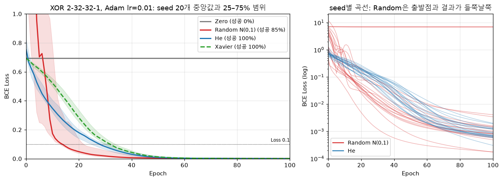
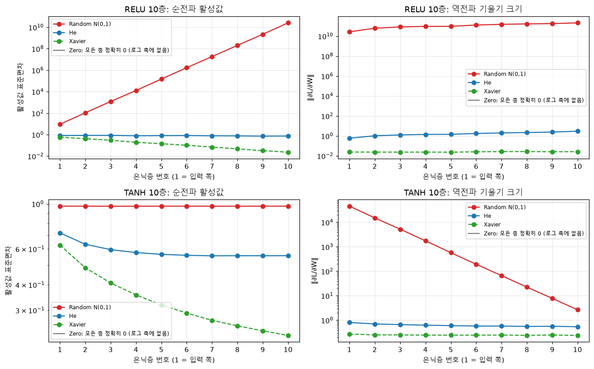
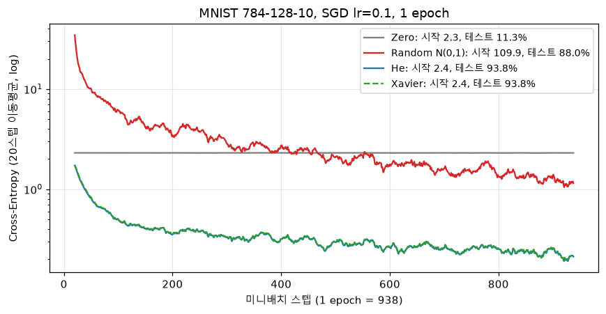
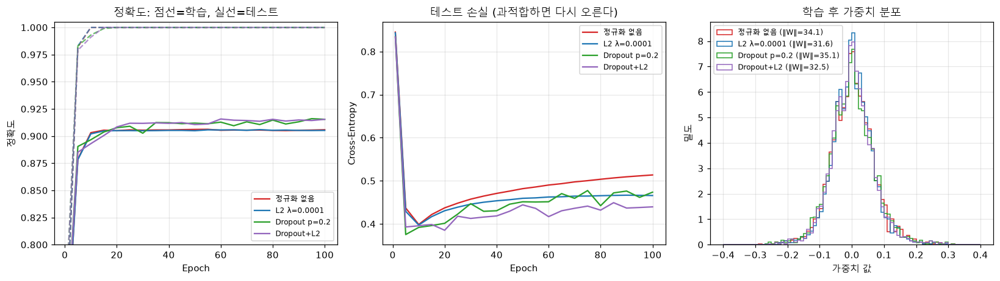
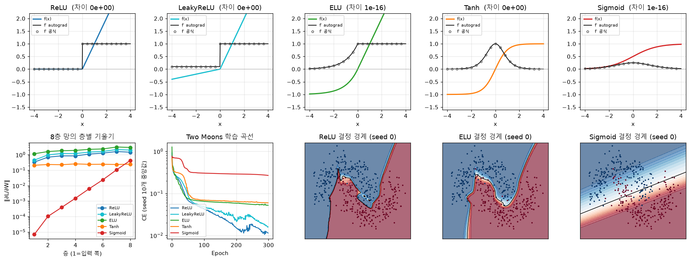

# 실험 리포트 — 가중치 초기화, 그리고 보너스 실험

[README](../README.md) · [검증 리포트](VERIFICATION_REPORT.md)

재현 명령은 `uv run python scripts/init_experiment.py`다. 원본 로그는 [init_experiment.log](init_experiment.log), 수치 전체는 [init_experiment.json](init_experiment.json)에 있다. 모든 실험은 seed를 고정했다.

## 1. 질문

초기화 방법(Zero, Random N(0,1), He, 선택으로 Xavier)에 따라 학습 초기의 loss 감소 속도와 수렴 여부가 어떻게 달라지는가? 그 차이는 어디서 오는가?

## 2. 실험 설계

| 항목 | 설정 | 이유 |
| --- | --- | --- |
| 과제 | XOR 4개 샘플 | 선형 분리가 안 되므로 은닉층이 실제로 일해야 풀린다 |
| 모델 | 2-32-32-1, ReLU, 출력 Sigmoid, BCE | 미션의 Linear·ReLU·Sigmoid 레이어 조합 |
| 최적화 | Adam lr=0.01, 전체 배치 (1 epoch = 1 스텝), 100 epoch | 기준 "100 Epoch 내 Loss < 0.1" |
| 편향 | 모든 방법에서 0 | 가중치 초기화 효과만 비교 |
| 반복 | seed 0–19 (20개) | seed 하나로는 운에 따라 결론이 뒤집힌다 |
| 지표 | epoch별 loss 중앙값·사분위 범위, 100 epoch 내 loss < 0.1 성공률 | 평균은 실패한 seed 하나에 끌려간다 |

초기화의 표준편차는 다음과 같다(Linear 가중치 shape `(n_in, n_out)`).

| 방법 | 표준편차 | 이 모델의 층별 값 (2→32, 32→32, 32→1) |
| --- | --- | --- |
| Zero | 0 | 0, 0, 0 |
| Random | 1 | 1, 1, 1 |
| He | √(2/n_in) | **1.00**, 0.25, 0.25 |
| Xavier | √(2/(n_in+n_out)) | 0.24, 0.18, 0.24 |

첫 층은 입력이 2차원이라 He와 Random이 같다. 결과 해석에 중요한 사실이다.

## 3. 결과: XOR

| Initialization | Epoch 0 | Epoch 5 | Epoch 50 | Epoch 100 | 성공률 | 0.1 도달 epoch (중앙값) |
| --- | ---: | ---: | ---: | ---: | ---: | ---: |
| Zero | 0.6931 | 0.6931 | 0.6931 | 0.6931 | 0% | — |
| Random N(0,1) | 4.2967 | 0.7028 | 0.0036 | 0.0010 | 85% | 14 |
| He | 0.7530 | 0.4877 | 0.0082 | 0.0008 | **100%** | 28 |
| Xavier | 0.6940 | 0.6175 | 0.0123 | 0.0008 | **100%** | 32 |

seed 0 하나만 보면 He는 epoch 30에 0.1 아래로 내려가고 epoch 100에 0.0019, 정확도 100%다([train_xor_he.log](train_xor_he.log)).

### 3.1 Zero: 대칭성 때문에 전혀 학습하지 못한다

- loss는 epoch 0–50 동안 0.693147(= ln 2)에서 **정확히 0만큼** 변했다(최대 변화량 0.00e+00).
- ReLU 은닉층에서는 모든 은닉값이 relu(0) = 0이다. 그래서 dL/dW2 = hᵀ·δ = 0이고, dL/dh = δ·W2ᵀ = 0이다. 출력 편향의 기울기 mean(p − y)도 XOR의 정답 비율이 1:1이라 0이다. 갱신할 기울기가 하나도 없다.
- 대칭성 자체를 따로 보려고 모든 가중치를 상수 0.5로 초기화해 보았다. 50 epoch 뒤에도 W1의 열들이 완전히 같았다(열 사이 최대 차이 0). loss는 7.08에서 7.03으로 조금 움직였지만, 32개 뉴런이 한 개처럼 행동하므로 XOR을 풀 수 없다. He 초기화에서는 열 사이 차이가 2.77로 벌어졌다.

| 초기화 | loss: 첫 스텝 → 50 epoch | W1 열 사이 최대 차이 |
| --- | --- | ---: |
| 모두 0 | 0.6931 → 0.6931 | 0 |
| 모두 0.5 | 7.0810 → 7.0287 | 0 |
| He | 0.7136 → 0.0209 | 2.77 |

**결론**: 같은 값에서 출발한 뉴런은 같은 기울기를 받아 영원히 같은 값으로 남는다. 무작위 초기화는 이 대칭을 깨기 위해 필요하다.

### 3.2 Random: 이 망에서는 빠르지만 불안정하다

미션 예시는 "Random은 분산이 커서 느리고 He는 빠르다"고 예상한다. 이 설정에서는 그 예상과 다르게 나왔다.

- 성공한 seed만 보면 Random이 더 빨랐다(0.1 도달 중앙값 14 vs 28 epoch). 첫 층은 He와 같다. 뒤 두 층은 Random의 가중치가 4배 크므로 출력 로짓도 크게 시작한다. 그래서 "확신 있는" 출력에 더 빨리 도달한다.
- 대신 출발점이 나쁘다. 초기 loss 중앙값이 4.30으로 He(0.75)의 약 6배다. 20개 중 3개 seed(4, 8, 17)는 100 epoch 뒤에도 loss 6.9에 멈췄다.

실패 원인을 진단했다([init_experiment.log](init_experiment.log)의 1-1절).

| seed | 초기 출력 로짓 (4개 입력) | 최종 loss | 정확도 |
| --- | --- | ---: | ---: |
| 0 (성공) | [0, 13.3, 23.9, 21.9] | 0.001 | 100% |
| 4 | [0, 3.1, −43.9, −41.2] | 6.908 | 75% |
| 8 | [0, 37.4, 19.8, 31.5] | 6.908 | 75% |
| 17 | [0, 33.5, 42.0, 62.8] | 6.993 | 75% |

- 로짓이 ±40이면 σ(z)는 float64에서 0이나 1로 반올림된다. BCE는 log(0)을 막으려고 확률을 [1e-12, 1−1e-12]로 자른다. 잘린 구간 밖에서는 기울기가 0이다.
- 6.908 = −log(1e-12)/4다. 샘플 하나가 완전히 틀린 채 clip 경계에 붙어 기울기 없이 멈춘 값이다.
- 수학적으로는 Sigmoid∘BCE의 로짓 기울기가 σ(z) − y = ±1이다. 틀린 쪽으로 포화될수록 오히려 강하게 고쳐야 하는 상황이다.

**대조 실험**: 같은 seed를 안정형 BCE(`binary_cross_entropy_with_logits`, 기울기가 항상 σ(z) − y)로 다시 학습했다.

| Initialization | 분리형 Sigmoid+BCE 성공률 | 안정형 BCE 성공률 | 안정형 0.1 도달 중앙값 |
| --- | ---: | ---: | ---: |
| Zero | 0% | 0% | — |
| Random N(0,1) | 85% | **100%** | 14 |
| He | 100% | 100% | 28 |
| Xavier | 100% | 100% | 32 |

**결론**: XOR에서 Random의 실패는 "큰 분산 → 출력 포화"와 "포화된 확률을 자르는 손실 구현"이 함께 만든 것이다. 손실이 포화를 견디면 사라진다. He는 두 구현 모두에서 안정적이었다. 초기 출력을 작은 범위에 두기 때문이다. 반면 Zero의 실패는 손실을 바꿔도 그대로다. 초기화 자체의 문제다.

### 3.3 민감도: 결론이 설정에 따라 바뀌는가

망 크기·옵티마이저·학습률을 바꿔 seed 20개씩 다시 돌렸다. 칸의 값은 100 epoch 내 loss < 0.1 성공률이고, 괄호는 epoch 5 loss 중앙값이다.

| hidden | opt | lr | Zero | Random | He | Xavier |
| --- | --- | ---: | ---: | ---: | ---: | ---: |
| [8] | sgd | 0.5 | 0% (0.69) | 95% (0.60) | 85% (0.65) | 65% (0.66) |
| [16, 16] | sgd | 0.5 | 0% (0.69) | 95% (0.48) | 95% (0.53) | 100% (0.65) |
| [32, 32] | sgd | 0.1 | 0% (0.69) | 90% (0.16) | 80% (0.57) | 0% (0.68) |
| [32, 32] | sgd | 0.5 | 0% (0.69) | 50% (6.92) | 100% (0.39) | 100% (0.63) |
| [16, 16] | adam | 0.01 | 0% (0.69) | 90% (0.87) | 95% (0.62) | 100% (0.65) |
| [32, 32] | adam | 0.01 | 0% (0.69) | 85% (0.70) | 100% (0.49) | 100% (0.62) |
| [32, 32] | adam | 0.05 | 0% (0.69) | 90% (0.09) | 100% (0.22) | 100% (0.35) |

- **Zero**: 모든 설정에서 0%다. 유일하게 설정과 무관한 결론이다.
- **Random**: 작은 학습률에서는 큰 가중치가 학습을 앞당긴다(sgd 0.1에서 90%). 큰 학습률(sgd 0.5, [32, 32])에서는 절반이 발산했다.
- **He·Xavier**: Xavier는 작은 학습률의 SGD에서 너무 느렸다([32, 32], sgd 0.1에서 0%). ReLU 망에서는 층마다 분산이 절반으로 줄기 때문이다(4절).
- XOR은 너무 작은 문제라 초기화 우열이 설정에 따라 바뀐다. 초기화의 진짜 효과를 보려면 깊거나 넓은 망을 봐야 한다.

## 4. 결과: 깊은 망에서의 기울기 소실과 폭주

폭 256, 은닉층 10개 망에 N(0,1) 입력 512개를 넣었다. 층별 활성값 표준편차(순전파)와 가중치 기울기 노름(역전파, 무작위 레이블의 CE)을 쟀다.

| 활성화/초기화 | 활성 std 1층 → 10층 | ‖∂L/∂W‖ 1층 / 10층 | 해석 |
| --- | --- | --- | --- |
| ReLU / Random | 9.3 → **2.6e10** | 2.7e10 / 2.1e11 | 폭주: 층마다 √(256/2) ≈ 11배 |
| ReLU / He | 0.82 → 0.75 | 0.60 / 2.97 | 거의 일정하게 유지 |
| ReLU / Xavier | 0.58 → **0.023** | 0.024 / 0.026 | 소실: 층마다 약 0.7배 |
| Tanh / Random | 0.97 → 0.98 | **4.6e4** / 2.7 | 포화: 출력이 ±1에 붙고 기울기가 불안정 |
| Tanh / He | 0.72 → 0.56 | 0.81 / 0.54 | 약간 큰 편이지만 안정 |
| Tanh / Xavier | 0.63 → 0.23 | 0.27 / 0.24 | 안정 (Tanh에서 의도한 조합) |
| Zero (둘 다) | 0 → 0 | 0 / 0 | 신호가 아예 없다 |

이유는 분산의 곱셈이다. 입력 분산이 Var(x)이고 가중치 분산이 σ²이면 선형층 출력의 분산은 n_in·σ²·Var(x)이다. ReLU는 절반을 0으로 만들어 이 값을 다시 절반으로 줄인다. 그래서 ReLU 층 하나를 지날 때마다 분산은 n_in·σ²/2배가 된다.

- Random(σ² = 1, n_in = 256): 128배. 표준편차로는 약 11배씩 커진다.
- He(σ² = 2/n_in): 정확히 1배. He 초기화의 설계 목표다.
- Xavier(σ² = 2/(n_in+n_out) = 1/256): 0.5배. 표준편차로는 약 0.7배씩 줄어든다.

역전파도 같은 곱셈을 반대 방향으로 거친다. 그래서 순전파가 폭주하면 기울기도 폭주하고, 순전파가 소실되면 기울기도 소실된다.

## 5. 결과: MNIST 1 epoch

입력이 784차원이면 Random의 문제가 XOR보다 훨씬 커진다(784-128-10, ReLU, SGD lr=0.1, batch 64).

| Initialization | 첫 스텝 loss | 마지막 스텝 loss | 테스트 정확도 |
| --- | ---: | ---: | ---: |
| Zero | 2.303 | 2.328 | 11.35% |
| Random N(0,1) | **109.9** | 0.206 | 88.00% |
| He | 2.390 | 0.086 | **93.76%** |
| Xavier | 2.372 | 0.087 | 93.76% |

- **Zero**: loss가 ln 10 = 2.303에 머문다. 정확도 11.35%는 테스트 세트에서 가장 많은 숫자 1의 비율(1135/10000)과 같다. 모든 입력에 같은 답을 낸다는 뜻이다.
- **Random**: 첫 층 출력의 표준편차가 √784 ≈ 28배로 커져 로짓이 수백 단위가 된다. 첫 loss는 110이다. 1 epoch 동안 이를 수습하느라 정확도가 5.8%p 낮았다.
- **He와 Xavier**: 이 구조에서는 두 방법의 표준편차 차이가 4~8%뿐이다. 학습 경로가 거의 겹쳐 정확도가 우연히 같은 값(9,376개 정답)이 되었다. 손실값은 서로 다르다.

## 6. 결론

1. **Zero 초기화는 어떤 설정에서도 학습하지 못한다.** 같은 값에서 출발한 뉴런은 같은 기울기를 받아 대칭이 깨지지 않는다. ReLU에서는 기울기 자체가 0이다.
2. **He 초기화는 ReLU 망의 활성값·기울기 분산을 층마다 보존한다.** 10층에서도 활성값 표준편차가 0.82에서 0.75로 유지되었다. XOR seed 20개 모두와 MNIST에서 가장 안정적이었다.
3. **N(0,1) 초기화는 분산이 층마다 n_in/2배로 커진다.** 깊은 ReLU 망에서는 폭주(10층에서 2.6e10), 넓은 입력에서는 출력 포화(MNIST 첫 loss 110)로 나타났다. 입력이 2차원인 XOR에서는 첫 층이 He와 같아 오히려 빨랐다. 다만 출력 포화 때문에 seed 15%가 멈췄다.
4. **Xavier는 Tanh·Sigmoid용이다.** ReLU 망에서는 층마다 분산이 절반이 되어 신호가 소실되었다.
5. **원문 예시와의 차이**: 예시의 "Random은 느림" 패턴은 이 XOR 설정에서는 재현되지 않았다. 초기화의 효과는 망의 폭·깊이와 손실 구현에 따라 달라진다. seed 하나의 곡선으로 결론을 내리면 위험하다.

## 7. 보너스 실험

### 7.1 Dropout과 L2 정규화

재현: `uv run python scripts/bonus_regularization.py` · 로그: [bonus_regularization.log](bonus_regularization.log)

**Inverted Dropout 동작 확인** (p=0.5, 입력이 모두 1)

- 학습 모드: 0이 된 비율 0.501, 남은 값 2.0(= 1/(1−p)), 평균 0.998이다. 기댓값이 보존된다.
- 같은 입력을 두 번 넣으면 마스크가 다르다. 평가 모드(`model.eval()`)에서는 항등 함수다.

**과적합 억제**: MNIST 학습 1,000장, 검증 5,000장, 테스트 10,000장을 썼다. 모델은 784-256-256-10, SGD(lr=0.05, momentum=0.9), 100 epoch다. λ와 p는 **검증 정확도**로 골랐다.

| 설정 | train | val | test | train−test | test loss | ‖W‖ |
| --- | ---: | ---: | ---: | ---: | ---: | ---: |
| 정규화 없음 | 100% | 89.66% | 90.58% | 9.42%p | 0.514 | 34.1 |
| L2 λ=1e-4 (선택) | 100% | 89.84% | 90.52% | 9.48%p | 0.466 | 31.6 |
| L2 λ=1e-3 | 100% | 89.54% | 90.32% | 9.68%p | 0.354 | 17.4 |
| L2 λ=1e-2 | 100% | 89.62% | 90.33% | 9.67%p | 0.329 | 7.9 |
| Dropout p=0.2 (선택) | 100% | 90.58% | **91.54%** | 8.46%p | 0.474 | 35.1 |
| Dropout p=0.5 | 100% | 90.44% | 91.33% | 8.67%p | 0.571 | 40.2 |
| Dropout 0.2 + L2 1e-4 | 100% | 90.92% | **91.54%** | 8.46%p | 0.440 | 32.5 |

- **Dropout**: 정확도 기준으로 효과가 가장 컸다(+0.96%p). 매 스텝 다른 부분망을 학습해 특정 뉴런 조합에 의존하지 않게 한다.
- **L2**: 정확도는 ±0.3%p로 거의 그대로였다. 대신 가중치 노름이 34.1에서 7.9까지 줄었고(λ=1e-2), 테스트 손실도 0.514에서 0.329로 줄었다. 정규화 없는 모델은 epoch 10 이후 정확도는 유지하면서 테스트 손실이 계속 올랐다. 틀린 답에 점점 더 확신하게 된 것이다(그림 가운데). L2는 이 과신을 막는다.
- **한계**: seed 1개, 학습 1,000장의 결과다. 정확도 차이 1%p는 테스트 10,000장의 표준오차(약 0.3%p)보다 크지만, 학습 seed에 따른 편차는 재지 않았다.

### 7.2 추가 활성화 함수 (Tanh, LeakyReLU, ELU)

재현: `uv run python scripts/bonus_activations.py` · 로그: [bonus_activations.log](bonus_activations.log)

| 함수 | f(x) | f′(x) (손 유도) | autograd와 최대 차이 |
| --- | --- | --- | ---: |
| Tanh | (eˣ−e⁻ˣ)/(eˣ+e⁻ˣ) | 1 − tanh²(x) | 0 |
| LeakyReLU (α=0.1) | x (x>0), αx | 1 (x>0), α | 0 |
| ELU (α=1) | x (x>0), α(eˣ−1) | 1 (x>0), αeˣ = f(x)+α | 1.1e-16 |
| Sigmoid | 1/(1+e⁻ˣ) | σ(1−σ) | 1.1e-16 |

세 함수 모두 [Gradient Check](VERIFICATION_REPORT.md)도 통과했다.

| 함수 (초기화) | 8층 망 ‖∂L/∂W‖ 1층/8층 | Two Moons 테스트 정확도 (seed 10개) |
| --- | ---: | ---: |
| ReLU (He) | 0.23 | 96.14% ± 0.17% |
| LeakyReLU (He) | 0.22 | 96.32% ± 0.16% |
| ELU (He) | 0.39 | 97.09% ± 0.25% |
| Tanh (Xavier) | 0.84 | **97.17% ± 0.28%** |
| Sigmoid (Xavier) | **1.6e-5** | 91.14% ± 4.68% |

- **Sigmoid**: 최대 기울기가 0.25다. 그래서 층을 지날 때마다 기울기가 4배 이상 줄어 8층에서 입력 쪽이 1.6e-5배가 되었다. 결정 경계가 거의 직선에 머물렀다.
- **Tanh**: 0 중심이고 최대 기울기가 1이다. Xavier와 함께 쓰면 기울기가 거의 일정하게 전달되었다.
- **LeakyReLU·ELU**: 음수 영역에서도 기울기가 0이 아니어서 죽은 ReLU 문제가 없다. ELU는 음수 출력이 −α로 부드럽게 포화되어 평균 활성값이 0에 가깝다. Two Moons에서 ELU는 ReLU보다 학습 손실이 높게 끝났지만(0.052 vs 0.012) 테스트 정확도는 더 높았다. ReLU가 노이즈가 섞인 학습 점까지 더 맞추며 경계를 꺾었다는 뜻으로 읽힌다(그림의 결정 경계 비교).
