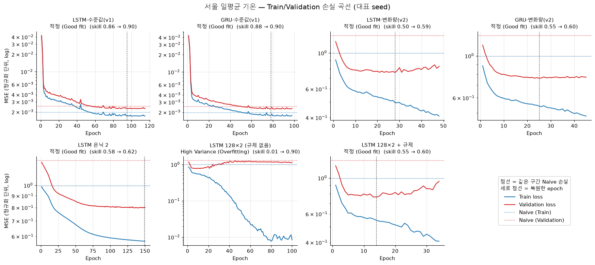
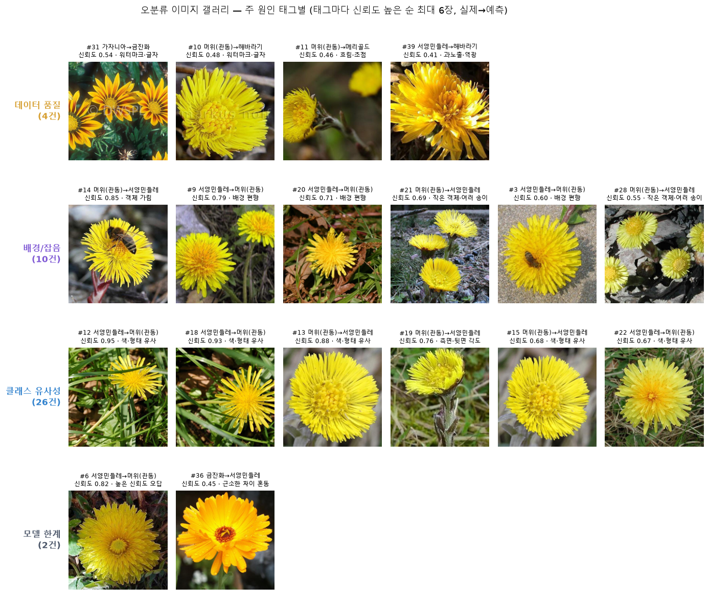
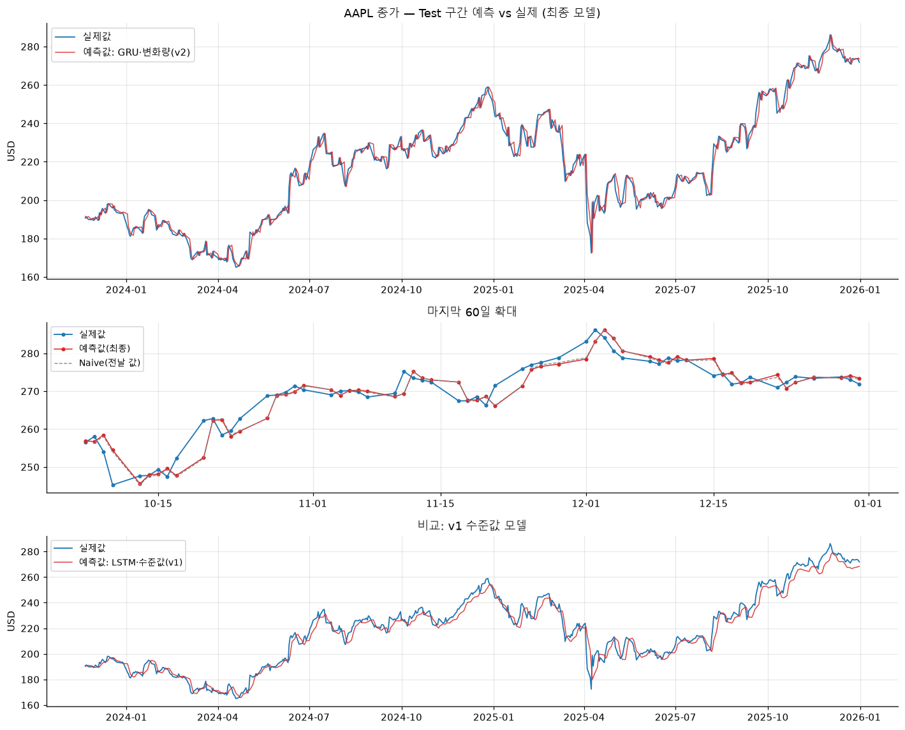
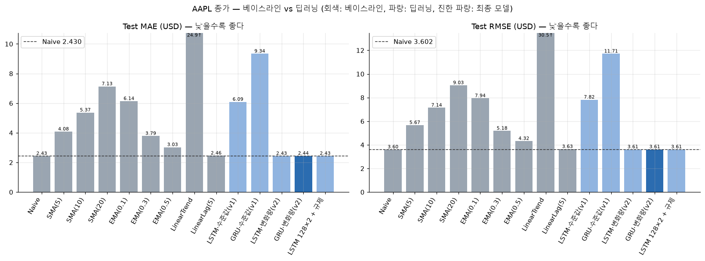
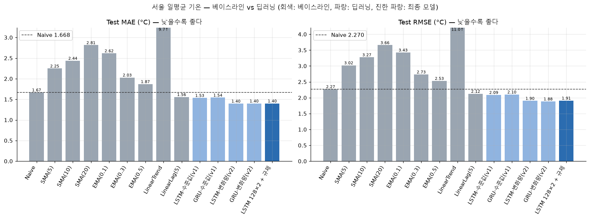
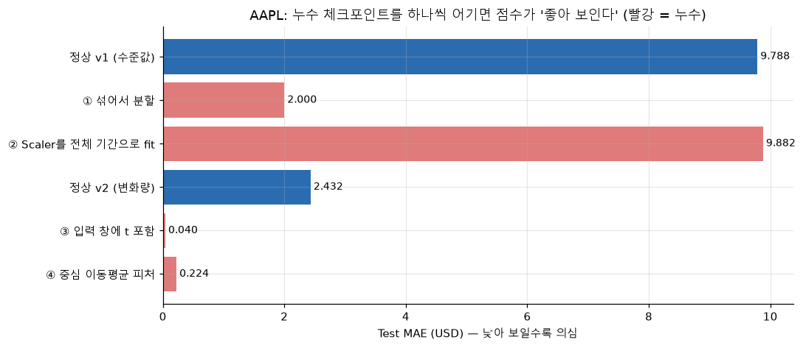
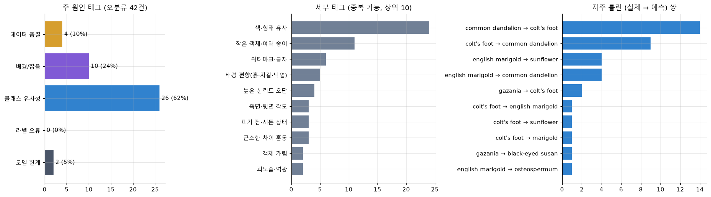
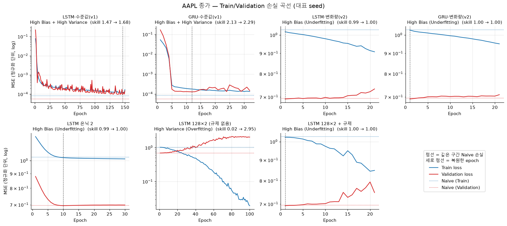
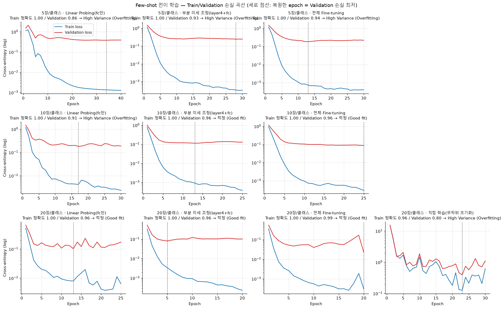

# A6-2 모델 진단과 오차 분석: 무엇을 고칠지 어떻게 알까?

딥러닝 모델이 어디서 왜 틀리는지 진단하고, 진단에 맞춰 고치는 미션이에요. 진단에는 두 가지를 봐요. 하나는 학습에 쓴 데이터(Train)와 처음 보는 데이터(Validation)의 오차 차이이고, 다른 하나는 모델이 실제로 틀린 사례예요. 두 문제에 같은 순서를 적용했어요. 학습 없는 예측(베이스라인)을 먼저 재고, 딥러닝을 적용한 뒤, 진단하고, 처방의 효과를 숫자로 확인해요.

- **꽃 사진 분류:** 생김새가 비슷한 꽃 8종(민들레, 머위, 금잔화, 해바라기 등)을 종류당 5·10·20장만으로 구별해요. ImageNet으로 미리 학습된 ResNet18을 가져와 이어서 학습해요(전이 학습).
- **시계열 예측:** 애플 주가(AAPL)와 서울 일평균 기온의 다음 날 값을 LSTM·GRU로 예측해요. 2015~2025년 일별 데이터를 시간순으로 Train, Validation, Test에 7:1:2로 나눴어요.

## 기온 예측 모델이 데이터를 외웠을 때

큰 LSTM(은닉 128, 2층)이 서울의 다음 날 기온을 예측하게 하고, 규제 없이 100 epoch 동안 학습했어요. 이 미션의 진단 방법이 가장 또렷하게 드러나는 실험이라 골랐어요.

| 학습 방법 | Train 오차 | Validation 오차 | 진단 |
| --- | ---: | ---: | --- |
| 규제 없이 100 epoch | 0.14℃ | 1.63℃ | 과적합 (High Variance) |
| Dropout 0.3, Weight decay, 조기 종료 | 1.16℃ | 1.28℃ | 적정 |

오차는 예측이 실제 기온과 평균 몇 ℃ 차이 났는지(MAE)예요. 규제가 없을 때 Train에서는 거의 틀리지 않았지만, Validation 오차는 "전날 기온 그대로"라고 예측했을 때(1.66℃)와 비슷했어요. 학습 데이터를 외웠다는 신호라서, 처방은 덜 외우게 하는 규제예요. 규제를 넣자 Train 오차는 올라갔지만 Validation 오차는 줄었고, 시험용 Test 오차도 1.76℃에서 1.41℃로 줄었어요.



아래 줄 가운데 '128×2 (규제 없음)' 칸에서는 Train 손실(파란 선)만 계속 떨어지고 Validation 손실(빨간 선)은 내려가지 않아요. 오른쪽 '128×2 + 규제' 칸에서는 두 선이 가까이 붙어 있어요.

## 결론: 진단이 무엇을 고칠지 알려 줬어요

**Train과 Validation의 오차 차이, 그리고 틀린 사례를 보면 무엇을 고칠지 정할 수 있었어요. 다만 주가처럼 데이터 자체에 단서가 없으면 어떤 처방도 "전날 값 그대로"를 넘지 못했어요.**

| 문제 | 비교 기준 | 최종 딥러닝 모델 | 결과 |
| --- | --- | --- | --- |
| 서울 기온 | 가장 나은 베이스라인(최근 5일 선형 회귀) 오차 1.56℃ | LSTM 오차 1.41℃ | 오차가 9.3% 작아요 |
| 애플 주가 | 전날 값 그대로 오차 2.43달러 | GRU 오차 2.43달러 | 차이가 없어요 (0.16% 나쁨, 우연으로 볼 수 있는 차이) |
| 꽃 8종, 종류당 20장 | 처음부터 학습한 ResNet18 정확도 85.2% | 사전학습 ResNet18 정확도 97.5% | 12.3%p 높아요 |

시계열은 종목 하나와 도시 하나, 꽃은 8종으로 잰 결과라서 다른 데이터에서도 같은 순위가 나온다고 말할 수는 없어요.

## 어떻게 진단할까?

1. **베이스라인을 먼저 재요.** 전날 값 그대로, 최근 n일 평균, 선형 회귀처럼 학습이 거의 없는 예측의 오차를 딥러닝보다 먼저 측정해요. 딥러닝 스크립트는 베이스라인 결과가 없으면 실행되지 않아요.
2. **Validation으로만 고르고 Test는 마지막에 봐요.** 모델, 설정, 조기 종료 시점은 모두 Validation으로 정하고 Test는 최종 비교에만 써요.
3. **Train과 Validation 오차를 비교해 상태를 진단해요.**

   | 상태 | Train 오차 | Validation 오차 | 처방 |
   | --- | --- | --- | --- |
   | 과소적합 (High Bias) | 높음 | 높음, Train과 비슷 | 모델 키우기, 입력 정보 보강 |
   | 과적합 (High Variance) | 낮음 | 높음, Train과 차이가 큼 | 규제(Dropout, Weight decay, 조기 종료), 데이터 늘리기 |

   '높다'는 기준선과 비교해 정해요. 시계열은 같은 구간에서 "전날 값 그대로"의 오차 제곱을 기준으로 삼아, Train에서도 그보다 5% 넘게 낫지 못하면 과소적합이에요. 꽃은 사람이 거의 틀리지 않으니 오류율 0을 기준으로 삼아, Validation 오류율이 Train보다 5%p 넘게 높으면 과적합이에요. 위 기온 예시는 이 표의 두 번째 줄이에요.
4. **틀린 사례를 직접 봐요.** 꽃 분류기가 틀린 사진마다 원인 태그(데이터 품질, 배경/잡음, 클래스 유사성, 라벨 오류, 모델 한계)를 달고, 가장 많은 원인에 맞는 처방을 골라요.

## 꽃: 사진이 적을수록 더 외워요

사전학습 모델을 어디까지 다시 학습할지(Layer Freezing)와 사진 수를 바꿔 가며 Validation 정확도를 쟀어요.

| 종류당 사진 | 분류기만 학습 (Linear Probing) | 마지막 블록까지 학습 | 전체 학습 (Fine-tuning) |
| --- | ---: | ---: | ---: |
| 5장 | 86.2% | 92.5% | 93.8% |
| 10장 | 91.2% | 96.2% | 96.2% |
| 20장 | 96.2% | 96.2% | **98.8%** |

- **사진을 늘리자 과적합이 줄었어요.** 사전학습 모델은 모두 Train 정확도가 100%였어요. 5장에서는 세 전략 모두 과적합으로 진단됐고, 사진이 늘수록 Validation과의 차이가 줄었어요. 진단표의 처방 '데이터 늘리기'와 같은 방향이에요.
- **분류기만 학습하는 전략은 어느 사진 수에서도 최선이 아니었어요.** 데이터가 아주 적으면 분류기만 학습하라는 규칙이 흔하지만, 이 실험에서는 오히려 5장에서 차이가 가장 컸어요. ImageNet에는 민들레·머위 같은 클래스가 없어서, 미리 학습된 특징만으로는 이 꽃들을 가르기 어려웠다고 봐요.
- **사전학습 없이 처음부터 학습하면 Train도 다 맞히지 못했어요.** 같은 20장으로 Train 정확도 95.6%, Test 정확도 85.2%였어요. 사진 160장으로 파라미터 1,100만 개를 처음부터 배우기는 어려워요.

Validation은 80장이라 한 장 차이가 1.25%p예요. 전략 사이의 차이가 1~2장이면 seed를 바꿨을 때 순위가 바뀔 수 있어요.

## 꽃: 틀린 사진에서 처방을 찾았어요

오분류 사진 42장을 직접 보고 원인을 분류했어요. 최종 모델이 틀린 사진은 8장뿐이라, 미션 기준 30장을 채우려고 같은 Test 사진에서 다른 6개 모델이 틀린 사진도 합쳤어요.



- **42장 중 23장(55%)이 민들레와 머위를 서로 헷갈린 사진이에요.** 둘 다 노란 방사형 꽃이에요. 사람은 머위의 비늘 덮인 줄기나 민들레의 톱니 잎으로 구별하지만, 꽃만 크게 찍힌 사진에서는 그 단서가 화면 밖에 있어요.
- **배경을 단서로 쓴 흔적도 있어요.** 머위의 Train 사진은 맨흙·자갈 위가 많아서, 자갈이나 낙엽 위의 민들레가 머위로 예측됐어요.
- **처방:** 가장 많은 원인이 '클래스 유사성'(26장, 62%)이라, 작은 단서를 볼 수 있게 입력 해상도를 160px에서 224px로 높였어요. Test 정확도가 97.8%에서 99.2%로 올랐어요(seed 3개 평균).

원인 태그는 아직 사람이 검수하기 전의 초안이에요. 처방은 Test의 오분류를 보고 골랐고 같은 Test로 다시 쟀기 때문에, 처음 보는 사진에서도 같은 효과가 나는지는 확인하지 않았어요.

## 주가: 진단표대로 안 될 때

주가를 그대로 예측한 LSTM은 Train에서도 "전날 값 그대로"보다 오차가 컸어요. 진단표대로라면 과소적합이니 모델을 키워야 해요. 그런데 큰 LSTM(은닉 128, 2층)을 규제 없이 학습하자 Train 오차 0.14달러, Validation 오차 3.16달러로 외우기만 했어요.

그래서 모델 대신 문제를 바꿨어요. 주가 자체가 아니라 다음 날 얼마나 오르내릴지(변화량)를 예측하게 하자 Test 오차가 6.09달러에서 2.43달러로 줄었어요. 하지만 "전날 값 그대로"와 같은 수준이었어요. 은닉 크기 2짜리 작은 모델도, 규제를 건 큰 모델도 같은 자리에 머물렀어요.



가운데 확대 그림에서 예측(빨간 선)은 실제(파란 선)를 하루 늦게 따라가요. 사실상 전날 값을 내놓는 셈이에요.

- **이 과소적합은 모델 크기 문제가 아니었어요.** 과거 가격만으로는 다음 날 변화를 거의 예측할 수 없어요. 처방은 더 큰 모델이 아니라 새 입력 정보(거시 지표, 뉴스, 다른 종목 등)예요.
- **베이스라인을 먼저 쟀기 때문에 착시를 피했어요.** 최종 모델은 최근 5일 평균(SMA)보다 오차가 40% 작아요. 이 비교만 봤다면 딥러닝이 잘했다고 오해했을 거예요.

## 언제 이 진단을 쓰면 좋을까?

- **처방의 방향을 빨리 정할 때 좋아요.** Train과 Validation의 차이만 봐도 모델을 키울지, 규제를 걸지 알 수 있어요. 기온과 꽃에서는 이 방향이 맞았어요.
- **과소적합의 원인은 표만으로 가릴 수 없어요.** 모델이 작아서인지, 데이터에 답이 없어서인지는 작은 모델과 큰 모델을 함께 돌려 같은 자리에 머무는지 봐야 알 수 있어요.
- **틀린 사례 보기는 숫자가 못 보여 주는 원인을 찾아요.** 배경 편향은 오차 숫자에는 드러나지 않았어요. 다만 처방의 효과는 처방을 고를 때 보지 않은 데이터로 재야 믿을 수 있어요.

## 실행하기

[uv](https://docs.astral.sh/uv/getting-started/installation/)가 필요해요. 없다면 `pip install uv`로 설치할 수 있어요.

```bash
cd 02_Advanced/A6-2
uv sync
uv run python scripts/run_all.py
```

- `uv sync`는 이 폴더의 `.venv`에 PyTorch CPU 빌드(약 200MB)와 라이브러리를 설치해요. GPU는 없어도 돼요.
- 처음 실행할 때 꽃 이미지(약 346MB)와 ResNet18 가중치(약 45MB)를 자동으로 받아요. 시계열 데이터는 `data/timeseries/`에 들어 있어 인터넷 없이 돌아가요.
- 노트북 CPU로 전체 약 2시간 30분 걸려요. 실험 하나만 돌리려면 `scripts/` 안의 스크립트를 `uv run python scripts/ts_baselines.py`처럼 실행해요. 순서는 `scripts/run_all.py`에 있어요.
- **원인 태그 검수:** `scripts/build_tagging_page.py`가 만든 `annotations/tagging.html`을 브라우저에서 열어 태그를 고치고 CSV로 저장해요. 받은 파일로 `annotations/error_tags.csv`를 바꾼 뒤 `scripts/vision_error_analysis.py`와 `scripts/build_reports.py`를 다시 실행해요.

## 더 알아보기

| 이럴 때 | 여기를 보세요 |
| --- | --- |
| 편향·분산, 전이 학습, 누수를 그림과 함께 이해하고 싶어요 | [`study/a6-2.html`](study/a6-2.html): 인터넷 없이 브라우저로 열어요 |
| 계산을 한 단계씩 따라가고 싶어요 | [`notebooks/diagnosis_walkthrough.ipynb`](notebooks/diagnosis_walkthrough.ipynb): 입력 윈도우, Train 전용 정규화, 진단까지 직접 계산해요. 작은 설정으로 다시 학습해서 수치가 README와 달라요 |
| 진단 결과를 실험별로 보고 싶어요 | [`reports/DIAGNOSIS_REPORT.md`](reports/DIAGNOSIS_REPORT.md) |
| 오분류 42장의 원인 태그를 하나씩 보고 싶어요 | [`reports/ERROR_ANALYSIS.md`](reports/ERROR_ANALYSIS.md) |
| 베이스라인 9개와 모든 딥러닝 모델의 성능을 보고 싶어요 | [`reports/BASELINE_COMPARISON.md`](reports/BASELINE_COMPARISON.md) |

## 자세한 근거

미션에서 요구한 세부 결과예요. 필요할 때만 펼쳐 보세요.

<details>
<summary>베이스라인 비교표</summary>

모든 모델을 같은 Test 구간에서 평가했어요. 개선율은 (베이스라인 오차 − 딥러닝 오차) ÷ 베이스라인 오차예요. 양수면 딥러닝이 나아요. 베이스라인 이름의 괄호는 SMA는 평균 낸 일수, EMA는 최근 값에 주는 가중치예요.

**애플 주가 (Test 2023-11-21 ~ 2025-12-31, 529일)**

| 모델 | MAE (달러) | RMSE (달러) | MAPE | 최종 모델의 MAE 개선율 |
| --- | ---: | ---: | ---: | ---: |
| Naive (전날 값) | 2.430 | 3.602 | 1.131% | -0.16% |
| SMA(5) | 4.078 | 5.666 | 1.893% | +40.32% |
| SMA(20) | 7.132 | 9.033 | 3.281% | +65.87% |
| EMA(0.5) | 3.027 | 4.316 | 1.407% | +19.59% |
| 선형 추세 | 24.940 | 30.461 | 10.732% | +90.24% |
| 최근 5일 선형 회귀 | 2.456 | 3.632 | 1.144% | +0.89% |
| **GRU·변화량 (최종)** | 2.434 | 3.613 | 1.134% | |

**서울 기온 (Test 2023-11-14 ~ 2025-12-31, 779일)**

| 모델 | MAE (℃) | RMSE (℃) | 최종 모델의 MAE 개선율 |
| --- | ---: | ---: | ---: |
| Naive (전날 값) | 1.668 | 2.270 | +15.33% |
| SMA(5) | 2.248 | 3.022 | +37.20% |
| SMA(20) | 2.815 | 3.657 | +49.84% |
| EMA(0.5) | 1.870 | 2.531 | +24.49% |
| 선형 추세 | 9.658 | 11.028 | +85.38% |
| 최근 5일 선형 회귀 | 1.557 | 2.125 | +9.33% |
| **LSTM 128×2 + 규제 (최종)** | 1.412 | 1.909 | |

기온은 0℃ 근처를 지나 비율 오차(MAPE)의 분모가 0에 가까워지므로 MAE·RMSE로만 비교했어요. SMA(10), EMA(0.1·0.3)와 딥러닝 모델 10개의 결과는 [`reports/BASELINE_COMPARISON.md`](reports/BASELINE_COMPARISON.md)에 있어요.





</details>

<details>
<summary>데이터 누수 방지</summary>

시계열에서 미래 정보가 학습에 들어가지 않도록 미션의 체크포인트 네 개를 지켰어요.

| 체크 항목 | 지킨 방법 |
| --- | --- |
| 시간순 분할 | 날짜순으로 앞에서부터 7:1:2로 잘라요. 섞지 않아요 |
| 전처리 fit 구간 | 정규화 통계는 Train 구간으로만 계산하고, Validation·Test에는 그 값을 적용만 해요 |
| 입력 윈도우 | 날짜 t를 예측할 때 입력은 t 바로 전날까지만 써요 |
| 피처 생성 시점 | 지연값·이동평균은 분할 전에 만들되, 날짜 d의 피처는 d와 그 이전 값만 써요 |

규칙을 일부러 하나씩 어기면 Test 점수가 얼마나 '좋아 보이는지' 애플 주가 LSTM으로 쟀어요.

| 어긴 규칙 | 지켰을 때 Test MAE | 어겼을 때 Test MAE |
| --- | ---: | ---: |
| 날짜를 섞어서 분할 | 9.79달러 | 2.00달러 |
| 정규화 통계를 전체 기간으로 계산 | 9.79달러 | 9.88달러 |
| 입력 윈도우에 예측할 날 포함 | 2.43달러 | 0.04달러 |
| 앞뒤 날짜를 함께 쓰는 이동평균 피처 | 2.43달러 | 0.22달러 |

앞의 두 줄은 주가를 그대로 예측한 모델, 뒤의 두 줄은 변화량을 예측한 모델이에요. 정규화 통계를 전체 기간으로 계산해도 점수가 거의 그대로인 것은, 새어 들어간 정보가 Test 구간의 최솟값·최댓값 두 개뿐이기 때문이에요. 점수가 크게 좋아진 경우는 모델이 나아진 것이 아니라 정답 일부를 본 거예요. 구현 위치는 [`reports/LEAKAGE.md`](reports/LEAKAGE.md)에 있어요.



</details>

<details>
<summary>오차 분석표 요약</summary>

| 주 원인 태그 | 건수 | 비율 | 평균 신뢰도 | 개선 방향 |
| --- | ---: | ---: | ---: | --- |
| 클래스 유사성 | 26 | 62% | 0.59 | 고해상도 입력, 더 깊은 층까지 학습, 헷갈리는 쌍의 사진 보강 |
| 배경/잡음 | 10 | 24% | 0.60 | 꽃 위주로 자르기, 가림 증강, 다양한 배경의 사진 수집 |
| 데이터 품질 | 4 | 10% | 0.47 | 밝기·색 증강, 저화질 사진 보강 |
| 모델 한계 | 2 | 5% | 0.64 | 모델 구조 변경, 신뢰도 보정 |
| 라벨 오류 | 0 | 0% | - | 원본 라벨 재확인 |

자주 틀린 쌍은 민들레 → 머위 14장, 머위 → 민들레 9장, 금잔화 → 해바라기 4장, 금잔화 → 민들레 4장이에요. 신뢰도 0.8 이상으로 틀린 사진도 5장 있었어요. 사진별 태그와 세부 원인 42행은 [`reports/ERROR_ANALYSIS.md`](reports/ERROR_ANALYSIS.md)에, 원본은 [`annotations/error_tags.csv`](annotations/error_tags.csv)에 있어요.



</details>

<details>
<summary>학습 곡선 전체와 보너스 실험</summary>

**Train/Validation 손실 곡선:** 서울 기온은 위 예시에 있어요. 애플 주가와 꽃 분류의 곡선은 아래와 같아요.





사진 수별 정확도는 [`vision_shots_strategy.png`](figures/vision_shots_strategy.png), 혼동 행렬은 [`vision_confusion.png`](figures/vision_confusion.png)에 있어요.

**보너스 1, 하이퍼파라미터 탐색:** 서울 기온 LSTM으로 넓은 범위를 무작위로 16번 탐색한 뒤, 상위 4개가 있던 범위로 좁혀 8번 더 탐색했어요(Random Search → Coarse-to-Fine). 성능을 가장 크게 좌우한 것은 학습률과 규제 강도였고, 은닉 크기와 층 수는 거의 영향이 없었어요. 탐색 1등 설정을 다시 학습하면 Test 오차가 1.401℃로 기본 설정(1.397℃)보다 낫지 않았어요. 24번 중 Validation 1등을 고르면 운이 섞이기 때문이에요. ([그림](figures/bonus_hparam_search.png))

**보너스 2, Attention:** LSTM에 Attention을 붙여도 기본 LSTM보다 낫지 않았어요. Transformer는 기온 90일 입력에서 오차가 조금 낮았지만(1.37℃ vs 1.39℃) 학습 시간이 10배 넘게 걸렸어요. 30~90일은 LSTM이 감당할 만한 길이이고, 이 데이터에는 먼 과거의 특정 날짜가 중요한 구조가 없었어요. ([그림](figures/bonus_attention.png))

자세한 수치는 [`reports/BONUS.md`](reports/BONUS.md)에 있어요.

</details>

---

[심화 과정 목차](../README.md) · [전체 과정](../../README.md)
